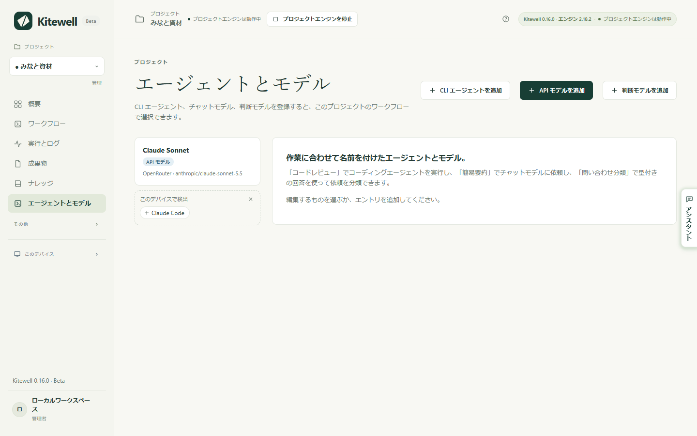
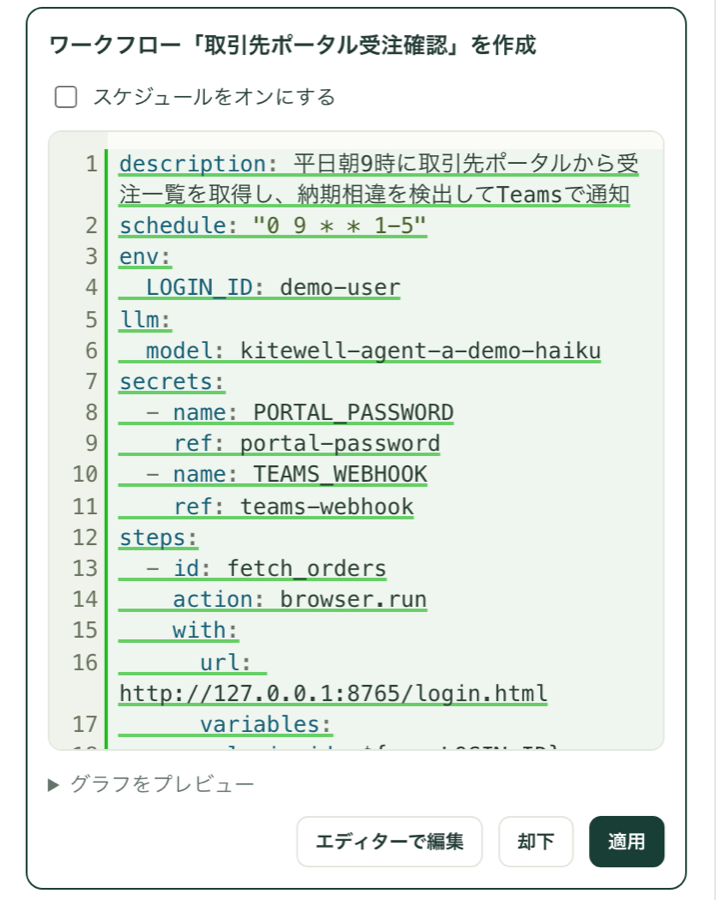

Kitewell の AI 機能にはモデルが必要です。プロバイダーの API キーで追加するモデル、このコンピューターにすでに入っているコーディングツール、または Dagu Cloud にサインインしたコンピューターで使える Kitewell の付属モデルのいずれかです。

モデルがあれば、Kitewell がチャットで一緒にワークフローを作ったり直したりでき、失敗した実行が理由を説明できるようになり、シートが各実行から値を読み取れるようになり、ワークフローの途中でモデルに質問できるようになります。

## 必要なもの

- インターネット越しにモデルを呼ぶものには、プロバイダーの API キーが必要です。すでにプロジェクトに登録されていれば、サイドバーの **エージェントとモデル** に表示されています。[Kitewell の付属モデル](#use-kitewells-included-model)にキーは要りません。
- コマンドラインのコーディングエージェントを使うには、そのツールをこのコンピューターにインストールし、そこでサインインしておきます。Kitewell はツールを起動するだけで、代わりにサインインすることはありません。
- **エージェントとモデル** のページは、管理者と編集者が使えます。費用はプロバイダーに対してご自身で負担します。

## プロジェクトで使うモデルを登録する

1. サイドバーの **エージェントとモデル** を選び、**API モデルを追加** を選びます。
2. **プロバイダー** を選びます。Anthropic、OpenAI、Google Gemini、OpenRouter、Z.ai、OpenCode Zen、Local server (Ollama, vLLM) から選べます。ローカルサーバーにキーは不要です。
3. **API キー** では、そのキーを持つプロジェクトの[シークレット](/ja/docs/secrets/)を選びます。シークレットとは、ログに残らない形で保管されたパスワードやキーのことです。管理者であれば **新しいキー…** を選び、**API キーを貼り付け** てそのまま保存することもできます。キーはこのモデルを使う各実行に結び付けられ、ワークフロー自体に含まれることはありません。
4. **モデル ID** を入力します。OpenRouter、OpenCode Zen、動作中のローカルサーバーでは、プロバイダーが提供するすべてのモデルが一覧表示されるので、名前の一部を入力して検索できます。ほかのプロバイダーでは候補が出るだけで、プロバイダーが受け付ける ID なら何でも使えます。
5. 「簡易要約」「請求書の読み取り」のように自分の言葉で名前を付け、**モデルをテスト** を選びます。送信する前に、送るプロンプト、送信先、使うキー、残るものがそのまま表示されます。

このページには **種類** で選ぶ 3 つのエントリがあります。

- **API モデル** は、プロバイダーのモデルに直接問い合わせて回答を返します。**モデルに尋ねる** タスク、アシスタント、失敗の診断、シートの結果列、**Web サイトを自動操作** と **デスクトップアプリを自動操作** のタスクで使われます。
- **判断モデル** は、分類、採点、はい / いいえの判断を、確率付きで返します。**判断モデルを追加** では OpenRouter か TypeSafe を選べます。**AI に判断を依頼** タスクはこのモデルで資料を仕分けたり採点したりし、後続のステップがその答えで分岐できます。[シート](/ja/docs/batches/)も、はい / いいえ、選択、段階の列の判断に使います。
- **CLI エージェント** は、このデバイスにインストールされたコーディングエージェントを動かします。

エントリは、失敗したときに別のエントリへ引き継げます。その場合はカードに「代替」としてその名前が並びます。引き継ぎのたびに新しいリクエストになり、そのつど課金されます。

## Kitewell の付属モデルを使う

[Dagu Cloud](/ja/docs/cloud-sync/#サインイン) にサインインしたコンピューターでは、**エージェントとモデル** に **Kitewell（付属）** が表示されます。API キーは不要です。リクエストは Dagu Cloud を経由して OpenRouter に届き、料金はワークスペースの Dagu Cloud クレジットから支払われます。

- **モデルに尋ねる** や **Web サイトを自動操作** のタスクの **モデル**、シートの結果列、失敗の診断で選べます。ワークフローの YAML では `kitewell-agent-included` と書きます。
- **デスクトップアプリを自動操作** で使えるのは Kitewell Personal と Team だけで、無料プランでは使えません。**AI に判断を依頼** では使えません。
- Kitewell のチャットは、管理者が **デバイス設定 → Kitewell の AI モデル** でモデルを設定するまで、付属モデルで答えます。

無料のアカウントには、100 クレジットが 1 回だけ付きます。Kitewell Personal と Team では、プランで支払っているコンピューター 1 台につき毎月 500 クレジットが付き、ワークスペース全体で共有されます。補充は毎月 1 日（UTC）です。アシスタントの Web 検索も同じクレジットを使います。

残りのクレジットは、管理者が **デバイス設定** の **Dagu Cloud アカウント** で確認できます。使い切ると、補充されるまで（無料プランでは有料プランに登録するまで）付属モデルは使えません。自分で追加したモデルはそのまま使えます。

Dagu Cloud は、受け取った内容を保存も学習もしないプロバイダーにだけ振り分けるよう OpenRouter に求めます。Dagu Cloud 自身はプロンプトの文面を残さず、残すのはワークスペース、デバイス、モデル、使ったクレジットだけです。

## このコンピューターのコーディングエージェントを使う

先にツールをインストールし、サインインしておきます。Kitewell は Aider、Amp、Claude Code、Cline、Codex、Cursor、DeepSeek、Droid、Gemini、GitHub Copilot、Goose、Kiro、OpenCode、Pi、Qwen の 15 のツールを知っていて、それ以外は **カスタムコマンド** として実行します。このコンピューターで見つかり、まだどのエージェントも使っていないツールは **このデバイスで検出** に並び、1 回のクリックでエントリにできます。

1. **CLI エージェントを追加** を選び、**ハーネス** を選びます。一覧には、このデバイスにインストール済みかどうかが表示されます。
2. Claude Code、Codex、OpenCode では、**モデルを読み込む** でそのツールが提供するモデルが入ります。ほかのツールではモデル名を入力します。
3. **エージェントをテスト** を選びます。送るプロンプト、作業するフォルダー（空の一時フォルダーで、終わると削除されます）、スキップする確認が、実行前に表示されます。
4. ワークフローに **AI エージェントに依頼** タスクを追加し、**エージェント** を選び、**プロンプト · タスクを記述** に内容を書きます。**エージェント設定とコンテキスト** を開いて、作業する **プロジェクトのフォルダー** を指定します。

Kitewell は、ツールがこのコンピューターですでに持っているサインインのままツールを動かします。Claude Code、Codex、GitHub Copilot のように推論の強さを指定できるツールでは、エージェントの **推論の強度** で設定し、ステップごとに上書きもできます。

エージェントの **失敗したとき** には、ほかの CLI エージェントを最大 3 つまで指定できます。このエージェントのツールがレート制限、サインイン切れ、クラッシュなどのエラーで終了すると、指定した順に試します。答えの質が低いだけでは失敗になりません。試すたびにプロンプトを最初から実行するので、そのつど料金がかかります。

レビュー担当者がエージェントのステップの作業を差し戻すと、エージェントはレビュー担当者のフィードバックをプロンプトに加えて、もう一度実行します。[人の判断を待つ](/ja/docs/workflow-builder/#stop-and-ask-a-person)を参照してください。

コーディングエージェントは、このコンピューターであなたの権限で動くプログラムで、ツール自体に与えた権限をそのまま持ちます。ファイルの読み書きもコマンドの実行もできます。エージェントの **権限の確認をスキップ** はツール自身の確認を省く設定で、いずれかを設定したエージェントのカードには **承認をスキップ** の印が付きます。外部から届いた文章をこうしたエージェントに渡さないでください。メールの文面がエージェントに届く組み方をすると、ワークフローエディターが警告します。差出人がそのままエージェントに指示できてしまうからです。その場合は、何も実行できない **モデルに尋ねる** を使ってください。

## アシスタント

Kitewell には、このコンピューターのすべてのプロジェクトにまたがるチャットが 1 つあります。ワークフローを作ったり直したり、何かを実行したり、実行が失敗した理由を調べたりするよう頼めます。Kitewell ウィンドウ上部の **Kitewell に頼む** から開くか、Mac では ⌘J、Windows では Ctrl+J を押します。管理者と編集者が使えます。

チャットは、Kitewell ウィンドウの右側に組み込まれた状態で開きます。**別ウィンドウで開く** で独立したウィンドウにでき、**常に手前に表示** でそのウィンドウをほかのウィンドウより前に保ち、**Kitewell ウィンドウ内に表示** で元に戻せます。Mac ではメニューバーのメニューの **チャットを開く** で表示し、Windows では通知領域のアイコンをクリックするたびに表示と非表示が切り替わります。

チャットは **Kitewell の AI モデル** で答えます。**デバイス設定** で一度設定すれば、すべてのプロジェクトに適用されます。管理者が設定するまでは、Dagu Cloud にサインインしたコンピューターなら [Kitewell の付属モデル](#use-kitewells-included-model)を使います。そうでなければ、管理者がチャットの中から設定できます。

すぐには答えられない作業は、対象のワークフローや実行に結び付いたスレッドで進みます。依頼が作業になると Kitewell がスレッドを始め、どのメッセージからでも **スレッドで返信** でスレッドを始められます。**メインの会話に戻る** で戻り、**完了にする** でスレッドを閉じ、**再開する** でもう一度開きます。複数のスレッドが同時に動けます。

Kitewell が作業している間も入力できます。新しいメッセージは次の手順で読まれ、**今すぐ割り込む** を選ぶと作業を止めてそのメッセージに先に答えます。Kitewell ウィンドウが開いていれば、チャットはそこに表示されているものを知っているので、「このワークフロー」はエディターで開いているもの（保存前の編集を含む）を指します。

Kitewell の提案は、カードのボタンを押すまで何も保存されず、何も実行されません。

- 新規または変更したワークフローは、図と **詳細** を載せたカードで届きます。**適用** するか、理由を尋ねられる **却下** を選びます。スケジュールはオンの状態で、次の実行予定とともに提案されます。一時停止の状態で保存するには **スケジュールをオンにする** のチェックを外します。適用後は **開く** でワークフローが開き、**今すぐ実行** で実行できます。既存のワークフローへの変更は **元に戻す** で戻せます。
- [シート](/ja/docs/batches/)の行や列をカードで提案します。適用と同時に対象の行を実行することもでき、その場合は元に戻せません。
- ワークフローの実行、待機中のステップの承認・却下・差し戻し、実行の停止、スケジュールの一時停止と再開ができます。いずれもワークフローの図を載せたカードになり、**実行** や **承認** などのボタンを押したときだけ動きます。**今はしない** で断れます。
- 下書きを実際に動かして、動くかどうかを確かめられます。スレッドで最初に試すときに **試行を許可** で確認します。試行では、コマンド、Web サイトのステップ、読み取り、モデルの呼び出しが、プロジェクトのシークレットを使って実際に実行されます。POST、メール、別のマシンでのコマンドなど、外に送ったり変えたりするものは、送る内容を報告するだけです。
- **許可** を選ぶと、ワークフローでのサイトの使い方を確かめるため、専用のブラウザーでサイトを操作します。その様子はチャットで見られ、いつでも **操作を代わる** を選べます。公開 Web ページも読めますが、このデバイスやそのネットワーク上のアドレスは読みません。Dagu Cloud にサインインしたコンピューターでは、Web 検索もできます。
- 短い質問を最大 6 つ、1 つのカードにまとめて尋ねられます。**回答を送信** で答え、**スキップ** で飛ばせます。シークレットを名前で依頼することもあります。値をカードに入力して **保存** を選べば、アシスタントが値を見ることはありません。この方法で追加できるのも、シークレットの名前を一覧できるのも管理者だけです。
- プロジェクトの[ナレッジ](/ja/docs/knowledge/)をメッセージのたびに読み、作業しながら分かったことを書き留めます。Kitewell にどう動いてほしいかを伝えると、すぐに覚え、**元に戻す** で取り消せます。会話で Web ページや実行の出力を読んだあとは、[先に確認します](/ja/docs/knowledge/#what-the-assistant-does)。

Kitewell は、どのプランでも自分からカードを投稿します。あなたの対応を待つ実行には、**承認**、**却下**、または回答をその場で入力できるカードが付きます。通知の設定がこのデバイスに送るものにもカードが付きます。失敗が続くワークフローには **リトライ**、開始されなかったスケジュールには **今すぐ実行** があり、成功した実行、キャンセルされた実行、長引いている実行、終わったシートは 1 行で知らせます。チャットが前面にないときは、どのカードもシステムの通知として表示されます。

失敗した実行の **Kitewell に頼む** は、原因の調査と修正案を Kitewell に依頼します。

会話はこのコンピューターに残り、バックアップには含まれません。**削除** で 1 つのメッセージを、**スレッドを削除** でスレッド全体を削除できます。**デバイス設定 → Kitewell の AI モデル** の **すべてのプロジェクトの会話を削除** は、すべてを削除します。Kitewell が保存したワークフローなどの変更は残ります。

## 実行が失敗した理由

Kitewell は、失敗した実行を読んで、どうすればよいかを示せます。

1. **プロジェクト設定 → 失敗の診断** を開き、**失敗した実行を自動で診断** をオンにします。
2. 使う **モデル** を選びます。
3. **ワークフロー** の一覧で、各ワークフローを **プロジェクトの既定** のままにするか、**オン** か **オフ** を個別に選びます。**診断の設定を保存** を選びます。

診断されるのは、失敗が続き始めた最初の 1 回だけで、そのあとの失敗ごとではありません。成功すると、続いていた失敗は途切れます。答えは失敗した実行に、**もう一度試す**、**対応が必要**、**ワークフローの変更**、**不明** のいずれかで表示され、原因と次の一手が添えられます。どの失敗した実行でも **診断** で依頼でき、**もう一度診断** で新しい答えを得られます。

モデルには、失敗したステップの結果、そのログの末尾、ブラウザー・デスクトップ・エージェントのステップが止まったときの様子、子の実行の失敗、そしてその実行が実際に使った定義が送られます。モデルにツールは渡されないので、実行が出力した内容が何かを動かすことはありません。診断はこのデバイスに残り、実行とともに削除されます。

## このコンピューターから出るもの

プロンプトとそのコンテキストは、選んだプロバイダーまたはツールに送られ、そのプロバイダーの課金、データ保持、プライバシーのルールが適用されます。ワークスペースがこのコンピューターにあっても、すべてのタスクがここで完結するわけではありません。

- 実行する前に、ワークフローエディターの **ツール → AI プロンプトを確認** で、各 AI タスクが受け取る指示を読めます。実行時の変数は、実行が始まるときに埋められます。
- 実行したあとは、**実行とログ** にその実行が記録したプロンプトと結果が残ります。
- チャットは、直近の会話、Kitewell ウィンドウに表示されているもの（エディターで開いているワークフローを含む）、プロジェクトのワークフロー、モデル、ナレッジ、使ったツールが返した内容を送ります。シークレットの値を送ることはありません。
- チャットのモデルが OpenRouter 上の OpenRouter 標準アドレスのモデルである場合、そのリクエストは、受け取った内容を保存も学習もしないプロバイダーにだけ振り向けるよう OpenRouter に求めます。
- Kitewell の付属モデルは、各リクエストを Dagu Cloud に送り、Dagu Cloud がそれを OpenRouter に渡します。

全体像は[コンピューターの外に出るもの](/ja/docs/data-flow/)にあります。
