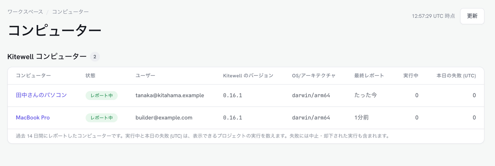
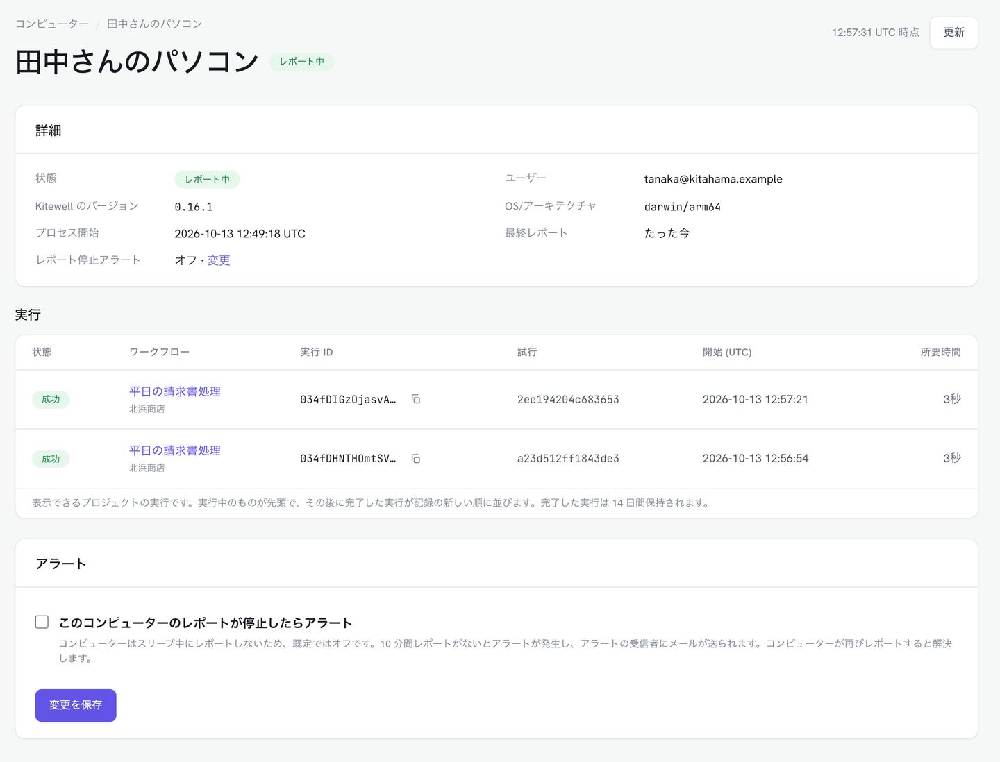

Dagu Console では、同期したプロジェクトの実行の様子を、スマホを含むどのブラウザーからでも [console.dagu.sh](https://console.dagu.sh) で確認できます。仕事をするのは、これまでどおりあなたのコンピューターです。Dagu Console が受け取るのは各実行のステータスだけで、ログ、出力、シークレットの値は受け取りません。

## 必要なもの

- Dagu Cloud アカウントと[同期したプロジェクト](/ja/docs/cloud-sync/)。無料プランを含むどのプランでも使えます。同期していないプロジェクトは報告されません。
- 複数のコンピューターを見るには Kitewell Team。無料アカウントと Kitewell Personal で接続できるコンピューターは 1 台です。

Dagu Console には、コンピューターが使っているアカウントでサインインします。ワークスペースのオーナーは、同期したすべてのプロジェクトを見られます。それ以外のメンバーが見られるのは、ロールを持つプロジェクトの実行と、コンピューターの一覧です。

## 実行を見る

**モニタリング** のページには、Kitewell のコンピューターと Dagu サーバーがまとめて表示されます。

- **概要**：レポート中のコンピューターの数、本日の失敗、未解決のアラート、対応が必要なコンピューター。
- **コンピューター**：各コンピューターの **状態**（**レポート中** または **レポート停止**）、ユーザー、Kitewell のバージョン、OS、最終レポート、実行中と本日失敗した実行の数。コンピューターを選ぶと、過去 14 日間の実行が表示されます。
- **実行**：すべての実行を、プロジェクト、ワークフロー、状態、期間で絞り込めます。
- **インサイト**：ワークフローごとの実行数、失敗、成功率、所要時間を、7 日、30 日、90 日の範囲で。

コンピューターは 2 分ごとに、また進行中の実行が変わったときはそれより早くレポートします。ページには開いた時点で届いていた内容が表示されます。最新の状態は **更新** で確認してください。

## Dagu Console のアラート

Dagu Console は、どのプランでも 2 種類のアラートを開きます。

- ワークフローが失敗した。アラートは、何台のコンピューターで動かしていてもワークフローごとに 1 件です。どのコンピューターでの失敗もそのアラートに加わり、どのコンピューターでも次に成功すれば解決します。中止や却下された実行は数えますが、アラートにはなりません。
- コンピューターのレポートが止まった。10 分間レポートがないとアラートが開き、再びレポートすると解決します。コンピューターはスリープするたびにレポートを止めるため、既定ではオフです。

動かし続けるコンピューターを見張るには、ワークスペースのオーナーが **コンピューター** でそのコンピューターを開き、**このコンピューターのレポートが停止したらアラート** にチェックを入れて **変更を保存** を選びます。

メールは、アラートが開いたときと解決したときに届きます。

- コンピューターのレポートが止まったことは、ワークスペースのオーナーにメールで届きます。
- ワークフローの失敗は、オーナーがオンにすると届きます。**設定** の **アラートメール** で、**オーナーと管理者** の行の **Kitewell** にチェックを入れ、**変更を保存** を選びます。オーナーと、そのプロジェクトの管理者に届きます。
- **宛先を追加** で、**Kitewell** にチェックを入れた **メンバー** や **外部アドレス** を加えられます。どちらにも、レポートが止まったコンピューターとワークフローの失敗が届きます。メンバーには開けるプロジェクトの分が、外部アドレスには確認が済んだあとですべてのプロジェクトの分が届きます。

### Kitewell のアラートとの違い

[Kitewell 自身のアラート](/ja/docs/alerts/)は、コンピューターから送られます。2 つは併用できます。

| | Kitewell のアラート | Dagu Console のアラート |
| --- | --- | --- |
| 送信元 | コンピューター | Dagu Cloud |
| プラン | Personal と Team | すべてのプラン |
| イベント | 失敗、復旧、入力待ち、スケジュール実行の取りこぼし、長時間の実行、キャンセル、成功、バッチの完了 | ワークフローの失敗、コンピューターのレポートの停止 |
| 送り先 | このデバイス、メール、Slack、Microsoft Teams、PagerDuty、Webhook | メール |
| コンピューターのスリープ中 | 何も送られず、逃したスケジュールは復帰してから知らされる | レポート停止のアラートが開く |

## Dagu Console が保持するもの

- 各実行のワークフロー、ステータス、トリガー、日時、失敗したステップの名前を 14 日間。ワークスペースが 1 日（UTC）に保持できる完了した実行は 500 件までです。それを超えると、**デバイス設定** に実行履歴が再開する時刻が表示されます。
- インサイトのためのワークフローごとの日次の集計を 13 か月。
- アラートを、解決してから 90 日間。
- 30 日間レポートのないコンピューターは、報告した内容とともに削除されます。

実行ステータスの送信を止めるには、[Dagu Cloud で実行を見る](/ja/docs/cloud-sync/#follow-runs-in-dagu-cloud)のとおり、ワークスペースのオーナーがオフにします。オフの間、コンピューターは稼働していることだけを報告します。
