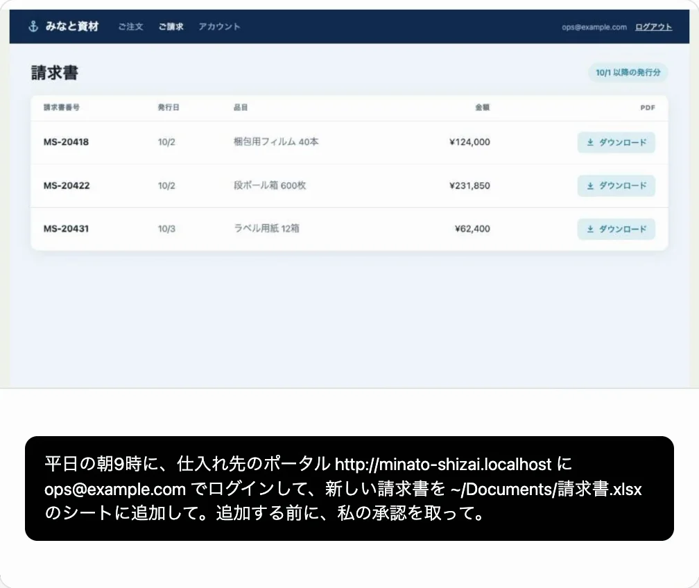
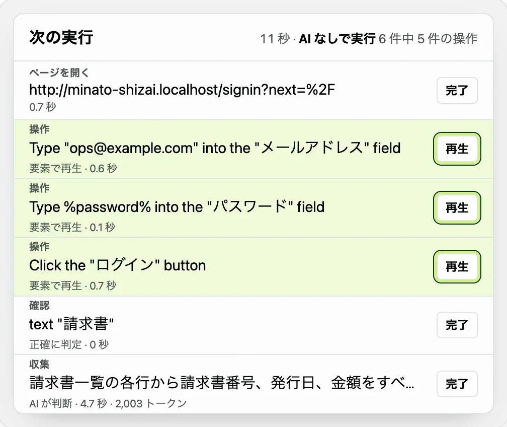
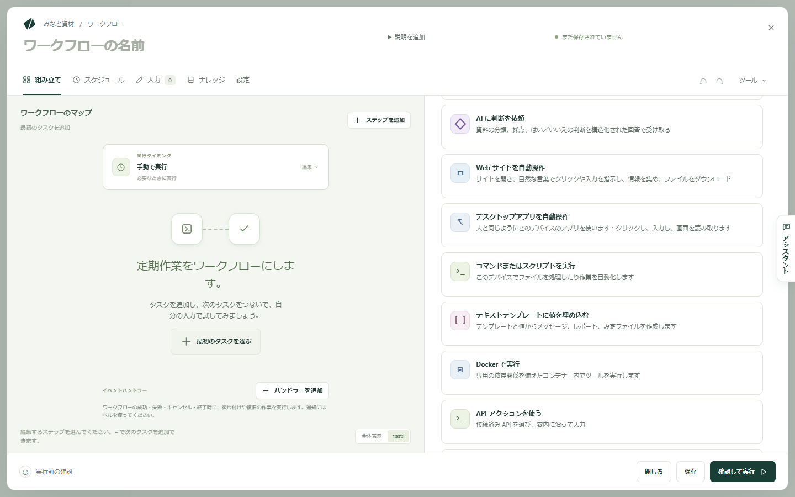
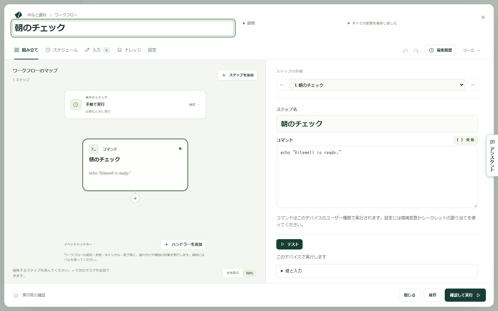
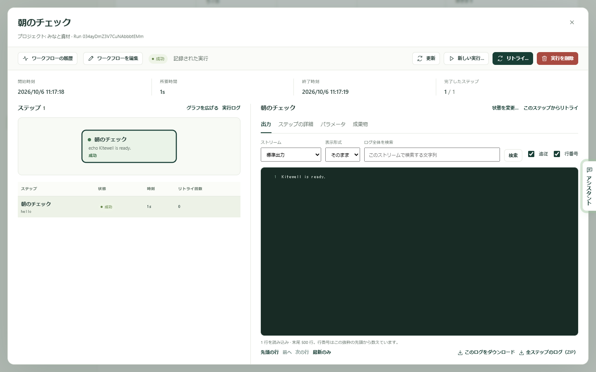

パソコンでくり返している作業を、ふだんの言葉で Kitewell に伝えます。AI が目の前で一度その作業をやってみせ、決まった時間にくり返すワークフローを提案します。このページでは、空のチャットから、ひとりでに動く実行までを順に進めます。

## 必要なもの

[インストール](/ja/docs/install/)済みの Kitewell が開いていること。初めて開いたときは、**サインインして Kitewell の AI を使う** を選びます。ブラウザーで Dagu Cloud が開き、コードを照合すると、Kitewell の付属 AI が 100 クレジット分無料で使えるようになります。API キーは要りません。ご自身のモデルを使うときは、**このデバイスで始める** を選び、チャットから接続します。[AI エージェントとモデル](/ja/docs/ai/)を参照してください。

Web サイトの作業には、Google Chrome（Windows では Microsoft Edge も可）も必要です。

## 作業を伝える

1. チャットを開きます。空のチャットは **いつも手作業でしていることは何ですか？** とたずね、始めやすい作業をいくつか示します。
2. そこから選ぶか、自分で頼みます。何を、どこで、いつやるかを書きます。たとえば次のように。

   > 平日の朝9時に、[仕入先ポータルのアドレス] に [ログインに使うメールアドレス] でログインして、新しい請求書を [ブックの場所] のシートに追加して。

3. 送信します。

サイト、ファイル、時刻は書き、パスワードは書きません。パスワードは、アシスタントが専用のカードでたずねます。

## 作業を見守る

アシスタントは、書く前にまず見て確かめます。必要なものは、カードでたずねます。

- **許可** を選ぶと、チャットの上部に表示される Kitewell のブラウザーでサイトを開きます。**操作を代わる** を選ぶと、あなたにしかできない操作をその場でクリックや入力で行えます。
- パスワードは、シークレットとして保存するカードに入力します。アシスタントが値を見ることはありません。
- 見ても分からないことは、短いフォームでたずねます。

## 確かめて、適用する

アシスタントは、ステップの並びと実行する時刻をカードで提案します。読んで確かめたら、**適用** を選びます。適用するまで、何も保存されず、何も実行されません。

アシスタントがブラウザーで行った操作は、ワークフローといっしょに残ります。クリックは記録されるので、最初の実行から、考え直さずにくり返します。

## 実行する

チャットで「今すぐ実行して」と頼むか、ワークフローを開いて **今すぐ実行** を選びます。続けて **実行とログ** を開き、**実行を表示** を選びます。

ブラウザーのステップを選ぶと、ブラウザーが行った操作が 1 つずつ表示されます。

- **再生**：記録したクリックや入力を、AI なしでくり返した操作。
- **復旧**：ページが変わっていたので、AI が新しい手順を見つけ、次の実行のために覚え直した操作。
- 新しい請求書のように、ページの内容を読み取る操作は、毎回 AI が行います。

ステップの **AI なしで実行** は、モデルを使わなかった操作の数です。

## スケジュールで動かす

「平日の朝9時に」のように時刻を頼めば、ワークフローにスケジュールが付きます。Kitewell はその時刻にワークフローを実行します。ウィンドウは閉じてかまいません。メニューバーやトレイで動き続けます。無人での実行に頼る前に、[スケジュール](/ja/docs/scheduling/)を読んでください。

## うまくいかないとき

- 実行が失敗した。**実行とログ** から開きます。上部の要約が、失敗したステップを名指しし、**失敗を確認** を示します。そのステップのログが見られます。
- ワークフローがサイトと合っていない。どこが違うかをチャットで伝えると、アシスタントがワークフローを直して、もう一度提案します。

## AI を使わずに作る

ワークフローは、ステップを 1 つずつ手で組み立てることもできます。いちばん小さいのは、コマンド 1 つです。

1. **ワークフローを作成** を選び、**ワークフロー名** に `Morning check-in` と入力します。
2. **最初のタスクを選ぶ** を選び、**コマンドまたはスクリプトを実行** を選びます。

   

3. **コマンド** に `echo "Kitewell is ready."` と入力します。

   

4. **確認して実行**、**保存して実行…**、**実行を開始** の順に選びます。

完了した実行の出力に、その 1 行が表示されます。

ほかの種類のステップは、[ワークフローを組み立てる](/ja/docs/workflow-builder/)で説明しています。

## 技術的な詳細

- コマンドは、Kitewell を実行しているユーザーアカウントの権限で動きます。
- `echo "…"` は、Windows の PowerShell でも Mac のシェルでも同じように動く数少ないコマンドの 1 つです。片方のシステム向けに書いたコマンドが、もう片方でも動くとは限りません。
