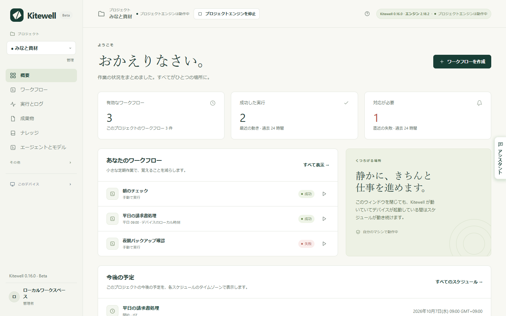

Kitewell は、チームが手作業でこなしている定期的な仕事を代わりに実行します。手順を一度だけ書いておけば、あとは自分のコンピューターの中で、決めた時刻に実行されます。実行はすべて、結果と出力つきで記録に残ります。

## はじめに

1. Mac または Windows の PC に [Kitewell をインストールする](/ja/docs/install/)。
2. [最初のワークフローを作る](/ja/docs/getting-started/)。ワークフローとは、ステップを組み合わせた 1 つの定期作業です。
3. [スケジュールを設定する](/ja/docs/scheduling/)。無人で実行するために何が必要かも、ここで確かめます。
4. [ワークフローをチームと共有する](/ja/docs/sharing/)。

14 日間のトライアルにカードは必要ありません。

## ワークフローにできること

- **[ステップを組み合わせて作る](/ja/docs/workflow-builder/)**：コマンドやスクリプト、コンテナー、SSH 経由の別のマシン、Web リクエスト、AI、そして人が承認するまでの一時停止。
- **[Webhook で開始する](/ja/docs/webhooks/)**：GitHub、Stripe、フォーム、Zapier からリクエストが届いたときに実行を始めます。ポートを開けたり、トンネルを用意したりする必要はありません。
- **[Web サイト](/ja/docs/browser/)**、**[デスクトップアプリ](/ja/docs/desktop/)**、**[メール](/ja/docs/email/)** を、コードではなく自然な言葉で自動操作します。
- **[Excel を自動化](/ja/docs/spreadsheets/)**：現場にあるブックをそのまま読み、結果を元の行に書き戻します。
- **[シートで一括実行](/ja/docs/batches/)**：行ごとに 1 回ずつ実行し、各実行の結果を集めます。
- **[アシスタントに任せる](/ja/docs/ai/#the-assistant)**：ワークフローの下書きや修正を頼み、失敗した実行を[診断](/ja/docs/ai/#failure-diagnosis)させます。
- **[OpenAPI の定義をインポート](/ja/docs/apis/)**：そこから Kitewell が作るリクエストフォームに入力します。
- **[プロジェクトを共有](/ja/docs/sharing/)**、または **[Dagu Cloud と同期](/ja/docs/cloud-sync/)** して、すべてのコピーを同じ状態に保ちます。各デバイスは独自の認証情報を用意し、そのデバイスで実行すべきワークフローだけを有効にします。

:::note[初期リリースについて]
Kitewell は公開されたばかりのため、機能や制限は今後変更される可能性があります。公開インストーラーは macOS と Windows 向けです。Linux への対応も予定しています。現在の提供状況は[ダウンロード](/ja/download/)で確認してください。
:::

## 料金

Kitewell は、カード不要の 14 日間のトライアルから始まります。Team の機能をコンピューター 3 台まで使え、[Kitewell の付属モデル](/ja/docs/ai/#use-kitewells-included-model)用の 100 クレジットが付きます。トライアルは、Kitewell から Dagu Cloud にサインインしたときに始まります。終わった後は、プランに登録するまで何も実行されません。プロジェクトはコンピューターに残り、開いて編集したり、エクスポートしたりできます。プロジェクトごとに、ワークフロー、履歴、シークレットは分かれています。

Kitewell Personal は 1 人が自分の仕事に 1 台で使うプランで、月額 3,000 円（税込 3,300 円）です。それぞれ最大 100 個のワークフローを持つプロジェクトを最大 5 個、[アラート](/ja/docs/alerts/)、[Webhook](/ja/docs/webhooks/)を利用できます。実行されるのは、あなたがサインインしている間です。Kitewell Team は 25 人までの組織向けで、コンピューター 1 台につき月額 14,800 円（税込 16,280 円）です。最大 15 個のプロジェクトと、それを同期するチームを利用でき、Windows では誰もサインインしていなくても実行できます。以前から Kitewell を使っている場合、無料プランと、Personal で誰もサインインしていないときの実行は、2026 年 12 月 1 日まで引き続き使えます。詳しくは[料金](/ja/pricing/)を参照してください。

## どこで何が実行されるか

[Dagu Cloud と同期](/ja/docs/cloud-sync/)することを選ばない限り、プロジェクトはデバイス上にとどまります。シークレットの値がデバイスの外に出ることはありません。アシスタントとの会話、失敗の診断、シートに読み取った値もデバイスに残ります。

AI のステップは、読み取った内容を選んだモデルのプロバイダーに送ります。実行の出力、ワークフローの定義、ページのテキストなどです。送り先の一覧は[コンピューターの外に出るもの](/ja/docs/data-flow/)にあります。

ウィンドウを閉じても何も止まりません。Kitewell は Mac ではメニューバー、Windows ではトレイに残って動き続け、スケジュールもそのまま実行されます。そのメニューの **Kitewell を終了** が、サービスとワークフローエンジンを止める操作です。

Mac では、スケジュールされた作業を実行するには、コンピューターがスリープしておらず、あなたがサインインしている必要があります。Windows で Kitewell Team を使う場合は、サインインサービスをオンにすれば、誰もサインインしていなくてもスケジュールされた作業は実行され、PC はそのために復帰します。Kitewell はクラウド上のマシンを提供しません。AI プロバイダー、リモートサーバー、コンテナー、外部サービスには、それぞれ独自の要件と費用があります。

## 技術的な詳細

Kitewell は、プロジェクトごとにローカルの Dagu ワークフローエンジンを実行します。エンジンはそれぞれ独自のデータディレクトリ、スケジューラー、暗号鍵を持ちます。ステップは Kitewell を実行しているユーザーアカウントの権限で動くため、信頼できるワークフロー定義とコマンドだけを実行してください。
