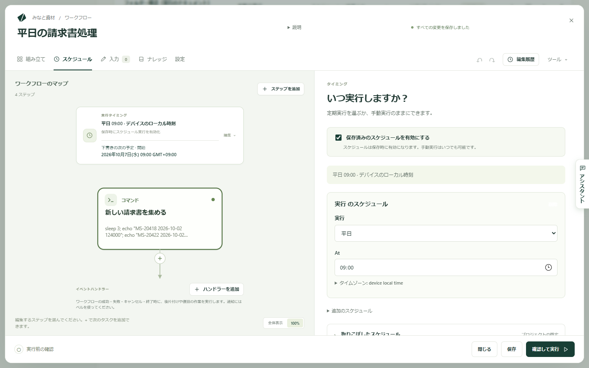

Kitewell はワークフローを自動で開始できます。毎平日の 9 時、1 時間ごと、あるいは別のサービスからリクエストが届いたときに実行できます。作業はこのコンピューターで行われます。Windows で Kitewell Team を使う場合はサインインしているかどうかにかかわらず、Mac と Kitewell Personal ではサインインしている間に行われます。

## スケジュールを設定する

1. ワークフローを開き、**スケジュール** を選びます。
2. **保存済みのスケジュールを有効にする** にチェックが入っていることを確認します。
3. **実行** で頻度を選びます。**毎日**、**平日**、**毎週**、**毎時**、**カスタムスケジュール** から選べます。
4. 時刻を指定します。カスタムスケジュールは 5 項目の cron 式を受け付けます。
5. 時刻を特定の地域に合わせたい場合は **タイムゾーン** を開きます。空欄のままなら、このコンピューターの時計に従い、夏時間も反映されます。
6. **保存** を選びます。

フォームの下の **次の予定5件** には、このワークフローが実際に実行される時刻が表示されます。その下の 1 行が、このコンピューターでスケジュールがどうなるかを伝えます。**サインインの有無にかかわらず実行されます**、**サインイン中のみ実行されます**、**実行されません** のいずれかで、理由と、それを直すボタンが添えられます。

**今すぐスケジュールを試す** は、スケジュールと同じ方法でワークフローを 1 回実行し、その実行を開きます。夜の実行をスケジュールに任せる前に使ってください。

## 今夜の実行が行われるか確かめる

**ワークフロー** の一覧でも、各ワークフローの次回の開始時刻の下に同じ判定が表示されます。ページ上部のバナーは、今夜の実行を妨げるものを 1 行で伝え、その横に直すボタンを置きます。妨げるものがなければ、バナーは出ません。

判定が見るもの: コンピューターがサインインされているか、プロジェクトとそのエンジン、一時停止中や保留中のワークフロー、画面を必要とするステップ、あなたのパスワードを必要とするブラウザーのサインイン、別のタイムゾーンで書かれたスケジュールです。

## 誰もサインインしていなくても実行する（Windows）

誰もサインインしていないときの実行には、Kitewell Team かトライアルが必要です。Kitewell Personal では、スケジュールはあなたがサインインしている間だけ実行されます。

**デバイス設定 → 誰もサインインしていないときに実行** をオンにします。管理者の確認 1 回で、パスワードは不要で、小さな Windows サービス「Kitewell sign-in」が設定されます。このサービスは PC の起動時にエンジンを起動し、サインインの有無にかかわらず、あなたとしてスケジュールを実行します。

カードには実行アカウント、サインイン、エンジン、次回の予定、スリープの状態が表示され、同じ場所でサービスをオフに戻せます。

2 種類のステップだけは、今も PC の前にあなたが必要です。デスクトップのステップと、ブラウザーのウィンドウを表示する Web サイトのステップです。それらのワークフローは **サインイン中のみ実行されます** と表示されます。それ以外はどちらでも実行されます。

カードの **自分のパスワードを使う…** は任意です。ネットワーク共有や、Windows があなたのパスワードで保護する Web サイトのサインインが必要なワークフローがあるときに追加します。**パスワードを削除** で取り消せます。Microsoft アカウントや職場のアカウントでは、サインインそのものにパスワードが必要な場合があります。その場合はカードがそう伝えて入力を求めます。

## Kitewell を動かしたままにする

ウィンドウを閉じても何も止まりません。Kitewell は Mac ではメニューバー、Windows では通知領域に残ります。Mac では **ログイン時に開く**、Windows では **サインイン時に起動** で、サインインしたときに Kitewell が開きます。**Kitewell を終了** は Mac ではエンジンを停止します。Windows でサービスがオンのときは、ウィンドウがなくてもエンジンは動き続けます。

## スリープと、取りこぼした実行

Windows でサービスがオンのときは、予定された実行の前後で PC がスリープせず、電源プランがウェイクタイマーを許可していれば次の実行のためにスリープから復帰します。Mac では、スリープ中のコンピューターは何も実行しません。**デバイス設定 → スリープ防止** で、作業中はスリープしないようにできます。

実行されないまま過ぎた予定時刻は、**実行とログ** に **未実行** の行として表示され、理由が添えられます。デバイスがスリープしていた、Kitewell が動いていなかった、プロジェクトのエンジンが動いていなかった、実行が開始されなかった、のいずれかです。行には、取りこぼしの実行で補われるかどうかと、補った実行へのリンクが示されます。

取りこぼしの実行は、コンピューターが戻ったあとに逃した開始を実行します。既定では 24 時間さかのぼります。変更は **スケジュール → 取りこぼしたスケジュール** で行います。

## うまくいかないときは

- **時刻になっても実行されなかった。** **実行とログ** を開き、**未実行** の行を探してください。理由が書かれています。続けて、ワークフローの次回の開始時刻の下にある判定を確認します。
- **違う時刻に実行された。** スケジュールの **タイムゾーン** と、**次の予定5件** の時刻を確認してください。
- **コンピューターの復帰後に実行がまとめて始まった。** 取りこぼしの実行です。**取りこぼし時の動作** を **取りこぼした最新の回のみ実行** にするか、取りこぼしの実行を **オフ** にしてください。
- **判定が「実行されません」になっている。** 横のボタンを押してください。理由に応じて、サービスをオンにする、パスワードを求める、エンジンを起動する、エディターを開く、のいずれかが行われます。

ほかの症状は[トラブルシューティング](/ja/docs/troubleshooting/)にあります。

## スケジュールについてもっと知る

[スケジュールのリファレンス](/ja/docs/reference/scheduling/)に残りがあります。各判定の意味、Windows のサービスがすることとしないこと、取りこぼしの設定と上限、キュー、Webhook、メニュー項目です。
