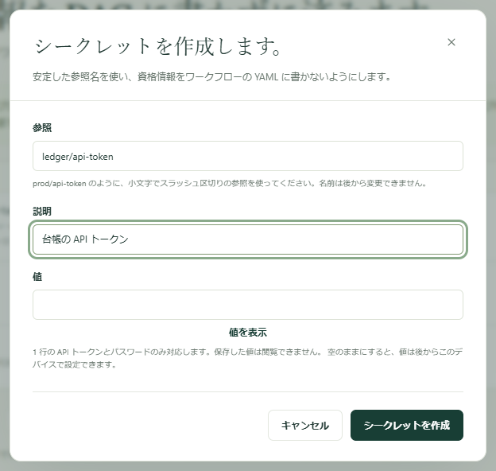
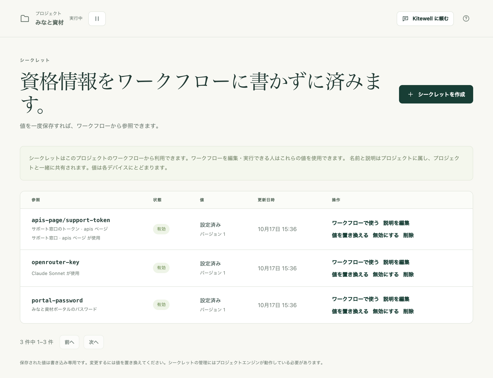

ワークフローには、パスワード、API トークン、鍵などが必要になることがよくあります。シークレット（Kitewell が預かる認証情報）として一度保存すれば、ワークフローは名前でそれを読みます。もう誰も入力し直す必要はなく、ワークフローの定義に値が現れることもなく、ログでは値の場所に `*******` と表示されます。

## 必要なもの

- 編集できるプロジェクト。サイドバーの **その他** に **シークレット** があります。Dagu Cloud で閲覧者として共有されたプロジェクトでは、このデバイスの値は設定できますが、シークレットは作成できません。
- プロジェクトが動いていること。一時停止中は、ページに **このプロジェクトは一時停止中です** と表示されます。**再開** を選んでください。

## 認証情報を保存する

1. **その他 → シークレット** を開き、**シークレットを作成** を選びます。
2. ワークフローが使う名前を **参照** に入力します。たとえば `services/api-token` です。小文字の英字、数字、ハイフンを使い、各部分をスラッシュで区切ります。参照は後から変更できません。
3. 何を開くための認証情報かが次の人に分かるよう、**説明** を書きます。
4. 認証情報を **値** に入力します。**値を表示** で、貼り付けた内容を確かめられます。空のままにすると、後でこのデバイスで値を追加できます。
5. **シークレットを作成** を選びます。

シークレットが一覧に **有効** として表示され、値は **設定済み**、**バージョン** は 1 です。値そのものは、ここでもほかのどこでも、二度と表示されません。

## ワークフローで使う

ワークフローエディターで、ステップの欄に `${` と入力し、**シークレット** からシークレットを選びます。Kitewell がそれをワークフローに割り当て、欄には名前が入ります。値は入りません。

ほかに 3 つのページで、値ではなく名前でシークレットを指定します。

- モデルの API キー（**エージェントとモデル**）。
- サーバーや踏み台ホストのパスワード（**サーバー**）。
- インポートした API の認証情報やクライアントシークレット（**API ライブラリ**）。

YAML を自分で書くときは、シークレットの行で **ワークフローで使う** を選びます。最上位に貼り付ける `secrets:` のブロックが表示されます。ここには、ステップが値を読む環境変数の名前が入っています。たとえば `services/api-token` なら `SECRET_API_TOKEN` です。

[Web サイトのステップ](/ja/docs/browser/)や[デスクトップのステップ](/ja/docs/desktop/)では、**ブラウザーが入力する値** または **ステップが入力する値** でシークレットを選びます。指示とモデルに届くのは `%name%` と書かれた値の名前だけで、値はステップ自身が入力します。

[アシスタント](/ja/docs/ai/#the-assistant)は、ワークフローを組む途中でシークレットを依頼できます。その名前のシークレットを追加するカードが現れるので、認証情報を **値** に入力して **保存** を選びます。入力した内容をアシスタントが見ることはありません。

## デバイスにまだ値がないとき

シークレットの名前と説明はプロジェクトに属し、値は入力したデバイスに属します。インポートや[同期](/ja/docs/cloud-sync/)で届いたプロジェクトは、名前を持っていて、値を必要としています。

- **値が必要** は、プロジェクトが使うシークレットのうち、このデバイスに値がないものです。**値を設定** を選んでください。
- **概要** には、このデバイスでまだ値が必要なシークレットがすべて並び、それぞれに **値を設定** があります。
- **このデバイスのみ** は、このデバイスが持っていてプロジェクトには載っていないシークレットです。**宣言** を選ぶとプロジェクトに追加されます。
- 各シークレットの行には、「Claude Sonnet が使用」のように、それを必要としているもの（モデル、ワークフロー、サーバー、API）が示されるので、どの認証情報を探せばよいか分かります。

値が設定されるまで、Kitewell は途中で失敗させるのではなく、作業そのものを拒否します。手動、Webhook、AI エージェント、アシスタントのどれで始めた実行も、開始前に止まり、「シークレットページで … の値を設定してから、もう一度実行してください。」と表示されます。実行のリトライ、再実行、続行、バッチの開始、シートの行の更新、ステップのテストも同じです。シートのスケジュールはその回に何も開始せず、理由を表示します。ワークフロー自身のスケジュールは拒否されず、実行が開始してから失敗します。

## 変更する、削除する

- **値を置き換える** は、同じ参照のまま新しい認証情報を保存します。**バージョン** の番号が上がり、そのシークレットを使っているものを編集する必要はありません。
- **説明を編集** は、説明だけを変えます。
- **無効にする** を選ぶと、そのシークレットは読み取られなくなりますが、値は残ります。それを必要とする実行は、開始してから失敗します。**有効にする** で元に戻ります。
- **削除** は、プロジェクトからシークレットを、このデバイスから値を削除します。そのプロジェクトを同期するほかのデバイスからは名前が消えます。値を持っていたデバイスでは、そこで削除するまで値が残り、**このデバイスのみ** と表示されます。まだ何かが使っている参照は「… が使用」とともに一覧に残り、別のシークレットが必要になります。

## うまくいかないとき

- **「シークレットページで … の値を設定してから、もう一度実行してください。」** このデバイスにそのシークレットの値がありません。**シークレット** を開いて **値を設定** を選び、もう一度実行してください。
- **「このプロジェクトは一時停止中です」と表示される。** **再開** を選んでから、もう一度試してください。
- **複数行の値が拒否される。** 対応しているのは 1 行のトークンとパスワードだけです。複数行にまたがる鍵は、ステップが読むファイルなど、別の方法で渡してください。
- **「already has a value on this device」と表示される。** シークレットの作成が、保存済みの値を上書きすることはありません。**値を置き換える** を使ってください。

## 守られるもの、守られないもの

シークレットはプロジェクトのエンジンによってディスク上で暗号化されます。それを復号する鍵は、さらに OS が保持するデバイスの鍵で封印されています。Windows では、この PC だけが開ける鍵なので、データフォルダーをコピーしてもほかの場所では何も読めません。実行中は、その実行のすべてのステップが、ワークフローに割り当てられたシークレットを受け取ります。

これはサンドボックスではありません。このプロジェクトのワークフローを編集・実行できる人は、そのシークレットを読むステップを書けます。また、ステップは Kitewell を実行している人の権限で動きます。プロジェクトを分ければシークレットは分かれますが、コマンドにできることが制限されるわけではありません。

Kitewell は、ログ、実行の詳細、出力の中で、シークレットの値そのものを `*******` と表示します。ステップがエンコード、切り詰め、変換をしてから出力した値は、マスクされないことがあります。ステップがファイルや成果物に書いた値もマスクされません。認証情報を出力しないでください。

## エクスポート、同期、リリース、バックアップ

| プロジェクトの行き先 | 名前と説明 | 値 |
| --- | --- | --- |
| プロジェクトの[エクスポート](/ja/docs/sharing/) | 参照も含めて含まれる | 含まれない |
| [Dagu Cloud との同期](/ja/docs/cloud-sync/) | プロジェクトと一緒に同期される | 送信されない |
| [リリース](/ja/docs/releases/) | ワークフローが読むものが含まれる | 含まれない |
| デバイスの[バックアップ](/ja/docs/backups/) | 含まれる | 鍵とともに含まれない |

プロジェクトを受け取った人には、各シークレットが **値が必要** と表示され、それぞれが自分で値を設定します。

バックアップを復元すると、このデバイスが持っている値は消えます。バックアップを作ったデバイスで復元しても同じです。認証情報をもう一度入力してください。復元は、プロジェクトごとに最大 5 件を名前で示し、**シークレット** と **概要** には、まだ値が必要なものがすべて並びます。復旧に必要な認証情報は、別に安全な場所へ記録しておいてください。

Dagu Cloud が新しいシークレットをプロジェクトに受け付けなかった場合も、値はこのデバイスに保存され、**このデバイスのみ** と表示されます。ほかの同期先には、宣言されるまで表示されません。ただし、同期済みの何かがすでにその名前を使っていれば表示されます。

エクスポートとバックアップは暗号化されません。ワークフロー、OpenAPI のファイル、ソース URL に直接書いた認証情報は、書いたままアーカイブに残ります。共有する前にアーカイブを確認し、共有ストレージに置く前に自分で暗号化してください。

## 詳細

- 参照は `^[a-z0-9][a-z0-9-]*(/[a-z0-9][a-z0-9-]*)*$` に一致し、80 文字以内です。説明は 1 行で 200 文字以内です。
- 値が 1 行だけなのは、エンジンのログのマスク処理が 1 行ずつ動くためです。
- 保存先は `engines/<project>/data/secrets` にある Dagu の AES-256-GCM のシークレットレジストリです。その鍵は、デバイスの鍵 `device.key` で封印して `engines/<project>/key.sealed` に置かれます。デバイスの鍵は Windows がこの PC 専用に封印し、Mac ではあなたのユーザーだけが読めるファイルです。いずれもバックアップには入りません。
- デバイスの鍵は年に 1 回更新され、それで封印されたものはすべて封印し直されます。**デバイス設定 → 保存されたシークレット** に更新日が表示され、**今すぐ新しい鍵を作る** もあります。Windows の再インストール後などで鍵が失われた場合は、同じ場所にそのことが表示され、保存されていた値はもう一度入力を求められます。ワークフローとそのデータは影響を受けません。
- エンジンは、実行の開始時にその実行のシークレットを読み、環境変数としてステップに渡します。Kitewell 自身が値を読むのは、あなたのために使うときだけです。アシスタントやシートが使うモデルのキー、API を接続するときのクライアントシークレット、アシスタントのブラウザーが入力する値、そしてアシスタントの試行の報告から隠す値です。
- 一覧は 1 ページ 50 件で、**前へ** と **次へ** で移動します。
- コンテナーレジストリ、メールボックス、API へのサインインはエンジン内部の値として保存され、このページには並びません。**プロジェクト設定**、**メールアカウント**、**API ライブラリ** で管理してください。
