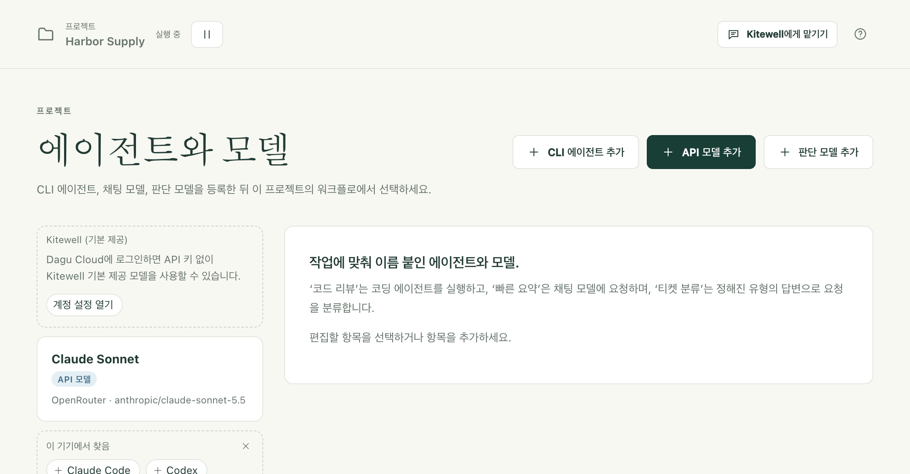

Kitewell의 AI 기능에는 모델이 필요합니다. 공급자의 API 키로 추가하는 모델, 이 컴퓨터에 이미 설치된 코딩 도구, 또는 Dagu Cloud에 로그인한 컴퓨터에서 쓸 수 있는 Kitewell의 기본 제공 모델 중 하나입니다.

모델이 있으면 Kitewell이 채팅에서 사용자와 함께 워크플로를 만들고 고치며, 실패한 실행이 스스로 원인을 설명하고, 시트가 각 실행에서 값을 읽어 내며, 워크플로가 작업 도중에 모델에게 질문할 수 있습니다.

## 필요한 것

- 인터넷을 통해 모델을 호출하는 기능에는 공급자의 API 키가 필요합니다. 프로젝트에 이미 키가 있다면 사이드바의 **에이전트와 모델**에 표시됩니다. [Kitewell의 기본 제공 모델](#use-kitewells-included-model)에는 키가 필요 없습니다.
- 명령줄 코딩 에이전트를 쓰려면, 그 도구가 이 컴퓨터에 설치되어 있고 거기서 로그인되어 있어야 합니다. Kitewell은 도구를 실행할 뿐, 대신 로그인하지는 않습니다.
- **에이전트와 모델** 페이지는 관리자와 편집자가 사용합니다. 요청에 대해 공급자가 청구하는 비용은 사용자가 부담합니다.

## 프로젝트에서 쓸 모델 추가하기

1. 사이드바에서 **에이전트와 모델**을 선택한 다음 **API 모델 추가**를 선택합니다.
2. **공급자**를 고릅니다. Anthropic, OpenAI, Google Gemini, OpenRouter, Z.ai, OpenCode Zen, Local server (Ollama, vLLM) 중에서 고를 수 있습니다. 로컬 서버에는 키가 필요 없습니다.
3. **API 키**에서 키를 담고 있는 프로젝트 [시크릿](/ko/docs/secrets/)을 고릅니다. 시크릿이란 로그에 절대 나타나지 않도록 저장된 비밀번호나 키입니다. 관리자는 여기서 **새 키…** 버튼을 선택하고 **API 키 붙여넣기**로 키를 넣어, 한 번에 시크릿으로 저장할 수도 있습니다. 키는 이 모델을 사용하는 각 실행에 연결되며, 워크플로 자체에는 절대 들어가지 않습니다.
4. **모델 ID**를 입력합니다. OpenRouter, OpenCode Zen, 실행 중인 로컬 서버에서는 공급자가 제공하는 모든 모델이 나열되므로, 이름 일부를 입력해 검색할 수 있습니다. 다른 공급자에서는 후보를 제안할 뿐이며, 공급자가 받아들이는 ID라면 무엇이든 쓸 수 있습니다.
5. ‘빠른 요약’, ‘청구서 판독’처럼 직접 이름을 붙이고 **모델 테스트**를 선택합니다. 무엇이든 보내기 전에, 패널에 정확한 프롬프트, 보낼 곳, 사용할 키, 남게 되는 것이 표시됩니다.

이 페이지에는 **종류**로 고르는 세 가지 항목이 있습니다.

- **API 모델**은 공급자의 모델에 직접 묻고 답을 돌려줍니다. **모델에 묻기** 작업, 어시스턴트, 실패 진단, 시트의 결과 열, 그리고 **웹사이트 자동화**와 **데스크톱 앱 자동화** 작업에 쓰입니다.
- **판단 모델**은 분류, 점수 매기기, 예/아니요 질문에 답하며, 답마다 확률을 붙입니다. **판단 모델 추가**에서는 OpenRouter 또는 TypeSafe를 고를 수 있습니다. **AI에 판단 요청** 작업은 이 모델로 무언가를 분류하거나 점수를 매겨 이후 단계가 그 답에 따라 분기할 수 있게 하며, [시트](/ko/docs/batches/)는 예/아니요 열, 선택 열, 단계 열을 판단할 때 이 모델을 사용합니다.
- **CLI 에이전트**는 이 기기에 설치된 코딩 에이전트를 실행합니다.

항목이 실패했을 때 다른 항목으로 넘어가게 할 수 있습니다. 그러면 카드에 ‘대체:’와 함께 그 항목들의 이름이 표시됩니다. 시도할 때마다 새 요청이므로 매번 다시 비용이 청구됩니다.

## Kitewell의 기본 제공 모델 사용하기

[Dagu Cloud](/ko/docs/cloud-sync/#sign-in)에 로그인한 컴퓨터에서는 **에이전트와 모델**에 **Kitewell (기본 제공)** 항목이 표시됩니다. API 키가 필요 없습니다. 각 요청은 Dagu Cloud를 거쳐 OpenRouter로 가고, 비용은 워크스페이스의 Dagu Cloud 크레딧에서 지불됩니다.

- **모델에 묻기**나 **웹사이트 자동화** 작업의 **모델**, 시트의 결과 열, 실패 진단에서 이 모델을 고를 수 있습니다. 워크플로 YAML에서는 `kitewell-agent-included`입니다.
- **데스크톱 앱 자동화**는 프로젝트가 **프로젝트 설정 → 화면 단계**에서 다른 모델을 고르지 않는 한, 모든 요금제에서 이 모델로 화면을 읽습니다. 스크린샷에는 Dagu Cloud가 컴퓨터 사용에 맞춰 만든 비전 모델을 씁니다. **AI에 판단 요청**은 이 모델을 쓸 수 없습니다.
- 관리자가 **기기 설정 → Kitewell의 AI 모델**에서 모델을 설정할 때까지, Kitewell의 채팅은 이 모델로 답합니다.

체험 기간에는 100 크레딧을 한 번 받습니다. Kitewell Personal과 Team은 플랜으로 비용을 내는 컴퓨터 한 대당 매월 500 크레딧을 받으며, 이 크레딧은 워크스페이스 전체가 함께 쓰고 매월 1일(UTC)에 새로 채워집니다. 어시스턴트의 웹 검색도 같은 크레딧을 씁니다.

Personal과 Team에서는 [Dagu Console](https://console.dagu.sh/kitewell)에서 1,000 크레딧 팩을 12달러에 살 수 있습니다. 팩의 크레딧은 만료되지 않으며, 그달의 크레딧을 다 쓴 뒤에 사용됩니다.

관리자는 **기기 설정**의 **Dagu Cloud 계정**에서 남은 크레딧을 확인할 수 있습니다. 크레딧을 다 쓰면 새로 채워지거나 팩을 살 때까지(체험 기간에는 구독할 때까지) 기본 제공 모델이 거부됩니다. 직접 추가한 모델은 계속 작동합니다.

Dagu Cloud는 이 요청을, 받은 내용을 저장하지도 학습에 쓰지도 않는 공급자에게만 보내 달라고 OpenRouter에 요청합니다. Dagu Cloud는 프롬프트 텍스트를 남기지 않으며, 워크스페이스, 기기, 모델, 사용한 크레딧만 기록합니다.

## 이 컴퓨터의 코딩 에이전트 사용하기

먼저 도구를 설치하고 로그인해 두세요. Kitewell은 Aider, Amp, Claude Code, Cline, Codex, Cursor, DeepSeek, Droid, Gemini, GitHub Copilot, Goose, Kiro, OpenCode, Pi, Qwen의 15개 도구를 알고 있으며, 그 밖의 도구는 **사용자 지정 명령**으로 실행합니다. 이 컴퓨터에서 찾았지만 아직 어떤 에이전트도 쓰지 않는 도구는 **이 기기에서 찾음**에 표시되며, 클릭 한 번으로 그 도구의 항목을 만들 수 있습니다.

1. **CLI 에이전트 추가**를 선택하고 **도구**를 고릅니다. 목록에 이 기기에 설치된 것과 설치되지 않은 것이 표시됩니다.
2. Claude Code, Codex, OpenCode에서는 **모델 불러오기**가 그 도구가 제공하는 모델을 채워 줍니다. 다른 도구에서는 모델 이름을 직접 입력합니다.
3. **에이전트 테스트**를 선택합니다. 실행하기 전에 패널에 보낼 프롬프트, 작업할 폴더(새로 만든 빈 임시 폴더로, 끝나면 삭제됩니다), 건너뛰게 될 확인 절차가 표시됩니다.
4. 워크플로에 **AI 에이전트에 요청** 작업을 추가하고, **에이전트**를 고른 뒤 **프롬프트 · 작업 설명**을 작성합니다. **에이전트 설정 및 컨텍스트**에서 에이전트가 작업할 **프로젝트 폴더**를 지정합니다.

Kitewell은 도구가 이 컴퓨터에서 이미 가진 로그인으로 도구를 실행합니다. Claude Code, Codex, GitHub Copilot처럼 추론 강도를 지원하는 도구에서는 에이전트의 **추론 강도**로 도구가 얼마나 깊이 추론할지 정하며, 단계에서 이를 덮어쓸 수 있습니다.

에이전트의 **실패했을 때**에는 다른 CLI 에이전트를 최대 3개까지 지정할 수 있습니다. 이 에이전트의 도구가 사용량 제한, 로그인 누락, 비정상 종료 같은 오류로 끝나면 지정한 순서대로 시도합니다. 답이 부실한 것은 실패가 아닙니다. 시도할 때마다 프롬프트를 처음부터 실행하므로 작업 비용이 다시 듭니다.

검토자가 에이전트 단계의 작업을 돌려보내면, 에이전트는 검토자의 피드백을 프롬프트에 더해 다시 실행합니다. [멈추고 사람에게 묻기](/ko/docs/workflow-builder/#stop-and-ask-a-person)를 참고하세요.

코딩 에이전트는 이 컴퓨터에서 사용자 본인으로 실행되는 프로그램이며, 사용자가 도구 자체에 준 권한을 그대로 가집니다. 파일을 읽고 바꾸며 명령을 실행할 수 있습니다. 에이전트의 **권한 확인 건너뛰기**는 도구 자체의 확인 절차를 끄며, 이런 설정이 하나라도 있는 에이전트의 카드에는 **승인 건너뜀** 표시가 붙습니다. 이런 에이전트에게 외부에서 들어온 텍스트를 절대 넘기지 마세요. 메일 본문이 이런 에이전트에 닿게 되면 워크플로 편집기가 경고합니다. 메일을 보낸 사람이 에이전트에게 지시할 수 있게 되기 때문입니다. 그런 경우에는 아무것도 실행할 수 없는 **모델에 묻기**를 사용하세요.

## 어시스턴트

Kitewell에는 이 컴퓨터의 모든 프로젝트에 걸친 채팅이 하나 있습니다. 워크플로를 만들거나 고치고, 무언가를 실행하고, 실행이 실패한 이유를 알아봐 달라고 요청하세요. Kitewell 창 맨 위의 **Kitewell에게 맡기기**로 열거나, Mac에서는 ⌘J, Windows에서는 Ctrl+J를 누르세요. 관리자와 편집자가 쓸 수 있습니다.

채팅은 Kitewell 창 오른쪽에 붙은 채로 열립니다. **별도 창에서 열기**는 채팅을 창 밖으로 꺼내고, **항상 위에 표시**는 그 창을 다른 창 위에 띄워 두며, **Kitewell 창에 붙이기**는 다시 되돌립니다. Mac에서는 메뉴 막대 메뉴의 **채팅 열기**로 채팅을 표시하고, Windows에서는 트레이 아이콘을 클릭할 때마다 표시하거나 숨깁니다.

채팅은 **Kitewell의 AI 모델**로 답하며, 이 모델은 **기기 설정**에서 모든 프로젝트에 대해 한 번 설정합니다. 관리자가 설정하기 전까지 Dagu Cloud에 로그인한 컴퓨터는 [Kitewell의 기본 제공 모델](#use-kitewells-included-model)을 사용합니다. 그렇지 않은 컴퓨터에서는 관리자가 채팅 안에서 바로 모델을 설정할 수 있습니다.

간단히 답할 수 없는 작업은 스레드에서 진행되며, 스레드는 관련된 워크플로나 실행에 연결됩니다. 요청이 작업으로 이어지면 Kitewell이 스레드를 시작하고, **스레드로 답장**으로 어떤 메시지에서든 스레드를 시작할 수 있습니다. **기본 대화로 돌아가기**로 돌아가고, **완료로 표시**로 스레드를 닫고, **다시 열기**로 다시 엽니다. 여러 스레드가 동시에 작업할 수 있습니다.

Kitewell이 작업하는 동안에도 계속 입력할 수 있습니다. 새 메시지는 Kitewell이 다음 동작으로 넘어갈 때 읽히며, **지금 끼어들기**를 누르면 작업을 멈추고 그 메시지에 먼저 답합니다. Kitewell 창이 열려 있으면 채팅은 창에 표시된 내용을 알고 있으므로, ‘이 워크플로’는 저장하지 않은 편집까지 포함해 편집기에 열린 워크플로를 뜻합니다.

카드의 버튼을 누르기 전에는 Kitewell이 제안한 것이 하나도 저장되지 않으며, Kitewell이 하려는 일도 하나도 실행되지 않습니다.

- 새 워크플로나 변경된 워크플로는 다이어그램과 **세부 정보**가 담긴 카드로 옵니다. **적용**하거나 **거부**를 선택하세요. **거부**를 고르면 이유를 묻습니다. 일정은 켜진 상태로, 다음 실행 시각과 함께 제안됩니다. 일시 중지된 상태로 저장하려면 **일정 켜기**의 체크를 해제하세요. 적용한 뒤에는 **열기**로 워크플로를 열고 **지금 실행**으로 실행할 수 있으며, 기존 워크플로에 대한 변경은 **되돌리기**로 되돌릴 수 있습니다.
- [시트](/ko/docs/batches/)의 행과 열도 카드로 제안합니다. 적용하면서 변경한 행의 실행을 시작할 수도 있으며, 그 경우에는 되돌릴 수 없습니다.
- 워크플로 실행, 대기 중인 단계의 승인·거부·돌려보내기, 실행 중지, 일정의 일시 중지와 재개도 할 수 있습니다. 각각 워크플로 다이어그램이 담긴 카드로 나오며, **실행**이나 **승인** 같은 버튼을 눌러야만 동작합니다. **지금은 안 함**을 누르면 거절합니다.
- 초안이 잘 작동하는지 보려고 실제로 실행해 볼 수 있습니다. 스레드에서 처음 시험할 때는 **시험 실행 허용**으로 허락을 구합니다. 시험 실행에서는 명령, 브라우저 단계, 읽기, 모델 호출이 프로젝트의 시크릿을 사용해 실행됩니다. 다른 곳으로 무언가를 보내거나 바꾸는 동작(POST, 이메일, 다른 머신의 명령)은 무엇을 보냈을지 보고만 합니다.
- **허용**을 선택하면, 워크플로가 사이트를 어떻게 써야 하는지 익히기 위해 자체 브라우저로 사이트를 조작할 수 있습니다. 사용자는 채팅에서 그 모습을 지켜보며 언제든 **직접 조작**을 선택할 수 있습니다. 공개 웹 페이지를 읽을 수 있지만 이 기기 자체나 그 네트워크 안의 주소는 읽을 수 없으며, Dagu Cloud에 로그인한 컴퓨터에서는 웹 검색도 할 수 있습니다.
- 짧은 질문을 최대 6개까지 카드 하나로 물을 수 있으며, **답변 보내기**로 답하거나 **건너뛰기**로 넘어갑니다. 시크릿을 이름으로 요청할 수도 있습니다. 사용자가 카드에 값을 입력하고 **저장**을 선택하면 되며, 어시스턴트는 그 값을 보지 못합니다. 이 방법으로 시크릿을 추가하거나 시크릿 이름 목록을 볼 수 있는 사람은 관리자뿐입니다.
- 메시지마다 프로젝트의 [지식](/ko/docs/knowledge/)을 읽고, 작업하면서 알게 된 것을 적어 둡니다. 어떻게 일해 주었으면 하는지 말하면 바로 기억하며, **되돌리기**로 취소할 수 있습니다. 대화에서 웹 페이지나 실행 출력을 읽은 뒤에는 [먼저 묻습니다](/ko/docs/knowledge/#what-the-assistant-does).

Kitewell은 모든 플랜에서 자체 카드도 게시합니다. 사용자를 기다리는 실행에는 카드가 생기며, 카드에서 바로 **승인**, **거부**하거나 답을 입력할 수 있습니다. 알림 설정이 이 기기로 보내는 내용에도 카드가 생깁니다. 실패하는 워크플로에는 **재시도**가, 시작하지 않은 일정에는 **지금 실행**이 붙고, 성공했거나 취소되었거나 오래 실행되는 실행, 끝난 시트는 한 줄로 알려 줍니다. 채팅이 앞에 있지 않으면 각 카드는 알림으로도 표시됩니다.

실패한 실행에서 **Kitewell에게 맡기기**를 선택하면 Kitewell이 원인을 찾고 수정안을 제안합니다.

대화는 이 컴퓨터에 남으며 백업에는 포함되지 않습니다. **삭제**는 메시지 하나를, **스레드 삭제**는 스레드 전체를 지웁니다. **기기 설정 → Kitewell의 AI 모델**에 있는 **모든 프로젝트의 대화 삭제**는 전부 지웁니다. Kitewell이 저장한 워크플로와 그 밖의 변경 사항은 남습니다.

## 실행이 실패한 이유

Kitewell은 실패한 실행을 읽고 어떻게 해야 할지 알려 줄 수 있습니다.

1. **프로젝트 설정 → 실패 진단**을 열고 **실패한 실행 자동 진단**을 켭니다.
2. 사용할 **모델**을 고릅니다.
3. **워크플로**에서 각 워크플로를 **프로젝트 기본값**으로 두거나, 워크플로별로 **켜기** 또는 **끄기**로 설정합니다. **진단 설정 저장**을 선택합니다.

실패가 이어질 때는 첫 번째 실패만 진단하며, 그 뒤의 실패한 실행은 진단하지 않습니다. 성공하면 연속 실패가 끝납니다. 답은 실패한 실행에 **다시 시도**, **조치 필요**, **워크플로 변경**, **불분명** 중 하나로 표시되며, 원인과 다음에 할 일이 함께 나옵니다. **진단**은 어떤 실패한 실행에서든 진단을 요청하고, **다시 진단**은 새 답을 요청합니다.

모델에는 실패한 단계의 결과, 그 로그의 끝부분, 브라우저·데스크톱·에이전트 단계가 멈췄을 때 하던 일, 하위 실행의 실패, 그리고 실행이 실제로 사용한 정의가 전달됩니다. 모델에는 도구가 주어지지 않으므로, 실행이 출력한 어떤 내용도 동작을 일으킬 수 없습니다. 진단은 이 기기에 남으며 실행과 함께 삭제됩니다.

## 이 컴퓨터 밖으로 나가는 것

프롬프트와 그 컨텍스트는 사용자가 고른 공급자나 도구로 가며, 그때부터는 그 공급자의 과금, 보관, 개인정보 규칙이 적용됩니다. 워크스페이스가 사용자의 컴퓨터에 있다고 해서 모든 작업이 컴퓨터 안에 머무는 것은 아닙니다.

- 실행하기 전에, 워크플로 편집기의 **도구 → AI 프롬프트 확인**에서 각 AI 작업이 받을 지시를 볼 수 있습니다. 실행 시점의 값은 실행이 시작될 때 채워집니다.
- 실행한 뒤에는 **실행 및 로그**에 실행이 기록한 프롬프트와 돌아온 답이 표시됩니다.
- 채팅은 최근 대화, Kitewell 창에 표시된 내용(편집기에 열린 워크플로 포함), 프로젝트의 워크플로·모델·지식, 그리고 사용한 각 도구가 돌려준 내용을 보냅니다. 시크릿 값은 절대 보내지 않습니다.
- 채팅 모델이 OpenRouter 자체 주소를 쓰는 OpenRouter 모델이면, 채팅의 요청은 받은 내용을 저장하지도 학습에 쓰지도 않는 공급자에게만 보내 달라고 OpenRouter에 요청합니다.
- Kitewell의 기본 제공 모델은 각 요청을 Dagu Cloud로 보내고, Dagu Cloud가 이를 OpenRouter에 전달합니다.

전체 그림은 [컴퓨터 밖으로 나가는 것](/ko/docs/data-flow/)을 참고하세요.
