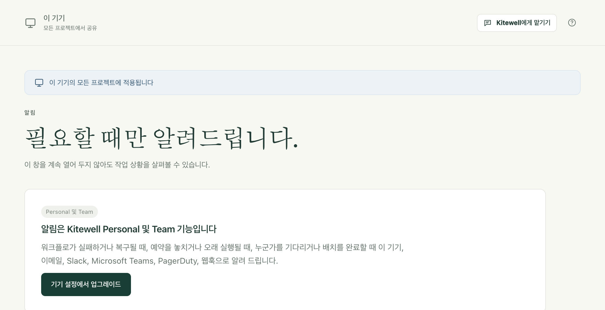

알림은 워크플로에 사용자가 필요할 때 알려 줍니다. 실패했을 때, 누군가의 승인을 기다릴 때, 시작해야 할 때 시작하지 않았을 때입니다. 그러니 상황을 확인하려고 Kitewell을 계속 열어 둘 필요가 없습니다.

## 필요한 것

알림은 모든 플랜과 체험 기간에 쓸 수 있습니다. 체험 기간이나 플랜이 끝나면 **알림** 페이지에 대신 구독 안내가 표시되며, 아무것도 보내지 않습니다. 이메일도, 메시지도, 이 컴퓨터의 알림조차 보내지 않습니다. 나중에 보내려고 쌓아 두지도 않으므로, 알림은 플랜이 적용된 순간부터 다시 시작됩니다.

이 알림은 컴퓨터에서 보냅니다. 동기화한 프로젝트의 워크플로가 실패하거나 컴퓨터의 보고가 끊기면 [Dagu Console](/ko/docs/console/#alerts-from-dagu-console)도 이메일로 알려 줄 수 있습니다.

이전 플랜에서 저장한 채널은 **저장된 채널**에 남아 있으며, 거기서 제거할 수 있습니다. 플랜이 다시 적용될 때까지 이 채널로는 아무것도 보내지 않습니다.

## 알림 받을 곳 정하기

**이 기기 → 알림**을 엽니다. 채널은 알림이 도착하는 곳입니다. **채널 추가**를 선택하고, **형식**을 고르고, **이름**을 붙인 뒤 필요한 항목을 채웁니다.

- **이 기기**는 이 컴퓨터에 알림을 표시합니다. 처음부터 있는 채널입니다. **데스크톱 알림**에서 **이 기기에서 알림**을 켜고, 시스템이 물으면 알림을 허용하세요. 브라우저 창만으로는 안 되고, 설치된 Kitewell 앱이 필요합니다.
- **이메일**에는 주소 목록인 **받는 사람**을 입력합니다. 메일을 보낼 서버는 기기 전체에 대해 **메일 서버**에서 한 번만 설정합니다. 설정 항목은 **SMTP 서버**, **포트**, **사용자 이름**, **비밀번호**, **보내는 주소**, **연결 보안**이며, **연결 보안**에서는 **STARTTLS(보통 포트 587)** 또는 **TLS(보통 포트 465)** 중에서 고릅니다. 암호화된 연결이 필요합니다. 메일 서비스 제공업체가 요구하면 앱 비밀번호를 사용하세요.
- **Slack**에는 **수신 웹후크 URL**을 입력합니다. Slack에서 채널에 수신 웹후크를 추가하고 그 주소를 붙여 넣으세요.
- **Microsoft Teams**에는 **워크플로 URL**을 입력합니다. Teams에서 웹후크 요청을 받으면 채널에 게시하는 템플릿으로 워크플로를 만들고, 그 주소를 붙여 넣으세요.
- **PagerDuty**에는 Events API v2 통합의 **통합 키**와 **서비스 지역**(**미국** 또는 **유럽 연합**)을 입력합니다. 알림이 오면 인시던트가 열리고, 복구되면 인시던트가 닫힙니다.
- **웹후크**에는 **수신 URL**을 입력합니다. [Standard Webhooks](https://www.standardwebhooks.com/) 형식으로 서명된 JSON을 그 주소로 보냅니다. **서명 비밀**은 채널을 저장할 때 만들어지고 한 번만 표시됩니다. 메시지를 받는 쪽에 전달하세요.

**테스트 보내기**는 저장하기 전에, 지금 입력한 값으로 샘플 알림을 보냅니다. 그래서 잘못된 부분이 바로 드러납니다. PagerDuty 테스트는 인시던트를 열었다가 바로 닫으므로 아무도 호출되지 않습니다.

채널마다 마지막 전송이 도착했는지가 표시되며, **최근 알림**에는 보낸 알림과 아직 재시도 중인 알림이 나열됩니다. **워크플로 알림 보내기**를 끄면 이 기기의 모든 알림이 꺼집니다. 다시 켜면 그 시점부터 알림이 시작되며, 꺼져 있는 동안 일어난 일은 알리지 않습니다.

## 알림 받을 내용 정하기

규칙은 어떤 이벤트를 어떤 채널로 보낼지 정하며, 세 계층으로 이루어집니다.

1. **알림** 페이지의 **기본 알림 규칙**은 자체 규칙이 없는 모든 프로젝트에 적용됩니다. 처음에는 **실패할 때**, **입력이 필요할 때**, **예약 실행을 놓쳤을 때**, **배치를 완료할 때**를 **이 기기**로 보냅니다.
2. **프로젝트 설정 → 알림**에서 프로젝트 하나에 자체 규칙을 줄 수 있습니다. **이 기기의 기본 규칙 따르기** 대신 **이 프로젝트 전용 규칙 사용**을 선택하세요. 프로젝트 규칙은 기본 규칙에 더해지는 것이 아니라 기본 규칙을 대신합니다.
3. 편집기나 **워크플로** 목록에 있는 워크플로의 종 아이콘은 그 워크플로 하나에만 적용됩니다. **1시간 동안**, **1일 동안**, **1주 동안**, **해제할 때까지** 중에서 골라 **음소거**하거나, **이 워크플로 전용 규칙 사용**으로 자체 규칙을 주거나, **오래 실행으로 보는 기준**을 **최근 실행을 바탕으로 자동 판단**, **지정한 시간이 지난 후**, **없음** 중 하나로 설정할 수 있습니다. 그런 다음 **알림 설정 저장**을 선택하세요. 이 설정은 이 기기에서 바로 적용되며 워크플로 자체는 건드리지 않으므로, 워크플로와 함께 옮겨 가는 일이 없습니다.

기본 규칙과 프로젝트 규칙에 있는 **놓친 것으로 보는 시간**은 예약 실행이 몇 분까지 늦게 시작되면 놓친 것으로 볼지를 정합니다. 처음 값은 5분입니다.

## 각 이벤트의 의미

- **실패할 때**: 마지막 자동 재시도 후에도 실행이 실패했습니다. 실패한 실행마다 알리는 것이 아니라 실패가 이어지기 시작할 때 알리고, 다음 실행이 성공하면 다시 알립니다. 복구 알림은 항상 실패 알림을 보낸 채널과 같은 채널로 갑니다.
- **입력이 필요할 때**: 사람에게 맡긴 작업이나 승인이 누군가를 기다리고 있습니다. 응답을 받은 뒤 다시 기다리는 단계는 다시 알립니다.
- **예약 실행을 놓쳤을 때**: 예약된 실행이 시작되지 않았습니다. 몇 건인지와 그 이유(컴퓨터가 잠자기 상태였다, Kitewell이 실행되고 있지 않았다, 프로젝트 엔진이 멈춰 있었다)를 함께 알립니다. 워크플로가 다시 제시간에 실행되면 메시지가 한 번 더 옵니다.
- **오래 실행될 때**: 최근 성공한 실행들이 걸린 시간을 훨씬 넘겨서, 또는 종 아이콘에서 정한 한도를 넘겨서 실행이 계속되고 있습니다. 실행 하나당 한 번 알립니다.
- **취소되었을 때**와 **성공할 때**: 어딘가로 보내도록 지정하지 않으면 꺼져 있습니다.
- **배치를 완료할 때**: [배치](/ko/docs/batches/)의 모든 행이 끝나고 값을 읽었습니다. 성공하지 못한 행 수와 열별 변화(예: "Price: 9 dropped, 3 rose")를 함께 알립니다. 취소한 배치는 알리지 않으며, 모든 행이 성공하고 아무것도 바뀌지 않은 예약 배치도 알리지 않습니다. 시작하지 못한 예약 배치는 그 이유와 함께 알립니다. 배치의 각 행이 다른 이벤트를 하나하나 일으키지는 않습니다.

PagerDuty는 **실패할 때**, **예약 실행을 놓쳤을 때**, **오래 실행될 때**만 받습니다. 인시던트에는 나중에 그것을 닫을 무언가가 필요한데, 끝이 있는 이벤트는 이 세 가지이기 때문입니다.

## 알림에 담기는 내용

알림에는 프로젝트, 워크플로, 실행을 시작한 계기, 시작 시각, 소요 시간이 담기고, 실패했다면 어떤 단계가 어떻게 실패했는지가 종료 코드나 제한 시간과 함께 담깁니다. 단계가 출력한 내용이나 실행에 주어진 값은 절대 담기지 않습니다. 알림은 이 컴퓨터 밖으로 나가고, 출력에는 무엇이든 들어 있을 수 있기 때문입니다.

알림의 링크는 그 실행을 수행한 컴퓨터의 Kitewell에서 실행을 엽니다. 따라서 그 컴퓨터 앞에 있는 사람에게 유효합니다. 예약 실행을 놓쳤다는 알림은 프로젝트의 **워크플로** 페이지를 열고, 배치 알림은 해당 시트를 엽니다.

알림 메시지 자체는 Kitewell의 표시 언어와 관계없이 영어로 작성됩니다.

## 알림이 전송되는 때

컴퓨터가 깨어 있고 Kitewell이 실행 중인 동안 백그라운드 서비스가 알림을 보냅니다. 전달하지 못한 알림은 간격을 점점 늘려 가며 최대 하루 동안 재시도합니다. 컴퓨터가 잠자기 상태이거나 꺼져 있는 동안에는 아무것도 보내지 않으며, 그동안 놓친 일정은 컴퓨터가 깨어난 뒤 알립니다. 끝난 지 하루가 넘은 실행은 Kitewell이 뒤늦게 발견해도 알리지 않습니다. 계속 켜 두어야 하는 컴퓨터가 조용해졌을 때 알고 싶다면 [Dagu Console의 보고 중단 알림](/ko/docs/console/#alerts-from-dagu-console)을 켜세요.

## 이벤트 핸들러가 아닌 알림

[이벤트 핸들러](/ko/docs/workflow-builder/#run-a-task-when-the-workflow-ends)는 워크플로가 성공, 실패, 취소되거나 끝났을 때 실행되는 작업입니다. 정리와 복구를 위한 것입니다. 사람에게 알리려면 알림을 사용하세요.

워크플로는 스스로 누군가에게 메일을 보낼 수 없습니다. `mail_on`, `smtp`, `error_mail`, `info_mail`, `mail_on_error`는 저장할 때 거부됩니다. 그렇게 보낸 알림은 어떤 규칙도, 음소거도, 전송 기록도 따르지 않기 때문입니다.

## 문제가 생기면

- **아무것도 오지 않습니다.** 플랜을 확인하고, 다음으로 **워크플로 알림 보내기**를, 그다음 규칙을 확인하세요. 자체 규칙이 있는 프로젝트는 기본 규칙을 따르지 않습니다.
- **이 컴퓨터에 아무것도 오지 않습니다.** **이 기기** 채널에는 설치된 Kitewell 앱과 알림을 표시할 시스템 권한이 필요합니다. **테스트 알림 보내기**로 확인하세요.
- **채널에 실패 중이라고 표시됩니다.** 채널 카드에 오류와 그 오류가 시작된 시각이 표시됩니다. 채널을 **편집**해서, 저장하기 전에 **테스트 보내기**로 고친 내용을 시험해 보세요.
- **워크플로 하나만 조용해졌습니다.** **워크플로** 목록에서 그 행의 종 아이콘을 확인하세요. 음소거되어 있거나 자체 규칙이 있을 수 있습니다.

## 세부 사항

- 이 알림을 쓰려면 플랜이나 체험 기간이 필요합니다. 설정 내용 보기와 채널 제거는 플랜이 끝난 뒤에도 할 수 있습니다.
- 기기 하나에 채널을 최대 50개까지 둘 수 있습니다.
- 전달하지 못한 알림은 1분 뒤, 이어서 2분, 4분, 8분, 16분, 30분 뒤에 재시도하며, 하루가 지나면 포기합니다. 메시지를 이해했지만 거부한다는 응답이 오면 재시도하지 않습니다.
- **최근 알림**은 최근 200건의 전송을 보관하고 최신 20건을 보여 줍니다.
- **놓친 것으로 보는 시간**은 1분부터 1,440분까지 설정할 수 있습니다. 워크플로별 오래 실행 한도는 최대 1주까지 설정할 수 있습니다.
- ‘오래 실행될 때’는 해당 워크플로의 최근 성공한 실행을 바탕으로 스스로 판단하며, 판단하려면 성공한 실행이 최소 5개 있어야 합니다.
- 웹후크 채널은 `https`뿐 아니라 `http` 주소로도 보낼 수 있습니다. Slack은 `hooks.slack.com` 주소만, Teams는 `https`만 받습니다.
