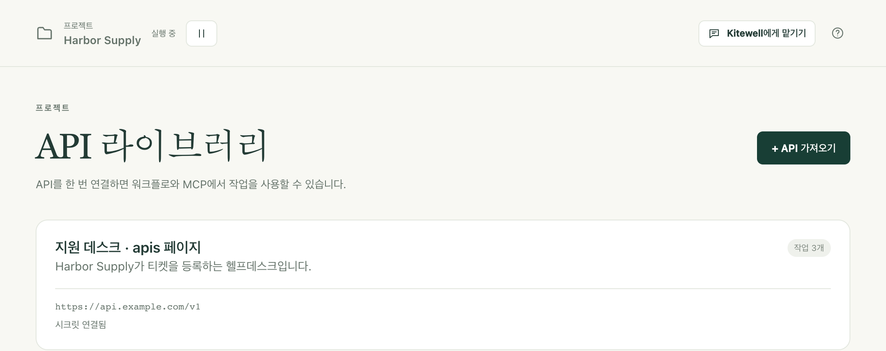
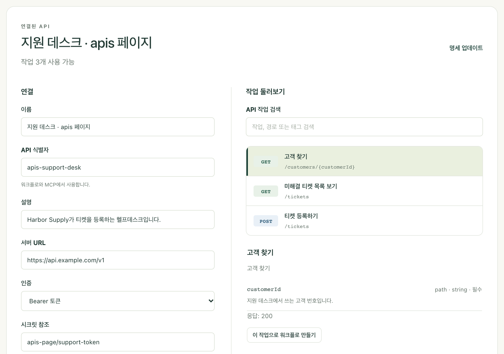

다른 서비스가 이미 하는 일, 예를 들어 고객 조회, 티켓 등록, 주문 등록을 목록에서 고를 수 있는 단계로 만드세요. 서비스의 설명 문서를 한 번 가져오면 Kitewell이 입력 양식을 만들어 주므로, 워크플로 단계는 요청을 직접 작성하는 대신 몇 가지 항목만 채우면 됩니다.

## 필요한 것

- 서비스의 OpenAPI 문서: OpenAPI 3.0 또는 3.1 형식의 JSON 또는 YAML 파일입니다. 서비스 운영자가 공개하며, 개발자 페이지에 "OpenAPI"나 "openapi.json"이라는 링크로 올려 두는 경우가 많습니다. 찾을 수 없으면 운영자에게 요청하세요.
- 서비스가 요구하는 토큰, 키, 비밀번호(필요한 경우). 준비해 두되 워크플로에 직접 입력하지는 마세요. [시크릿](/ko/docs/secrets/)에 넣어야 할 값입니다.
- OAuth 2.0으로 로그인하는 서비스(많은 회계·CRM 서비스가 그렇습니다)라면, 대신 그 서비스의 개발자 페이지에 등록한 앱이 필요합니다. [OAuth 2.0으로 로그인하기](#sign-in-with-oauth-20)를 참고하세요.

연결은 프로젝트 하나에 속하며, 그 프로젝트의 모든 워크플로가 사용할 수 있습니다.

## 서비스 가져오기

1. 프로젝트 사이드바에서 **더 보기 → API 라이브러리**를 열고 **API 가져오기**를 선택합니다.
2. 문서를 Kitewell에 전달할 방법을 고릅니다. **파일 업로드**, **URL에서 가져오기**, **명세 붙여넣기** 중 하나입니다.
3. **작업 미리보기**를 선택합니다. Kitewell이 문서를 읽고 **검토 후 연결** 화면을 열어, 그 서비스가 할 수 있는 모든 작업을 나열합니다.
4. **작업 둘러보기**에서 이름, 경로, 태그로 검색하고 작업을 선택해 입력과 응답을 읽어 봅니다. Kitewell이 단계로 실행할 수 없는 작업은 그 자리에서 이유를 알려 줍니다.
5. **연결**에서 **이름**, **API 식별자**, **서버 URL**을 확인합니다. 문서에 서버 주소가 없으면 직접 입력합니다.
6. **인증**을 고르고, 서비스에 필요하면 시크릿을 연결합니다. 아래의 [자격 증명 연결하기](#connect-credentials)를 참고하세요. 로그인하는 서비스라면 [OAuth 2.0으로 로그인하기](#sign-in-with-oauth-20)를 참고하세요.
7. **API 연결**을 선택합니다.

그러면 연결이 **API 라이브러리**에 카드로 나타나며, 작업이 몇 개인지와 시크릿이 연결되었는지(OAuth 2.0이라면 이 기기에서 로그인했는지)가 표시됩니다.

카드를 선택하면 언제든 같은 화면으로 돌아올 수 있습니다. 왼쪽에는 연결 설정이, 오른쪽에는 작업이 있습니다.

**API 식별자**는 워크플로가 이 연결을 찾을 때 쓰는 이름이므로, 한 번 저장하면 바뀌지 않습니다. 문서 자체는 URL에서 가져온 경우에도 프로젝트에 저장되므로, 실행할 때 다시 가져오지 않습니다. 미리 보기나 연결을 해도 서비스를 호출하지 않습니다.

문서의 URL에 별도 로그인이 필요하다면, 먼저 브라우저에서 파일을 내려받은 뒤 **파일 업로드** 또는 **명세 붙여넣기**를 사용하세요.

## 자격 증명 연결하기

**인증**에서 서비스가 요구하는 방식을 고릅니다. **인증 없음**, **Bearer 토큰**, **API 키**, **사용자 이름 및 비밀번호**, **OAuth 2.0 로그인** 중 하나입니다. 마지막 방식은 아래에서 따로 설명합니다. **API 키**를 고르면 **키 이름**도 입력하고, **키 전송 위치**에서 **헤더**, **쿼리 매개변수**, **쿠키** 중 하나를 고릅니다.

그다음 값을 담고 있는 시크릿을 지정합니다. 같은 프로젝트에 있는 **시크릿 참조**(예: `services/support-token`)를 입력하거나 고르세요. 여기서 새로 만들려면 **새 시크릿 저장**을 열고, **비밀번호 또는 액세스 토큰**에 값을 입력한 뒤 **시크릿 저장**을 선택합니다.

Bearer 토큰이나 API 키라면 시크릿에 토큰이나 키 자체를 담습니다. **사용자 이름 및 비밀번호**라면 **사용자 이름**은 연결에 입력하고, 비밀번호는 시크릿에 보관합니다.

연결에는 참조만 저장됩니다. Kitewell이 값을 찾아 이 연결을 사용하는 모든 요청에 덧붙이며, 값 자체는 워크플로나 로그에 나타나지 않습니다. 나중에 값을 바꾸는 방법은 [시크릿](/ko/docs/secrets/)을 참고하세요.

## OAuth 2.0으로 로그인하기

토큰을 발급하는 대신, 로그인해서 접근을 허용하게 하는 서비스도 있습니다. Kitewell은 기기마다 한 번 이런 서비스에 로그인하고, 그 뒤로는 접근 권한을 계속 유효하게 유지합니다. 그래서 워크플로가 토큰을 다룰 일이 없습니다.

1. 서비스의 개발자 페이지에서 앱을 등록합니다. 리디렉션 URL(콜백 URL이라고도 함)을 묻는 곳에는 Kitewell이 **인증** 아래에 보여 주는 **리디렉션 URL**(예: `http://127.0.0.1:19741/oauth/callback`)을 입력합니다. 로그인한 뒤 서비스가 이 주소로 돌려보냅니다. 클라이언트 ID와, 서비스가 발급한다면 클라이언트 시크릿을 적어 둡니다.
2. **인증**에서 **OAuth 2.0 로그인**을 선택합니다. 서비스 문서에 로그인 방식이 설명되어 있으면 Kitewell이 **인증 URL**, **토큰 URL**, **범위**를 채웁니다. 그렇지 않으면 개발자 페이지에서 복사해 넣으세요.
3. **클라이언트 ID**를 입력합니다. 서비스가 클라이언트 시크릿을 발급했다면, **클라이언트 시크릿 참조**에 그 값을 담은 시크릿을 지정하거나 **새 시크릿 저장**으로 새로 만드세요. 없으면 비워 둡니다.
4. **API 연결**을 선택합니다. Kitewell이 연결을 저장하고 로그인을 시작합니다. **브라우저에서 계속**을 선택하고, 서비스에 로그인한 뒤 Kitewell을 허용하세요. Kitewell로 돌아오면 **이 기기의 로그인**에 로그인한 시각부터 연결되어 있다고 표시됩니다.

Kitewell은 접근 권한이 만료되기 전에 갱신하며, 갱신할 때마다 새 갱신 토큰을 발급하는 서비스도 지원합니다. 누군가 로그인을 취소했거나 너무 오래 쓰지 않아서 서비스가 로그인을 더 이상 받아들이지 않으면, **API 라이브러리**의 카드에 **다시 연결 필요**가 표시되고 연결 화면에 서비스가 밝힌 이유가 나옵니다. **다시 연결**을 선택하고 다시 로그인하세요.

로그인은 그 로그인을 한 기기에 속합니다. 다른 기기에서 이 워크플로를 실행하는 사람은 그 기기에서 **연결**을 한 번 선택합니다. 그 전까지 이 API를 사용하는 실행은 시작하기 전에 거부되며, 프로젝트 개요에 연결해야 할 API가 표시됩니다. 백업과 프로젝트 내보내기에는 로그인이 포함되지 않습니다. **연결 해제**를 선택하면 이 기기에서 로그인이 제거됩니다. 클라이언트 ID, 엔드포인트, 범위를 바꿔 저장해도 로그인이 끝나므로, 그 뒤에 다시 연결하세요.

## 워크플로에서 작업 사용하기

1. 워크플로를 열고 **구성**으로 가서 **단계 추가**를 선택합니다.
2. **API 작업 사용**을 선택합니다.
3. **연결된 API**를 고른 다음, **API 작업 찾기**에서 검색해 원하는 작업을 고릅니다.
4. Kitewell이 만든 입력 항목을 채웁니다. 필수 항목이 먼저 나오고, 나머지는 **선택 매개변수**를 열면 나옵니다. 작업이 요청 본문을 받으면 **요청 본문** 양식이 나타납니다. 작업이 업로드할 파일은 이 기기의 전체 경로(예: `~/Documents/receipt.pdf`)를 입력하거나, 파일을 가리키는 앞 단계의 출력을 고르세요.
5. 입력 옆의 **변수**로 워크플로 입력이나 앞 단계의 값을 넣습니다.
6. **도구 → 워크플로 확인**을 선택한 다음, 저장하고 실행해 **실행 및 로그**에서 결과를 확인합니다.

서비스에서 시작할 수도 있습니다. **API 라이브러리**에서 카드를 열고, **작업 둘러보기**에서 작업을 선택한 뒤 **이 작업으로 워크플로 만들기**를 선택하세요.

## 결과를 다음 단계로 넘기기

API 단계의 **응답 필드**를 열면 문서에 설명된 필드가 보입니다. 이후 단계에서 입력 옆의 **변수**를 열고 그중 하나를 고르세요. Kitewell이 매핑을 추가하고 두 단계를 연결하므로, 이후 단계는 API 호출이 끝날 때까지 기다립니다.

예를 들어 고객 조회 결과의 `id`를 티켓을 등록하는 단계에 넘길 수 있습니다. 어떤 필드를 고를 수 있는지는 문서가 응답 내용을 어떻게 설명하는지에 달려 있습니다. 자세히 설명된 것이 없으면 응답 전체를 하나의 값으로 쓸 수 있습니다.

## 서비스 설명 업데이트하기

Kitewell은 가져온 시점의 문서를 그대로 보관합니다. 원래 URL의 내용이 바뀌어도 프로젝트에 저절로 반영되지 않습니다.

1. **API 라이브러리**에서 연결을 열고 **명세 업데이트**를 선택합니다.
2. 새 문서를 업로드하거나, URL에서 가져오거나, 붙여 넣은 다음 **작업 미리보기**를 선택합니다.
3. 작업을 검토하고 **연결 저장**을 선택합니다.

Kitewell은 저장하기 전에 프로젝트의 워크플로를 확인합니다. 새 문서 때문에 저장된 워크플로가 깨진다면(사용하던 작업이 없어졌거나 입력이 바뀐 경우) 업데이트가 거부되고 기존 연결이 그대로 남습니다. 먼저 그 워크플로들을 고치거나, 새 문서를 다른 **API 식별자**로 가져와 워크플로를 하나씩 옮기세요.

같은 이유로, 저장된 워크플로가 사용 중인 연결은 삭제할 수 없습니다. **API 삭제**를 선택하면 연결을 사용 중인 워크플로의 이름이 표시됩니다.

## 자격 증명 없이 연결 공유하기

[프로젝트 내보내기](/ko/docs/sharing/)에는 가져온 문서와 연결 설정(서버 주소, 인증 방식, 시크릿 이름)이 담깁니다. 시크릿 값은 포함되지 않습니다. 받는 기기에서는 누군가 값을 설정할 때까지 **시크릿**에서 그 시크릿에 **값 필요**가 표시됩니다. 연결이 그 프로젝트의 다른 시크릿을 가리키도록 바꿀 수도 있습니다.

OAuth 2.0 연결에는 클라이언트 ID, 엔드포인트, 범위, 클라이언트 시크릿의 이름이 담기지만 로그인은 담기지 않습니다. 그 워크플로를 실행하는 기기마다 한 번씩 연결해야 합니다.

내보내기에는 문서를 가져온 주소도 남습니다. 문서, 서버 주소, 워크플로 입력에 직접 입력한 자격 증명은 자동으로 지워지지 않습니다. 파일을 공유하기 전에 이 항목들을 살펴보세요.

## 가져올 수 있는 문서

- JSON 또는 YAML 문서 하나, 최대 8 MiB. Swagger 2 문서는 먼저 OpenAPI 3.0 또는 3.1로 변환해야 하며, 그대로 시도하면 Kitewell이 알려 줍니다.
- 참조는 같은 문서 안을 가리켜야 합니다. 외부 참조는 가져오기 전에 한 문서로 묶으세요.
- 요청 본문은 JSON, URL 인코딩 양식, 텍스트, 멀티파트 양식일 수 있습니다. 멀티파트 양식으로 업로드할 파일은 이 기기의 경로로 지정하며 최대 100 MB입니다. 그 밖의 바이너리 본문은 API 단계로 쓸 수 없으니, 웹 서비스 호출 단계를 사용하세요.
- 자격 증명 두 가지를 동시에 요구하는 작업이나 Kitewell이 처리하지 못하는 인증 방식은 작업 목록에 이유와 함께 표시됩니다.
- 페이지 넘김은 자동으로 되지 않습니다. 페이지나 커서 입력을 직접 지정하고, 워크플로에서 요청을 반복하세요.

가져온 같은 작업과 스키마는 편집 권한이 있는 AI 어시스턴트도 사용할 수 있습니다. [MCP와 API 액세스](/ko/docs/mcp/)를 참고하세요.
