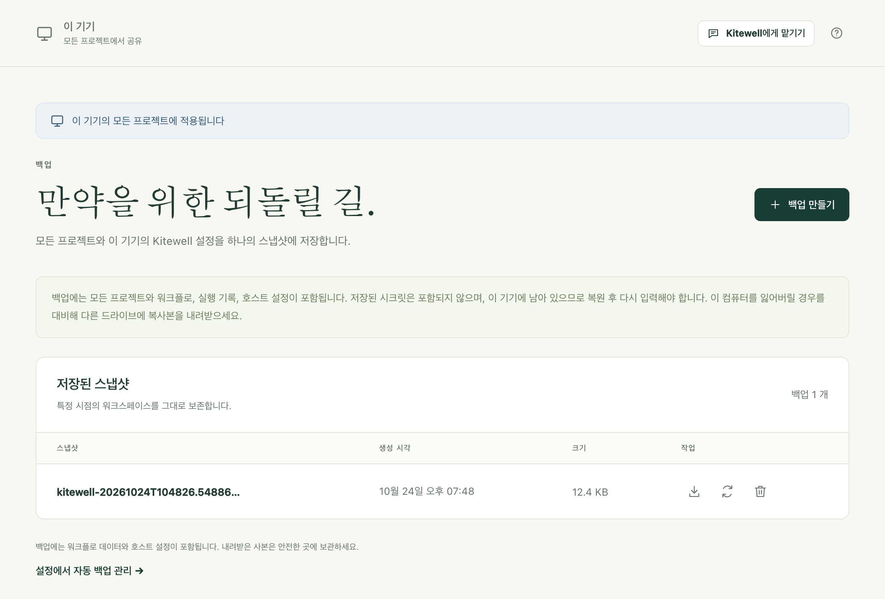
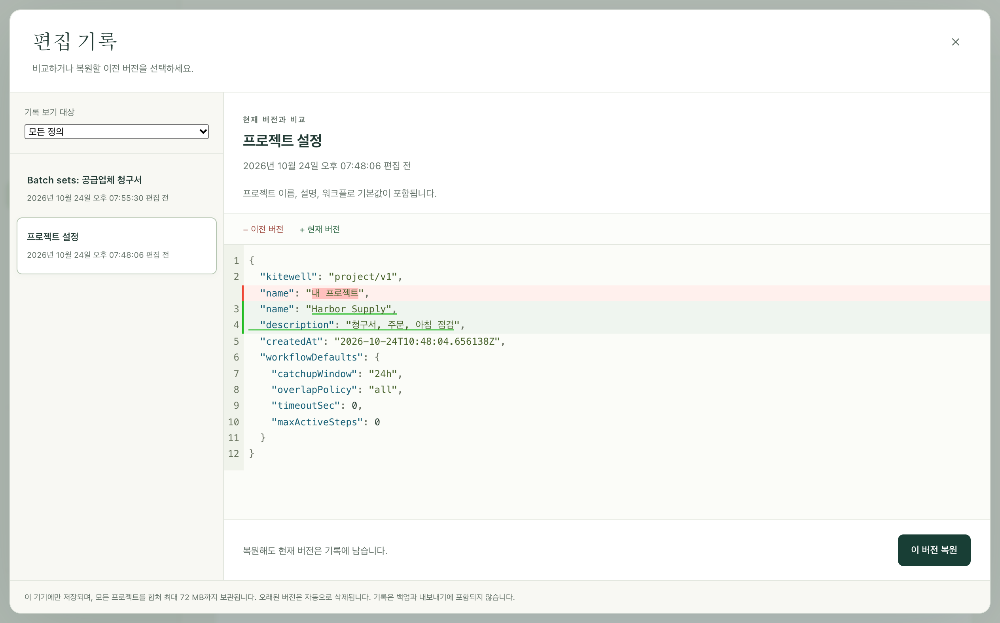

스냅샷은 이 기기의 모든 프로젝트(워크플로, 실행 기록, 설정, 시트, 지식)를 파일 하나에 담습니다. 이 파일을 안전한 곳에 보관했다가 나중에 되돌릴 수 있습니다. Kitewell은 매일 밤 스스로 스냅샷을 만들 수 있습니다. 편집한 모든 것의 이전 버전도 보관하므로, 워크플로 하나의 변경은 전체를 복원하지 않고도 되돌릴 수 있습니다.

## 필요한 것

이 기기의 관리자 권한이 필요합니다. **백업**은 사이드바의 **이 기기** 아래에 있습니다.

## 지금 백업하기

1. **이 기기 → 백업**을 열고 **백업 만들기**를 선택합니다.
2. 잠시 기다립니다. 스냅샷을 만드는 동안 각 프로젝트의 엔진이 멈췄다가 끝나면 다시 시작합니다.
3. 스냅샷이 **저장된 스냅샷** 아래에 **생성 시각**과 **크기**와 함께 나타납니다.
4. 스냅샷 옆의 화살표인 **백업 내려받기**를 선택하고, 직접 관리하는 곳에 파일을 저장합니다.



이 기기에만 있는 스냅샷은 변경을 되돌리는 데는 쓸모가 있습니다. 하지만 기기 자체를 잃어버리거나 도난당하면 도움이 되지 않으므로, 내려받은 사본을 다른 드라이브나 팀이 보호하는 저장소에 보관하세요.

## 매일 백업하기

**기기 설정 → 자동 백업 → 매일 백업**을 켜고 **백업 시각**을 선택합니다. 그러면 Kitewell이 하루에 한 번, 그 시각이 지난 직후에 이 기기의 시간대로 스냅샷을 만듭니다. 그 시각에 기기가 잠자기 상태라면 깨어난 뒤에 스냅샷을 만듭니다.

Kitewell은 가장 최근의 자동 스냅샷 10개를 보관하고 그보다 오래된 것은 지웁니다. 직접 요청해 만든 스냅샷과 복원 전에 만드는 안전 스냅샷은 삭제할 때까지 남습니다.

자동 스냅샷을 막는 경우는 두 가지입니다. 실행 중이거나, 대기열에 있거나, 기다리는 중인(승인을 기다리는 것 포함) 워크플로가 있으면 스냅샷이 미뤄지고, Kitewell은 15분마다 다시 시도합니다. 그리고 모든 프로젝트가 멈춘 기기는 보호할 실행이 없으므로 스냅샷을 전혀 만들지 않습니다.

## 변경 하나만 되돌리기

워크플로, 시트, 프로젝트 설정을 저장할 때마다 Kitewell은 바뀌기 전의 버전을 보관합니다. **워크플로** 페이지나 **프로젝트 설정**, 워크플로 편집기의 도구 막대에서 **편집 기록**을 선택하세요.

1. 목록에서 버전을 고릅니다. 각 버전에는 그 위에 저장한 시각이 붙어 있습니다.
2. 비교를 읽습니다. **이전 버전**은 지금 보고 있는 버전이고, **현재 버전**은 지금 저장된 버전입니다.
3. **이 버전 복원**을 선택한 다음 **복원**을 선택해 확인합니다.



복원해도 현재 버전은 기록에 남으므로 다시 되돌릴 수 있습니다. **기록 보기 대상**으로 목록을 워크플로 하나나 설정 하나로 좁힐 수 있습니다. 삭제한 워크플로도 여기에 남아 있으며, 복원하면 일정이 일시 중지된 상태로 돌아옵니다.

이 기록은 이 기기에만 있습니다. 스냅샷에도, 프로젝트 내보내기에도 들어가지 않으며, 스냅샷을 복원하면 지워집니다.

## 스냅샷에서 전부 복원하기

1. 진행 중인 작업이 끝나기를 기다립니다. 워크플로가 실행 중이거나, 대기열에 있거나, 기다리는 중이면 복원이 거부됩니다.
2. **이 기기 → 백업**을 열고, 스냅샷 옆의 둥근 화살표인 **백업 복원**을 선택합니다.
3. 경고를 읽고 **백업 복원**으로 확인합니다. Kitewell은 먼저 안전 스냅샷을 저장한 다음, 모든 프로젝트와 이 기기의 설정을 교체하고 다시 불러옵니다.
4. 복원이 알려 주는 내용을 읽고 하나씩 처리합니다.

복원은 프로젝트마다 다시 입력할 시크릿, 다시 연결할 메일함, 다음 실행 때 다시 로그인할 웹사이트 단계를 알려 줍니다. 컨테이너 레지스트리 로그인은 지워지므로 이것도 다시 입력하세요.

이 기기는 자기 것을 그대로 유지합니다. 로그인, API 키, 그리고 어떤 프로젝트를 멈춰 두었는지입니다. 어떤 스냅샷도 사용자를 잠가 버릴 수 없고, 다른 사람의 키를 이 기기로 가져올 수도 없습니다.

복원은 Dagu Cloud에 아무것도 쓰지 않습니다. [동기화된 프로젝트](/ko/docs/cloud-sync/)는 스냅샷에 있던 상태로 돌아오고, 다음 업데이트 때 Dagu Cloud의 사본을 가져옵니다.

## 스냅샷에 들어 있는 것

| 스냅샷에 포함 | 제외 |
| --- | --- |
| 기기 설정, 알림 채널과 규칙 | 시크릿 값과 그것을 해독하는 키 |
| 프로젝트, 워크플로 정의, 워크플로 기본값 | 알림 채널 비밀번호, 웹후크 주소와 키 |
| 가져온 OpenAPI 파일과 API 연결 설정 | 메일함 로그인 |
| 일괄 처리 시트, 릴리스, 지식 페이지 | 저장된 웹사이트 로그인과 재생 캐시 |
| 시크릿 이름과 설명 | 데스크톱 단계가 기록한 화면 정보 |
| 실행 기록과 아티팩트 | 실행 출력 로그 |
| 어시스턴트 대화와 실패 진단 | 편집 기록, 알림 기록 |
| 실행 취소용으로 보관한, 연결된 Excel 파일의 사본 | 이 기기의 로그인과 API 키 |
| 이 기기가 프로젝트마다 정한 것: 승인한 SSH 호스트, 키 경로, 이 기기에서 실행할 워크플로 | Dagu Cloud 연결(데이터 폴더 맨 위에 있는 파일) |

제외된 것은 의도적으로 제외한 것입니다. 시크릿과 그것을 해독하는 키를 둘 다 담은 스냅샷은 그 시크릿을 그대로 드러내게 되므로, 복원한 기기는 대신 자격 증명을 다시 요청합니다.

파일은 암호화되어 있지 않으며, 담긴 내용의 일부는 업무 데이터입니다. 실행의 출력과 아티팩트, 어시스턴트와 나눈 대화, 그리고 시트가 결과를 쓰는 Excel 파일마다 최대 10개의 사본이 들어 있습니다. 워크플로, OpenAPI 파일, 소스 URL에 직접 입력한 자격 증명도 입력한 그대로 들어 있습니다. 내려받은 스냅샷은 민감한 파일로 다루고, 공유 저장소에 두기 전에 직접 암호화하세요.

Kitewell은 자기가 보관하는 것만 백업합니다. 단계가 호출하는 스크립트, 단계가 읽는 파일, Docker 볼륨, 마운트된 폴더, 워크플로가 접근하는 서비스는 들어 있지 않습니다. 이것들은 컴퓨터의 나머지를 백업하는 방식대로 백업하세요.

## 문제가 생겼을 때

- **"has a workflow running, queued, or waiting".** 아직 진행 중인 것이 있습니다. 끝나기를 기다리거나 기다리는 승인에 답한 다음 다시 시도하세요.
- **크기 때문에 백업이 실패합니다.** 스냅샷에는 데이터 최대 2GiB, 파일 최대 100,000개가 들어갑니다. 먼저 더 이상 필요 없는 실행 기록을 지우세요.
- **복원이 이 버전에서 읽을 수 없는 구조의 백업이라고 알려 줍니다.** 다른 Kitewell에서 만든 스냅샷입니다. 그 스냅샷을 만든 버전을 설치하거나, 더 최근의 스냅샷을 복원하세요.
- **복원 후 워크플로가 보류된 상태로 돌아옵니다.** 정의는 보관되고 보고되므로 그 자리에서 고칠 수 있습니다. 다른 워크플로는 실행됩니다.

그 밖의 문제는 [문제 해결](/ko/docs/troubleshooting/)을 참고하세요.

## 공간 지켜보기

**프로젝트 설정 → 저장 공간**은 프로젝트가 쓰는 공간과 디스크에 남은 공간을 보여 주고, 공간이 부족해지면 경고합니다. 다음이 나열됩니다.

- 워크플로마다의 실행 기록과 **기록 삭제…**
- 저장된 웹사이트 로그인과 **로그인 삭제…**
- 웹사이트 단계와 데스크톱 단계가 보관하는 재생 캐시와 **지우기**
- 프로젝트가 보관하는 그 밖의 모든 것을 합한 수치

Kitewell은 하루에 한 번 **백업 시각**에 **기기 설정 → 실행 기록 보관**보다 오래된 실행 기록, 그와 함께한 끝난 시트 실행, 더 이상 없는 실행의 파일을 정리합니다. 보관 설정을 낮추면 밤을 기다리지 않고 오래된 기록을 바로 지웁니다.

실행 로그에는 자체 크기 제한이 없습니다. 출력이 많은 실행 하나가 기록이 지워질 때가 오기 전에 디스크를 채울 수도 있습니다.

## 데이터가 있는 곳

```text
macOS:    ~/Library/Application Support/Kitewell
Windows:  %LOCALAPPDATA%\Kitewell
```

`data`에는 프로젝트와 설정이, `backups`에는 스냅샷이, `runtime`에는 내려받은 엔진 버전이, `logs`에는 서비스가 쓴 내용이 있습니다. 직접 옮기기 전에는 Kitewell을 종료하세요. 내려받아 둔 스냅샷 없이 설치 문제를 고치려고 폴더를 삭제하지 마세요.

## 세부 정보

- 스냅샷은 `backups` 아래의 `kitewell-<timestamp>.tar.gz`이며, gzip으로 압축한 tar이고 소유자만 읽을 수 있습니다. Kitewell이 스스로 만든 것은 이름에 `-auto`가 붙습니다. 정리할 때는 이것만 셉니다.
- 아카이브 하나의 한도는 압축 전 데이터 2GiB, 파일 100,000개입니다.
- 편집 기록은 모든 프로젝트를 합쳐 64MB, 전체 1,000개 버전, 워크플로나 설정 하나에 100개 버전까지이며, 가장 오래된 것부터 지워집니다. `data/history/<project>`에 있습니다.
- 백업은 `credentials.json`, `state.json`, `mail.key`, `data/history`, 각 프로젝트의 `mail.json`, 모든 `logs` 디렉터리, 그리고 각 프로젝트 엔진 아래의 `auth`, `secrets`, `browser`, `computer` 디렉터리를 제외합니다. 기기 파일 세 개는 아카이브에서 가져오지 않고 복원을 거치며 그대로 이어집니다.
- 매일의 정리는 실패 진단도 지우고, 더 이상 어떤 실행도 쓰지 않는 아티팩트를 회수하도록 엔진에 요청합니다. 워크플로는 YAML의 `hist_retention_days`나 `hist_retention_runs`로 자기 기록을 따로 보관할 수 있으며, 이 값이 기기 설정보다 우선합니다. 엔진 업데이트가 격리된 동안에는 정리를 건너뜁니다.
- 복원은 실행 중인 MCP 리스너를 아카이브의 설정으로 바꿉니다. 이미 진행 중인 실행은 기다리지도 끝내지도 않습니다.
