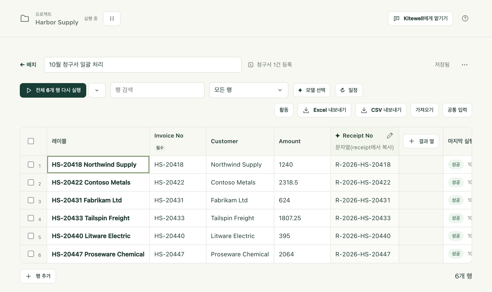

처리해야 할 목록이 있습니다. 이번 달 청구서, 확인할 공급업체 100곳, 검색에 나온 모든 매물. 그리고 그중 하나를 처리하는 워크플로가 하나 있습니다. 시트는 그 목록을 행으로 놓고, 행마다 그 행의 값으로 워크플로를 한 번씩 실행합니다. 각 실행이 찾은 내용은 옆의 결과 열로 돌아오므로, 전체 작업을 정렬하고 필터링하고 내보낼 수 있는 표로 볼 수 있습니다.

실패한 행만 다시 실행할 수 있습니다. 이미 끝낸 행은 그대로 둡니다. 누군가 앉아서 클릭할 필요가 없습니다.

## 준비할 것

- 항목 하나에 대한 일을 하는 워크플로. 항목마다 달라지는 값은 이름 있는 입력으로 둡니다. 입력이 없는 워크플로도 시트로 실행할 수 있지만, 모든 행이 같은 일을 하게 됩니다.
- 단계가 이미 수집하는 값을 복사하는 열만 있는 시트라면 다른 것은 필요 없습니다. 대신 각 실행에서 모델이 무언가를 읽게 하려면 프로젝트에 [에이전트와 모델](/ko/docs/ai/)의 API 모델이 있어야 합니다.

## 시트 만들기

1. 사이드바에서 **더 보기**를 열고 **배치**를 선택한 다음 **새 시트**를 선택합니다.
2. **워크플로**를 고르고 **시트 이름**을 붙인 다음 **시트 만들기**를 선택합니다.
3. 시트가 열리면 워크플로의 입력마다 열이 하나씩 있으며, 각 입력의 형식, 기본값, 허용 값이 그대로 적용됩니다. 왼쪽 끝에는 **레이블** 열이 있습니다. **레이블**은 내가 행을 알아보기 위한 이름이며, 워크플로에는 전달되지 않습니다.
4. 행을 넣고(아래 참조) 실행 버튼을 선택합니다.

워크플로의 실행 양식에서 시작할 수도 있습니다. **단일 실행**에서 **배치 시트**로 전환하면 입력해 둔 값이 새 시트의 공통 값이 됩니다. 이 전환은 새 실행 양식에만 있으며, 재시도 양식에는 없습니다.

시트 하나에는 최대 5,000행, 결과 열 30개까지 담을 수 있습니다.

## 행 넣기

- 그리드에 직접 입력하거나, 스프레드시트에서 복사한 셀을 현재 셀부터 붙여 넣습니다. 행은 필요한 만큼 추가됩니다. **행 추가**로 한 행씩 직접 추가할 수도 있습니다.
- **가져오기**로 Excel 워크북이나 CSV 파일을 가져오거나, 시트 아무 곳에나 파일을 끌어다 놓거나, 패널의 **행** 상자에 행을 붙여 넣고 **열 미리 보기**를 선택합니다. 미리 보기에는 첫 행들이 표시되며, 열 이름이 있는 행이 자동으로 골라집니다. **3행을 열 이름으로 사용**으로 다른 행을 고르거나 **열 이름 없음**을 고를 수 있습니다. 그런 다음 각 열을 입력, **레이블**, **열 건너뛰기** 중 하나에 연결합니다. 쉼표로 구분되지 않은 파일은 **구분 기호** 선택기로 처리합니다.
- **공통 입력**은 행이 자체 값을 지정하지 않는 한 모든 행이 쓰는 값입니다. 빈 셀에는 그 셀이 쓸 공통 값이나 워크플로 기본값이 회색 기울임꼴로 표시됩니다.
- **워크플로 실행 결과로 행 채우기**는 검색에서 나오는 매물처럼 실행이 항목을 찾게 하고, 행을 최신 상태로 유지합니다.
- **이 기기의 워크북 연결**은 행을 복사해 오는 대신 Excel 파일과의 연결을 유지하므로, 각 행의 결과가 원래 행에 되돌려 쓰입니다. [Excel 자동화](/ko/docs/spreadsheets/)를 참조하세요.
- 어시스턴트가 행과 열을 제안할 수도 있습니다. 제안은 결정할 때까지 열려 있는 시트에 표시됩니다.

열 이름보다 위에 있는 행, 빈 행, 그리고 ‘합계’나 ‘Subtotal’처럼 합계를 나타내는 행은 가져오지 않고 각각 개수를 알려 주며, 합계 행을 포함하는 확인란도 있습니다. 워크북은 Excel이 열 때의 시트로 열리고, 다른 시트도 고를 수 있습니다. 숨긴 행은 제외하는 확인란을 선택하지 않는 한 가져옵니다. 가져오기는 파일을 읽기만 하며, 절대 바꾸지 않습니다.

각 값은 입력의 형식에 따라 읽힙니다. 텍스트는 입력한 그대로, 숫자, `true` 또는 `false`, 목록과 객체는 JSON으로 읽습니다. 맞지 않는 값은 입력할 때는 거부되고, 붙여 넣을 때는 건너뛰며, 파일에서 들어올 때는 유지하되 표시합니다. 표시된 셀에는 빨간 테두리와 이유가 나타나며, 고칠 때까지 아무것도 시작되지 않습니다. 실행하려는 행에 맞지 않는 셀이 하나라도 있으면 그 행을 알려 주며 실행 전체가 멈춥니다.

워크북의 셀은 Excel에 보이는 대로 들어옵니다.

- 날짜는 `2026-10-01`, 날짜와 시간은 `2026-10-01 12:00:00`, 시간은 `09:30:00`으로 들어옵니다.
- 숫자는 구분 기호나 통화 기호 없이 들어오며, 지수 표기로 바뀌지 않습니다. 백분율은 소수가 되므로 12%는 `0.12`입니다.
- `TRUE`와 `FALSE`는 소문자 `true`와 `false`가 됩니다. 예/아니요 입력이 기대하는 형태입니다.
- `00123` 같은 코드는 셀이 텍스트이든, 앞에 0을 붙이는 서식의 숫자이든 0을 유지한 채 들어옵니다.
- 여러 행에 걸쳐 아래로 병합된 셀은 각 행에 반복되고, 한 행 안의 병합은 첫 셀에만 남습니다.
- 수식은 Excel이 마지막으로 저장한 결과가 됩니다.
- `#N/A` 같은 Excel 오류를 표시하는 셀은 빈 값으로 들어오며, 그 개수를 알려 줍니다.

이전 형식인 `.xls` 파일과 비밀번호로 보호된 워크북은 거부됩니다. 먼저 `.xlsx`로 저장하거나 비밀번호를 해제하세요. 파일 크기는 최대 16MiB입니다. `.csv`, `.tsv`, `.txt`도 쓸 수 있습니다.

시트는 편집하는 대로 저장되며 **저장됨**이라고 표시됩니다.

## 행 실행하기

실행 버튼은 지금 실행할 만한 행 묶음을 시작하며, 어떤 행인지 알려 줍니다. 아직 실행한 행이 없으면 **아직 실행 안 한 6개 행 실행**, 일부가 실패했다면 **실패하거나 중지된 2개 행 다시 실행**, 마지막에는 모든 행 다시 실행이 됩니다. 옆의 펼침 버튼은 **다른 실행 방법**을 열며, 여기서 묶음을 직접 고릅니다. **목록에서 사라짐**으로 표시된 행은 선택해서 실행할 때를 제외하고 어떤 묶음에도 들어가지 않습니다.

각 행은 워크플로의 대기열에서 별도의 실행이 됩니다. 배너에는 끝난 행 수, 동시에 실행되는 수, 대기열 이름, 그리고 세 행이 끝난 뒤부터는 대략적인 남은 시간이 표시됩니다. **default** 대기열은 프로젝트 전체에서 한 번에 5개를 실행합니다. 사이트가 한꺼번에 몰리는 요청을 거부한다면 배너에서 **동시에 실행할 수 변경**을 선택합니다. **대기열** 페이지에서 그 대기열이 열리며, 낮춰야 할 값은 **동시 실행 수**입니다.

기본 대기열에서는 행이 약 10개씩 대기열에 들어가고, 나머지는 자리가 날 때까지 **보류 중**으로, 엔진이 받은 뒤에는 **대기 중**으로 표시됩니다. 따라서 같은 대기열을 쓰는 다른 워크플로의 예약 실행은 시트 전체가 아니라 많아야 행 한 차례분만 기다립니다.

- **대기 중인 행 취소**는 아직 기다리는 행을 취소합니다. 실행 중인 행은 계속됩니다.
- **모두 중지**는 실행 중인 행도 멈춥니다. 끝난 결과는 남습니다.

실행을 시작할 때 워크플로와 각 행의 값이 따로 복사되므로, 나중에 시트나 워크플로를 편집해도 이미 대기열에 들어간 실행은 바뀌지 않습니다. 실행 이후 입력이 바뀐 행에는 **변경됨**이 표시되고, **마지막 실행 이후 변경됨** 필터로 모아 볼 수 있습니다. 공통 입력을 편집하면 그 입력을 쓰는 모든 행이 표시됩니다.

### 행이 실패했을 때

행을 선택하면 멈춘 단계와 그 단계의 오류가 표시됩니다. **포털에 등록하기의 재시도 설정**을 선택하면 워크플로 편집기에서 그 단계가 열리고, **재시도 한도**를 바로 설정할 수 있습니다. 한꺼번에 몰리는 요청을 거부하는 사이트도 나중에 다시 시도하면 대개 통과시킵니다. 새 재시도 규칙은 행을 다시 실행할 때부터 적용되며, 이미 대기열에 들어간 실행에는 적용되지 않습니다.

## 각 실행에서 결과 모으기

결과 열은 각 실행에서 값 하나를 모읍니다. 열을 추가할 때 **값의 출처**에서 방법을 고릅니다.

**워크플로가 게시하는 값**은 각 실행에서 값을 그대로 복사합니다. 모델도 비용도 없이, 단계가 찾은 그대로의 값을 실행이 끝나자마자 가져옵니다. 열이 생기기 전에 실행된 행도 채워집니다. **출력**에서 고릅니다.

- 값을 게시하는 워크플로로 새 시트를 만들면 “이 워크플로는 다음 값을 게시합니다. 열로 추가할까요?” 아래에 그 값들이 선택된 상태로 제시됩니다.
- 그리드 오른쪽의 **결과 열**로 열을 하나 추가합니다.
- 숫자 열에 들어온 `¥12,800`처럼 열의 형식에 맞지 않는 값은 게시된 그대로 표시와 함께 나타납니다. 세부 정보에서 **열을 문자열로 변경** 또는 **모델이 읽도록 하기**를 고를 수 있습니다.
- 워크플로가 더 이상 게시하지 않는 값의 열은 헤더에 표시가 붙습니다.

복사할 수 있는 것은 실행의 출력에 도달하는 값뿐입니다. 웹사이트·데스크톱 추출, 이메일 단계, 명령 단계가 선언한 결과가 해당하며, 사람이 양식에 입력한 답이나 루프 안의 단계 값은 해당하지 않습니다. 두 단계가 같은 이름을 게시하면 마지막에 실행된 단계의 값이 쓰입니다.

그 밖의 모든 경우는 **모델이 실행을 읽음**으로 처리합니다. 열에 이름을 붙이고 형식(**문자열**, **숫자**, **예 / 아니요**, **선택**, **단계**)을 고른 뒤, **읽을 내용(모델에게 주는 설명)** 항목에 단위나 값이 여러 개일 때 어느 것을 고를지 등 무엇을 찾을지 설명합니다. **선택**과 **단계** 형식에는 각각 **선택지**와 **단계(낮은 순)** 항목을 채웁니다.

이런 열은 **에이전트와 모델**의 API 모델 중 **모델 선택**에서 고른 모델이 채웁니다.

- **추출 모델**은 문자열 열과 숫자 열을 읽으며, 판단 모델이 없으면 다른 열도 읽습니다. 각 값에는 인용문 **실행에서 인용**이 함께 붙으며, 보낸 내용에서 그 인용문이 글자 그대로 발견되지 않으면 표시됩니다.
- **판단 모델**은 선택 사항입니다. 예/아니요, 선택, 단계 열을 확률과 함께 판단하며, 인용문은 없지만 더 빠르고 비용이 적게 듭니다. **이 확신도 미만은 ‘확인 필요’로 표시**는 사람이 확인하도록 표시할 확신도 기준을 정하며, 기본값은 70%입니다.

값은 각 실행이 성공한 뒤에 읽힙니다. 단, 행을 시작할 때 시트에 이미 열과 모델이 있어야 합니다. 배너의 **4개 행 채우기**는 값이 빠진 끝난 행을 읽고, 셀 세부 정보의 **다시 읽기**는 실행 하나를 다시 읽습니다. 둘 다 워크플로를 다시 실행하지는 않습니다. 열의 정의를 바꾸기 전에 읽은 값은 오래된 값으로 표시되며, 모델을 바꾸는 것으로는 아무것도 표시되지 않습니다.

모델에는 행의 입력, 실행의 단계 결과, 게시된 출력, 실행이 만든 텍스트 파일 최대 5개, 최대 4개 단계의 로그 끝부분이 전송되며, 스크린샷은 전송되지 않습니다. 이 정보를 맡길 수 있는 제공업체를 고르세요.

## 실행이 행을 찾게 하기

행은 워크플로의 실행이 찾은 목록에서 올 수 있으므로, 새 항목은 누가 추가하지 않아도 행이 됩니다. **가져오기** 아래나 새 시트의 빈 행 아래에서 **워크플로 실행 결과로 행 채우기**를 선택합니다.

1. **워크플로**(시트 자신의 워크플로여도 됩니다)와, 그 실행이 게시하는 **목록**을 고릅니다. [웹사이트](/ko/docs/browser/)나 [데스크톱](/ko/docs/desktop/) 단계의 **항목 목록**, **메일 찾기** 단계가 찾은 메일, 또는 단계가 목록으로 게시하는 모든 출력이 해당합니다.
2. 최근 실행의 첫 항목들을 확인합니다. 아직 실행한 적이 없거나 실행해 봐야 필드를 알 수 있다면 **지금 실행**을 선택합니다.
3. **각 입력을 채울 값**에서는 각 입력이 같은 이름의 항목 필드를 받습니다. 항목을 구별하는 입력에 **이 값으로 행 맞추기**를 지정하고, 목록을 가져오는 실행 자체가 받을 입력을 설정합니다.
4. **행 채우기**를 선택합니다. 워크플로가 한 번 실행되고 항목마다 행이 추가됩니다.

그러면 도구 모음에 행의 출처가 표시되며, **행 새로 고침**은 워크플로를 다시 실행합니다. 실행이 성공하면:

- 항목은 같은 키를 가진 행을 채웁니다. 그 키로 직접 추가한 행은 중복으로 만들지 않고 그대로 이어받습니다. 키는 텍스트로 비교하지만, 숫자로 읽히는 값은 숫자로 비교합니다.
- 새 항목은 행을 추가하며, 실행되기 전까지 **새 항목**으로 표시됩니다.
- 항목이 사라진 행은 남아 **목록에서 사라짐**으로 회색 표시되며, 항목이 돌아오면 다시 살아납니다. **목록에서 사라짐** 필터로 모아 볼 수 있고, 한 번에 모두 지우는 버튼도 있습니다.
- 키가 없는 항목, 다른 항목의 키를 반복하는 항목, 5,000행 한도를 넘는 항목은 건너뛰고 개수를 알려 줍니다.

실행이 실패하면 아무것도 바뀌지 않고 이유를 알려 줍니다. 빈 목록이 돌아오거나 키가 있는 항목이 하나도 없는 목록이 돌아와도 마찬가지입니다. 실행이 망가졌다고 시트 전체가 회색이 되는 일은 없습니다. 목록이 실제로 짧아진 경우에는 빠진 행이 표시됩니다.

출처가 더 이상 맞지 않으면(워크플로가 삭제되었거나 더 이상 목록을 게시하지 않음, 채우던 입력의 이름이 바뀜, 목록의 항목에서 필드가 사라짐) 시트가 이를 알리고, 배치 목록에도 표시가 붙습니다. **원본 변경**을 선택하면 연결을 다시 맞춘 상태로 패널이 열립니다.

## 일정에 따라 실행하고 바뀐 점 보기

매일 아침 확인하는 가격이나 매물처럼 시간에 따른 값의 변화를 지켜보려면, 시트 도구 모음에서 **일정**을 선택하고 **모든 행 다시 실행**을 **매시간**, **매일**, **평일**, **매주**, 또는 cron 형식의 **사용자 지정 일정**으로 설정합니다. **끄기**를 고르면 일정이 없어집니다. 시트는 한 시간에 최대 한 번 실행됩니다. 도구 모음과 시트 목록에 다음 실행이 표시됩니다.

- 일정은 이 기기에 속합니다. 시트와 함께 동기화되지 않으므로, 팀원이 공유한 시트는 누군가 일정을 지정한 곳에서만 실행되며, 실수로 두 컴퓨터에서 실행되는 일은 없습니다.
- 일정은 이 컴퓨터가 깨어 있고 이 프로젝트의 엔진이 실행 중일 때 실행됩니다. 컴퓨터가 꺼져 있거나 절전 중이어서 놓친 실행은 컴퓨터가 돌아왔을 때 어떻게 할지 고릅니다. 기본값인 **다음 실행이 더 가깝지 않으면 복귀 시 실행**, **복귀 시 항상 실행**, **건너뛰기** 중 하나입니다. 어느 쪽이든 놓친 실행은 최대 한 번만 실행됩니다.
- 예정 시각에 지난 실행이 아직 진행 중이면 그 회차는 건너뛰며, 건너뛰었다고 알려 줍니다.
- 워크플로 실행 결과에서 행을 가져오는 시트는 먼저 행을 새로 고치므로, 새 항목은 새 행으로 실행되고 목록에서 사라진 행은 빠집니다. 행을 있는 그대로 실행하려면 **먼저 새 매물 찾기에서 행 새로 고침**의 선택을 해제하세요.

각 행은 같은 입력으로 실행한 이전 실행이 읽은 값을 보관합니다. 그 뒤로 바뀐 결과는 셀에 표시됩니다. 이전 값과 새 값이 모두 숫자면 화살표, 그 밖에는 점으로 표시되며, 이전 값은 마우스를 올리거나 셀 세부 정보를 열면 볼 수 있습니다. 배너가 변화의 수를 세어 주고, **보기**를 선택하면 **결과가 바뀐 행** 필터가 적용됩니다.

공백과 대소문자 차이를 무시하는 것은 문자열 열뿐이며, 다른 형식은 정확히 비교합니다. 모델은 같은 값을 실행마다 다르게 표현할 수 있으므로, 가능하면 단계가 게시하는 값을 복사하세요.

## 실행마다 바뀐 점 보기

시트 도구 모음의 **활동**에는 시트에서 마지막으로 끝난 실행 묶음 50개가 최신순으로 나열됩니다. 각 항목에는 실행된 행과 실패한 행의 수, 열마다 오르거나 내리거나 바뀐 값, 새 행·목록에 돌아온 행·목록에서 사라진 행, 그리고 바뀐 값 최대 20개가 이전 값과 함께 표시됩니다. 바뀐 값을 선택하면 그 행이 열립니다.

값을 선택하면 **기록**에 지난 1년 동안 그 값이 바뀐 모든 시점이 표시되며, 숫자는 선 그래프로도 보여 줍니다.

이 기록은 시트를 실행한 기기에 남습니다. 한 달에 파일 하나로 쌓이며, 그 달이 지나면 압축되고 12개월 뒤에 삭제됩니다.

## 내보내기, 복제, 삭제

- **Excel 내보내기**와 **CSV 내보내기**는 입력, 값, 각 판단의 확률, 바뀐 결과의 이전 값, 각 행의 **상태**, **실행 ID**, **오류**를 시트 이름과 날짜를 붙인 파일로 저장합니다. 워크북은 필터가 달린 고정 헤더와 함께 열리며, 숫자와 날짜는 Excel에서 정렬할 수 있는 셀로 들어가고 각 행의 상태는 색으로 구분됩니다. 다시 가져오면 입력이 자동으로 연결됩니다. 워크플로 실행 결과로 채운 시트에는 **목록 상태** 열이 있어, 어떤 행이 새 행인지 또는 목록에서 사라진 행인지 알려 줍니다.
- 시트 메뉴인 **시트 작업**에는 같은 행, 입력, 결과 열, 모델을 가진 사본을 만드는 **복제**와, 같은 설정에 빈 행 하나만 있는 **행 없이 복제**가 있습니다. 값은 그 값을 만든 실행에 속하므로, 사본은 결과 없이, 일정도 없이 시작합니다.
- **시트 삭제**는 시트와 이 기기에서 읽은 값을 삭제합니다. 실행은 **실행 및 로그**에 남습니다. 행이 아직 실행 중인 시트는 삭제할 수 없습니다.

## 세부 사항

- **배치를 완료할 때** [알림](/ko/docs/alerts/)은 한 번 시작한 실행 묶음의 모든 행이 끝나고 값을 읽은 뒤에 알려 줍니다. 성공하지 못한 행의 수와 열별 변화, 그리고 먼저 행을 새로 고친 경우에는 새 행, 목록에 돌아온 행, 목록에서 사라진 행의 수를 알려 줍니다. 모든 행이 성공하고 바뀐 것이 없는 예약 실행은 조용히 넘어가지만, 수동 실행은 그래도 보고합니다. 시작하지 못한 예약 실행은 그 이유를 알려 줍니다. 배치 행은 사람을 기다리는 경우를 제외하고 행마다 실행 알림을 보내지 않습니다.
- [MCP 클라이언트](/ko/docs/mcp/)는 시트를 나열하고 읽을 수 있으며(각 워크플로가 게시하는 값과 바뀐 값의 이전 값 포함), 시트를 만들고 교체하고 삭제하고, 워크플로 실행 결과로 행을 채우고 새로 고치고, 이 기기에서 일정을 지정하고, 행을 실행하고 값을 다시 읽고 실행을 취소하고, 워크북을 연결하거나 연결을 해제할 수 있습니다. 시트를 교체하면 통째로 바뀌므로, 빠뜨린 행이나 열은 그 값과 함께 삭제됩니다.
- 시트 자체는 프로젝트에 속하므로 프로젝트 내보내기에 함께 담기고 [Dagu Cloud와 동기화](/ko/docs/cloud-sync/)됩니다. 행의 값, 행의 출처, 목록에서 사라진 행도 함께 동기화됩니다. 행 상태, 실행에서 읽은 값과 그 이전 값, 최근 새로 고침, 활동 및 값 기록, 시트의 일정은 그것들을 실행한 기기에 남습니다.
