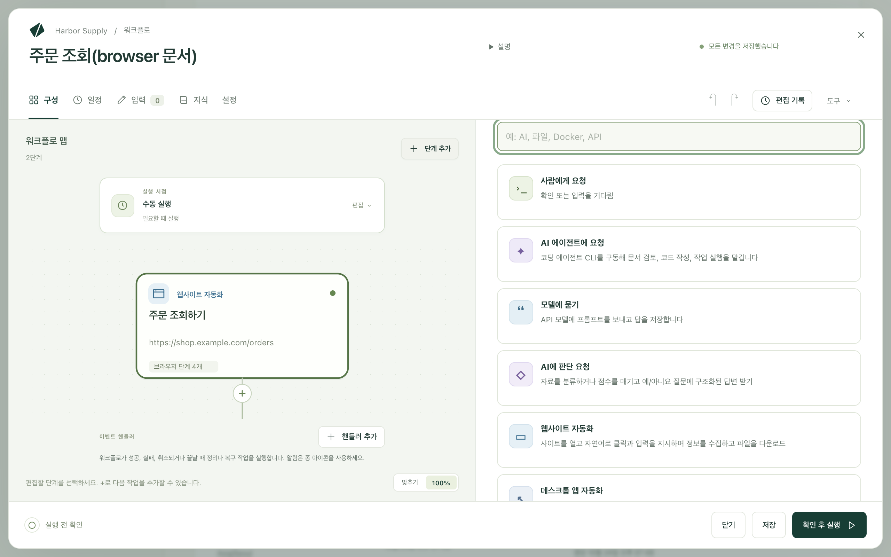
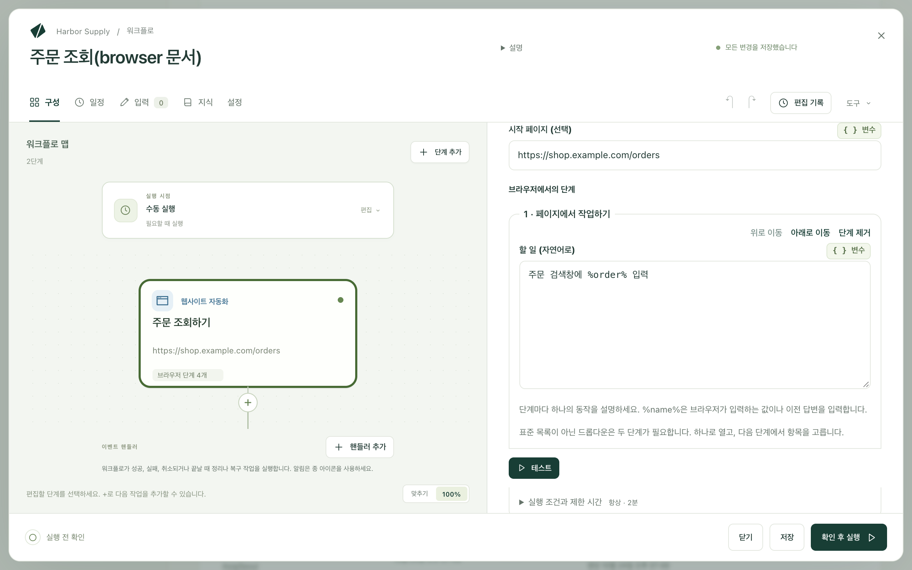

Kitewell은 웹사이트 작업을 대신할 수 있습니다. 페이지를 열고, 로그인하고, 클릭하고 입력하고, 파일을 업로드하고, 페이지에 보이는 내용을 읽고, 찾은 내용을 다음 단계로 넘깁니다. 할 일은 평범한 말로 쓰면 되고, 각 페이지에서 어떻게 할지는 모델이 알아냅니다. 녹화할 것도, 작성할 선택자도 없습니다.

맡길 수 있는 일:

- 공급업체 포털에서 이번 달 청구서 다운로드하기.
- 이메일로 받은 영수증을 회계 소프트웨어에 업로드하기.
- 스프레드시트에 있는 모든 주문의 상태 조회하기.
- 웹 대시보드의 수치를 일일 보고서로 옮기기.
- 목록의 행마다 같은 웹 양식 작성하기.
- 릴리스 후에도 사이트의 로그인과 결제가 제대로 동작하는지 확인하기.

브라우저는 내 컴퓨터에서 실행되며, 브라우저에서 한 로그인도 그 컴퓨터에 남습니다.

## 준비할 것

이 컴퓨터의 브라우저. Mac에서는 Google Chrome을 `/Applications`에 설치합니다. Windows에서는 이미 설치된 Chrome이나 Microsoft Edge를 씁니다. Chromium, Brave, Mac용 Edge, 또는 다른 위치에 있는 Chrome을 쓰려면 **기기 설정 → 브라우저 → 브라우저 실행 파일**에 전체 경로를 입력합니다. 단계에 브라우저를 찾았는지, 어떤 브라우저를 열지 표시됩니다.

모델. 웹사이트 단계는 각 페이지에서 무엇을 할지 API 모델에 묻습니다. **에이전트와 모델**에서 [모델을 추가](/ko/docs/ai/)한 다음 단계의 **모델**에서 고르거나, **설정 → 실행 및 재시도 → 브라우저 및 데스크톱 단계의 기본 모델**에서 워크플로 전체에 하나를 지정합니다. Anthropic, OpenAI, Gemini 모델을 쓰세요. 작은 로컬 모델은 대개 브라우저를 조작하지 못합니다.

그런 다음 단계나 **기기 설정**에서 **브라우저 확인**을 선택합니다. 실행할 때와 같은 방식으로 Kitewell의 백그라운드 서비스에서 브라우저를 한 번 열어 보므로, 시작되지 않는 브라우저를 예약 실행 도중이 아니라 지금 발견할 수 있습니다. Mac에서는 macOS가 묻는 확인에도 자리에 있을 때 답할 수 있습니다.

## 첫 웹사이트 단계 만들기

이 예에서는 쇼핑 사이트에서 주문을 조회하고 그 상태를 다음 단계로 넘깁니다.

1. 워크플로를 열고 **단계 추가**를 선택합니다. 작업 선택 화면이 열립니다.

   

2. **웹사이트 자동화**를 선택합니다. **단계 이름**을 `주문 조회하기`처럼 붙입니다. **기술 설정** 아래의 **단계 식별자**는 이 단계가 수집한 값을 나중 단계가 읽을 때 쓰는 짧은 이름입니다. `order`처럼 단순하게 정하세요.
3. **모델**을 고르고, **시작 페이지 (선택)** 항목에 `https://shop.example.com/orders`처럼 처음 열 페이지를 지정합니다.
4. **브라우저가 입력하는 값**에서 **값 추가**를 선택하고, 이름을 `order`로 정한 뒤 **값**에 주문 번호를 지정합니다. 직접 입력한 텍스트, 워크플로 입력, 시크릿(로그에 절대 나타나지 않도록 저장한 비밀번호나 키) 중 무엇이든 쓸 수 있습니다.
5. **브라우저에서의 단계**에서 **브라우저 단계 추가**로 다음을 순서대로 추가합니다.
   - **페이지에서 작업하기**: **할 일 (자연어로)** 항목에 `주문 검색창에 %order% 입력`
   - **페이지에서 작업하기**: `검색 버튼 클릭`
   - **다음을 확인…**: **페이지가 다음 상태여야 함…** 항목에 `주문 상세 정보가 표시됨`
   - **정보 수집**: **찾을 내용**에 `주문 상태와 배송 예정일`을 입력하고, **수집할 값**에 `status`와 `delivery` 두 값을 추가한 뒤 둘 다 **형식**을 **문자열**로 지정

   

6. **브라우저 설정**을 열고 **브라우저 창 표시**를 켠 다음 **테스트**를 선택해 단계가 단독으로 동작하는 모습을 지켜봅니다.
7. 수집한 값을 `${steps.order.outputs.status}`처럼 쓰는 나중 단계를 추가합니다.

새 워크플로의 **또는 예제로 시작**에는 대신 복사해 쓸 수 있는 웹사이트 예제 두 가지, **웹사이트에서 데이터 수집**과 **한 번 로그인한 뒤 수집**이 있습니다.

## 모델이 따를 수 있는 지시 쓰기

지시 하나에 동작 하나. **페이지에서 작업하기** 단계는 첫 번째 동작만 수행하므로, `코드를 입력하고 계속 버튼 클릭`이라고 쓰면 입력까지만 하고 멈춥니다. 대신 두 단계로 나눠 쓰세요.

일반 목록이 아닌 드롭다운도 두 단계가 필요합니다. 한 단계에서 드롭다운을 열고, 다음 단계에서 옵션을 고릅니다.

동료에게 말하듯 페이지에 있는 것의 이름을 대세요.

- `최신 청구서 옆의 다운로드 클릭`
- `고객 필드에 %customer% 입력`
- `보고서 메뉴 열기`

수집하는 단계에는 동작이 아니라 원하는 것을 씁니다. `확인 페이지의 주문 번호와 합계`처럼, 값이 화면 어디에 있는지가 아니라 그 값이 무엇인지를 적으세요.

## 웹사이트 단계로 할 수 있는 일

안에 있는 단계는 하나의 브라우저에서 순서대로 실행됩니다.

- **페이지 열기**는 **웹 주소**로 이동합니다.
- **페이지에서 작업하기**는 **할 일 (자연어로)** 항목에 쓴 한 가지 동작을 합니다. `%name%`은 브라우저가 입력하는 값 중 하나, 또는 앞서 내가 한 답을 입력합니다.
- **파일 업로드하기**는 이 컴퓨터의 파일을 페이지에 넘깁니다. [파일 업로드](#upload-files)를 참조하세요.
- **정보 수집**은 **찾을 내용**을 읽고 **수집할 값** 아래의 값을 채웁니다. 각 값에는 **이름**, **형식**(**문자열**, **숫자**, **예 / 아니요**, **목록**, **항목 목록** 중 하나), 그리고 모델에 그 값이 무엇인지 알려 주는 **설명(선택)** 항목이 있습니다. **항목 목록**은 매물의 `url`, `title`, `price`처럼 **각 항목에 담기는 값**을 정합니다. 나중 단계는 각 값을 `${steps.<식별자>.outputs.<이름>}` 형식으로 읽습니다.
- **다음을 확인…** 단계는 페이지가 올바르지 않으면 단계를 실패시킵니다. **확인 방법**에서 방식을 고릅니다. **자연어로 (모델이 판단)** 방식은 **페이지가 다음 상태여야 함…** 항목을 읽고 모델에 묻습니다. **페이지에 텍스트가 있음**, **주소에 포함**, **요소가 나타남 (CSS 선택자)** 방식은 모델 없이 페이지를 직접 읽으므로 매번 같은 답을 냅니다. **확인 지속 시간 (선택)** 동안 페이지가 그 상태가 되기를 기다릴 수 있습니다.
- **대기**는 **일정 시간 동안**(**대기 시간**에 지정) 또는 **요소가 나타날 때까지 (CSS 선택자)** 기다립니다.
- **스크린샷 찍기**는 지정한 **스크린샷 이름**으로 PNG를 실행 파일과 함께 저장합니다.
- **나에게 입력 요청**은 **나에게 표시할 질문**을 보여 주고, 내가 답할 때까지 실행을 일시 중지합니다. 일회용 코드 같은 경우에 씁니다. **답변 이름**은 나중 단계가 그 답을 입력할 수 있도록 답에 이름을 붙입니다.

모든 단계에는 **실행 조건과 제한 시간**도 있어, 조건이 맞을 때만 실행하고 걸리는 시간에 상한을 둘 수 있습니다. 둘 다 설정하지 않은 단계는 최대 2분 동안 실행됩니다.

## 비밀번호를 모델에 보내지 않기

**브라우저가 입력하는 값**에는 고객 번호, 워크플로 입력, 비밀번호 등 단계가 입력하는 모든 것을 담습니다. 지시에서는 각각을 `%name%`으로 부르며, 모델은 그 이름만 봅니다.

민감한 값에는 시크릿을 값으로 고르세요. 시크릿은 지시에도, 모델에도, 로그에도 들어가지 않습니다. 시크릿의 값을 그대로 적은 지시는 그 값을 보내는 대신 실패하며, 실행 전에 **확인 후 실행**이 이를 알려 줍니다.

## 파일 업로드

**파일 업로드하기**는 파일 선택 창에서 파일을 고르듯이 이 컴퓨터의 파일을 페이지의 파일 필드에 넣습니다. 회계 도구의 파일 상자에 영수증을 넣거나, 포털에 서명한 양식을 올릴 때 씁니다.

- **업로드할 파일 · 한 줄에 하나**에는 `~/Documents/invoice.pdf` 같은 전체 경로, `~/Downloads/*.pdf` 같은 패턴, 또는 파일 목록을 내는 앞 단계의 결과를 넣습니다. **첨부 파일을 실행 파일에 저장**을 켠 이메일 단계는 찾은 메일의 첨부 파일을 나열하므로, `${steps.<식별자>.outputs.messages}`라고 쓰면 메일로 받은 파일을 업로드합니다.
- **업로드 위치(선택)** 항목에는 파일 필드, 또는 파일 선택 창을 여는 버튼이나 드롭 영역을 `영수증 드롭 영역`처럼 평범한 말로 적습니다. 모델이 한 번 찾아내면 이후 실행은 찾은 결과를 다시 씁니다. 페이지에 파일 필드가 하나뿐이면 비워 두세요. 그러면 모델에 전혀 묻지 않습니다.
- **매번 다시 찾기**는 업로드 영역이 자꾸 옮겨 다니는 페이지를 위해 대신 매번 모델에 묻습니다.

파일 선택 창은 화면에 열리지 않으며, 모델은 파일도, 파일 이름도, 파일 위치도 보지 못합니다. 한 번에 파일 하나만 받는 사이트에 여러 파일을 주면 단계가 실패합니다. 별도의 단계로 나누어 업로드하거나, 파일마다 단계를 한 번씩 실행하세요. 파일 하나는 최대 50MB입니다. 사이트는 받은 파일을 백그라운드에서 전송하므로, 업로드 뒤에 사이트가 완료 시 보여 주는 내용을 확인하는 **다음을 확인…** 검사를 두세요. 예를 들어 **페이지에 텍스트가 있음**에 `Uploaded`를 넣고, **확인 지속 시간 (선택)** 값을 1분으로 지정합니다.

어시스턴트가 업로드를 구성할 때는 먼저 자기 브라우저에서 시도해 보고, 파일이 사이트로 가기 전에 사이트와 각 파일을 밝히며 나에게 묻습니다. 업로드하는 워크플로를 시험 실행할 때도 마찬가지입니다.

## 한 번 로그인하고 로그인 상태 유지하기

**브라우저 설정**에서 **실행 간에 로그인 유지**를 켭니다. 쿠키와 로그인 상태가 이 컴퓨터에 남으므로, 다음 실행은 이미 로그인된 상태로 사이트를 엽니다. **한 번 로그인한 뒤 수집** 예제가 이렇게 시작합니다. 첫 단계가 창을 보여 주고 내가 직접 로그인할 때까지 기다리며, 그 뒤의 모든 단계와 실행은 그 로그인을 다시 씁니다.

**프로젝트 설정 → 저장 공간 → 로그인**에는 저장된 로그인과 각 로그인을 쓰는 워크플로가 표시되며, **로그인 삭제…** 버튼으로 하나를 지울 수 있습니다. 백업에는 로그인이 포함되지 않으므로, 복원한 컴퓨터는 시크릿을 다시 묻는 것과 마찬가지로 다시 로그인합니다.

항목을 동시에 실행하는 루프는 로그인 하나를 공유할 수 없습니다. 루프를 한 번에 한 항목씩 실행하도록 설정하거나 **실행 간에 로그인 유지**를 끄세요.

## 인증서를 요구하는 사이트

회사나 정부 포털처럼, 열리기 전에 브라우저에 클라이언트 인증서를 요구하는 사이트가 있습니다. Kitewell에 인증서를 한 번 추가하면 이 컴퓨터의 모든 웹사이트 단계와 어시스턴트의 브라우저가 지정한 사이트에 그 인증서를 제시하며, 시스템이 인증서 비밀번호를 묻지 않습니다.

1. **기기 설정 → 브라우저 → 클라이언트 인증서**를 엽니다.
2. `.pfx` 또는 `.p12` 파일은 **파일에서 추가…** 버튼으로 추가하고 **비밀번호**를 입력합니다. Kitewell 앱에서는 대신 **이 컴퓨터에서 추가…** 버튼으로 macOS 키체인이나 Windows 인증서 저장소에서 고를 수 있습니다. 시스템이 Kitewell의 복사를 허용할지 한 번 물을 수 있습니다.
3. **사용 대상**에서 **다음 사이트에만**을 고르고, **사이트(한 줄에 하나씩)** 칸에 `portal.example.com`처럼 사이트를 적습니다. 그 아래의 모든 사이트에 쓰려면 `*.example.com`을 적습니다. **인증서를 요구하는 모든 사이트**를 고르면 요구하는 모든 사이트에 인증서를 제시합니다.
4. **인증서 추가**를 선택한 다음, **사이트 확인**으로 그 인증서를 써서 사이트를 열어 봅니다.

단계마다 따로 설정할 것은 없습니다. 사이트가 인증서를 요구해서 실행이 실패하면, 실패한 실행에서 관리자가 그 사이트용 인증서를 추가하거나 이미 추가한 인증서를 쓰도록 지정한 뒤 **실행 다시 시도**를 선택할 수 있습니다.

인증서를 제시하는 것은 웹사이트 단계와 어시스턴트의 브라우저뿐입니다. [데스크톱 단계](/ko/docs/desktop/)는 화면에 있는 브라우저를 조작하는데, 그 브라우저는 인증서를 직접 고르라고 묻고 답을 기다리므로, 그런 사이트는 웹사이트 단계로 자동화하세요.

Kitewell은 인증서를 내 비밀번호가 아닌 Kitewell 자체 비밀번호로 이 컴퓨터에 보관하며, 백업에는 넣지 않습니다. 인증서를 추가하거나 바꾸면 프로젝트 엔진이 다시 시작되며, 진행 중인 실행은 계속됩니다. Kitewell 채팅은 인증서가 만료되기 한 달 전과 일주일 전, 그리고 만료될 때 경고합니다.

## 실행 화면 살펴보기

**실행 및 로그**에서 실행을 엽니다. **브라우저가 수행한 작업**에는 단계가 찍은 스크린샷과 함께 단계가 순서대로 나열되고, 그 옆에 질문을 받은 **모델**과, 들어가고 나온 토큰 수인 **모델 사용량**이 표시됩니다.

**AI 없이 실행**은 단계의 동작 중 모델에 묻지 않고 실행된 동작이 몇 개인지 보여 줍니다. 재생된 동작, 페이지를 직접 읽는 검사, 페이지 열기 같은 동작이 해당합니다. 한 번 성공한 동작은 기억되어 다음에도 같은 방식으로 반복되며, 재생된 동작은 모델에 아무것도 보내지 않습니다.

사이트가 바뀌어 기억한 동작이 더 이상 통하지 않으면 모델에 다시 묻습니다. 한 단계에서 **매번 다시 판단**을 켜면 이 기억이 꺼지고, 사이트가 개편된 뒤에는 **프로젝트 설정 → 저장 공간 → 재생 캐시**에서 워크플로가 기억한 내용을 지울 수 있습니다. **정보 수집**과 자연어로 쓴 검사는 실행할 때마다 모델에 묻습니다.

단계가 **나에게 입력 요청**에 이르면 실행이 기다립니다. **실행 및 로그 → 대기 중**에서, 또는 알림에서 실행을 열고, **내 답변**에 입력한 뒤 **답**을 선택합니다. 단계를 실패시키려면 **거부**를 선택합니다. 답은 실행과 함께 보관되므로 비밀번호가 아니라 만료되는 코드에 쓰세요. 답하기 전에 브라우저가 닫혔다면 **브라우저 단계 다시 시작**으로 단계를 처음부터 다시 실행합니다.

## 여러 항목에 대해 실행하기

- 스프레드시트의 목록: 주문 번호 같은 입력을 워크플로에 두고, [배치 시트](/ko/docs/batches/)에서 항목마다 한 행씩 실행합니다. 시트에 진행 상황, 실패, 남은 시간이 표시됩니다.
- 사이트에 보이는 목록: 검색 결과 전체처럼 **항목 목록**을 수집하고 [그 목록으로 시트의 행을 채웁니다](/ko/docs/batches/#let-a-run-find-the-rows). 새로 고치면 새 항목이 추가되고 사라진 항목이 표시됩니다.
- 한 번의 실행 안의 목록: 단계를 **각 항목 처리** 루프에 넣습니다.
- 일정에 따라: [일정](/ko/docs/scheduling/)을 추가하고, 작업 중에 Chrome이 열리지 않도록 **브라우저 창 표시**를 끈 채로 두고, 실행이 실패하거나 답을 기다릴 때 [알림](/ko/docs/alerts/)이 알려 주게 합니다.

## 문제가 생기면

먼저 단계의 스크린샷을 보세요. 로그인 화면, 쿠키 배너, 봇 검사가 대부분의 실패를 설명해 줍니다. 그런 다음:

- 지시와 일치하는 것이 페이지에 없다고 단계가 알립니다. 페이지에 있는 것의 이름을 대도록 지시를 고쳐 쓰거나, 둘로 나누세요.
- 파일 선택 창이 열리지 않았다고 업로드 단계가 알립니다. **업로드 위치(선택)** 항목에 파일 필드 자체나 선택 창을 여는 버튼을 적으세요. 업로드가 메뉴나 대화 상자 안에 있다면 앞 단계에서 먼저 여세요.
- 브라우저가 시작되지 않습니다. **브라우저 확인**을 실행하고, 브라우저를 찾지 못했다면 **기기 설정 → 브라우저 → 브라우저 실행 파일**을 지정합니다.
- 단계에 필요한 사이트가 로드되지 않습니다. **허용 웹사이트 · 한 줄에 하나 (선택)** 항목을 채웠다면 로그인 서버와 이미지 서버를 포함해 사이트가 쓰는 모든 호스트를 나열해야 합니다.

나머지는 [문제 해결](/ko/docs/troubleshooting/#a-website-step-fails)에 있습니다.

## 세부 사항

단계의 **브라우저 설정**에는 **스크린샷 저장**(**단계가 실패했을 때**, **단계가 실패했을 때와 마지막에**, **각 단계 후**, **없음**)과 픽셀 단위의 **창 너비**, **창 높이**도 있습니다. **허용 웹사이트 · 한 줄에 하나 (선택)** 항목에는 `example.com`이나 `*.example.com` 같은 호스트 이름을 넣습니다. 로컬 주소, 포트, 경로는 거부됩니다.

모델에 전달되는 것은 페이지에 보이는 텍스트와 레이아웃이며, 모델이 결정하는 동작마다 한 번씩 보내지고 선택한 제공업체가 요금을 청구합니다. 재생된 동작과 페이지를 직접 읽는 검사는 아무것도 보내지 않으며, 브라우저가 입력하는 값, 업로드하는 파일, 시크릿도 보내지 않습니다. 업로드한 파일은 직접 골랐을 때와 마찬가지로 사이트로 갑니다. [컴퓨터 밖으로 나가는 정보](/ko/docs/data-flow/)를 참조하세요.

일부 사이트는 자동화된 브라우저를 거부합니다. 저장된 로그인과 쿠키 배너를 지난 시작 페이지로 흔한 경우는 피할 수 있지만, CAPTCHA는 풀지 못합니다. 예약 실행을 하려면 컴퓨터가 깨어 있어야 합니다.

[첫 웹사이트 단계 만들기](#build-your-first-website-step)의 워크플로는 두 단계입니다. 시작 페이지, `order`라는 값 하나, **페이지에서 작업하기** 단계 두 개, **다음을 확인…** 검사 하나, 상태와 배송 예정일을 읽는 **정보 수집** 단계 하나로 이루어진 **웹사이트 자동화** 단계, 그리고 그 두 값을 쓰는 나중 단계입니다.
