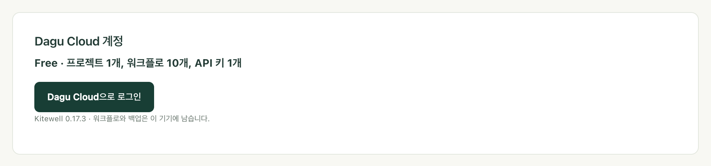

노트북에서 고친 워크플로를 사무실 컴퓨터가 새 버전으로 실행합니다. 누구에게도 파일을 보낼 필요가 없습니다. [Dagu Cloud](https://console.dagu.sh)는 프로젝트의 정의를 보관합니다. 작업은 여전히 각 컴퓨터가 자신의 비밀번호로 직접 실행하며, 시크릿 값은 입력한 기기 밖으로 나가지 않습니다.

동기화는 프로젝트마다 선택합니다. 동기화하기 전까지 프로젝트는 그 컴퓨터에만 있으며, Dagu Cloud에는 아무것도 전송되지 않습니다.

## 필요한 것

- Dagu Cloud 계정. 무료이며, Kitewell에서 로그인하면 컴퓨터 최대 3대에서 Team 기능을 쓸 수 있는 14일 체험이 시작됩니다. 카드는 필요 없습니다.
- 다른 사람과 공유하려면 Kitewell Team. 워크스페이스에 연결하는 컴퓨터 1대당 월 99달러이며, 최대 25명까지 쓸 수 있습니다. [Dagu Console](https://console.dagu.sh/kitewell)에서 구독하세요. 더 큰 팀은 [Enterprise](/ko/pricing/#enterprise)를 이용합니다. 팀 소유자가 워크스페이스 비용을 내므로 멤버는 따로 구독할 필요가 없습니다. 월 20달러인 Kitewell Personal은 한 사람이 컴퓨터 1대에서 자신의 업무에 쓰는 플랜이라 다른 사람을 초대할 수 없습니다. [요금](/ko/pricing/)을 참고하세요.

## 로그인

1. **이 기기 → 기기 설정**을 열고 **Dagu Cloud 계정**을 찾습니다. 이 컴퓨터가 어떤 플랜인지 표시됩니다.
2. **Dagu Cloud으로 로그인**을 선택합니다.
3. Kitewell이 짧은 코드와 **브라우저에서 계속** 버튼을 표시합니다. 버튼으로 브라우저를 열어 로그인한 다음, 브라우저에 표시된 코드가 Kitewell에 표시된 코드와 같은지 확인하고 컴퓨터를 연결합니다.

컴퓨터는 워크스페이스 하나와 동기화하며, 연결되면 **Dagu Cloud 계정**에 그 워크스페이스 이름이 표시됩니다. 워크스페이스에 연결할 수 있는 컴퓨터 대수는 플랜에 따라 정해집니다. Kitewell Personal은 1대, 체험 기간에는 최대 3대, Kitewell Team은 구매한 대수입니다. 한 대를 더 연결하면 그 워크스페이스에 있는 내 컴퓨터 중 가장 오래된 컴퓨터의 연결이 해제됩니다. 나머지가 모두 다른 사람의 컴퓨터라면, 그중 하나의 연결을 해제하거나 플랜의 대수를 늘릴 때까지 연결이 거부됩니다.

로그인만으로는 아무것도 보내지 않습니다. 로그인한 컴퓨터는 플랜을 확인하고, Kitewell 버전과 자신의 이름, ID를 보고합니다. 워크플로와 실행 상태는 동기화한 프로젝트의 것만 보내며, 로그와 시크릿 값은 보내지 않습니다. 로그인하면 [Kitewell 기본 제공 모델](/ko/docs/ai/#use-kitewells-included-model)도 쓸 수 있으며, 그 요청은 Dagu Cloud를 거칩니다.

## 프로젝트 동기화

1. 프로젝트 선택기를 열고 **관리**를 선택합니다.
2. **프로젝트 관리**에서 프로젝트 옆의 **Dagu Cloud에 동기화**를 선택하고 확인합니다.

프로젝트가 업로드되고 **동기화됨**으로 표시됩니다. 그 뒤로는 저장할 때마다 먼저 Dagu Cloud로 전송됩니다.

:::caution
워크플로 YAML, 배치 입력, API 주소는 작성한 그대로 공유됩니다. 이런 곳에 직접 입력한 비밀번호가 있다면 동기화하기 전에 지우고, 대신 [시크릿](/ko/docs/secrets/)에 보관하세요.
:::

업로드가 도중에 끊기면 프로젝트에 **업로드 미완료**가 표시되고 **업로드 재개**를 선택할 수 있습니다. 업로드가 끝날 때까지 저장은 대기합니다.

Kitewell Personal은 최대 5개, Kitewell Team과 체험 기간에는 최대 15개 프로젝트를 동기화하며, 프로젝트마다 워크플로는 최대 100개입니다. 워크스페이스에 연결할 수 있는 컴퓨터 대수는 플랜에 따라 정해집니다. Kitewell Personal은 1대, 체험 기간에는 최대 3대, Kitewell Team은 구매한 대수입니다. 한 대를 더 연결하면 그 워크스페이스에 있는 내 컴퓨터 중 가장 오래된 컴퓨터의 연결이 해제됩니다. 나머지가 모두 다른 사람의 컴퓨터라면, 그중 하나의 연결을 해제하거나 플랜의 대수를 늘릴 때까지 연결이 거부됩니다. 플랜에 여유가 없는 프로젝트를 동기화하려 하면 거부되며, 그 이유가 표시됩니다. 동기화한 프로젝트는 컴퓨터 자체의 프로젝트 한도가 아니라 워크스페이스 플랜의 한도에 포함됩니다.

Personal에서 Team으로 바꾸거나 Team의 컴퓨터 대수를 변경하려면 [Dagu Console](https://console.dagu.sh/kitewell)에서 **Kitewell** 페이지를 여세요. Team은 매월 결제하거나, 10개월분 가격으로 1년 단위로 결제할 수 있습니다. Personal로 되돌리려면 먼저 다른 사람을 제거하고, 보낸 초대를 취소하고, 연결된 컴퓨터를 1대만 남기세요.

## 다른 컴퓨터에서 프로젝트 작업하기

1. 그 컴퓨터에서 같은 워크스페이스에 로그인합니다.
2. **프로젝트 관리**를 열고 **Dagu Cloud에서 다운로드**를 선택합니다.
3. **Dagu Cloud의 프로젝트**에서 프로젝트 옆의 **다운로드**를 선택합니다.

목록에는 이미 이 컴퓨터에 있는 프로젝트에 **이 기기에서**가, 역할상 읽기만 할 수 있는 프로젝트에 **보기 전용**이 표시됩니다. 컴퓨터에 이미 있는 프로젝트와 이름이 같은 프로젝트는 둘 중 하나의 이름을 바꿀 때까지 다운로드할 수 없습니다.

다운로드한 워크플로는 일시 중지된 상태로 도착합니다. 하나를 직접 실행해 본 뒤, 이 컴퓨터가 실행해야 할 워크플로를 사용 설정하세요.

메일함을 처리하는 워크플로는 예외로, 한 번에 컴퓨터 1대에서만 실행됩니다. 두 대가 실행하면 같은 메일을 두 번 읽게 되기 때문입니다. 다른 컴퓨터가 이미 실행 중인 이런 워크플로를 사용 설정하면 그 사실이 표시되고, 워크플로를 이 컴퓨터로 옮기는 **여기서 실행**이 제공됩니다.

## 최신 상태 유지

Kitewell은 시작할 때, 프로젝트를 열 때, 워크플로를 편집하려고 열 때 다른 곳에서 바뀐 내용을 가져옵니다. Dagu Cloud에 확인하는 것은 많아야 1분에 한 번입니다. 컴퓨터는 약 5분마다 스스로도 확인하므로, 아무도 앞에 앉아 있지 않은 컴퓨터도 새 버전을 받아 옵니다.

그 밖의 시점에 확인하려면 **프로젝트 관리**에서 **Dagu Cloud에서 업데이트**를 선택합니다. 편집기에 열려 있는 워크플로는 아무것도 입력하지 않았다면 그 자리에서 업데이트를 받습니다.

변경 사항을 받으면 프로젝트 엔진이 다시 시작됩니다. 이미 진행 중인 실행은 시작할 때의 정의로 계속됩니다. 이 컴퓨터에 처음 들어오는 워크플로는 일시 중지된 상태로 도착하고, 이미 있던 워크플로는 켜져 있는지 여부, 실행 위치, 알림을 그대로 유지합니다.

내가 연 뒤에 다른 사람이 같은 항목을 저장했다면 저장이 중단되고 **Dagu Cloud에서 변경됨**이 표시됩니다. 상대의 변경을 내 변경으로 바꾸려면 **덮어쓰기**를, 저장하지 않고 편집 내용을 남겨 두려면 **취소**를 선택합니다.

동기화한 프로젝트의 파일은 Kitewell이 관리합니다. Kitewell 밖에서 파일을 편집하면, Dagu Cloud에서 변경 사항이 도착할 때나 Kitewell에서 그 항목을 다음에 저장할 때 덮어씌워집니다.

## 동기화되는 것과 남는 것

동기화한 프로젝트에는 [프로젝트 내보내기](/ko/docs/sharing/)에 들어가는 것과 같은 내용이 담깁니다. 워크플로 정의와 일정, 에이전트와 모델, API 연결과 가져온 문서, 서버와 서버 그룹, 대기열, 이미지 레지스트리, 배치 시트, 시크릿의 이름과 설명, 프로젝트의 워크플로 기본값, 그리고 [지식](/ko/docs/knowledge/)입니다. 내보내기에는 빠지는 프로젝트의 [릴리스](/ko/docs/releases/)도 함께 동기화됩니다.

:::note[시크릿 값은 컴퓨터에 남습니다]
동기화한 프로젝트는 사용하는 시크릿을 이름으로만 표시합니다. 값은 컴퓨터마다 따로 보관하며, 각 컴퓨터에서 설정합니다. 설정하기 전까지 **시크릿**에는 **값 필요**가 표시됩니다.
:::

레지스트리 로그인 정보, SSH 키와 승인한 호스트 키, 작업 디렉터리, 어떤 워크플로를 사용 설정했는지, 알림, 실행 기록, 로그도 각 컴퓨터가 따로 보관합니다. 아래에서 설명하는 실행별 상태를 제외하면, 이 중 어느 것도 Dagu Cloud로 전송되지 않습니다.

## Dagu Cloud에서 실행 확인하기

동기화한 프로젝트는 실행 상황을 보고합니다. 각 컴퓨터는 2분마다, 또는 진행 중인 실행이 바뀌면 그보다 빨리, 실행별 워크플로, 상태, 트리거, 대기열에 들어간 시각, 시작 시각, 종료 시각, 실패한 단계의 이름을 Dagu Cloud로 보냅니다. Kitewell 버전, 운영 체제, 시작 시각도 함께 보냅니다.

매개변수, 로그, 출력, 시트 값은 컴퓨터에 남으며, 동기화하지 않은 프로젝트는 보고되지 않습니다. 워크스페이스의 구성원은 자신이 열 수 있는 프로젝트의 실행을 Dagu Cloud에서 볼 수 있습니다.

어느 쪽인지는 **기기 설정**의 **Dagu Cloud 계정**에 **실행 상태가 Dagu Console과 공유됩니다** 또는 **이 워크스페이스에서는 실행 상태 공유가 꺼져 있습니다**로 표시됩니다.

워크스페이스 소유자는 Dagu Cloud의 **설정**에서 **Kitewell 실행 상태 공유**의 체크를 해제하고 **변경 사항 저장**을 선택해 이 기능을 끌 수 있습니다. 그러면 컴퓨터는 실행 중이라는 사실만 보고하며, 그동안 끝난 실행은 전송되지 않습니다.

콘솔에 표시되는 내용과 콘솔이 보내는 알림은 [Dagu Console](/ko/docs/console/)에서 설명합니다.

## 팀으로 작업하기

워크스페이스 소유자는 Dagu Cloud의 **Kitewell** 페이지에서 팀을 관리합니다.

- **초대**에서 이메일 주소로 사람을 초대합니다. 초대는 수락되거나, 취소되거나, 7일 뒤 만료될 때까지 25명 한도에 포함됩니다. 초대받은 사람은 그 주소로 Dagu Cloud에 로그인해 초대를 수락합니다.
- **동기화 프로젝트**에는 팀이 동기화하는 모든 프로젝트가 나열되며, 프로젝트마다 멤버별 역할을 지정합니다.
  - **뷰어**는 프로젝트를 읽고 다운로드할 수 있습니다.
  - **편집자**는 여기에 더해 변경 사항을 저장할 수 있습니다.
  - **관리자**는 여기에 더해 Dagu Cloud에서 프로젝트를 삭제할 수 있습니다.
  - **접근 없음**은 프로젝트를 숨깁니다.

소유자는 모든 프로젝트를 열 수 있습니다. 프로젝트를 동기화한 멤버는 그 프로젝트의 관리자가 됩니다. 멤버도 같은 방법으로 컴퓨터를 연결하며, Dagu Cloud가 물으면 팀의 워크스페이스를 선택합니다.

:::caution
편집자가 저장한 변경은 프로젝트를 동기화하는 모든 컴퓨터에서, 각 컴퓨터가 업데이트를 받는 즉시 실행됩니다. 편집자 역할은 팀의 컴퓨터에서 명령을 실행하게 해도 될 만큼 믿을 수 있는 사람에게만 부여하세요.
:::

내 역할이 **뷰어**인 프로젝트에는 페이지 헤더와 다운로드 목록에 **보기 전용**이 표시됩니다. 이 경우에도 워크플로를 실행하고, 내 컴퓨터에서 시크릿 값을 설정하고, 이 컴퓨터가 실행할 워크플로를 사용 설정할 수 있습니다. Dagu Cloud가 거부할 편집, 즉 워크플로 변경, 릴리스 만들기와 적용, 시크릿 선언은 Kitewell이 숨깁니다.

## 플랜이 끝났을 때

체험 기간이 끝나면 구독할 때까지 아무것도 실행되지 않습니다. 모든 프로젝트는 컴퓨터에 남으므로 열어 보고, 편집하고, 실행 기록을 확인하고, 내보낼 수 있습니다.

유료 플랜이 끝나면 알림, MCP Events, 웹후크가 멈춥니다. 나머지는 7일 동안 계속 실행되며, 며칠에 멈추는지 모든 페이지의 배너에 표시됩니다. 그 뒤에는 체험 기간이 끝났을 때와 같습니다. 삭제되는 것은 없으며, 다시 구독하면 모든 항목이 일정과 함께 이전처럼 실행됩니다.

Team에서 Personal로 바꾸는 것처럼 한도가 더 낮은 플랜으로 바꾸면, 새 플랜의 한도를 넘는 항목에도 같은 7일이 주어집니다.

- **남길 항목을 고르세요.** 배너나 **기기 설정**에서 플랜 한도 안에서 계속 사용할 프로젝트와 워크플로를 고릅니다. 아무것도 고르지 않으면 가장 최근에 실행했거나 사용한 항목이 남습니다.
- **요금제 외.** 한도를 넘는 항목에는 **요금제 외**가 표시됩니다. 일정으로도 수동으로도 실행되지 않고 편집할 수도 없지만, 열어 보고, 실행 기록을 확인하고, 내보내거나 삭제할 수는 있습니다. 이미 진행 중인 실행은 끝까지 실행됩니다.

Dagu Cloud에 연결할 수 없는 기기는 마지막 유료 플랜의 라이선스가 만료될 때까지 그 플랜을 유지하고, 그 뒤에 같은 7일이 주어집니다.

## 동기화 중지

- **프로젝트 관리**의 **동기화 중지**를 선택하면 프로젝트는 이 컴퓨터와 Dagu Cloud 양쪽에 남습니다. 이후 이 컴퓨터에서 저장한 내용은 로컬에만 남습니다.
- 다운로드 목록에서 내 역할이 **관리자**인 프로젝트에 표시되는 **Dagu Cloud에서 삭제**는 이 컴퓨터가 동기화하지 않는 프로젝트를 삭제하고, 플랜에서 차지하던 자리를 비웁니다. 다른 컴퓨터에 있는 사본은 더 이상 Dagu Cloud에 저장할 수 없습니다.
- 다른 워크스페이스와 동기화된 프로젝트에는 **다른 워크스페이스**가 표시되고, **동기화 중지**만 선택할 수 있습니다.

Dagu Cloud에서 프로젝트가 삭제되거나 그 프로젝트에 대한 접근 권한을 잃으면, 프로젝트는 로컬 프로젝트로 내 컴퓨터에 남습니다.

컴퓨터가 오프라인인 동안에는 동기화한 프로젝트에 저장할 수 없습니다. 워크플로 사용 설정이나 시크릿 값 설정처럼 컴퓨터 안에서만 바뀌는 변경은 계속할 수 있으며, 사용 설정된 워크플로는 컴퓨터에 있는 사본으로 계속 실행됩니다. Dagu Cloud가 컴퓨터의 연결을 더 이상 받아들이지 않으면 **기기 설정**에서 **계정 다시 연결**을 선택하세요.
