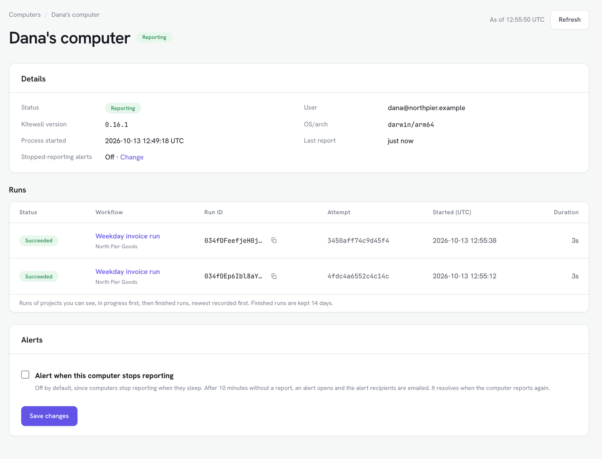

Dagu Console에서는 동기화한 프로젝트의 실행 상황을 휴대폰을 포함한 어떤 브라우저에서든 [console.dagu.sh](https://console.dagu.sh)에서 확인할 수 있습니다. 작업은 여전히 내 컴퓨터가 합니다. 콘솔이 받는 것은 실행별 상태뿐이며, 로그, 출력, 시크릿 값은 받지 않습니다.

## 필요한 것

- Dagu Cloud 계정과 [동기화한 프로젝트](/ko/docs/cloud-sync/). 무료 플랜을 포함한 모든 플랜에서 쓸 수 있습니다. 동기화하지 않은 프로젝트는 보고되지 않습니다.
- 여러 대의 컴퓨터를 확인하려면 Kitewell Team. 무료 계정과 Kitewell Personal은 각각 컴퓨터 1대까지입니다.

Dagu Console에는 컴퓨터가 사용하는 계정으로 로그인합니다. 워크스페이스 소유자는 동기화한 모든 프로젝트와 모든 컴퓨터를 볼 수 있습니다. 그 밖의 구성원은 자신에게 역할이 있는 프로젝트의 실행, 자신의 컴퓨터, 그리고 그 프로젝트를 실행한 컴퓨터를 볼 수 있습니다.

## 실행 확인하기

**모니터링** 페이지에는 Kitewell 컴퓨터와 Dagu 서버가 함께 표시됩니다.

- **개요**: 보고 중인 컴퓨터 수, 오늘의 실패, 해결되지 않은 알림, 주의가 필요한 컴퓨터.
- **컴퓨터**: 각 컴퓨터의 **상태**(**보고 중** 또는 **보고 중단**), 사용자, Kitewell 버전, 운영 체제, 마지막 보고, 진행 중인 실행과 오늘 실패한 실행. 컴퓨터를 선택하면 최근 14일 동안의 실행이 표시됩니다.
- **실행**: 모든 실행을 프로젝트, 워크플로, 상태, 시간별로 볼 수 있습니다.
- **인사이트**: 워크플로별 실행 수, 실패, 성공률, 소요 시간을 7일, 30일, 90일 기간으로 보여 줍니다.

컴퓨터는 2분마다, 또는 진행 중인 실행이 바뀌면 그보다 빨리 보고합니다. 페이지에는 페이지를 연 시점까지 도착한 내용이 표시됩니다. 최신 상태를 보려면 **새로고침**을 선택하세요.

## Dagu Console의 알림

Dagu Console은 모든 플랜에서 두 종류의 알림을 발생시킵니다.

- 워크플로 실패. 워크플로를 몇 대의 컴퓨터에서 실행하든 알림은 워크플로마다 하나입니다. 이후 어느 컴퓨터에서 실패하든 그 알림에 더해지고, 어느 컴퓨터에서든 다음에 성공하면 해결됩니다. 중단되거나 거부된 실행은 집계되지만 알림을 발생시키지 않습니다.
- 컴퓨터 보고 중단. 10분 동안 보고가 없으면 알림이 발생하고, 컴퓨터가 다시 보고하면 해결됩니다. 컴퓨터는 절전 상태가 될 때마다 보고를 멈추므로 이 알림은 기본적으로 꺼져 있습니다.

계속 켜 두는 컴퓨터를 지켜보려면, 워크스페이스 소유자가 **컴퓨터**에서 그 컴퓨터를 열고 **이 컴퓨터의 보고가 중단되면 알림**을 체크한 뒤 **변경 사항 저장**을 선택합니다.

알림이 발생할 때와 해결될 때 이메일이 발송됩니다.

- 컴퓨터 보고 중단은 워크스페이스 소유자에게 이메일로 발송됩니다.
- 워크플로 실패는 소유자가 켜야 이메일로 발송됩니다. **설정**의 **알림 이메일**에서 **소유자 및 관리자** 행의 **Kitewell**을 체크하고 **변경 사항 저장**을 선택하세요. 소유자와 그 프로젝트의 관리자에게 발송됩니다.
- **수신자 추가**로 **Kitewell**을 체크한 **멤버**나 **외부 주소**를 추가할 수 있습니다. 둘 다 컴퓨터 보고 중단과 워크플로 실패 소식을 받습니다. 멤버는 자신이 열 수 있는 프로젝트와 볼 수 있는 컴퓨터에 대해, 외부 주소는 확인을 마친 뒤 모든 프로젝트에 대해 받습니다.

### Kitewell의 알림과 Dagu Console의 알림

[Kitewell 자체 알림](/ko/docs/alerts/)은 컴퓨터에서 보냅니다. 두 알림은 함께 쓸 수 있습니다.

| | Kitewell의 알림 | Dagu Console의 알림 |
| --- | --- | --- |
| 보내는 곳 | 컴퓨터 | Dagu Cloud |
| 플랜 | Personal, Team | 모든 플랜 |
| 이벤트 | 실패, 복구, 입력 필요, 예약 실행 놓침, 오래 실행, 취소, 성공, 배치 완료 | 워크플로 실패, 컴퓨터 보고 중단 |
| 채널 | 이 기기, 이메일, Slack, Microsoft Teams, PagerDuty, 웹후크 | 이메일 |
| 컴퓨터가 절전 상태일 때 | 아무것도 보내지 않으며, 놓친 일정은 깨어난 뒤 알림 | 보고 중단 알림이 발생함 |

## Dagu Console이 보관하는 것

- 실행별 워크플로, 상태, 트리거, 시각, 실패한 단계 이름: 14일 동안. 워크스페이스에는 하루(UTC)에 완료된 실행이 최대 500건까지 보관되며, 이를 넘으면 실행 기록이 언제 다시 보관되는지 **기기 설정**에 표시됩니다.
- 인사이트용 워크플로별 일일 집계: 13개월 동안.
- 알림: 해결된 뒤 90일 동안.
- 30일 동안 보고하지 않은 컴퓨터는 그 컴퓨터가 보고한 모든 내용과 함께 삭제됩니다.

실행 상태 전송을 멈추려면 [Dagu Cloud에서 실행 확인하기](/ko/docs/cloud-sync/#follow-runs-in-dagu-cloud)에서 설명한 대로 워크스페이스 소유자가 이 기능을 끕니다. 그러면 컴퓨터는 실행 중이라는 사실만 보고합니다.
