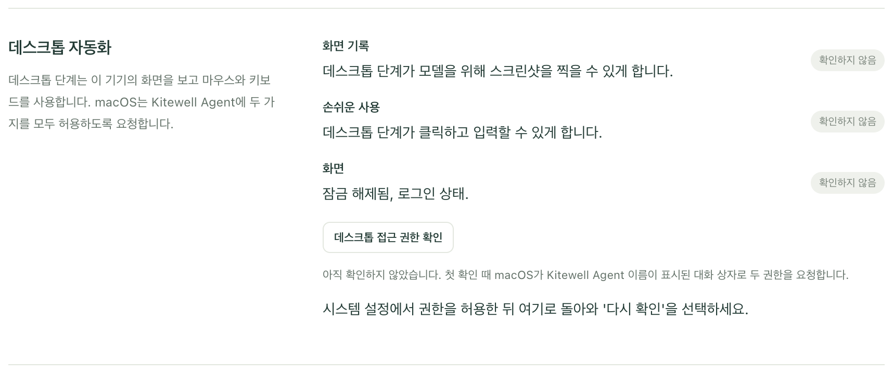
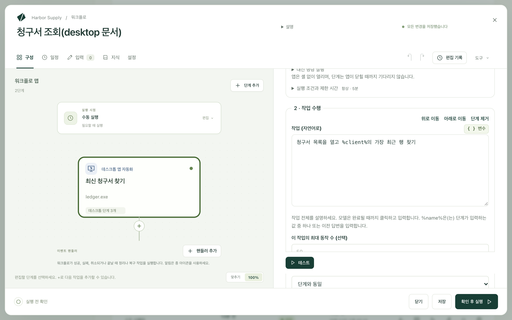

Kitewell은 사람처럼 컴퓨터의 앱을 쓸 수 있습니다. 화면을 보고, 클릭하고, 입력합니다. "%client%의 청구서를 만들고 저장하기"처럼 작업을 평범한 말로 설명하면, 모델이 작업을 끝낼 때까지 일합니다.

API가 없는 앱을 조작하는 일, 즉 데스크톱 RPA 도구가 하는 일을 손으로 녹화할 것도 관리할 선택자도 없이 해냅니다. 처음에는 모델이 작업 방법을 알아내고, 이후 실행에서는 앱이 그대로인 동안 모델 없이 그 동작을 재생합니다. Windows에서는 앱 자체의 요소로, macOS에서는 화면을 대조해 재생합니다. 앱이 더 이상 맞지 않으면 바뀐 부분을 모델에 다시 묻습니다.

그래서 API도 웹 버전도 없는 회계 패키지나 ERP 클라이언트도 자동화할 수 있습니다.

- 스프레드시트의 각 행을 회계 앱이나 영업 앱에 옮겨 입력하기.
- 데스크톱 대시보드에서 수치를 읽어 다음 단계로 넘기기.
- 메뉴로만 내보낼 수 있는 앱에서 보고서 내보내기.
- 업데이트 후 앱이 제대로 표시되는지 확인하기.

macOS와 Windows에서, 눈앞의 화면에서 동작합니다. 실행 중에는 마우스와 키보드를 쓰지만, 내가 손대는 순간 바로 돌려줍니다.

## 준비할 것

화면을 읽는 모델. 프로젝트마다 하나이며, **프로젝트 설정 → 화면 단계**에서 지정합니다. 다른 모델을 고르기 전까지는 [Kitewell의 기본 제공 모델](/ko/docs/ai/#use-kitewells-included-model)을 씁니다. API 키가 필요 없고, 모든 요금제에서 비용은 워크스페이스의 Dagu Cloud 크레딧에서 지불되며, 무료 요금제의 크레딧으로 짧게 체험할 수 있습니다. Claude Sonnet 5, GPT-5.4, Gemini 3.6 Flash처럼 내 모델로 화면을 읽으려면 **에이전트와 모델**에서 [모델을 추가](/ko/docs/ai/)한 다음 그곳에서 고르거나, 모델 페이지에서 **화면 단계에 사용**을 고릅니다. Kitewell은 먼저 그 모델에 테스트 스크린샷 한 장을 읽게 합니다. 데스크톱 단계는 단계의 **모델**이나 워크플로의 **설정 → 실행 및 재시도 → 브라우저 및 데스크톱 단계의 기본 모델**에서 다른 모델을 지정하지 않는 한 프로젝트의 모델을 씁니다. Anthropic, OpenAI, Gemini 모델은 제공업체에 컴퓨터 사용 도구가 있으면 그 도구로 화면을 조작하고, 도구를 호출할 수 있는 다른 비전 모델은 일반적인 클릭·입력 도구로 작업합니다. 다만 더 느리고 덜 안정적입니다. **데스크톱 설정**의 **모델이 데스크톱을 사용하는 방식**은 보통 **자동**입니다. **일반 도구 (모든 비전 모델용)** 옵션을 고르면 모든 모델이 일반 도구로 작업합니다.

화면을 쓸 권한. **기기 설정 → 데스크톱 자동화**를 엽니다. 각 행은 **데스크톱 접근 권한 확인**을 선택하기 전까지 **확인하지 않음**으로 표시되고, 확인한 뒤에는 **준비됨** 또는 **확인 필요**로 표시됩니다.

- Mac에서는 행이 **화면 기록**과 **손쉬운 사용**입니다. 첫 확인 때 macOS가 두 권한을 모두 묻는데, 대화 상자에는 **Kitewell Agent**라는 이름이 표시됩니다. 실제로 화면을 조작하는 Kitewell의 백그라운드 서비스입니다. 권한을 허용하세요. 대화 상자를 닫아 버렸다면 **시스템 설정 열기**로 해당 패널로 갈 수 있습니다.
- Windows에서는 행이 **로그인한 세션**입니다. 데스크톱 단계는 내가 로그인해 있는 동안 내 화면에서 실행됩니다. **로그인하지 않아도 실행**을 켜면 엔진은 백그라운드에서도 돌아가지만, 데스크톱 단계는 여전히 나를 기다리며, 그 워크플로에는 **로그인한 동안에만 실행됩니다**라고 표시됩니다. 또한 관리자 권한으로 실행되는 앱에는 Kitewell도 관리자 권한으로 실행되지 않는 한 데스크톱 단계가 클릭하거나 입력할 수 없습니다.

잠기지 않은 화면과 로그인한 사용자. 데스크톱 단계는 내가 보는 화면을 쓰므로, 잠겨 있거나 절전 중인 컴퓨터에서는 실행할 수 없습니다. 일정에 따른 실행도 마찬가지입니다.

## 첫 데스크톱 단계 만들기

이 예에서는 회계 앱을 열어 고객의 최신 청구서를 찾고, 그 번호를 다음 단계로 넘깁니다.

1. 워크플로를 열고 **단계 추가**를 선택한 뒤 **데스크톱 앱 자동화**를 선택합니다. **단계 이름**을 `최신 청구서 찾기`처럼 붙입니다. **기술 설정** 아래의 **단계 식별자**는 이 단계가 읽은 값을 나중 단계가 읽을 때 쓰는 짧은 이름입니다. `invoice`처럼 단순하게 정하세요.
2. **모델**은 **프로젝트 기본값**으로 두거나, 이 단계에 쓸 다른 모델을 고릅니다.
3. **단계가 입력하는 값**에서 **값 추가**를 선택하고, 이름을 `client`로 정한 뒤 **값**에 고객 이름을 지정합니다. 직접 입력한 텍스트, 워크플로 입력, 시크릿(로그에 절대 나타나지 않도록 저장한 비밀번호나 키) 중 무엇이든 쓸 수 있습니다.
4. **데스크톱에서의 단계**에서 **데스크톱 단계 추가**로 다음을 순서대로 추가합니다.
   - **앱 열기**: Mac에서는 **앱**을 채우거나 **앱 선택…** 버튼으로 고릅니다. Windows에서는 **프로그램**에 프로그램 경로를 채우거나 **프로그램 선택…** 버튼으로 고릅니다.
   - **작업 수행**: **작업 (자연어로)** 항목에 `청구서 목록을 열고 %client%의 가장 최근 행 찾기`
   - **화면에서 읽기**: **읽을 내용(모델에게 주는 설명)** 항목에 `그 행의 청구서 번호와 총액`을 입력하고, **읽을 값**에 두 값을 추가합니다. `number`는 **형식**을 **문자열**로, `total`은 **형식**을 **숫자**로 지정합니다

   

5. **테스트**를 선택하고, 마우스와 키보드에서 손을 뗀 채 지켜봅니다.
6. 읽은 값을 `${steps.invoice.outputs.number}`처럼 쓰는 나중 단계를 추가합니다.

새 워크플로의 **또는 예제로 시작**에는 **데스크톱 앱에서 데이터 가져오기**가 있습니다. 이 컴퓨터에 이미 있는 앱을 열고 화면에 보이는 내용을 읽는 예제입니다.

## 모델이 끝낼 수 있는 작업 쓰기

웹사이트 단계는 한 번에 동작 하나를 하지만, 데스크톱 단계는 작업 전체를 맡습니다. 모델은 작업이 끝날 때까지 클릭하고 입력하므로, 클릭 하나하나가 아니라 끝내고 싶은 일을 쓰세요.

- `청구서 목록을 열고 %client%의 가장 최근 행 찾기`
- `%client% 앞으로 %amount% 청구서를 새로 만들고 초안으로 저장`
- `이번 달 매출 보고서를 CSV로 문서 폴더에 내보내기`

**데스크톱 설정**의 **작업당 최대 동작 수**는 작업 하나가 할 수 있는 클릭과 키 입력 수의 상한입니다. 기본값은 50이며, **이 작업의 최대 동작 수 (선택)** 항목으로 작업 하나에 다른 상한을 둘 수 있습니다. 더 많은 동작이 필요한 작업은 실패하므로, 작업을 나누거나 상한을 올리세요.

## AI가 판단하는 범위

데스크톱 단계가 매번 모델에 물어야 하는 것은 아닙니다. **데스크톱 설정**의 **AI가 판단하는 범위**는 단계 전체에 적용되며, 작업 하나에 따로 지정할 수도 있습니다.

- **재생하고, 달라진 곳만 AI가 고침**(기본값)은 성공한 작업을 기록해 두고 이후 실행에서 재생합니다. 화면이 기록과 더 이상 맞지 않으면 그 지점부터 모델이 이어받고, 기록을 고칩니다.
- **매번 AI가 판단**은 모든 동작을 모델에 묻습니다. 화면에 무엇이 보이든 맞춰 대응하며, 실행할 때마다 동작마다 스크린샷을 보냅니다.
- **재생만, AI 없음**은 기록만으로 실행합니다. 제공업체에 아무것도 보내지 않고 모델도 호출하지 않습니다. 기록한 것을 더 이상 찾지 못한 단계는 즉흥적으로 대처하지 않고, 멈춰서 무엇이 바뀌었는지 알려 줍니다.

기록은 그 기록을 만든 컴퓨터에 남습니다. Windows에서는 작업을 익힌 실행에서 **이 단계 고정**을 선택하면 기록이 단계에 저장되어, 모든 Windows 컴퓨터에서 재생할 수 있습니다.

처음부터 끝까지 **재생만, AI 없음**을 쓰고 문장으로 쓴 검사가 없는 단계에는 모델이 전혀 필요 없습니다. **화면에서 읽기**는 처음에는 모델이 필요합니다. Windows에서는 이후 실행에서 가능한 경우 같은 요소를 모델 없이 다시 읽습니다. macOS에서는 실행할 때마다 모델에 물으므로, macOS에서는 **재생만, AI 없음**으로 설정하지 마세요.

## 데스크톱 단계로 할 수 있는 일

안에 있는 단계는 이 컴퓨터의 화면에서 순서대로 실행됩니다.

- **앱 열기**는 앱이나 프로그램을 시작합니다. 앱이 닫히기를 기다리지는 않습니다. Mac에서는 **대신 명령 실행**을 고르면 **명령**과 **인수 · 한 줄에 하나 (선택)** 항목을 지정합니다.
- **작업 수행**은 **작업 (자연어로)** 항목의 내용을 수행합니다. `%name%`은 단계가 입력하는 값 중 하나, 또는 앞서 내가 한 답을 입력합니다.
- **화면에서 읽기**는 **읽을 내용(모델에게 주는 설명)** 항목을 읽고 **읽을 값** 아래의 값을 채웁니다. 각 값에는 **이름**, **형식**, 그리고 모델에 그 값이 무엇인지 알려 주는 **설명(선택)** 항목이 있습니다. 나중 단계는 각 값을 `${steps.<식별자>.outputs.<이름>}` 형식으로 읽습니다.
- **다음을 확인…** 단계는 화면이 올바르지 않으면 단계를 실패시킵니다. **확인 방법**에서 방식을 고릅니다. **AI가 문장으로 판단** 방식은 **화면에 표시되어야 하는 것…** 항목을 읽고 스크린샷을 바탕으로 모델에 묻습니다. **화면에 텍스트가 있음**, **요소가 있음**, **창 제목에 포함됨** 방식은 모델 없이 맨 앞 창의 요소를 읽으며, Windows에서만 쓸 수 있습니다. **확인 지속 시간 (선택)** 동안 앱이 그 상태가 되기를 기다릴 수 있습니다.
- **대기**는 지정한 **대기 시간**만큼 기다립니다.
- **스크린샷 찍기**는 지정한 **스크린샷 이름**으로 화면 전체의 PNG를 실행 파일과 함께 저장합니다.
- **나에게 입력 요청**은 **나에게 표시할 질문**을 보여 주고 내가 답할 때까지 일시 중지합니다. **답변 이름**은 나중 단계가 그 답을 입력할 수 있도록 답에 이름을 붙입니다. 기다리는 동안 다른 데스크톱 단계가 화면을 쓸 수 있습니다.

모든 단계에는 **실행 조건과 제한 시간**도 있어, 조건이 맞을 때만 실행하고 걸리는 시간에 상한을 둘 수 있습니다. 둘 다 설정하지 않은 단계는 최대 5분 동안 실행됩니다.

## 비밀번호를 모델에 보내지 않기

**단계가 입력하는 값**에는 단계가 입력하는 모든 것을 담고, 작업에서는 `%name%`으로 부릅니다. 모델은 그 이름만 봅니다.

민감한 값에는 시크릿을 값으로 고르세요. 시크릿은 작업에도, 모델에도, 로그에도 들어가지 않습니다. 시크릿의 값을 그대로 적은 작업은 그 값을 보내는 대신 실패하며, 실행 전에 **확인 후 실행**이 이를 알려 줍니다.

## 나와 화면 나눠 쓰기

데스크톱 단계는 한 번에 하나씩 실행됩니다. 화면이 하나뿐이므로 두 번째 단계는 첫 번째 단계를 기다립니다. **각 항목 처리** 루프 안에서도, [배치 시트](/ko/docs/batches/)에서도 마찬가지로, 항목은 함께 실행되지 않고 차례로 실행됩니다.

단계는 클릭하거나 입력하기 전에 아무도 마우스나 키보드를 5초 동안 쓰지 않을 때까지 기다리고, 내가 다시 쓰는 순간 일시 중지하므로 내 입력을 가로채지 않습니다. **데스크톱 설정**의 **마우스나 키보드를 아무도 사용하지 않은 채 기다릴 시간**으로 이 대기 시간을 바꿀 수 있으며, 아무도 작업하지 않는 컴퓨터에서는 `0`으로 꺼 둘 수 있습니다.

데스크톱 단계가 실행되는 동안 메뉴 막대나 시스템 트레이의 Kitewell 아이콘이 포인터 모양으로 바뀌고, 메뉴 맨 위에 실행 중인 단계가 하나씩 표시됩니다. 각 단계는 컴퓨터를 사용하는 중, 내가 쓰는 동안 일시 중지됨, 다른 데스크톱 단계를 기다리는 중 가운데 하나입니다. 그 아래의 **중지**는 그 단계들이 속한 실행만 끝냅니다. 화면 위에는 아무것도 그리지 않습니다. 모델이 스크린샷에서 그것을 보고 클릭할 수도 있기 때문입니다.

## 실행 화면 살펴보기

**실행 및 로그**에서 실행을 엽니다. **데스크톱에서 일어난 일**에는 단계가 스크린샷과 함께 순서대로 나열되며, 단계가 내가 마우스와 키보드에서 손을 떼기를 기다린 곳이나 다른 데스크톱 단계를 기다린 곳도 표시됩니다. 그 옆에는 질문을 받은 **모델**과, 들어가고 나온 토큰 수인 **모델 사용량**이 표시됩니다.

**AI 없이 실행**은 단계의 동작 중 모델에 묻지 않고 실행된 동작이 몇 개인지 보여 줍니다. 재생된 작업, 창을 직접 읽는 검사, 앱 열기 같은 동작이 해당합니다. 재생된 동작은 모델에 아무것도 보내지 않습니다.

작업이 재생되는 방식은 시스템에 따라 다릅니다.

- Windows에서는 버튼, 필드, 메뉴에 대해 한 동작이 지금 그 요소가 어디에 있든 그 요소에 대해 재생되므로, 창이 옮겨지거나 제목이 바뀌어도 멈추지 않습니다. 그 밖의 동작은 macOS와 마찬가지로 화면을 기준으로 재생됩니다.
- macOS에서는 화면 자체를 기준으로 재생합니다. 화면 크기가 같아야 하고, 각 화면이 작업을 기록했을 때와 똑같이 보여야 합니다.

재생은 기록된 요소가 나타나거나 화면이 일치하기를 **데스크톱 설정**의 **요소를 기다릴 최대 시간**만큼 기다린 뒤에야 불일치로 판단합니다. 따로 설정하지 않으면 10초입니다.

재생이 맞지 않으면 그 지점부터 모델이 이어받습니다. **재생만, AI 없음**에서는 단계가 멈추고 무엇이 바뀌었는지 알려 줍니다. 앱이 개편된 뒤에는 **프로젝트 설정 → 저장 공간 → 재생 캐시**에서 워크플로가 기억한 내용을 지울 수 있습니다. 캐시는 이 컴퓨터에 남으며 백업에는 포함되지 않습니다.

## 제공업체가 확인을 요청할 때

일부 모델 제공업체는 구매 같은 동작을 사람에게 승인받으려고 멈춥니다. 그러면 단계도 함께 멈춥니다. **데스크톱 설정**의 **모델 제공업체가 동작 확인을 요청할 때**는 **단계 중지**이며, **계속 진행**을 고르면 그런 동작이 승인 없이 실행됩니다. 더 안전한 방법은 작업 앞에 **나에게 입력 요청** 단계를 두는 것입니다. 그러면 결정은 내가 하고, 그 결정이 실행과 함께 기록됩니다.

## 문제가 생기면

먼저 단계의 스크린샷을 보세요. 그런 다음:

- 권한이 필요하다고 단계가 알립니다. **데스크톱 접근 권한 확인**을 다시 실행하고, 행에 표시된 권한을 허용하세요.
- 화면이 잠겨 있었거나 다른 사람이 로그인해 있었습니다. 데스크톱 단계에는 내가 로그인해 있고 잠기지 않은 이 컴퓨터의 화면이 필요합니다.
- 작업이 동작 수 한도에 도달했습니다. 작업을 둘로 나누거나 **작업당 최대 동작 수**를 올리세요.
- 제한 시간 내내 누군가 마우스나 키보드를 써서 단계가 화면을 쓰지 못했습니다. 컴퓨터가 비어 있을 때 실행하거나, 단계의 제한 시간을 늘리세요.
- 브라우저가 인증서를 고르라고 묻습니다. 데스크톱 단계는 화면에 있는 브라우저를 조작하는데, Kitewell에 추가한 클라이언트 인증서는 그 브라우저에 쓰이지 않습니다. 대신 [웹사이트 단계](/ko/docs/browser/#sites-that-ask-for-a-certificate)로 사이트를 자동화하세요.

나머지는 [문제 해결](/ko/docs/troubleshooting/#a-desktop-step-fails)에 있습니다.

## 세부 사항

모델이 결정하는 동작마다 다른 열린 창까지 포함한 화면 전체의 스크린샷이 모델 제공업체로 보내지며, 그 제공업체가 요금을 청구합니다. 보여서는 안 되는 것은 실행 전에 닫거나, 다른 사람이 작업하지 않는 컴퓨터를 쓰세요. 기억에서 재생되는 동작과 창의 요소를 읽는 검사는 아무것도 보내지 않으며, 단계가 입력하는 값과 시크릿도 보내지 않습니다. 실행과 함께 저장된 스크린샷은 실행의 보존 기간에 따라 이 컴퓨터에 남습니다. [컴퓨터 밖으로 나가는 정보](/ko/docs/data-flow/)를 참조하세요.

데스크톱 단계는 macOS와 Windows에서만, 이 컴퓨터 자체의 화면에서 실행됩니다. 화면 기록을 막는 앱은 조작할 수 없으며, Windows에서 Kitewell이 관리자 권한으로 실행되지 않을 때 관리자 권한으로 실행 중인 앱도 조작할 수 없습니다.

[첫 데스크톱 단계 만들기](#build-your-first-desktop-step)의 워크플로는 두 단계입니다. `client`라는 값 하나, Numbers를 시작하는 **앱 열기** 단계, 그 고객의 가장 최근 행을 찾는 **작업 수행** 단계, 청구서 번호와 총액을 읽는 **화면에서 읽기** 단계로 이루어진 **데스크톱 앱 자동화** 단계, 그리고 그 두 값을 쓰는 나중 단계입니다.

Windows에서는 **앱 열기**에 `notepad.exe`처럼 프로그램 이름을 넣거나, 프로그램과 프로그램에 넘길 인수를 넣습니다.
