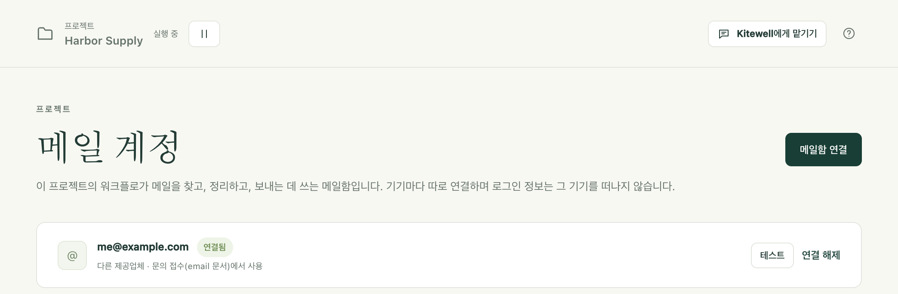
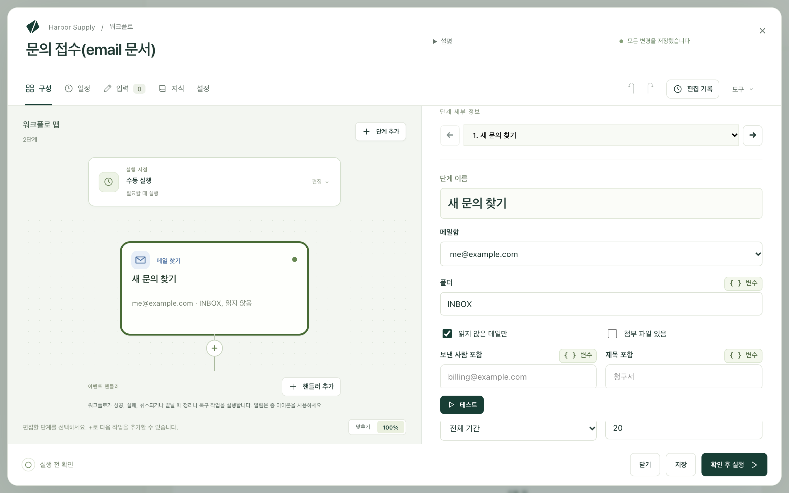

Kitewell은 받은편지함 작업을 대신할 수 있습니다. 중요한 메일을 찾아 처리하고 정리해 두거나, 직접 메일을 써서 보냅니다. 이 컴퓨터에서 연결한 메일함에서 동작하며, 로그인 정보는 이 컴퓨터 밖으로 나가지 않습니다.

받은편지함에서 시작하거나 끝나는 일:

- 읽지 않은 청구서 메일의 첨부 파일을 보관하고 금액을 기록하기.
- 지원 요청을 연결된 API로 티켓으로 만들기.
- 지난 24시간 동안 받은 메일을 요약해 다이제스트 보내기.
- 받은 메일을 모델이 고른 폴더로 분류하기.
- 요청마다 답장 초안을 쓰고, 누군가 승인하면 보내기.

## 준비할 것

이 컴퓨터에서 연결한 메일함. Gmail 또는 Google Workspace, Microsoft 365 또는 Outlook.com, iCloud, Yahoo, Fastmail, 그 밖의 모든 IMAP 메일함을 쓸 수 있습니다. 프로젝트의 **메일 계정**에는 프로젝트의 워크플로가 쓰는 메일함과, 이 컴퓨터에서 각 메일함의 상태가 나열됩니다.

메일함을 추가하려면 그곳에서 **메일함 연결**을 선택하거나, 이메일 작업의 **메일함** 필드에서 **메일함 연결…** 버튼을 선택한 뒤 주소를 입력합니다. Kitewell은 주소를 보고, 또는 사용자 지정 도메인의 메일이 가는 곳을 보고 공급자를 알아내며, 잘못 판단했다면 **공급자** 목록에서 고칠 수 있습니다.

| 공급자 | 연결 방법 |
| --- | --- |
| Gmail, Google Workspace | Google이 Kitewell을 검토하는 동안에는 앱 비밀번호 |
| Microsoft 365, Outlook.com | 브라우저에서 로그인 |
| iCloud, Yahoo, Fastmail | 공급자 사이트에서 만든 앱 비밀번호(대화 상자에 링크가 있으며, 서버 정보는 미리 채워짐) |
| 그 밖의 메일함 | IMAP 및 SMTP 서버, 포트, 보안, 사용자 이름, 비밀번호 |

브라우저 로그인은 공급자의 페이지를 열고 기다리다가, 내가 승인하면 알아서 이어집니다. 그런 다음 Kitewell이 한 번 로그인해 폴더 목록을 가져오고, 받은편지함에 읽지 않은 메일이 몇 통 있는지, 또는 로그인이 왜 실패했는지 알려 줍니다. 이 확인을 통과하기 전에는 아무것도 저장되지 않습니다.

공급자별 참고 사항:

- Google은 Kitewell의 Gmail 접근 검토를 마칠 때까지 대부분의 계정에서 Kitewell의 브라우저 로그인을 막습니다. Google 페이지에는 “이 앱이 차단됨”이라고 표시되며, 넘어갈 방법이 없습니다. 그때까지 대화 상자는 Gmail 메일함을 앱 비밀번호로 연결하도록 안내합니다. 2단계 인증을 켜고, Kitewell이라는 이름으로 앱 비밀번호를 만들어 붙여 넣으세요. 브라우저 로그인이 되는 경우에도 입력한 주소로 로그인하고 Gmail 확인란을 선택해야 합니다. 서드 파티 앱을 제한하는 Google Workspace 관리자는 API 제어에서 Kitewell을 허용해야 합니다.
- Microsoft 365 메일함은 IMAP과 인증된 SMTP가 켜져 있어야 합니다. 관리자가 Microsoft 365 관리 센터의 해당 사용자의 메일, 이메일 앱 관리에서 켭니다. 승인된 앱만 허용하는 조직에서는 관리자가 Kitewell을 한 번 승인할 수 있는 링크가 제공됩니다. 공유 메일함은 그 메일함을 열 수 있는 구성원으로 로그인해 연결합니다.
- 앱 비밀번호는 공급자 사이트에서 만들며, 그곳에서 해지할 수 있습니다.

연결은 공급자가 끊을 때까지 유지됩니다. 컴퓨터가 켜져 있는 동안 Kitewell이 브라우저 로그인을 최신 상태로 유지합니다. 로그인이 더 이상 통하지 않는 메일함에는 **메일 계정**, **개요**, 그리고 그 메일함 때문에 실패한 실행 옆에 **다시 연결**이 표시됩니다.

## 첫 이메일 워크플로 만들기

이 예에서는 지원용 받은편지함에서 읽지 않은 메일을 찾아 연결된 API로 메일마다 티켓을 만들고, 티켓이 생긴 메일을 읽음으로 표시합니다.

1. 워크플로를 열고 **단계 추가**를 선택한 뒤 **메일 찾기**를 선택합니다. **메일함**을 고르고, **폴더**는 `INBOX`로, **읽지 않은 메일만**은 켠 채로 두고, **단계 이름**을 `새 문의 찾기`처럼 붙입니다. **테스트**를 선택하면 어떤 메일이 해당하는지 볼 수 있습니다. 테스트는 아무것도 읽음으로 표시하지 않습니다.

   

2. **메일마다…** 버튼을 선택합니다. Kitewell이 단계가 찾은 메일을 도는 **각 항목 처리** 루프를 추가하며, 루프의 끝에는 현재 메일을 읽음으로 표시하는 **메일 정리** 단계가 들어갑니다.
3. 루프 안, 그 단계 앞에 **API 작업 사용**을 추가하고 티켓 시스템의 “Create issue” 작업을 고릅니다. 그 필드에서는 변수 선택기에 현재 메일의 보낸 사람, 제목, 날짜, 본문이 나타납니다.
4. 5분마다처럼 [일정](/ko/docs/scheduling/)을 추가합니다.

새 워크플로의 **또는 예제로 시작**에는 **새 메일을 하나씩 처리**가 있습니다. 이와 같은 구조에서 할 일만 직접 채우도록 비워 둔 예제입니다.

## 이메일 단계가 하는 일

**메일 찾기**는 **폴더**에서 조건에 맞는 메일을 오래된 순으로 나열하며, 각 메일의 보낸 사람, 제목, 날짜, 본문을 가져옵니다. **읽지 않은 메일만**, **첨부 파일 있음**, **보낸 사람 포함**, **제목 포함**, **받은 시기**(**전체 기간**, **지난 1시간**, **최근 24시간**, **최근 7일**, **최근 30일**)로 범위를 좁힙니다. **첨부 파일을 실행 파일에 저장**을 켜면 파일이 실행의 산출물과 함께 저장됩니다. **이하**는 가져올 개수의 상한으로, 기본값은 20, 최대값은 50이므로 쌓인 메일은 여러 번의 실행에 걸쳐 순서대로 처리됩니다. 찾기만으로는 메일이 읽음으로 표시되지 않습니다. 나중 단계는 목록을 `${steps.<식별자>.outputs.messages}` 형식으로 읽습니다.

**메일 정리**는 지정한 **메일**을 처리합니다. **메일 찾기** 단계가 찾은 메일, 그중 한 통, 또는 메일마다 어디로 갈지 적은 AI 작업의 답을 지정할 수 있습니다. **표시**에서는 **읽음으로 표시**, **읽지 않음으로 표시**, **플래그 달기**, **플래그 해제**, **그대로 두기** 중에서 고릅니다. **이동**에서는 **이동하지 않음**, **폴더로 이동**(**폴더**에 이름을 지정하며, 메일함에 그 이름의 폴더가 없으면 만듭니다), **보관**, **휴지통으로 이동** 중에서 고릅니다. 영구 삭제되는 메일은 없으며, 다른 사람이 이미 옮긴 메일은 단계를 실패시키지 않고 찾을 수 없다고 보고됩니다. **테스트**는 변경 내용을 미리 보여 주기만 합니다.

**메일 보내기**는 **보내는 주소**의 메일함에서 **받는 사람**, **제목**, **메시지**, **첨부 파일 · 한 줄에 파일 경로 하나**를 담아 보냅니다. 찾은 메일을 도는 루프 안에서 **현재 메일에 답장**을 쓰면 답장이 그 메일의 스레드에 달리며, **받는 사람**과 **제목**을 따로 지정하지 않는 한 그 메일의 보낸 사람에게 `Re:`와 원래 제목으로 보냅니다. Gmail과 Microsoft 365는 보낸편지함에 사본을 남기지만, 다른 공급자는 남기지 않을 수도 있습니다.

## 메일마다 한 번만 처리하기

**읽지 않은 메일만**을 켠 채로 두고, 루프 안에서 그 메일의 단계 바로 뒤에 메일을 읽음으로 표시하거나 옮기세요. 그러면 작업이 실패한 메일은 읽지 않은 상태로 남아, 다음 실행에서는 그 메일만 다시 시도합니다.

대신 루프 뒤에서 표시하면 실패한 메일까지 표시됩니다. 일부 항목이 실패해도 루프 뒤의 단계는 실행되기 때문이며, 그 메일은 다시는 시도되지 않습니다. 다이제스트처럼 전체 묶음을 대상으로 하는 작업이라면 마지막에 **메일 정리** 단계 하나를 두는 것이 맞습니다.

**확인 후 실행**은 찾은 메일이 전혀 표시되지 않을 때, 루프 뒤에서만 표시될 때, 그리고 메일 본문이 명령이나 명령을 실행할 수 있는 AI 에이전트에 전달될 때 경고합니다. 그 본문은 메일을 보낸 사람이 쓴 것이니 보낸 사람의 글로 취급하세요. 메일을 읽는 모델에는 명령을 실행할 수 없는 **모델에 묻기** 단계를 쓰세요.

## 팀으로 실행하기

메일함 주소는 다른 텍스트와 마찬가지로 워크플로 안에 담겨 전달되지만, 연결은 절대 전달되지 않습니다. 팀원이나 [Dagu Cloud](/ko/docs/cloud-sync/)에서 받은 프로젝트는 **개요**에 연결해야 할 메일함을 나열하며, 메일함이 필요한 실행은 이 컴퓨터에서 연결할 때까지 거부됩니다.

동기화된 프로젝트에서 메일함을 다루는 예약 워크플로는 한 번에 한 컴퓨터에서만 실행되므로, 두 컴퓨터가 같은 메일을 처리하는 일은 없습니다. 다른 컴퓨터가 이미 실행하고 있는 워크플로를 여기서 켜면 이 컴퓨터로 옮길지 묻고, 다른 컴퓨터는 다음 동기화 때 그 워크플로를 끕니다. 어느 컴퓨터가 실행하는지는 워크플로 목록에 표시됩니다.

## 문제가 생기면

- 이 컴퓨터에 메일함이 연결되지 않아 실행이 거부됩니다. **메일 계정**을 열고 **연결** 또는 **다시 연결**을 선택합니다. 공급자가 무엇을 거부했는지 대화 상자에 표시됩니다.
- Google에 “이 앱이 차단됨”이라고 표시됩니다. 그 페이지를 닫고 Kitewell로 돌아가 **대신 앱 비밀번호 사용**을 선택합니다.
- 실행할 때마다 같은 메일을 다시 찾습니다. 메일이 표시되지 않고 있습니다. 루프 안에 **표시**를 **읽음으로 표시**로 지정한 **메일 정리** 단계를 추가하세요.

나머지는 [문제 해결](/ko/docs/troubleshooting/#a-mailbox-needs-reconnecting)에 있습니다.

## 세부 사항

자격 증명은 백업, 내보내기, 동기화에 포함되지 않으며, 복원한 컴퓨터에서는 다시 연결하라고 요청합니다. 단계가 읽은 메일은 실행의 보존 기간에 따라 이 컴퓨터에 실행과 함께 저장되며, AI 작업에서 고른 모델처럼 워크플로가 보내는 곳으로만 나갑니다. [컴퓨터 밖으로 나가는 정보](/ko/docs/data-flow/)를 참조하세요.

Gmail 브라우저 로그인은 메일 읽기, 라벨 지정, 휴지통으로 이동, 보내기 권한(`gmail.modify`)을 요청하며, 영구 삭제 권한은 절대 요청하지 않습니다. 동의 페이지와 [개인정보처리방침](/privacy/)에도 그렇게 적혀 있습니다. 반면 앱 비밀번호는 메일함 전체에 대한 IMAP 및 SMTP 접근 권한을 줍니다.

**메일 찾기** 단계는 실행 한 번에 최대 50통을 가져옵니다. 전달, 초안, 메일 한 통이 도착할 때의 트리거는 없습니다. **읽지 않은 메일만**을 켠 일정이 그 역할을 합니다. IMAP이나 인증된 SMTP를 끈 Microsoft 365 테넌트는 아예 연결할 수 없습니다.

[첫 이메일 워크플로 만들기](#build-your-first-email-workflow)의 워크플로는 세 단계입니다. **읽지 않은 메일만**을 켠 **메일 찾기**, **동시에 처리할 항목 수**를 1로 지정해 찾은 메일을 도는 **각 항목 처리** 루프, 그리고 루프 안에서 티켓 시스템의 “Create issue” 작업을 쓰는 **API 작업 사용**과 그 뒤에 현재 메일을 읽음으로 표시하는 **메일 정리**입니다.
