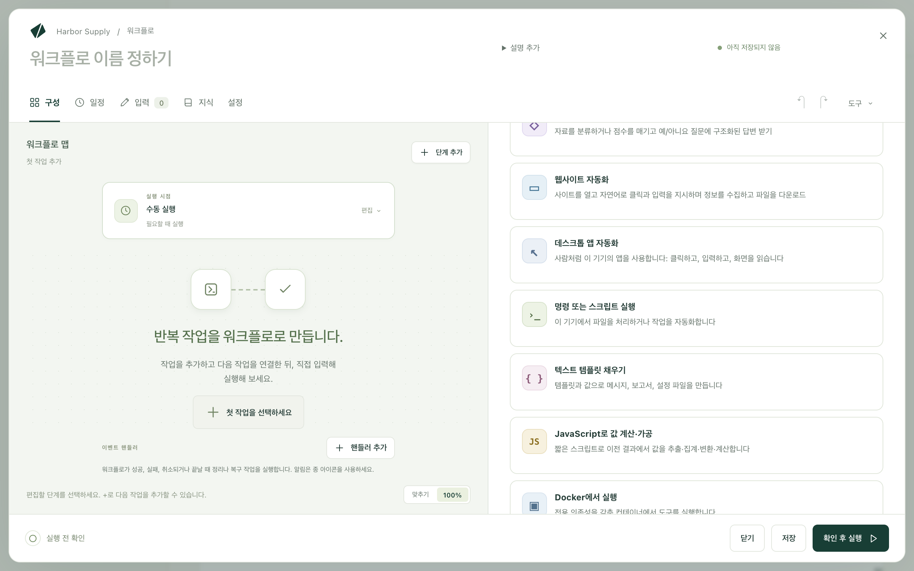
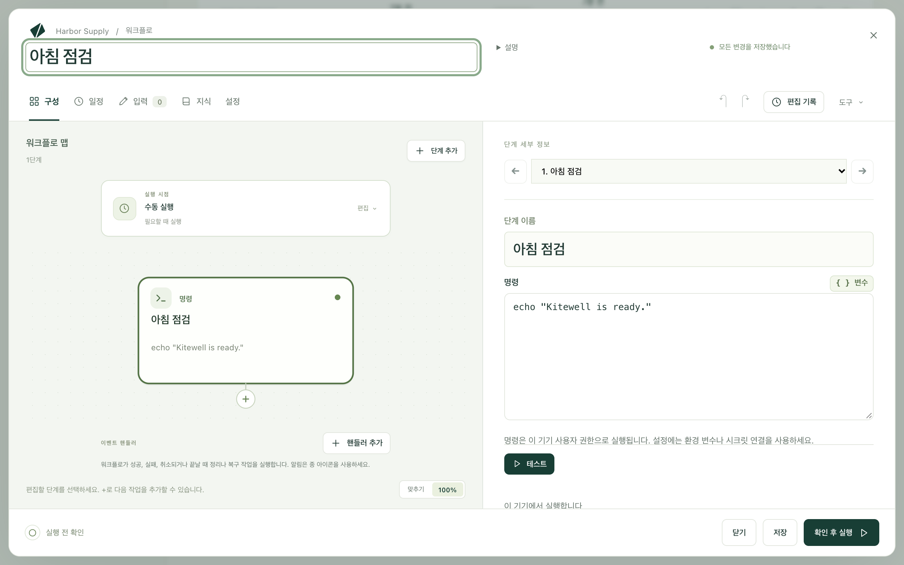
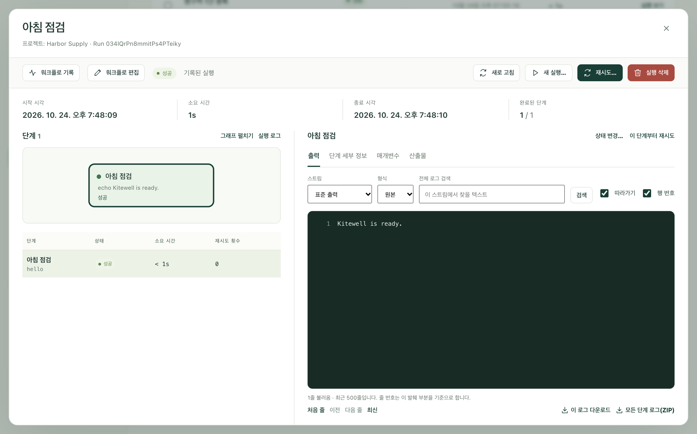

Kitewell에 맡길 일을 평범한 말로 알려 주세요. Kitewell의 AI가 내가 지켜보는 동안 그 일을 한 번 해 보고, 일정에 따라 반복하는 워크플로를 제안합니다. 이 페이지에서는 빈 채팅에서 시작해 혼자 돌아가는 실행까지, 첫 번째 일을 차례로 진행합니다.

## 준비할 것

[설치](/ko/docs/install/)해서 열어 둔 Kitewell. 처음 열 때 **로그인하고 Kitewell의 AI 사용**을 선택합니다. 브라우저에 Dagu Cloud가 열리고 대조할 코드가 표시되며, Kitewell의 기본 제공 AI를 API 키 없이 무료 크레딧 100으로 바로 쓸 수 있습니다. 대신 내 모델을 쓰려면 **이 기기에서 시작**을 선택하고 채팅에서 연결합니다. [AI 에이전트와 모델](/ko/docs/ai/)을 참조하세요.

웹사이트에서 하는 일에는 Google Chrome도 필요합니다. Windows에서는 Microsoft Edge도 됩니다.

## Kitewell에 할 일 알려 주기

1. 채팅을 엽니다. 채팅이 비어 있으면 **늘 손으로 직접 하는 일은 무엇인가요?** 하고 묻고, 시작할 만한 일을 몇 가지 보여 줍니다.
2. 그중 하나를 고르거나 직접 요청을 씁니다. 무엇을, 어디서, 언제 할지 적습니다. 예:

   > 평일마다 9:00에 [공급업체 포털 주소]에 [로그인 이메일]로 로그인해서, 새로 들어온 청구서를 [워크북 경로]의 내 시트에 추가해 주세요.

3. 보냅니다.

사이트, 파일, 시각은 적고 비밀번호는 빼세요. 비밀번호는 어시스턴트가 별도의 카드로 묻습니다.

## 작업 지켜보기

어시스턴트는 쓰기 전에 먼저 살펴보고, 필요한 것은 카드로 요청합니다.

- **허용**을 선택하면 채팅 상단에 표시되는 Kitewell 브라우저에서 사이트를 엽니다. **직접 조작**을 선택하면 나만 할 수 있는 단계를 그 브라우저에서 직접 클릭하고 입력할 수 있습니다.
- 비밀번호는 시크릿으로 저장하는 카드에 입력합니다. 어시스턴트는 그 값을 보지 못합니다.
- 살펴봐도 알 수 없는 것은 짧은 양식으로 묻습니다.

## 확인하고 적용하기

어시스턴트는 단계를 순서대로 나열하고 실행 시점을 적은 카드로 워크플로를 제안합니다. 내용을 읽은 뒤 **적용**을 선택합니다. 적용하기 전에는 아무것도 저장되거나 실행되지 않습니다.

어시스턴트가 브라우저에서 한 작업은 워크플로와 함께 남습니다. 클릭이 기록되므로, 첫 실행은 방법을 다시 알아내지 않고 그 클릭을 반복합니다.

## 실행하기

채팅에 지금 실행해 달라고 하거나, 워크플로를 열고 **지금 실행**을 선택합니다. 그런 다음 **실행 및 로그**를 열고 **실행 보기**를 선택합니다.

브라우저 단계를 선택하면 브라우저가 수행한 동작을 하나씩 볼 수 있습니다.

- **재생됨**: 기록된 클릭이나 키 입력을 AI 없이 반복한 동작.
- **복구됨**: 페이지가 바뀌어서 AI가 새 방법을 찾아내고, 다음 실행을 위해 기억해 둔 동작.
- 새 청구서처럼 페이지에서 값을 읽는 동작은 실행할 때마다 AI에 묻습니다.

단계의 **AI 없이 실행**은 모델이 필요 없었던 동작의 수입니다.

## 일정에 따라 실행

평일마다 9:00처럼 언제 실행할지 적은 요청에는 일정이 함께 붙습니다. Kitewell은 그 시각에 워크플로를 실행합니다. 창을 닫아도 괜찮습니다. 메뉴 막대나 트레이에서 계속 실행됩니다. 무인 실행에 의지하기 전에 [일정](/ko/docs/scheduling/)을 읽어 보세요.

## 문제가 생기면

- 실행이 실패했습니다. **실행 및 로그**에서 실행을 엽니다. 맨 위의 요약에 실패한 단계가 표시되고, 그 단계의 로그를 보여 주는 **실패 확인**이 있습니다.
- 워크플로가 사이트와 맞지 않습니다. 무엇이 다른지 채팅에 말하면 어시스턴트가 워크플로를 고쳐 다시 제안합니다.

## AI 없이 만들기

워크플로는 손으로 한 단계씩 만들 수도 있습니다. 가장 작은 워크플로는 명령 하나입니다.

1. **워크플로 만들기**를 선택하고 **워크플로 이름**에 `아침 점검`을 입력합니다.
2. **첫 작업을 선택하세요**를 선택한 다음 **명령 또는 스크립트 실행**을 선택합니다.

   

3. **명령**에 `echo "Kitewell is ready."`를 입력합니다.

   

4. **확인 후 실행**, **저장하고 실행…**, **실행 시작**을 차례로 선택합니다.

완료된 실행의 출력에 그 한 줄이 표시됩니다.

모든 종류의 단계는 [워크플로 구성하기](/ko/docs/workflow-builder/)에서 다룹니다.

## 세부 사항

- 명령은 Kitewell을 실행하는 사용자 계정의 권한으로 실행됩니다.
- `echo "…"`는 Windows의 PowerShell과 Mac의 셸에서 똑같이 동작하는 몇 안 되는 명령 중 하나입니다. 한 시스템용으로 쓴 명령이 다른 시스템에서 항상 실행되지는 않습니다.
