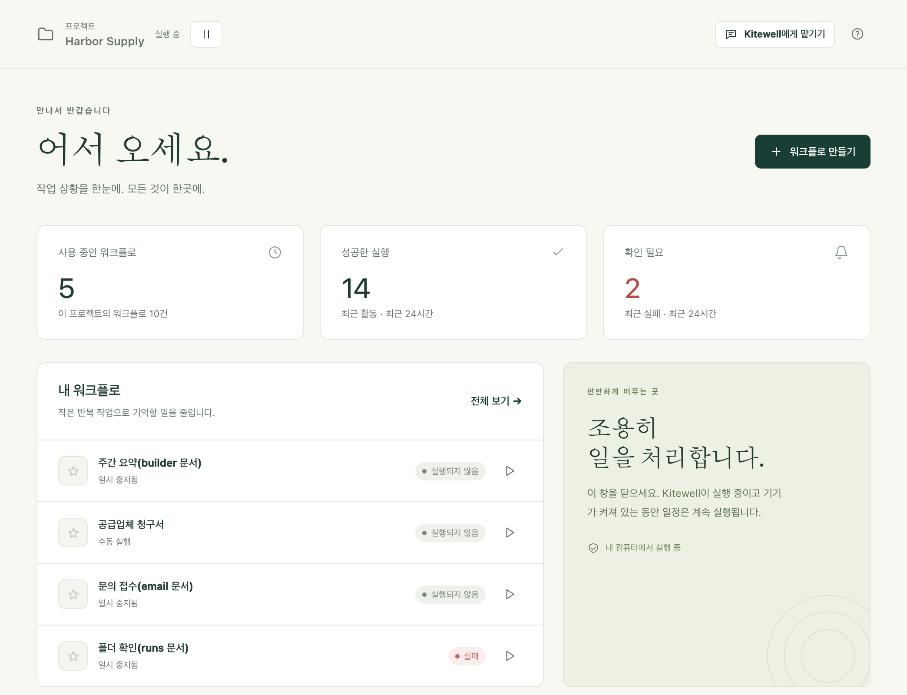

Kitewell은 팀이 손으로 하던 반복 업무를 대신 처리합니다. 업무를 한 번 설명해
두면 원하는 시각에 내 컴퓨터에서 실행되고, 모든 실행은 결과와 출력이 함께
기록으로 남습니다.

## 시작하기

1. Mac 또는 Windows PC에 [Kitewell을 설치합니다](/ko/docs/install/).
2. [첫 워크플로를 만듭니다](/ko/docs/getting-started/). 워크플로는 여러 단계로
   이루어진 하나의 반복 업무입니다.
3. [일정을 설정하고](/ko/docs/scheduling/), 무인으로 실행하려면 Kitewell에
   무엇이 필요한지 알아봅니다.
4. [팀과 워크플로를 공유합니다](/ko/docs/sharing/).

14일 체험에는 카드가 필요 없습니다.

## 워크플로로 할 수 있는 일

- **[단계를 조합해 만들기](/ko/docs/workflow-builder/)**: 명령과 스크립트,
  컨테이너, SSH로 연결한 다른 컴퓨터, 웹 요청, AI, 그리고 사람이 승인할
  때까지 기다리는 일시 중지.
- **[웹후크로 시작하기](/ko/docs/webhooks/)**: GitHub, Stripe, 양식, Zapier가
  요청을 보내면 실행이 시작됩니다. 포트나 터널을 설정할 필요가 없습니다.
- **[웹사이트](/ko/docs/browser/)**, **[데스크톱 앱](/ko/docs/desktop/)**,
  **[이메일](/ko/docs/email/)** 자동화: 코드 대신 평범한 말로 설명합니다.
- **[Excel 자동화](/ko/docs/spreadsheets/)**: 사무실에 이미 있는 워크북을
  읽고, 각 결과를 원래 행에 되돌려 씁니다.
- **[시트로 일괄 실행](/ko/docs/batches/)**: 행마다 한 번씩 실행하고, 각
  실행이 찾은 내용을 모읍니다.
- **[어시스턴트에게 묻기](/ko/docs/ai/#the-assistant)**: 워크플로 초안을
  작성하거나 고치도록 요청하고, 실패한 실행의
  [진단](/ko/docs/ai/#failure-diagnosis)을 맡깁니다.
- **[OpenAPI 명세 가져오기](/ko/docs/apis/)**: Kitewell이 명세를 바탕으로
  만든 요청 양식을 채웁니다.
- **[프로젝트 공유](/ko/docs/sharing/)** 또는
  **[Dagu Cloud 동기화](/ko/docs/cloud-sync/)**: 팀원과 프로젝트를 공유하거나,
  동기화해서 모든 사본을 똑같이 유지합니다. 각 기기는 자체 자격 증명을 쓰고,
  그 기기에서 실행해야 할 것만 켭니다.

:::note[초기 릴리스]
Kitewell은 새로 나온 제품이어서 기능과 제한이 바뀔 수 있습니다. 공개 설치
프로그램은 macOS와 Windows용입니다. Linux 지원은 계획 중입니다. 지금 받을 수
있는 버전은 [다운로드](/ko/download/)에서 확인하세요.
:::

## 요금

Kitewell은 카드 없이 쓸 수 있는 14일 체험으로 시작합니다. 컴퓨터 최대 3대에서
Team 기능을 쓸 수 있고,
[Kitewell의 기본 제공 모델](/ko/docs/ai/#use-kitewells-included-model)에 쓸
100 크레딧이 주어집니다. 체험은 Kitewell에서 Dagu Cloud에 로그인하면
시작됩니다. 체험이 끝나면 구독할 때까지 아무것도 실행되지 않으며, 프로젝트는
읽기 전용으로 컴퓨터에 남아 열어 보고 내보낼 수 있습니다. 각 프로젝트는 자체
워크플로, 기록, 시크릿을 가집니다.

Kitewell Personal은 한 사람이 컴퓨터 1대에서 자신의 업무에 쓰는 요금제로 월
20달러입니다. 워크플로를 각각 최대 100개 담을 수 있는 프로젝트 5개,
[알림](/ko/docs/alerts/), [웹후크](/ko/docs/webhooks/)를 쓸 수 있으며, 컴퓨터에
로그인해 있는 동안 실행됩니다. Kitewell Team은 최대 25명 규모의 조직용으로
컴퓨터 1대당 월 99달러입니다. 프로젝트 15개, 이를 동기화하는 팀, Windows에서
아무도 로그인하지 않아도 실행되는 기능이 포함됩니다. 이전부터 Kitewell을 써
왔다면 무료 플랜과, 아무도 로그인하지 않아도 실행되는 Personal의 기능이
2026년 12월 1일까지 계속 작동합니다. 자세한 내용은 [요금](/ko/pricing/)을
참조하세요.

## 무엇이 어디에서 실행되나요

[Dagu Cloud와 동기화](/ko/docs/cloud-sync/)하지 않는 한 프로젝트는 기기에
그대로 남습니다. 시크릿 값은 기기 밖으로 나가지 않습니다. 어시스턴트와의
대화, 실패 진단, 시트로 읽어 들인 값도 기기에 남습니다.

AI 단계는 읽은 내용을 사용자가 선택한 모델 제공업체로 보냅니다. 실행 출력,
워크플로 정의, 페이지의 텍스트 등입니다. 전송되는 곳은 모두
[컴퓨터 밖으로 나가는 정보](/ko/docs/data-flow/)에 정리되어 있습니다.

창을 닫아도 아무것도 멈추지 않습니다. Kitewell은 Mac에서는 메뉴 막대에,
Windows에서는 트레이에 남아 계속 실행되며, 일정도 계속 실행됩니다. 서비스와
워크플로 엔진을 멈추려면 그 메뉴에서 **Kitewell 종료**를 선택해야 합니다.

Mac에서 예약된 작업이 실행되려면 컴퓨터가 깨어 있고 사용자가 로그인해 있어야
합니다. Windows에서 Kitewell Team을 쓰면 로그인 서비스를 켜 두었을 때 아무도
로그인하지 않아도 예약된 작업이 실행되며, 이를 위해 PC가 절전 상태에서
깨어납니다. Kitewell은 클라우드 컴퓨터를 제공하지 않습니다. AI 제공업체, 원격
서버, 컨테이너, 외부 서비스에는 각자의 요구 사항과 비용이 있습니다.

## 세부 사항

Kitewell은 프로젝트마다 로컬 Dagu 워크플로 엔진을 실행합니다. 엔진마다 자체
데이터 디렉터리, 스케줄러, 암호화 키를 가집니다. 단계는 Kitewell을 실행하는
사용자 계정의 권한으로 실행되므로, 신뢰할 수 있는 워크플로 정의와 명령만
실행하세요.
