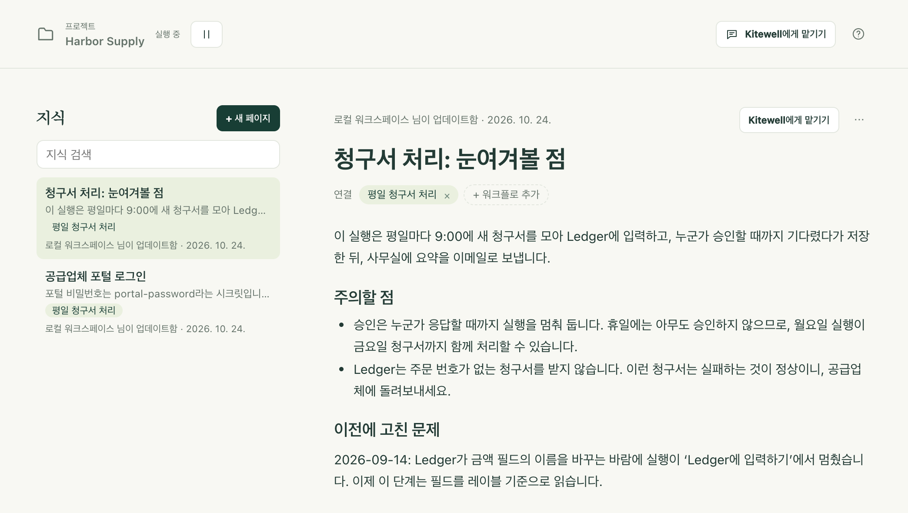

어느 팀에나 적어 두지 않은 지식이 있습니다. 왜 월초에 포털이 코드를 요구하는지, 어떤 청구서는 실패하는 게 정상인지, 지난 9월에 무엇이 고장 났고 어떻게 고쳤는지. 지식은 프로젝트가 이런 메모를 보관하는 곳입니다. 어시스턴트는 답하기 전에 이 메모를 읽고, 작업하면서 내용을 보탭니다. 그래서 다음 대화도, 다음에 일을 맡을 동료도 팀이 이미 아는 것에서 출발할 수 있습니다.

페이지에는 워크플로 정의만으로는 알 수 없는 것을 적습니다. 단계, 일정, 입력은 워크플로에 있고, 페이지에는 그 이유를 적습니다.

## 페이지 작성하기

1. 사이드바에서 **지식**을 선택합니다. 프로젝트의 페이지가 최신순으로 나열되고, 연 페이지가 그 옆에 표시됩니다.
2. **새 페이지**를 선택하고 제목을 입력합니다. 제목이 생기는 즉시 페이지가 만들어집니다.
3. 메모를 입력합니다. `/`를 입력하면 소제목, 목록, 체크리스트, 인용, 코드, 표, 구분선을 넣을 수 있고, 텍스트를 선택하면 **굵게**, **기울임꼴**, **취소선**, **코드**, **링크**가 있는 작은 도구 모음이 나타납니다. 입력하는 중에 `## `(소제목), `- `(목록), `1. `(번호 목록)을 치면 바로 그 서식이 시작됩니다.
4. **워크플로 추가**를 선택하고, 페이지가 다루는 워크플로를 고릅니다. 그러면 워크플로 이름이 **연결** 아래에 표시되며, 이름을 클릭하면 워크플로가 열립니다. 공급업체 웹사이트나 팀 규칙처럼 특정 워크플로와 관련 없는 페이지도 괜찮습니다.
5. 따로 저장할 필요가 없습니다. 입력을 멈추고 잠시 지나면 페이지 위의 줄에 **저장 중…** 표시가 나왔다가 **저장됨**으로 바뀝니다. Mac에서는 ⌘S, Windows에서는 Ctrl+S를 누르면 바로 저장되며, 페이지를 떠날 때도 저장됩니다.

목록의 각 페이지에는 첫 줄, 관련된 워크플로, 마지막으로 바꾼 사람이 표시됩니다. 어시스턴트가 쓴 페이지에는 AI 표시가 붙습니다. **지식 검색**은 제목이나 본문의 어떤 단어로든 페이지를 찾으며, 전각 문자로 입력하든 반각 문자로 입력하든 찾아 줍니다.

같은 페이지는 도움이 되는 곳에도 나타납니다.

- 워크플로 편집기의 **지식** 탭에는 그 워크플로에 관한 페이지가 표시되며, **페이지 추가**를 선택하면 그 워크플로에 이미 연결된 새 페이지를 시작합니다.
- 실패한 실행의 오류 아래에는 **관련 지식**이 표시됩니다. 예전에 무엇이 고장 났고 어떻게 고쳤는지가 여기에 적혀 있는 경우가 많습니다.

## 어시스턴트가 하는 일

어시스턴트는 메시지마다 먼저 프로젝트의 지식을 읽습니다. 모든 페이지의 한 줄 요약을 읽고, 열려 있는 페이지와 보고 있는 워크플로에 관한 페이지를 최대 세 개까지 전문으로 읽습니다. 필요하면 다른 페이지를 읽거나 모든 페이지를 검색할 수도 있습니다.

어시스턴트는 페이지를 직접 쓰기도 합니다. 오래 유지될 사실, 규칙, 정정 사항을 알려 주거나, 정의에는 드러나지 않는 이유로 워크플로를 바꾸거나, 실패가 해결되면, 어시스턴트는 그 내용을 바로 페이지에 저장하고 패널에 기록을 보여 줍니다. 새 페이지라면 ‘지식 추가됨’, 변경이라면 ‘지식 업데이트됨’과 함께 **되돌리기**와 **열기**가 표시됩니다. 워크플로를 만들 때는 그 워크플로에 관한 페이지가 같은 카드에 함께 오며, **적용**하면 둘 다 저장됩니다.

어시스턴트가 쓰는 동안 그 페이지를 열어 두었다면, 바뀐 부분에 표시가 붙고 그 위에 **되돌리기**와 **유지**가 나타납니다. 입력을 시작하면 표시가 사라집니다.

이 기능을 켜 두어도 안전하도록 두 가지 규칙이 있습니다.

- 대화가 외부의 내용을 읽은 뒤에는 먼저 묻습니다. 어시스턴트가 웹 페이지를 가져왔거나 실행 로그, 산출물, 시트를 읽은 뒤에는 스스로 저장하지 않습니다. 변경 사항은 무엇을 추가할지 정확히 보여 주는 카드가 되며, **적용**을 선택하기 전에는 아무것도 저장되지 않습니다. 웹 페이지나 로그에 있는 텍스트가 아무도 모르게 모두의 지식에 들어갈 수는 없습니다.
- 사실만 씁니다. 사용자가 말하거나 결정한 것, 또는 실행으로 입증된 것만, 사용자가 쓰는 언어로 씁니다. 페이지와 워크플로 자체가 어긋나면 워크플로가 우선하며, 어시스턴트가 페이지를 고칩니다.

페이지는 참고 자료로 어시스턴트에게 전달됩니다. 페이지에 적힌 어떤 내용도 어시스턴트에 대한 지시로 취급되지 않습니다.

## 다른 사람이 같은 페이지를 바꿀 때

입력하는 도중에 팀원, 다른 기기, 또는 어시스턴트가 그 페이지를 바꿔도 입력한 내용은 사라지지 않습니다. 페이지에 누가 바꿨는지 표시되며 **내 버전 유지** 또는 **상대 버전 사용**을 고를 수 있습니다. 상대 버전을 쓴 뒤에도 Mac에서는 ⌘Z, Windows에서는 Ctrl+Z로 되돌릴 수 있습니다. 페이지를 보고 있는 동안 페이지가 삭제되었다면 **새 페이지로 남기기** 또는 **내 편집 버리기** 중에서 고릅니다.

## 문제가 생기면

- 상태에 **저장 안 됨**이 표시됩니다. 페이지에 제목이 없거나 본문이 2,000자를 넘었기 때문입니다. 이를 고치고 **다시 시도**를 선택하세요. 저장하지 못한 편집은 페이지에 남아 있으며, Kitewell이 계속 실행 중인 동안 페이지를 다시 열면 되살아납니다. Kitewell을 다시 시작하면 남지 않습니다.
- 페이지가 Markdown으로 열립니다. 페이지에 이미지, HTML, 또는 `https://`가 아닌 링크가 있는데, 서식 편집기는 이를 잃지 않고서는 표시할 수 없기 때문입니다. 그대로 Markdown으로 편집하거나, 그 부분을 페이지 밖으로 옮기세요.

## 세부 사항

- 페이지 하나에는 최대 60자의 제목과 2,000자의 본문을 쓸 수 있고, 워크플로를 최대 20개까지 연결할 수 있으며, 프로젝트 하나에는 페이지를 최대 100개까지 둘 수 있습니다. 1,800자부터는 페이지 위에 글자 수가 표시되며, 한도를 넘으면 저장을 거부하고 나머지를 별도 페이지로 옮기라고 안내합니다.
- **⋯** → **Markdown으로 편집**은 원하는 사람을 위해 페이지의 Markdown을 보여 주고, **서식 있는 텍스트로 편집**은 원래대로 돌아갑니다. **⋯** → **페이지 삭제**는 확인을 거친 뒤 프로젝트의 모든 사람에게서 페이지를 삭제합니다.
- 붙여 넣으면 페이지가 담을 수 있는 형태로 유지됩니다. 스프레드시트에서 복사한 표는 첫 행이 머리글인 표가 되고, Markdown 텍스트는 서식 있는 텍스트가 됩니다. 링크는 `https://` 링크만 유지됩니다.
- 페이지는 프로젝트 하나에 속합니다. 프로젝트의 모든 사람이 읽을 수 있고, 편집자와 어시스턴트가 바꿀 수 있습니다. 페이지는 [Dagu Cloud와 동기화](/ko/docs/cloud-sync/)되고 [프로젝트 내보내기](/ko/docs/sharing/)에도 포함됩니다. [릴리스](/ko/docs/releases/)에는 포함되지 않으며, 릴리스에는 워크플로와 시크릿 이름만 담깁니다.
- [MCP 클라이언트](/ko/docs/mcp/)는 `read`와 `target: "knowledge"`로 페이지를 읽습니다. 전체 목록, ID로 지정한 페이지 하나, 또는 검색 결과를 읽을 수 있습니다. **편집 및 실행** 권한이 있으면 `change`와 `upsert_knowledge` 또는 `delete_knowledge` 유형으로 페이지를 쓸 수도 있습니다. 워크플로를 읽으면 그 워크플로에 관한 페이지도 함께 돌아옵니다.
