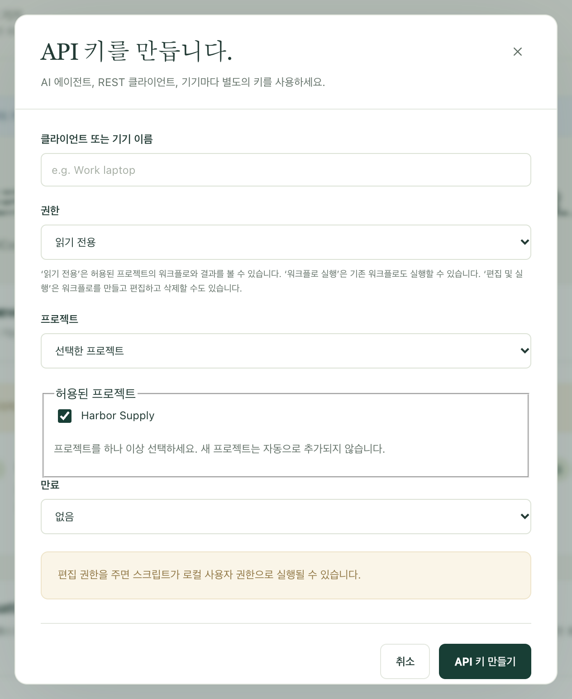
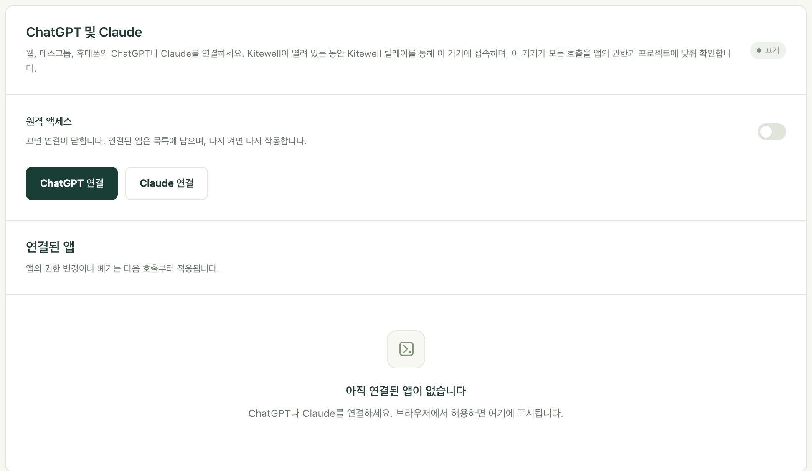

ChatGPT, Claude, Claude Code에게 워크플로 실행, 실행 내용 확인, 새 워크플로 작성을 맡기세요. 작업은 여전히 사용자 자신의 컴퓨터에서, 허용한 프로젝트 안에서만 이루어지며, 원할 때 언제든 접근 권한을 다시 회수할 수 있습니다.

## 필요한 것

- 워크플로가 있는 컴퓨터에서 Kitewell이 열려 있고, 그 컴퓨터가 깨어 있어야 합니다. 잠자기 중인 컴퓨터에는 호출이 닿지 않습니다.
- Claude Code나 Codex처럼 같은 컴퓨터에서 쓰는 어시스턴트라면 그 밖에 필요한 것은 없습니다. Kitewell은 이미 `http://127.0.0.1:19742/mcp`에서 연결을 기다리고 있습니다.
- 웹, 데스크톱, 휴대폰의 ChatGPT나 Claude라면 Dagu Cloud 계정이 필요하며, 이 컴퓨터가 그 계정으로 [로그인](/ko/docs/cloud-sync/#sign-in)되어 있어야 합니다. 이들은 자체 클라우드에서 호출하므로, 위 주소 대신 Kitewell의 릴레이를 통해 사용자의 컴퓨터에 닿습니다.

모든 설정은 **이 기기 → MCP** 한 페이지에 있습니다. 연결할 준비가 되면 **Kitewell MCP** 옆의 배지에 **수신 중**이 표시되며, 그 아래의 **Kitewell MCP URL**이 클라이언트에 알려 줄 주소입니다.


무료 플랜에서는 API 키와 연결된 앱을 합쳐 하나만 둘 수 있습니다. Kitewell Personal과 Team에서는 개수 제한이 없습니다. 하나를 폐기하면 다른 하나를 추가할 수 있습니다. 유료 플랜이 끝나면 무료 플랜 한도를 넘는 키와 앱은 7일 뒤 작동을 멈추며, 어느 것을 남길지는 직접 고릅니다. [플랜이 끝났을 때](/ko/docs/cloud-sync/#when-a-plan-ends)를 참고하세요.

## 이 컴퓨터의 어시스턴트 연결하기

Claude Code, Codex, 그 밖에 직접 실행하는 클라이언트는 이 방법으로 연결합니다. 키, 즉 클라이언트가 호출할 때마다 보내는 긴 비밀 문자열을 사용합니다.

1. **이 기기 → MCP**를 열고 **AI 에이전트 연결**을 선택합니다.
2. **클라이언트 또는 기기 이름**을 입력합니다. 예를 들어 ‘회사 노트북의 Claude Code’처럼 적습니다. 이름은 나중에 알아보기 위한 것일 뿐입니다.
3. **권한**을 고릅니다. **읽기 전용**, **워크플로 실행**, **편집 및 실행** 중 하나입니다. 각 권한으로 할 수 있는 일은 다음 섹션에서 설명합니다.
4. **프로젝트**를 고릅니다. **선택한 프로젝트**는 **허용된 프로젝트**에서 체크한 프로젝트만 허용하며, **현재 및 향후 모든 프로젝트**는 나중에 만드는 프로젝트도 포함합니다.
5. **만료**를 고릅니다. **없음**, **30일**, **90일**, **날짜 및 시간 지정** 중 하나입니다.
6. **API 키 만들기**를 선택합니다.



그러면 Kitewell이 **API 키** 아래에 키를 한 번만 보여 주며, 키를 전달하는 방법 세 가지를 함께 제공합니다.

- **Kitewell MCP URL**은 클라이언트가 접속할 주소입니다.
- **Kitewell MCP 클라이언트 설정**은 같은 내용을, 많은 클라이언트가 그대로 받아들이는 설정 블록으로 만든 것입니다.
- **AI 에이전트용 프롬프트**는 Claude Code나 Codex에 붙여 넣는 요청문으로, 붙여 넣으면 에이전트가 직접 연결을 추가합니다. 키가 들어 있으므로 신뢰하는 어시스턴트에만 붙여 넣으세요.

대화 상자를 닫기 전에 필요한 것을 복사하세요. 키는 다시는 표시되지 않습니다. 잃어버렸다면 폐기하고 새로 만드세요.

직접 설정하는 클라이언트에는 URL, Streamable HTTP, 그리고 `Authorization: Bearer <your key>` 헤더가 필요합니다. 클라이언트가 직접 입력하는 자격 증명을 지원해야 합니다. ChatGPT와 Claude는 이를 지원하지 않으므로, 아래 설명처럼 대신 로그인으로 연결합니다.

페이지로 돌아가면 **부탁할 수 있는 일**에, 연결한 어시스턴트에 복사해 넣고 시험해 볼 수 있는 요청 세 가지가 있습니다. **명령을 일정에 넣기**, **AI 에이전트 단계를 일정에 넣기**, **실패 원인 살펴보기**입니다. 모두 지금 열려 있는 프로젝트를 지정하며, 어시스턴트에게 워크플로를 확인하고 사용자가 읽어 볼 때까지 일정을 꺼 두라고 요청합니다.

## 각 권한으로 할 수 있는 일

| 권한 | 어시스턴트가 할 수 있는 일 |
| --- | --- |
| **읽기 전용** | 프로젝트, 워크플로, 실행, 그 로그, 실행이 남긴 파일, 프로젝트의 지식을 봅니다. 아무것도 바꾸지 않습니다. |
| **워크플로 실행** | 위의 모든 것에 더해, 실행 시작·재시도·다시 실행·취소, 사람을 기다리는 단계의 승인·거부·돌려보내기·완료, 대기 중인 웹사이트나 데스크톱 단계에 응답하기, 시트의 행 실행. |
| **편집 및 실행** | 위의 모든 것에 더해, 워크플로, 에이전트와 모델, 서버, 대기열, 워크플로 기본값, API 연결, 시트, 지식 페이지의 생성·변경·삭제. |

일을 해낼 수 있는 가장 작은 권한부터 시작하세요. 어젯밤 무엇이 실패했는지 물어보는 데는 **읽기 전용**이면 충분합니다. 실행을 요청하는 데는 **워크플로 실행**이면 충분합니다. 어시스턴트가 워크플로를 작성할 수 있는 것은 **편집 및 실행**뿐이며, 워크플로의 명령은 그 컴퓨터에서 사용자 본인으로 실행됩니다. 즉 파일을 바꾸고 다른 서비스에 접근할 수 있습니다. **편집 및 실행**은 그 컴퓨터에서 직접 명령을 실행하게 해도 될 만큼 신뢰하는 어시스턴트에만 주세요.

권한은 허용된 프로젝트 안에서만 적용됩니다. 컴퓨터의 나머지 부분을 잠그는 장치가 아닙니다.

연결이 볼 수 있는 것은 그 프로젝트 안에 있는 모든 것입니다. 워크플로 명령의 텍스트, 그 실행의 로그, 실행에 주어진 값도 포함됩니다. 볼 수 없는 것은 시크릿 값, 메일함 비밀번호, Dagu Cloud 로그인, 다른 API 키, 그리고 허용되지 않은 프로젝트 안의 모든 것입니다. 시크릿은 기기에 남아 있으며, 워크플로는 실행되는 동안 이름으로 시크릿을 읽습니다.

<a id="connect-chatgpt-or-claude"></a>

## ChatGPT나 Claude 연결하기

ChatGPT와 Claude는 `https://mcp.kitewell.app/mcp`를 통해, 사용자의 컴퓨터가 직접 연 연결로 컴퓨터에 닿습니다. 네트워크의 포트는 하나도 열리지 않으며, 컴퓨터는 키를 쓸 때와 똑같이 모든 호출을 승인한 권한과 프로젝트에 비추어 확인합니다.

1. Kitewell에서 **이 기기 → MCP**를 열고 **ChatGPT 연결** 또는 **Claude 연결**을 선택합니다. 아직 Dagu Cloud에 로그인하지 않은 컴퓨터는 먼저 로그인하며, **원격 액세스**가 켜집니다.
2. **권한**과 **프로젝트**를 고른 다음 **저장하고 단계 보기**를 선택합니다. Kitewell이 URL과 그 앱에서 할 절차를 보여 주며, 다음에 그 앱을 다시 연결할 때를 위해 고른 내용을 기억합니다.
3. 아래 [Claude](#claude) 또는 [ChatGPT](#chatgpt) 설명에 따라, 그 URL로 앱에 Kitewell을 추가합니다.
4. 앱이 Dagu Cloud를 엽니다. 이 컴퓨터가 로그인한 계정으로 로그인하세요.
5. 동의 페이지가 고른 내용이 채워진 채로 열립니다. 컴퓨터, 권한, 프로젝트를 확인하고, 원하면 바꾼 뒤 **허용**을 선택합니다.



그러면 앱이 **연결된 앱**에 **권한**, **프로젝트**, 연결한 시각, 마지막으로 호출한 시각과 함께 표시됩니다.

### Claude

1. Claude에서 **맞춤 설정 → 커넥터**(Customize → Connectors)를 열고 **+ 추가**(+ Add)를 선택한 다음 **맞춤 커넥터 추가**(Add custom connector)를 선택합니다.
2. 이름을 Kitewell로 하고, URL을 붙여 넣은 뒤 **계속**(Continue)을 선택합니다. 제안된 로그인 설정은 그대로 두고 **추가**(Add)를 선택합니다.
3. Dagu Cloud에 로그인하고, 권한과 프로젝트를 확인한 뒤 **허용**을 선택합니다.

Team 및 Enterprise 플랜에서는 먼저 소유자가 **조직 설정 → 커넥터**(Organization settings → Connectors)에서 Kitewell을 추가하고, 그다음 구성원이 그 항목에서 **연결**(Connect)을 선택합니다. Claude의 Free 플랜에서는 맞춤 커넥터를 하나만 쓸 수 있습니다.

### ChatGPT

ChatGPT는 웹에서만, 개발자 모드를 통해 연결합니다. 항목에 Kitewell 아이콘을 붙이려면 먼저 <a href="/kitewell-icon-256.png" download>Kitewell 아이콘(PNG)을 내려받으세요</a>. 256 × 256 px이며, ChatGPT의 10 KB 한도 안에 들어갑니다.

1. 웹의 ChatGPT에서 **플러그인**(Plugins)을 열고 **추가**(Add)를 선택한 다음 **맞춤 MCP 서버 만들기**(Create custom MCP server)를 선택합니다. 이 항목이 없다면 먼저 **설정 → 보안 및 로그인**(Settings → Security and login)에서, Business, Enterprise, Edu에서는 **설정 → 앱 → 고급 설정**(Settings → Apps → Advanced settings)에서 **개발자 모드**(Developer mode)를 켭니다.
2. 이름을 Kitewell로 하고, 원하면 Kitewell 아이콘을 추가한 뒤, **서버 URL**(Server URL)에 URL을 붙여 넣습니다. **OAuth**는 그대로 두고, **이해했으며 계속하겠습니다**(I understand and want to continue)에 체크한 다음 **플러그인으로 만들기**(Create as a plugin)를 선택합니다.
3. **Kitewell로 이동**(Proceed to Kitewell)을 선택하고, Dagu Cloud에 로그인한 뒤, 권한과 프로젝트를 확인하고 **허용**을 선택합니다.
4. **채팅에서 사용해 보기**(Try in chat)를 선택합니다. 이후에는 어떤 채팅에서든 **@** 기호를 입력하고 Kitewell을 고르거나, **+** 도구 메뉴에서 고를 수도 있습니다.

그러면 Kitewell이 **플러그인 → 개인 → 내가 만든 항목**(Plugins → Personal → Created by you)에 나타나며, 그 페이지에 로그인한 계정이 표시됩니다.

여기서의 두 가지 제한은 Kitewell이 아니라 ChatGPT 자체의 제한입니다.

- Plus와 Pro에서는 ChatGPT가 Kitewell의 읽기 전용 도구만 사용합니다. 실행을 시작하거나 워크플로를 편집하려면 ChatGPT Business, Enterprise, Edu가 필요합니다.
- Business에서는 관리자와 소유자만 개발자 모드를 쓸 수 있습니다. Enterprise와 Edu에서는 먼저 관리자가 권한을 줍니다.

ChatGPT는 맞춤 MCP 서버가 위험할 수 있다고도 경고합니다. Kitewell이 받는 것은 사용자가 승인한 권한과 프로젝트뿐입니다.

### 컴퓨터에 연결할 수 없다는 응답이 올 때

컴퓨터가 켜져 있고, 깨어 있고, Kitewell이 실행 중이어야 합니다. 그렇지 않아도 앱에는 Kitewell의 도구가 계속 나열되지만, 모든 호출에 그 컴퓨터의 Kitewell에 연결할 수 없다는 응답과 마지막으로 확인된 시각이 돌아옵니다. 그 컴퓨터에서 Kitewell을 열고 다시 요청하세요. 그래도 실패하면 [문제 해결](/ko/docs/troubleshooting/#chatgpt-and-claude)을 참고하세요.

## 접근 권한 바꾸거나 회수하기

- 키: **API 키**의 **편집**으로 비밀 값을 바꾸지 않고 이름, 권한, 프로젝트, 만료를 바꿉니다. **폐기**하면 키를 더 이상 쓸 수 없습니다.
- 연결된 앱: **연결된 앱**의 **변경**과 **폐기**를 사용합니다. ChatGPT나 Claude 쪽에서 연결을 취소해도 5분 안에 사용자의 컴퓨터에 반영됩니다.
- ChatGPT와 Claude를 한꺼번에: **원격 액세스**를 끕니다. 연결이 닫히며, 연결된 앱은 목록에 남아 있다가 다시 켜면 다시 작동합니다. 이 컴퓨터의 키에는 영향이 없습니다.

편집, 폐기, 만료는 다음 호출부터 적용됩니다. 이미 시작된 실행은 계속됩니다. 만료된 키는 만료를 연장하거나 없애면 다시 작동합니다.

워크플로의 웹후크는 같은 릴레이를 쓰지만 URL이 따로 있으며, **원격 액세스**가 꺼져 있어도 계속 작동합니다. 자세한 내용은 [웹후크로 워크플로 시작하기](/ko/docs/webhooks/)를 참고하세요.

## 무슨 일이 생기면 ChatGPT에 알리기

MCP Events를 지원하는 앱은 계속 되묻는 대신 알림을 받을 수 있습니다.

- `run.finished`: 실행이 끝났습니다. 실행 하나를 지정하거나, 알릴 결과를 지정할 수 있습니다.
- `run.needs_input`: 실행이 승인, 사람에게 맡긴 작업, 또는 질문에서 기다리고 있습니다.
- `batch.finished`: 시트 행의 [배치](/ko/docs/batches/)가 끝났습니다.
- `schedule.missed`: 예약 실행을 놓쳤습니다.

각 앱의 구독은 **연결된 앱**에서 앱 아래에 마지막 전송 시각과 함께 나열되며, **제거**로 하나씩 끝낼 수 있습니다. 앱을 폐기하면 모든 구독이 끝납니다. 구독은 **원격 액세스**가 꺼져 있는 동안 멈추며, 앱이 갱신하지 않으면 최대 1주 동안 유지됩니다. 이벤트를 찾아 보내는 것은 사용자의 컴퓨터이므로, 이벤트는 Kitewell이 실행 중일 때만 도착합니다. MCP Events는 [알림](/ko/docs/alerts/)과 마찬가지로 Kitewell Personal 및 Team 기능입니다.

## 세부 사항

### 연결에 보이는 도구

연결에는 그 권한이 허용하는 도구만 나열되므로, 읽기 전용 연결에는 쓰기 도구가 보이지 않습니다.

| 도구 | 권한 | 하는 일 |
| --- | --- | --- |
| `read` | **읽기 전용** | 프로젝트, 워크플로와 그 스키마, 로그와 산출물을 포함한 실행, 에이전트와 API 모델, 서버, 대기열, 메일함, 워크플로 기본값, 가져온 API, [배치 시트](/ko/docs/batches/)와 그 값, 프로젝트의 [지식](/ko/docs/knowledge/)을 읽습니다. 실패한 실행에 [실패 진단](/ko/docs/ai/#failure-diagnosis)이 있으면 함께 담깁니다. `target: "reference"`는 사용 안내서를 돌려줍니다. **워크플로 실행**은 다시 실행할 때 어떤 단계를 재사용할 수 있는지 미리 보는 기능을 더하고, **편집 및 실행**은 워크플로 YAML을 저장하지 않고 확인하는 기능과 이 컴퓨터의 Excel 워크북을 여는 기능을 더합니다. |
| `show` | **읽기 전용** | 워크플로의 의존 관계 그래프를 그리며, 실행을 지정하면 각 단계의 상태도 보여 줍니다. ChatGPT와 Claude에서는 진행 중인 실행을 따라가는 보기로 표시되고, 다른 클라이언트는 단계를 순서대로 텍스트로 받습니다. |
| `execute` | **워크플로 실행** | `start`, `retry`, `rerun`, `cancel`, `approve`, `reject`, `push_back`, `complete`, `answer`, `restart`, `resume`, `run_sheet`, `read_sheet_values`, `cancel_sheet`. **편집 및 실행**은 `refresh_sheet`, `link_workbook`, `unlink_workbook`을 더합니다. |
| `change` | **편집 및 실행** | 워크플로, 에이전트, 서버와 서버 그룹, 대기열, 워크플로 기본값, API 연결, 시트와 이 기기에서 시트가 실행되는 일정, 지식 페이지를 만들고, 교체하고, 삭제합니다. |
| `preview_api` | **편집 및 실행** | 전달받은 OpenAPI 문서를 읽거나 URL에서 가져와, 그 작업 목록을 보여 줍니다. 아무것도 저장하지 않지만, URL에서 가져올 때는 컴퓨터 밖에 접근합니다. |

권한이 허용하지 않는 호출(예: 클라이언트가 이전 권한일 때의 도구 목록을 계속 쓰는 경우)은 거부되며, Kitewell의 어디에서 권한을 바꿀 수 있는지 알려 줍니다.

교체나 삭제에는 항상 가장 최근에 읽을 때 받은 `version`이 필요하므로, 클라이언트가 보지 못한 변경을 덮어쓰는 일이 없습니다. 충돌하면 다시 읽고, 검토한 뒤, 의도적으로 다시 보내세요.

실행 상황을 계속 묻지 않고 따라가려면, 시작·재시도·다시 실행할 때 `execute`에, 또는 `target: "run"`과 함께 `read`에 최대 60초의 `wait`를 넘기세요. 실행이 끝나거나 사람을 기다리는 단계에서 멈추는 즉시 호출이 응답합니다. 그 전에 시간이 다 되면 그 시점의 실행 상태로 응답합니다.

연결한 워크북에 결과를 쓰는 일과 그 쓰기를 되돌리는 일은 어떤 연결에도 열려 있지 않습니다. 둘 다 사람이 앱에서 합니다.

### 프로젝트 지정하기

`target: "projects"`를 지정한 `read`는 연결이 접근할 수 있는 프로젝트만 나열하며, 따로 프로젝트를 지정할 필요가 없습니다. 그 밖의 모든 호출은 `projectId`로, REST 경로에서는 `?projectId=<id>`로 프로젝트를 지정합니다. 프로젝트 하나에만 접근하는 연결은 생략할 수 있고, 여러 프로젝트에 접근하는 연결은 하나를 지정해야 합니다. 먼저 프로젝트 목록을 요청한 다음, 요청과 이름이 맞는 프로젝트의 ID를 넘기세요.

에이전트, 서버, 대기열, 워크플로 기본값은 프로젝트에 속하므로, 같은 키라도 지정한 프로젝트에 따라 바뀌는 대상이 달라집니다.

### MCP로 API 가져오기

**편집 및 실행** 권한이 있는 어시스턴트는 OpenAPI 문서를 가져와 그 작업으로 워크플로를 만들 수 있습니다.

1. `preview_api`에 `spec`(JSON 또는 YAML 텍스트로 된 문서) 또는 `url`을 지정해 미리 봅니다. 아무것도 저장되지 않고 어떤 작업도 호출되지 않습니다.
2. `change`, `type: "upsert_api"`, `id`, `api` 정의로 저장합니다. `api.spec`을 넣거나, 생략해서 `api.sourceUrl`에서 한 번 가져오게 합니다. `api.auth.type`은 `none`, `bearer`, `apiKey`, `basic` 중 하나로 설정하고, `api.auth.secretRef`로 프로젝트에 이미 있는 시크릿의 이름을 지정합니다. 시크릿 값은 앱에서만 만들고 바꾸며, MCP로는 절대 할 수 없습니다.
3. `read`로 작업을 찾습니다. `target: "apis"`는 연결을 나열하고, `target: "api_operations"`는 `id`와 선택적인 `query`로 한 연결 안을 검색하며, `target: "api_operation"`에 `id`와 `operationId`를 지정하면 그 작업의 입력, 응답, 출발점이 될 워크플로 단계를 돌려줍니다.
4. `api.request` 단계를 추가한 다음, 평소 쓰는 도구로 워크플로를 확인하고 저장하고 실행합니다. 돌려받은 단계는 템플릿입니다. 실행하기 전에 예시를 검토하고 자리 표시자를 바꾸세요.

`upsert_api`는 연결 전체를 교체하므로, 먼저 `target: "api"`를 읽고 남기고 싶은 필드를 유지한 뒤, 그 `definitionVersion`을 `version`으로 넘기세요. `type: "delete_api"`를 지정한 `change`는 저장된 워크플로가 그 연결을 쓰지 않을 때만 연결을 제거합니다. 가져올 수 있는 문서는 [API 가져오기](/ko/docs/apis/)를 참고하세요.

### 스크립트용 REST

같은 키는 스크립트와 다른 연동을 위한 일반 HTTP 인터페이스에서도 작동합니다. 기본 주소는 MCP URL의 오리진에 `/api`를 붙인 것입니다. 이 컴퓨터에서도 모든 요청에 `Authorization: Bearer <your key>`가 필요합니다. 브라우저 자체의 로그인은 키가 아닙니다.

```http
GET /api/jobs HTTP/1.1
Host: your-host
Authorization: Bearer <Kitewell API key>
```

| 경로 | 필요한 최소 권한 |
| --- | --- |
| `GET /api/projects`, `/api/jobs`, `/api/runs`, `/api/queues` | **읽기 전용** |
| `GET /api/runs/{jobId}/{id}`, `/api/jobs/{id}/graph` | **읽기 전용** |
| `GET /api/runs/{jobId}/{id}/logs` 및 `/logs/download` | **읽기 전용** |
| `GET /api/dags/schema`, `/api/harnesses`, `/api/data/usage` | **읽기 전용** |
| `POST /api/jobs/{id}/run` | **워크플로 실행** |
| `POST /api/runs/{jobId}/{id}/resume` | **워크플로 실행** |
| `POST /api/runs/{jobId}/{id}/approvals/{stepId}/approve`, `/reject`, `/push-back` | **워크플로 실행** |
| `POST /api/runs/{jobId}/{id}/human-tasks/{stepId}/complete` | **워크플로 실행** |
| `POST /api/jobs`, `PUT` 및 `DELETE /api/jobs/{id}` | **편집 및 실행** |
| `POST /api/jobs/{id}/pause`, `POST /api/dags/validate` | **편집 및 실행** |
| `POST /api/runs/delete`, `DELETE /api/run-history/{jobId}` | **편집 및 실행** |

로그 읽기는 `stepId`, `stream=stdout`, `stderr` 또는 `run`, `tail=500` 또는 최대 500줄까지의 `offset`과 `limit`, 그리고 검색용 `query=<text>`를 받습니다. 실행 요청은 `{"params":{"region":"west"}}` 같은 본문을 받습니다.

REST는 워크플로와 배치 시트를 다룹니다. 기기 설정, 시크릿, API 키 관리, Dagu Cloud 계정, 백업, 엔진 제어는 앱에만 있으며 공개되지 않습니다. 가져온 API는 앱이나 MCP `change` 도구로 관리합니다.

### 다른 컴퓨터의 클라이언트

리스너는 `127.0.0.1:19742`에서 로컬 연결만 받습니다. ChatGPT와 Claude는 대신 릴레이를 통해 들어오므로 아래 내용은 전혀 필요 없습니다.

다른 컴퓨터의 클라이언트에는 HTTPS로 닿을 수 있는 주소가 필요하며, 그 주소는 사용자가 직접 마련하고 운영합니다. **Kitewell MCP 연결**에서 **Kitewell MCP 사용 설정**을 켠 상태로 두고, **TLS 및 원격 연결**을 열어 **공개 Kitewell MCP URL**에 `/mcp`로 끝나는 주소를 입력합니다. 그런 다음 **수신 주소**를 `127.0.0.1:19742`로 두고 직접 운영하는 HTTPS 프록시가 그 주소를 가리키게 하여 `/mcp`와 `/api/`를 모두 `Authorization` 헤더와 함께 전달하거나, 주소를 `0.0.0.0:19742`로 설정하고 **인증서 파일**과 **비공개 키 파일**에 절대 경로를 입력합니다. 마지막으로 **연결 저장**을 선택합니다.

다른 컴퓨터가 닿을 수 있는 주소로 설정하면 방화벽이 Kitewell의 연결 수락을 허용할지 묻습니다. 여기서 거부하면 모든 클라이언트가 응답을 기다리기만 하게 됩니다. Kitewell은 DNS, 인증서, 라우터 포워딩을 설정하지 않으며, 워크플로를 실행할 컴퓨터도 제공하지 않습니다. 보호되지 않은 HTTP 리스너를 절대 인터넷에 공개하지 마세요.

배지에 **사용할 수 없음**이 표시되고 다른 프로그램이 포트 19742를 쓰고 있다고 나온다면, 대개 Kitewell이 하나 더 실행 중인 것입니다. 예를 들어 설치된 앱 옆에서 개발 빌드가 실행되고 있을 수 있습니다. 그 프로그램을 종료한 다음 Kitewell을 다시 시작하세요.

키는 전체 값이 아니라 해시로만 저장됩니다. [백업](/ko/docs/backups/)을 복원해도 이 컴퓨터의 키는 유지됩니다. 키를 검토하고, 더 이상 접근하면 안 되는 키는 폐기하세요. 클라이언트의 자격 증명 설정이 분명하지 않으면 [지원팀에 문의](/ko/support/)하세요.
