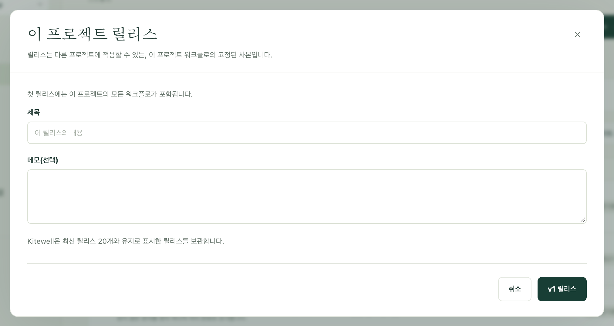

중요한 업무에 반영하기 전에 안전한 곳에서 변경을 시험해 보세요. 만드는 용도의 프로젝트와 실제로 운영하는 프로젝트를 따로 두고, 만족스러운 워크플로를 번호가 붙은 릴리스로 고정한 뒤, 준비가 되면 그 릴리스를 다른 프로젝트에 넘깁니다.

서버, 모델, API 연결, 대기열, 시크릿 값은 프로젝트마다 따로 보관되므로, 같은 워크플로가 한쪽에서는 테스트 시스템에, 다른 쪽에서는 실제 시스템에 연결됩니다.

## 필요한 것

같은 컴퓨터에 있는 프로젝트 2개 이상. 이름은 자유롭게 정할 수 있으며, 흔히 **Dev**, **Staging**, **Prod**를 씁니다. Kitewell Personal은 컴퓨터 한 대에 프로젝트를 최대 5개, Team은 15개까지 둘 수 있으므로 어느 쪽이든 충분합니다. 릴리스를 만들고 적용하려면 프로젝트 편집 권한이 필요합니다.

## 릴리스 만들기

1. 만드는 용도의 프로젝트에서 **워크플로**를 엽니다. 목록 위의 줄에 최신 릴리스와 그 이후 변경된 워크플로 수가 표시됩니다.
2. **릴리스…** 버튼을 선택합니다. 첫 릴리스에는 프로젝트의 모든 워크플로가 들어가며 대화 상자에도 그렇게 표시됩니다. 두 번째부터는 변경된 내용이 나열되고, 워크플로마다 옆에 **비교**가 있습니다.
3. **제목**을 입력하고, 필요하면 **메모(선택)** 칸에 메모를 추가한 뒤, 다음 번호가 적힌 버튼을 선택합니다. 첫 릴리스라면 **v1 릴리스**입니다.

릴리스는 프로젝트의 워크플로와 그 워크플로가 읽는 시크릿의 이름을 고정한 사본입니다. 릴리스는 바뀌지 않으므로, 그 뒤에 편집한 내용은 다음 릴리스에 들어갑니다. 최신 릴리스 이후 바뀐 것이 없으면 릴리스가 만들어지지 않으며, Kitewell이 그렇게 알려 줍니다.

Kitewell은 최신 릴리스 20개를 보관하고 그보다 오래된 릴리스는 삭제합니다. **삭제**로 더 일찍 지울 수도 있지만, 최신 릴리스는 다음 번호의 기준이 되므로 지울 수 없습니다. 삭제된 릴리스를 이미 받은 프로젝트는 그 워크플로를 그대로 유지하며, 그 릴리스를 다시 적용할 수 없을 뿐입니다.

믿을 수 있는 버전을 이후 릴리스가 몇 개 나오든 남겨 두려면 **릴리스**에서 그 옆의 **유지**를 선택합니다. 유지한 릴리스는 어느 컴퓨터에서도, Dagu Cloud에서도 제거되지 않으며, 누군가 **유지 해제**를 선택할 때까지 삭제할 수 없습니다. 최대 20개까지 유지할 수 있습니다.

[동기화한 프로젝트](/ko/docs/cloud-sync/)에서는 릴리스도 다른 항목처럼 동기화되므로, 팀원 누구나 같은 릴리스를 적용할 수 있습니다. 릴리스는 [프로젝트 내보내기](/ko/docs/sharing/)에는 빠지지만 [백업](/ko/docs/backups/)에는 들어갑니다.

## 릴리스 적용하기

1. **릴리스**를 선택한 뒤, 원하는 릴리스 옆의 **적용 대상…** 버튼을 선택합니다.
2. **적용 대상**에서 릴리스를 보낼 프로젝트, 즉 이 컴퓨터에 있는 다른 프로젝트를 고릅니다. 보기만 허용된 프로젝트는 고를 수 없습니다.
3. 미리보기를 읽습니다. **변경 내용** 열에 워크플로마다 **새 항목 · 일시 중지 상태로 도착**, 업데이트, 받는 쪽에서 편집되었고 릴리스는 바꾸지 않아서 **유지**, **변경 없음** 중 하나가 표시됩니다. **비교**로 차이를 볼 수 있습니다. 선택할 수 있는 경우 **Prod의 버전 유지**를 체크하면 받는 프로젝트의 사본이 그대로 남습니다. 이 항목에는 받는 프로젝트의 이름이 들어갑니다.

   미리보기는 이 밖에도 워크플로가 그 프로젝트에서 실행되지 않을 때, 그 프로젝트에 없는 워크플로를 호출하거나 대기열을 사용할 때, 그곳의 다른 워크플로가 이미 쓰는 이름일 때, 적용하는 즉시 효력이 생기는 일정 변경이 있을 때 경고합니다.
4. 변경 개수가 적힌 버튼(예: **변경 3개 적용**)을 선택합니다.

옮겨지는 것은 워크플로뿐입니다. 받는 프로젝트는 자신의 서버, 모델, 대기열, 시크릿 값을 그대로 유지합니다. 다만 릴리스가 읽는 시크릿의 이름은 추가되므로, 그 프로젝트의 각 컴퓨터에서 **시크릿** 또는 **개요**에서 값을 설정하세요.

새 워크플로는 일시 중지된 상태로 도착합니다. 그 프로젝트에서 실행할 워크플로를 켜세요. 이미 있던 워크플로는 켜져 있는지 여부, 실행 위치, 알림, 실패 진단 설정을 그대로 유지합니다.

미리보기를 만든 뒤에 받는 프로젝트가 바뀌었다면, Kitewell이 미리보기를 다시 확인하라고 요청합니다. 플랜의 워크플로 한도에 걸리는 등의 이유로 적용이 도중에 멈추면, 아직 적용되지 않은 항목이 미리보기에 표시됩니다. 다시 적용해 마무리하세요.

릴리스를 보낼 프로젝트가 없으면, Kitewell이 받을 프로젝트를 먼저 만들거나 다운로드하라고 알려 줍니다.

## 어디서 무엇이 실행 중인지 확인하기

릴리스를 받은 프로젝트에는 워크플로 목록 위에 **Dev의 v13**처럼 출처가 표시되고, 각 워크플로에는 어떤 릴리스로 들어왔는지가 표시됩니다. 이는 프로젝트를 동기화하는 모든 컴퓨터에 표시됩니다.

그 뒤에 그 프로젝트에서 워크플로를 편집하면 **여기서 편집됨**으로 표시됩니다. 다음 릴리스가 같은 워크플로를 건드리지 않았다면 그 편집은 기본적으로 유지됩니다. 건드렸다면 미리보기가 경고하고, 그 프로젝트 자신의 버전을 유지할 수 있게 해 줍니다.

만드는 용도의 프로젝트에서 최신 릴리스 이후 바뀐 워크플로에는 **미릴리스**가 표시되므로, 다음 릴리스에 무엇이 들어갈지 한눈에 알 수 있습니다.

## 되돌리기

이전 릴리스도 같은 방법으로 적용합니다. 다른 점은 두 가지입니다.

- 더 새로운 릴리스가 추가한 워크플로는, 그 워크플로가 들어 있지 않은 릴리스의 이름이 붙은 제목 아래에 따로 나열됩니다. 체크한 것만 제거됩니다.
- 이전 릴리스가 대체하는 워크플로는 모두 이 컴퓨터에 있는 프로젝트의 편집 기록에도 남으므로, 하나만 따로 되돌릴 수 있습니다.

릴리스를 실행하는 프로젝트 쪽에서 시작할 수도 있습니다. **Dev의 v13** 옆의 **Dev의 릴리스…** 버튼을 선택하면 그 프로젝트의 릴리스가 표시되고, 여기에서 실행 중인 릴리스에는 **여기에서 실행 중**이 표시됩니다. 원하는 릴리스에서 **여기에 적용**을 선택하세요. 다른 프로젝트가 같은 컴퓨터에 있을 때 사용할 수 있습니다.
