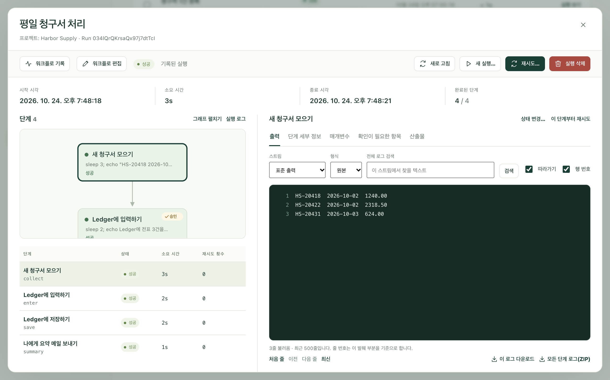
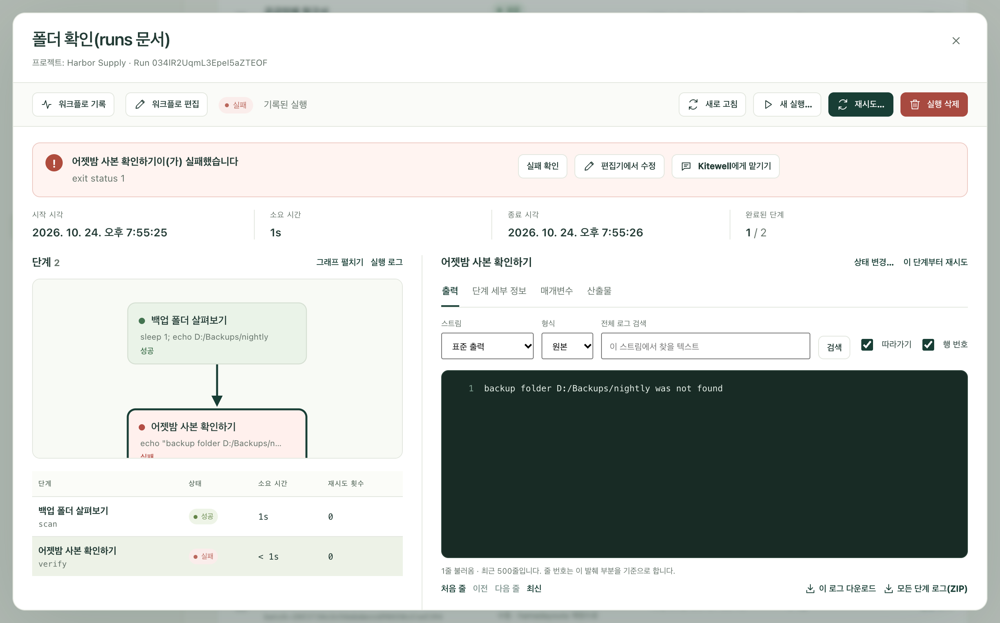

워크플로가 실행될 때마다 Kitewell은 무슨 일이 있었는지 기록합니다. 어떤 단계가 실행되었는지, 각 단계가 무엇을 출력했는지, 어떤 파일을 만들었는지, 결국 어떻게 끝났는지를 남깁니다. 잘 끝난 실행은 다시 들여다볼 일이 거의 없습니다. 잘 안 됐을 때 원인을 찾아 바로잡는 곳이 바로 여기입니다.

사이드바의 **실행 및 로그**를 열면 **실행 기록**이라는 제목 아래에 그 기록이 표시됩니다.

## 원하는 실행 찾기

최신 실행이 맨 위에 있습니다. 실행이 너무 많으면 목록을 좁혀 보세요.

- **워크플로**로 한 워크플로의 실행만 남깁니다. **모든 워크플로**를 고르면 전부 표시됩니다.
- **생성 기간**으로 기간을 정합니다. 처음에는 **최근 7일**로 열리며, 선택지는 **전체 기간**까지 있습니다.
- **실행 ID**는 식별자를 알 때 실행 하나를 찾아 줍니다. 식별자는 목록에서 워크플로 이름 아래에 표시되는 짧은 코드로, 거기서 복사할 수 있습니다.
- **필터 적용**을 선택하면 필터가 적용되고, **초기화**를 선택하면 해제됩니다. 초기화하면 기간이 **전체 기간**으로 넓어집니다.

목록 위쪽의 **모든 실행**, **실행 중 / 대기 중**, **대기 중**, **실패**, **놓침**, **성공**, **취소됨**으로 결과 종류를 바꿔 볼 수 있습니다. **놓침** 행은 실행이 아닙니다. 실행 없이 지나간 예약 시각을 표시하고 그 이유를 알려 줍니다. [일정](/ko/docs/scheduling/#sleep-and-the-runs-that-were-missed)을 참고하세요. 그 위의 **이 페이지**, **진행 중**, **실패한 실행**, **성공률**은 현재 페이지에 있는 실행을 집계합니다.

각 행에는 어떤 워크플로가 실행되었는지, 어떻게 끝났는지, 무엇이 계기가 되어 시작했는지, 언제 시작해 얼마나 걸렸는지가 표시됩니다. 계기는 수동, 예정됨, 예약 테스트, 따라잡기, 재시도, API, 웹후크, 하위 워크플로 중 하나입니다.

이 페이지에는 다음 기능도 있습니다.

- **대기열**은 대기열마다 실행 중인 수와 기다리는 수를 보여 주며, 기다리는 실행을 대기열에서 뺄 수 있습니다.
- **업데이트 일시 중지**는 읽는 동안 목록이 새로 고쳐지지 않도록 멈춥니다. 누르면 **업데이트 재개**로 바뀝니다.
- **이 페이지 내보내기**는 화면에 보이는 행을 스프레드시트 파일로 저장합니다. 다른 페이지의 실행은 내보내지 않습니다.
- **배치**는 [배치 시트](/ko/docs/batches/)를 엽니다.

## 실행 읽기

행 끝의 **실행 보기**를 선택합니다. 실패한 실행이면 **실패 확인**을 선택합니다.

실행은 별도 화면으로 열립니다. 맨 위에는 **시작 시각**, **소요 시간**, **종료 시각**, 그리고 **완료된 단계** 수가 표시됩니다.

왼쪽의 **단계**는 실행을 맵으로 그린 다음, 각 단계의 **상태**, **시각**, **재시도 횟수**를 나열합니다. **그래프 펼치기**는 맵을 넓게 보여 주고, **실행 로그**는 단계가 아닌 실행 자체의 기록을 보여 줍니다.

오른쪽에는 선택한 항목이 표시됩니다. 단계를 선택하면 다음을 볼 수 있습니다.

- **출력**: 단계가 출력한 내용입니다. **스트림**으로 **표준 출력**과 **오류 출력(stderr)** 사이를 전환합니다. 실패한 단계는 오류 출력부터 열립니다. **실행 로그**에서는 대신 **실행 이벤트**가 표시됩니다.
- **단계 세부 정보**: 단계가 어떻게 끝났는지, 무엇을 하도록 지시받았는지 보여 줍니다.
- **매개변수**: 이 실행에 주어진 값입니다.
- **산출물**: 실행이 저장한 파일입니다.
- **항목**: 목록을 차례로 처리한 단계에 나타나며, 항목마다 한 행씩 표시됩니다.
- **확인이 필요한 항목**: 누군가 응답해야 할 때 나타납니다.

## 로그 검색하고 보관하기

로그는 길어질 수 있으며, 창에는 가장 최근 부분이 표시됩니다.

- **전체 로그 검색**은 화면에 보이는 부분뿐 아니라, 보고 있는 스트림의 파일 전체에서 찾습니다. 텍스트를 입력하고 **검색**을 선택하세요. 로그가 길어 더 찾아볼 부분이 남아 있으면 **검색 계속**이 표시됩니다.
- **처음 줄**, **이전**, **다음 줄**, **최신**으로 로그 안을 이동합니다. **따라가기**는 실행이 진행되는 동안 최신 줄을 계속 보여 주고, **행 번호**는 줄마다 번호를 붙입니다.
- **이 로그 다운로드**는 보고 있는 스트림을 저장합니다. **모든 단계 로그(ZIP)** 버튼은 모든 단계의 로그를 파일 하나로 저장합니다.

## 사람이 처리해야 할 때

사람을 기다리는 실행은 맨 위에 그 사실과 기다리는 단계 수를 표시하며, **단계 확인**으로 바로 이동할 수 있습니다. 이런 실행은 목록의 **대기 중** 탭에도 있습니다.

**확인이 필요한 항목**에는 기다리는 단계마다 카드가 하나씩 있습니다. 사람에게 맡긴 작업에는 **작업 완료**가, 승인에는 **승인**, **돌려보내기**, **실행 거부**가 있고, 질문을 한 자동 단계에는 **내 답변**을 입력합니다. [워크플로 만들기](/ko/docs/workflow-builder/#stop-and-ask-a-person)를 참고하세요.

## 실패한 실행 바로잡기

실패한 실행을 열면 맨 위에 실패 내용, 즉 어떤 단계가 어떻게 실패했는지가 표시됩니다.

여기서 할 수 있는 일은 다음과 같습니다.

- **실패 확인**은 실패한 단계를 선택해 그 출력을 읽을 수 있게 합니다.
- **편집기에서 수정**은 그 실행 시점의 워크플로를 엽니다. 실행의 입력과 앞 단계가 모은 값이 채워진 상태입니다. 단계를 고친 다음 **저장하고 계속…** 버튼을 선택하고 **시작 단계**를 고르면, Kitewell이 같은 입력과 파일로 그 지점부터 새 실행을 시작합니다. 실패한 실행은 기록에 남습니다.
- **어시스턴트에게 묻기**는 실패를 [어시스턴트](/ko/docs/ai/#the-assistant)에게 넘겨 원인을 찾고 수정안을 제안하게 합니다.
- [실패 진단](/ko/docs/ai/#failure-diagnosis)을 켜 두면, 그 실패에 어떤 조치가 필요한지와 어느 단계를 살펴보면 되는지도 실행에 표시됩니다.

## 다시 실행하기

- **재시도…** 버튼은 같은 실행을 같은 실행 ID로 이어 갑니다. 이때 실행에 기록된 워크플로와 입력을 사용합니다. **재시도 범위**에서 **실패 및 미완료 단계** 또는 **선택한 단계**를 고른 뒤 **재시도 시작**을 선택합니다. 이전 시도도 실행의 일부로 남습니다.
- 단계 출력 위에 있는 **이 단계부터 재시도**는 같은 양식을 그 단계에서 엽니다. 뒤따르는 작업까지 다시 하려면 **이후 단계도 재시도**를 사용합니다.
- **새 실행…** 버튼은 새 ID로 별도의 실행을 시작합니다. 기록된 입력이 미리 채워져 있으며 바꿀 수 있습니다. **실행 방식**에서는 지금 저장된 워크플로와 이 실행이 기록한 워크플로 중 하나를 고릅니다. **새 실행 시작**을 선택하세요. 원래 실행은 기록에 남습니다.
- **실행 중단**은 아직 진행 중이거나 대기 중인 실행을 멈춥니다.
- 단계 출력 위에 있는 **상태 변경…** 버튼은 단계를 실행하지 않고 **성공** 또는 **실패**로 기록합니다. 단계가 낳은 결과를 손으로 바로잡았을 때 씁니다. 실행 전체의 결과는 다시 계산됩니다. 실행이 끝났고 남은 자동 재시도가 없을 때 선택할 수 있습니다.

## 실행 삭제하기

**실행 삭제**는 끝난 실행 하나를 로그, 출력, 파일과 함께 지웁니다. 목록에서 여러 개에 체크하고 **삭제…** 버튼을 선택할 수도 있습니다. 아직 진행 중이거나 방금 끝난 실행은 지워지지 않고 남으며, Kitewell이 그 사실을 알려 줍니다.

직접 정리할 필요는 없습니다. Kitewell은 하루에 한 번, **기기 설정 → 실행 기록 보관 → 실행 기록 보관 기간**(처음 값은 30일)보다 오래된 실행을 지웁니다. **프로젝트 설정 → 저장 공간**에는 워크플로마다 기록이 차지하는 용량이 표시되며, 워크플로마다 **기록 삭제…** 버튼이 있습니다.

## 실행이 만든 파일

사이드바의 **산출물**에는 프로젝트에서 끝난 모든 실행이 저장한 파일이 최신순으로 표시됩니다. 단계는 `$DAG_RUN_ARTIFACTS_DIR`에 파일을 쓰거나, 단계 편집기에서 **산출물 이름(선택)** 항목을 채우면 파일을 저장합니다.

**워크플로**, **생성 기간**, **파일 이름**으로 거를 수 있고, 종류로도 거를 수 있습니다. 종류는 **모든 파일**, **마크다운**, **이미지**, **데이터**, **텍스트 및 로그**입니다. 파일을 선택하면 미리 보기가 나오고, **전체 화면으로 보기**는 창 가득 보여 주며, **실행 열기 →** 버튼은 그 파일을 만든 실행으로 이동합니다. **더 오래된 파일 보기**로 더 이전까지 거슬러 올라갈 수 있습니다. 파일은 실행과 함께 삭제되며 [백업](/ko/docs/backups/)에 포함됩니다.

## 문제가 생기면

- **원하는 실행이 목록에 없습니다.** 기간은 최근 7일로 시작합니다. **생성 기간**을 넓히거나 **초기화**로 필터를 해제하세요.
- **있어야 할 버튼이 없습니다.** 재시도, 중단, 대기 중인 단계에 응답하기, 상태 변경에는 워크플로를 실행할 권한이 필요합니다. 실행 삭제, **편집기에서 수정**, **어시스턴트에게 묻기**에는 편집 권한이 필요합니다.
- **오래된 실행이 사라졌습니다.** 보관 기간보다 오래된 실행은 하루에 한 번 삭제되며, 워크플로를 삭제하면 그 기록도 함께 사라질 수 있습니다.

## 세부 사항

- 목록은 한 페이지에 실행을 최대 50개까지, 생성 시각이 최신인 것부터 보여 줍니다. 기간과 정렬은 실행이 생성된 시각을 기준으로 하며, 재시도해도 그 시각은 바뀌지 않습니다.
- 열어 둔 실행은 진행 중인 동안 3초마다 스스로 다시 읽어 들입니다.
- 로그 창은 한 번에 500줄씩 불러옵니다. 실행을 열면 단계 로그의 마지막 500줄과 실행 자체 이벤트의 마지막 200줄이 표시됩니다. 검색은 한 번에 일치하는 줄을 최대 100줄까지 돌려주며, 30초가 지나면 멈추고 어디서부터 이어서 찾으면 되는지 알려 줍니다.
- **모든 단계 로그(ZIP)** 파일에는 모든 단계의 표준 출력과 오류 출력이 들어 있습니다. 실행 자체의 이벤트 로그는 들어 있지 않으니 따로 내려받으세요.
- **상태 변경…** 버튼은 단계 하나에만 적용되며 실행 전체에는 쓸 수 없고, **성공** 또는 **실패**로만 설정할 수 있습니다.
