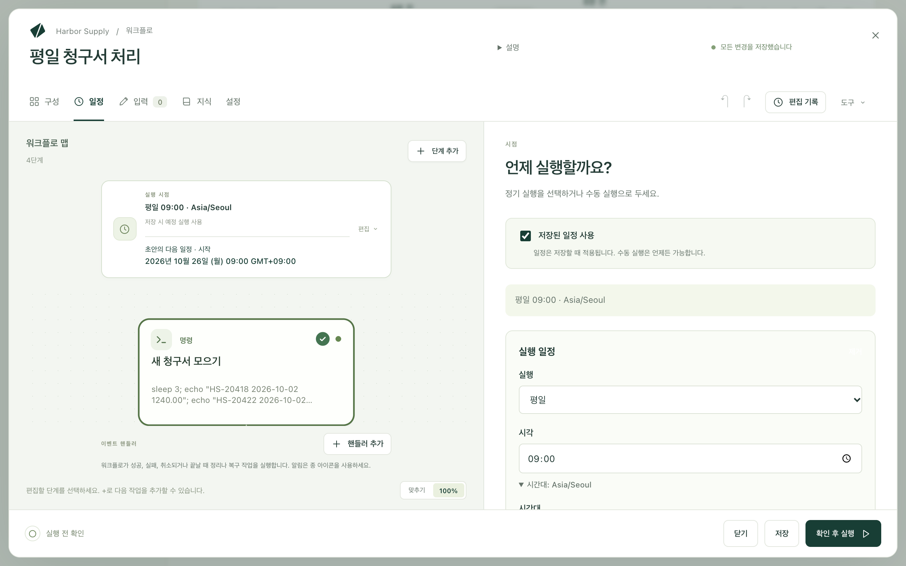

Kitewell은 워크플로를 대신 시작할 수 있습니다. 평일마다 9:00에, 한 시간마다, 또는 다른 서비스가 요청을 보낼 때 시작합니다. 작업은 이 컴퓨터에서 이루어집니다. Windows에서는 로그인 여부와 관계없이 실행되고, Mac에서는 로그인해 있는 동안 실행됩니다.

## 일정 설정하기

1. 워크플로를 열고 **일정**을 선택합니다.
2. **저장된 일정 사용**에 체크되어 있는지 확인합니다.
3. **실행**에서 빈도를 고릅니다. **매일**, **평일**, **매주**, **매시간**, **사용자 지정 일정** 중에서 선택합니다.
4. 시각을 정합니다. 사용자 지정 일정에는 다섯 필드로 된 cron 식을 입력합니다.
5. 시각이 특정 지역 기준이라면 **시간대**를 엽니다. 그대로 두면 일정은 일광 절약 시간을 포함해 이 컴퓨터의 시계를 따릅니다.
6. **저장**을 선택합니다.

양식 아래의 **다음 예약 이벤트 5개**에는 워크플로가 실제로 실행될 시각이 표시됩니다. 그 아래 한 줄에는 이 컴퓨터에서 일정이 어떻게 될지가 나옵니다. **로그인 여부와 관계없이 실행됩니다**, **로그인한 동안에만 실행됩니다**, **실행되지 않습니다** 중 하나이며, 이유와 함께 문제를 해결하는 버튼이 표시됩니다.

**지금 예약 테스트**는 일정이 실행할 때와 똑같이 워크플로를 한 번 실행하고 그 실행을 엽니다. 밤사이 실행을 일정에 맡기기 전에 먼저 사용해 보세요.

## 오늘 밤 실행이 이루어질지 확인하기

**워크플로** 목록에도 각 워크플로의 다음 시작 시각 아래에 같은 판정이 표시됩니다. 페이지 맨 위의 배너는 오늘 밤 실행을 가로막는 문제를 한 줄로 알려 주고, 그 옆에 해결 방법을 보여 줍니다. 가로막는 문제가 없으면 배너는 나타나지 않습니다.

판정은 다음을 살펴봅니다. 컴퓨터에 로그인되어 있을지, 프로젝트와 그 엔진, 일시 중지되었거나 보류된 워크플로, 화면이 필요한 단계, 사용자 비밀번호가 필요한 브라우저 로그인, 다른 시간대로 작성된 일정입니다.

## 아무도 로그인하지 않아도 실행하기(Windows)

**기기 설정 → 로그인하지 않아도 실행**을 켭니다. 비밀번호 없이 관리자 확인을 한 번만 거치면 작은 Windows 서비스인 Kitewell sign-in이 설정됩니다. 이 서비스는 PC가 켜질 때 엔진을 시작하고, 로그인 여부와 관계없이 사용자 본인의 계정으로 일정을 실행합니다.

그곳의 카드에는 실행 계정, 로그인, 엔진, 다음 예약 실행, 절전 상태가 표시되며, 서비스를 다시 끌 수도 있습니다.

두 종류의 단계는 여전히 PC 앞에 사용자가 있어야 합니다. 데스크톱 단계, 그리고 브라우저 창을 표시하는 웹사이트 단계입니다. 이런 단계가 있는 워크플로에는 **로그인한 동안에만 실행됩니다**라고 표시됩니다. 그 밖의 단계는 로그인 여부와 관계없이 실행됩니다.

카드의 **내 비밀번호 사용…** 버튼은 선택 사항입니다. 워크플로에 네트워크 공유 폴더가 필요하거나, Windows가 사용자 비밀번호로 보호하는 웹사이트 로그인이 필요할 때 추가하세요. **비밀번호 삭제**로 다시 지울 수 있습니다. Microsoft 계정이나 회사 계정은 로그인 자체에 비밀번호가 필요할 수 있습니다. 그런 경우 카드에 그렇게 표시되고 비밀번호를 묻습니다.

## Kitewell 계속 실행해 두기

창을 닫아도 아무것도 멈추지 않습니다. Kitewell은 Mac에서는 메뉴 막대에, Windows에서는 알림 영역에 남아 있습니다. Mac의 **로그인 시 열기**와 Windows의 **로그인 시 시작**은 로그인할 때 Kitewell을 엽니다. **Kitewell 종료**는 Mac에서는 엔진을 멈춥니다. Windows에서 서비스가 켜져 있으면 창이 없어도 엔진은 계속 실행됩니다.

## 절전과 놓친 실행

Windows에서 서비스가 켜져 있으면 PC는 예약 실행 전후로 절전 모드에 들어가지 않으며, 전원 관리 옵션이 절전 모드 해제 타이머를 허용하면 다음 실행을 위해 절전 모드에서 깨어납니다. Mac에서는 잠자기 중인 컴퓨터가 아무것도 실행하지 않습니다. **기기 설정 → 잠자기 방지**를 켜면 작업이 실행되는 동안 잠자기에 들어가지 않습니다.

실행 없이 지나간 예약 시각은 **실행 및 로그**에 **놓침** 행으로 나타나며 이유가 함께 표시됩니다. 기기가 절전 모드였거나, Kitewell이 실행되고 있지 않았거나, 프로젝트 엔진이 실행되고 있지 않았거나, 실행이 시작되지 않은 경우입니다. 행에는 따라잡기로 보충될지가 표시되고, 보충한 실행이 있으면 그 실행으로 연결됩니다.

따라잡기는 컴퓨터가 돌아온 뒤 놓친 시작을 실행하며, 기본적으로 24시간 전까지 거슬러 봅니다. **일정 → 놓친 일정**에서 바꿀 수 있습니다.

## 문제가 생기면

- **시각이 됐는데 아무것도 실행되지 않았습니다.** **실행 및 로그**를 열고 **놓침** 행을 찾아보세요. 이유가 적혀 있습니다. 그다음 워크플로의 다음 시작 시각 아래에 있는 판정을 확인하세요.
- **엉뚱한 시각에 실행되었습니다.** 일정의 **시간대**와 **다음 예약 이벤트 5개**의 시각을 확인하세요.
- **컴퓨터가 깨어난 뒤 여러 실행이 한꺼번에 시작되었습니다.** 따라잡기 때문입니다. **놓친 일정 처리 방식**을 **놓친 회차 중 최신 항목만 실행**으로 바꾸거나, 따라잡기를 **끄기**로 설정하세요.
- **판정이 ‘실행되지 않습니다’로 나옵니다.** 옆의 버튼을 누르세요. 이유에 따라 서비스를 켜거나, 비밀번호를 묻거나, 엔진을 시작하거나, 편집기를 엽니다.

다른 증상은 [문제 해결](/ko/docs/troubleshooting/)을 참고하세요.

## 일정 더 알아보기

나머지는 [일정 참조](/ko/docs/reference/scheduling/)에서 다룹니다. 각 판정의 의미, Windows 서비스와 그 서비스가 하는 일과 하지 않는 일, 따라잡기 설정과 한도, 대기열, 웹후크, 메뉴 항목입니다.
