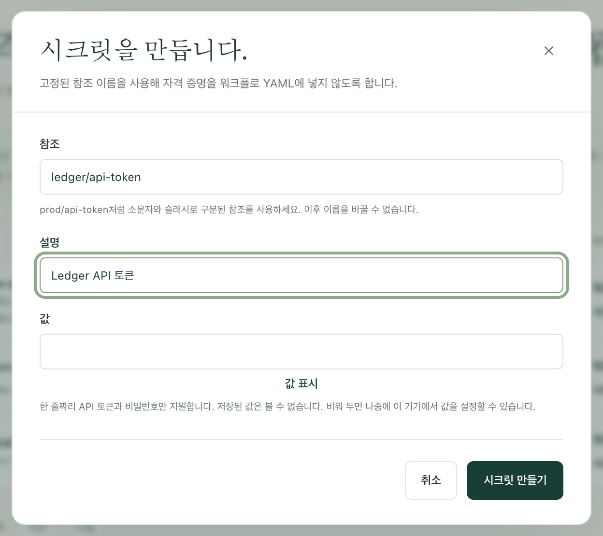
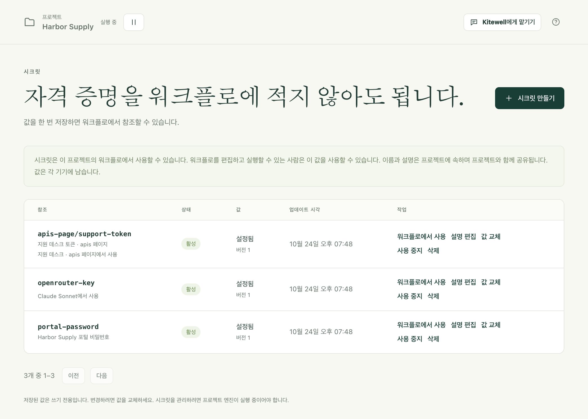

워크플로에는 비밀번호, API 토큰, 키가 필요할 때가 많습니다. 이를 시크릿(Kitewell이 대신 보관하는 자격 증명)으로 한 번 저장해 두면, 워크플로는 이름으로 그 값을 읽습니다. 누구도 다시 입력할 필요가 없고, 워크플로 정의에 값이 나타나지 않으며, 로그에는 값 대신 `*******`가 표시됩니다.

## 필요한 것

- 편집할 수 있는 프로젝트. **시크릿**은 사이드바의 **더 보기**에 있습니다. Dagu Cloud를 통해 보기 권한으로 공유된 프로젝트에서는 이 기기의 값을 설정할 수는 있지만 시크릿을 만들 수는 없습니다.
- 실행 중인 프로젝트. 프로젝트가 일시 중지되어 있으면 페이지에 **이 프로젝트는 일시 중지되었습니다**가 표시됩니다. **재개**를 선택하세요.

## 자격 증명 저장하기

1. **더 보기 → 시크릿**을 열고 **시크릿 만들기**를 선택합니다.
2. 워크플로가 사용할 이름을 **참조**에 입력합니다(예: `services/api-token`). 영문 소문자, 숫자, 하이픈을 사용하고, 각 부분은 슬래시로 구분합니다. 참조는 나중에 바꿀 수 없습니다.
3. 다음 사람이 무엇을 여는 자격 증명인지 알 수 있도록 **설명**을 추가합니다.
4. 자격 증명을 **값**에 입력합니다. **값 표시**로 붙여 넣은 내용을 확인할 수 있습니다. 비워 두면 나중에 이 기기에서 값을 추가할 수 있습니다.
5. **시크릿 만들기**를 선택합니다.

시크릿은 목록에 **활성**으로 표시되며, 값은 **설정됨**, **버전**은 1입니다. 값 자체는 여기서도 다른 어디에서도 다시 표시되지 않습니다.

## 워크플로에서 사용하기

워크플로 편집기에서 단계의 입력란에 `${`를 입력하고 **시크릿** 아래에서 시크릿을 선택합니다. Kitewell이 시크릿을 워크플로에 연결하고 입력란에 이름을 넣습니다. 값은 들어가지 않습니다.

다른 세 페이지에서도 값 대신 이름으로 시크릿을 지정합니다.

- 모델의 API 키(**에이전트와 모델**).
- 서버나 점프 호스트의 비밀번호(**서버**).
- 가져온 API의 자격 증명이나 클라이언트 시크릿(**API 라이브러리**).

YAML을 직접 작성하려면 시크릿 행에서 **워크플로에서 사용**을 선택합니다. Kitewell이 최상위에 붙여 넣을 `secrets:` 블록을 보여 줍니다. 이 블록에는 단계가 값을 읽을 환경 변수의 이름이 들어 있습니다. 예를 들어 `services/api-token`이라면 `SECRET_API_TOKEN`입니다.

[웹사이트 단계](/ko/docs/browser/)나 [데스크톱 단계](/ko/docs/desktop/)에서는 **브라우저가 입력하는 값** 또는 **단계가 입력하는 값**에서 시크릿을 선택합니다. 지시와 모델에는 `%name%` 형태로 쓴 값의 이름만 보이며, 값은 단계가 직접 입력합니다.

[어시스턴트](/ko/docs/ai/#the-assistant)는 워크플로를 만드는 도중에 시크릿을 요청할 수 있습니다. 그 이름으로 시크릿을 추가하라는 카드가 나타나면, 자격 증명을 **값**에 입력하고 **저장**을 선택합니다. 입력한 내용은 어시스턴트에게 보이지 않습니다.

## 기기에 아직 값이 없을 때

시크릿의 이름과 설명은 프로젝트에 속하고, 값은 그 값을 입력한 기기에 속합니다. 가져오기나 [동기화](/ko/docs/cloud-sync/)로 들어온 프로젝트에는 이름은 있지만 값은 따로 설정해야 합니다.

- **값 필요**는 프로젝트가 사용하지만 이 기기에 값이 없는 시크릿에 표시됩니다. **값 설정**을 선택하세요.
- **개요**에는 이 기기에 아직 필요한 시크릿이 모두 나열되고, 각각 옆에 **값 설정**이 있습니다.
- **이 기기에만 있음**은 이 기기에는 있지만 프로젝트에는 없는 시크릿에 표시됩니다. **선언**을 선택하면 프로젝트에 추가됩니다.
- **사용 워크플로**로 시작하는 줄에는 각 시크릿을 필요로 하는 대상(모델, 워크플로, 서버, API)이 표시되므로, 어떤 자격 증명을 찾아야 할지 알 수 있습니다.

값이 설정될 때까지 Kitewell은 작업을 도중에 실패시키지 않고 처음부터 거부합니다. 수동, 웹후크, AI 에이전트, 어시스턴트 중 무엇으로 시작한 실행이든 시작 전에 멈추고 “시크릿 페이지에서 …의 값을 설정한 뒤 다시 실행하세요.”라고 표시됩니다. 실행 재시도, 다시 실행, 계속, 배치 시작, 시트 행 새로 고침, 단계 하나 테스트도 마찬가지입니다. 시트의 일정은 그 시점에 아무것도 시작하지 않고 이유를 표시합니다. 워크플로 자체의 일정은 거부되지 않으며, 실행이 시작된 뒤 실패합니다.

## 변경하거나 삭제하기

- **값 교체**는 같은 참조로 새 자격 증명을 저장합니다. **버전** 번호가 올라가며, 이 시크릿을 사용하는 곳은 편집할 필요가 없습니다.
- **설명 편집**은 설명만 바꿉니다.
- **사용 중지**를 선택하면 시크릿을 읽을 수 없게 되지만 값은 남습니다. 이 시크릿이 필요한 실행은 시작된 뒤 실패합니다. **사용 설정**으로 되돌릴 수 있습니다.
- **삭제**는 프로젝트에서 시크릿을, 이 기기에서 그 값을 삭제합니다. 프로젝트를 동기화하는 다른 기기에서는 이름이 사라집니다. 값을 가지고 있던 기기에서는 그 기기에서도 삭제할 때까지 값이 남으며 **이 기기에만 있음**으로 표시됩니다. 아직 무언가가 사용하는 참조는 **사용 워크플로**와 함께 목록에 남으며, 다른 시크릿이 필요합니다.

## 문제가 생겼을 때

- **“시크릿 페이지에서 …의 값을 설정한 뒤 다시 실행하세요.”** 이 기기에 그 시크릿의 값이 없습니다. **시크릿**을 열고 **값 설정**을 선택한 뒤 다시 실행하세요.
- **“이 프로젝트는 일시 중지되었습니다”가 표시될 때.** **재개**를 선택한 뒤 다시 시도하세요.
- **여러 줄로 된 값이 거부될 때.** 한 줄짜리 토큰과 비밀번호만 지원됩니다. 여러 줄에 걸친 키는 단계가 읽는 파일 등 다른 방법으로 단계에 전달해야 합니다.
- **“already has a value on this device”가 표시될 때.** 시크릿을 만들어도 저장된 값을 덮어쓰지 않습니다. 대신 **값 교체**를 사용하세요.

## 보호되는 것과 보호되지 않는 것

시크릿은 프로젝트 엔진이 디스크에 암호화해 저장합니다. 이를 복호화하는 키 자체도 운영 체제가 보관하는 기기 키로 봉인됩니다. Windows에서는 이 PC만 열 수 있는 키이므로, 데이터 폴더를 복사해도 다른 곳에서는 아무것도 읽을 수 없습니다. 실행이 이어지는 동안에는 그 실행의 모든 단계가 워크플로에 연결된 시크릿을 받습니다.

이것은 샌드박스가 아닙니다. 이 프로젝트의 워크플로를 편집하고 실행할 수 있는 사람은 누구나 시크릿을 읽는 단계를 작성할 수 있으며, 단계는 Kitewell을 실행하는 사람의 권한으로 실행됩니다. 프로젝트를 나누면 시크릿은 나뉘지만, 명령이 할 수 있는 일이 제한되지는 않습니다.

Kitewell은 로그, 실행 세부 정보, 출력에서 시크릿 값과 정확히 일치하는 부분을 `*******`로 표시합니다. 단계가 인코딩하거나, 잘라 내거나, 변환한 뒤 출력한 값은 가려지지 않을 수 있으며, 단계가 파일이나 산출물에 쓴 값도 가려지지 않습니다. 자격 증명을 출력하지 마세요.

## 내보내기, 동기화, 릴리스, 백업

| 프로젝트가 가는 곳 | 이름과 설명 | 값 |
| --- | --- | --- |
| 프로젝트 [내보내기](/ko/docs/sharing/) | 참조까지 모두 포함 | 제외 |
| [Dagu Cloud 동기화](/ko/docs/cloud-sync/) | 프로젝트와 함께 동기화 | 전송하지 않음 |
| [릴리스](/ko/docs/releases/) | 워크플로가 읽는 것만 포함 | 제외 |
| 기기 [백업](/ko/docs/backups/) | 포함 | 키와 함께 제외 |

프로젝트를 받은 사람에게는 각 시크릿이 **값 필요**로 표시되며, 각자 자신의 값을 설정합니다.

백업을 복원하면 이 기기가 가진 값이 지워집니다. 백업을 만든 기기에서 복원해도 마찬가지입니다. 자격 증명을 다시 입력하세요. 복원 결과에는 프로젝트마다 최대 5개가 이름으로 표시되고, **시크릿**과 **개요**에는 아직 필요한 시크릿이 모두 나열됩니다. 복구에 필요한 자격 증명은 따로 안전하게 기록해 두세요.

Dagu Cloud가 프로젝트의 새 시크릿을 받아들이지 않아도 값은 이 기기에 저장되며, **이 기기에만 있음**으로 표시됩니다. 프로젝트를 동기화하는 다른 사람에게는 선언될 때까지 보이지 않습니다. 단, 동기화된 무언가가 이미 그 이름을 사용하고 있다면 보입니다.

내보내기와 백업은 암호화되지 않습니다. 워크플로, OpenAPI 파일, 소스 URL에 직접 입력한 자격 증명은 입력한 그대로 아카이브에 남습니다. 공유하기 전에 아카이브를 검토하고, 공유 저장소에 두기 전에 직접 암호화하세요.

## 세부 정보

- 참조는 `^[a-z0-9][a-z0-9-]*(/[a-z0-9][a-z0-9-]*)*$`에 맞아야 하며 최대 80자입니다. 설명은 한 줄이며 최대 200자입니다.
- 엔진의 로그 마스킹이 한 줄씩 작동하므로 값은 한 줄만 허용됩니다.
- 저장소는 `engines/<project>/data/secrets`에 있는 Dagu의 AES-256-GCM 시크릿 레지스트리입니다. 그 키는 기기 키 `device.key`로 봉인되어 `engines/<project>/key.sealed`에 보관됩니다. Windows는 기기 키를 이 PC 전용으로 봉인하며, Mac에서 기기 키는 내 사용자만 읽을 수 있는 파일입니다. 이 중 어느 것도 백업에 들어가지 않습니다.
- 기기 키는 1년에 한 번 갱신되며, 그 키로 봉인된 모든 것이 다시 봉인됩니다. **기기 설정 → 저장된 비밀 정보**에 갱신 시기가 표시되고, **지금 새 키 만들기**도 있습니다. Windows를 다시 설치한 경우처럼 키가 없어지면 같은 곳에 그 사실이 표시되고, 저장된 모든 값을 다시 입력하라는 요청이 나타납니다. 워크플로와 그 데이터는 영향을 받지 않습니다.
- 엔진은 실행이 시작될 때 그 실행의 시크릿을 읽어 환경 변수로 단계에 전달합니다. Kitewell 자신이 값을 읽는 것은 사용자를 위해 쓸 때뿐입니다. 어시스턴트나 시트가 쓰는 모델의 키, API를 연결할 때의 클라이언트 시크릿, 어시스턴트의 브라우저가 입력하는 값, 그리고 어시스턴트의 시험 실행 보고에서 가리는 값입니다.
- 목록에는 한 페이지에 시크릿 50개가 표시되며, **이전**과 **다음**으로 이동합니다.
- 컨테이너 레지스트리, 메일함, API의 로그인 정보는 엔진 내부 값으로 보관되며 여기에는 나열되지 않습니다. **프로젝트 설정**, **메일 계정**, **API 라이브러리**에서 관리하세요.
