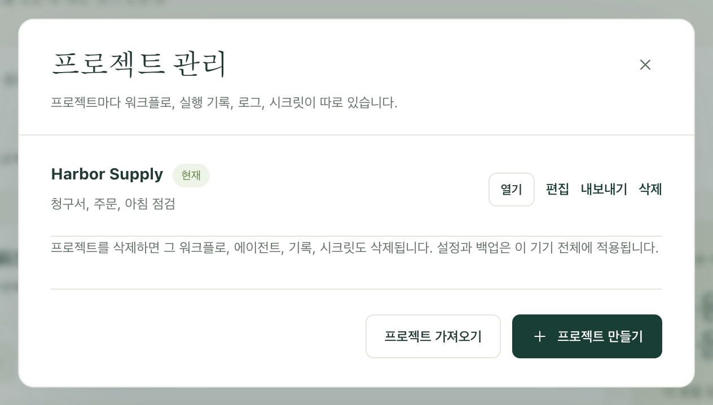

정해진 작업을 한 번 만들어 두면 프로젝트 전체를 동료에게, 또는 자신의 두 번째 컴퓨터에 넘길 수 있습니다. 받는 쪽은 워크플로와 그 워크플로에 필요한 설정의 이름을 받으며, 이쪽에 남아 있어야 할 것은 아무것도 받지 않습니다. 비밀번호도, 실행 기록도, 메일함 로그인도 넘어가지 않습니다.

워크플로가 바뀌어도 모든 사본을 똑같이 유지하려면, 대신 [프로젝트를 Dagu Cloud와 동기화](/ko/docs/cloud-sync/)하세요. 내보내기는 그 시점의 스냅샷이므로, 무언가를 편집하는 순간 최신 상태가 아니게 됩니다.

## 다른 컴퓨터로 프로젝트 보내기

1. 사이드바 맨 위의 프로젝트 선택기를 열고 **관리**를 선택합니다.
2. **프로젝트 관리**에서 프로젝트 옆의 **내보내기**를 선택합니다. Kitewell이 파일 하나를 내려받습니다. 파일 이름에는 `kitewell-project-harbor-supply-20261005T091500.tgz`처럼 프로젝트 이름과 시각이 들어갑니다.
3. 팀에서 평소 파일을 주고받는 방법으로 파일을 보냅니다.
4. 받는 컴퓨터에서 **프로젝트 관리**를 열고 **프로젝트 가져오기**를 선택한 뒤 파일을 고릅니다.
5. Kitewell이 ‘나머지는 이 기기에서 준비해야 합니다’라고 표시하고, 빠진 것을 나열합니다. 값이 필요한 시크릿, 연결할 메일함, 아직 아무도 호스트 키를 승인하지 않은 머신, 사용자 지정 명령, 그리고 일시 중지 상태로 도착한 워크플로입니다. **열기**를 선택하고 목록을 위에서부터 처리하세요.



가져오면 항상 새 프로젝트가 만들어지며, 기존 프로젝트를 대체하는 일은 없습니다. 같은 이름의 프로젝트가 이미 있으면 Kitewell이 다른 이름을 묻습니다.

새 프로젝트는 그 컴퓨터의 한도에 포함됩니다. 무료 플랜에서는 프로젝트 1개, Kitewell Personal에서는 최대 5개, Team에서는 최대 15개입니다. 플랜이 허용하는 것보다 워크플로가 많은 프로젝트(무료 플랜은 10개, Personal과 Team은 100개)는 아예 가져올 수 없습니다. 파일 자체는 최대 16 MiB까지 가능합니다.

## 넘어가는 것과 넘어가지 않는 것

파일에는 프로젝트가 일반 문서 묶음으로 담겨 있습니다.

- 워크플로 정의와 그 일정
- 이름을 붙인 에이전트와 모델
- 가져온 OpenAPI 문서와 API 연결 설정
- 서버 주소와 서버 그룹, 대기열, 이미지 레지스트리
- 배치 시트
- 시크릿의 이름과 설명(값은 절대 포함되지 않음)
- 프로젝트의 워크플로 기본값과 [지식](/ko/docs/knowledge/)
- 프로젝트가 마지막으로 받은 릴리스

나머지는 받는 컴퓨터가 직접 준비합니다.

- 시크릿 값과 레지스트리 비밀번호
- SSH 비공개 키 경로와 승인된 호스트 키
- 사용자 지정 에이전트 명령, 설치된 도구, 에이전트 로그인
- 메일함 연결
- 외부 스크립트, 입력 파일, Docker에 마운트하는 데이터

전혀 포함되지 않는 것: 실행 기록, 로그, 산출물, 릴리스, 로컬 편집 기록, 프로젝트 알림 규칙, 실패 진단 설정, 웹사이트 로그인, 기기 설정, 이 컴퓨터의 API 키.

:::caution
파일은 암호화되지 않습니다. 워크플로 명령, OpenAPI 문서, 서버 주소, 그 밖의 프로젝트 설정에 직접 입력한 내용은 적힌 그대로 넘어갑니다. 파일을 보내기 전에 이 항목들을 읽어 보고, 자격 증명은 [시크릿](/ko/docs/secrets/)에 보관해 이쪽에 남도록 하세요.
:::

## 어느 컴퓨터가 일정을 실행할지 정하기

가져온 워크플로는 일부러 일시 중지된 상태로 도착합니다. 먼저 하나를 직접 실행해 결과를 확인한 다음, 이 컴퓨터가 맡을 일정을 켜세요.

두 컴퓨터가 같은 일정을 모두 켜면 두 컴퓨터가 각자 그 일정을 실행합니다. 한 번만 이루어져야 하는 작업이라면 실행할 컴퓨터를 하나 정하고 다른 사본은 일시 중지 상태로 두세요. 그 컴퓨터는 해당 시각에 켜져 있고 깨어 있어야 합니다. [일정과 백그라운드 동작](/ko/docs/scheduling/)을 참고하세요.

## 한 컴퓨터의 워크플로를 팀원이 다루게 하기

작업은 한 머신에 그대로 두고, 동료들은 그 작업을 시작하거나 지켜보거나 바꾸기만 하면 될 때가 있습니다. 그럴 때는 프로젝트 사본 대신 각자에게 키를 주세요.

1. 그 컴퓨터에서 **이 기기 → MCP**를 엽니다.
2. **AI 에이전트 연결**을 선택하고, 사람마다 또는 클라이언트마다 키를 하나씩 만들어 역할에 맞는 **권한**을 줍니다. 보기만 하려면 **읽기 전용**, 작업을 시작하려면 **워크플로 실행**, 워크플로를 바꾸려면 **편집 및 실행**입니다.
3. **허용된 프로젝트**에서 각 키를 그 사람에게 필요한 프로젝트로 제한합니다.

그러면 팀원들은 어떤 MCP 클라이언트로든, 또는 일반 HTTP 요청으로 그 컴퓨터를 다룰 수 있습니다. 무료 플랜에서는 API 키와 연결된 앱을 합쳐 하나만 둘 수 있으며, Kitewell Personal과 Team에서는 개수 제한이 없습니다. 조직의 구성원이 이런 식으로 한 컴퓨터를 공유하려면 Kitewell Team이 필요합니다. [요금](/ko/pricing/)을 참고하세요. 모든 실행은 여전히 그 컴퓨터의 사용자로 이루어지므로, 키가 제한하는 것은 사람이 닿을 수 있는 프로젝트이지, 워크플로가 실행된 뒤 할 수 있는 일이 아닙니다. 앱 자체의 선택적 로그인은 별개이며, 이 키로 그 로그인 계정이 만들어지지는 않습니다.

다른 컴퓨터의 클라이언트에는 HTTPS로 닿을 수 있는 주소가 필요하며, 이는 사용자가 직접 마련합니다. 그 방법과 권한의 전체 내용은 [MCP와 API 액세스](/ko/docs/mcp/)를 참고하세요.

## 정의를 버전 관리하기

프로젝트의 문서는 일반 JSON 및 YAML 파일이므로, 팀은 자체 Git 저장소에서 이를 검토하고 버전 관리할 수 있습니다. Kitewell은 그 저장소에 대해 push, pull, merge를 대신 해 주지 않습니다.

파일은 Kitewell의 데이터 폴더 아래에 있습니다. Mac에서는 `~/Library/Application Support/Kitewell`, Windows에서는 `%LOCALAPPDATA%\Kitewell`입니다.

```text
data/workspace/project-<id>/
  project.json
  workflows/
  batch-sets/
  knowledge/
  agents/  apis/  queues/  registries/  secrets/  server-groups/  servers/
  releases/
```

`project.json`에는 프로젝트의 이름, 설명, 워크플로 기본값, 마지막으로 받은 릴리스가 들어 있습니다. `workflows`에는 워크플로마다 YAML 파일 하나, `batch-sets`에는 배치 시트마다 파일 하나, `knowledge`에는 지식 페이지마다 파일 하나, `releases`에는 릴리스마다 파일 하나가 있고, 나머지 각 폴더에는 에이전트, API 연결, 대기열, 레지스트리, 시크릿 이름, 서버 그룹, 서버마다 JSON 파일이 하나씩 있습니다. `project-<id>` 폴더 전체를 버전 관리하세요. 어느 폴더인지는 그 안의 `project.json`에 있는 이름으로 찾습니다. 파일 구성과 문서 ID는 그대로 유지하세요.

파일을 교체하거나 저장소의 변경 사항을 적용하기 전에 Kitewell을 종료하고, 충돌을 해결한 다음 다시 열어, 무엇이든 실행하기 전에 프로젝트를 살펴보세요. 종료하면 진행 중인 실행이 중단되므로, 먼저 끝날 때까지 기다리세요. [동기화된 프로젝트](/ko/docs/cloud-sync/)는 이 방법으로 관리하지 마세요. 그 파일은 Kitewell이 관리하며, Dagu Cloud에서 변경이 도착하면 교체합니다.

데이터 폴더 전체가 아니라 이 폴더 하나만 공유하세요. 기기 자격 증명, 시크릿 값, 실행 데이터는 각 컴퓨터에 속합니다. 새로 합류하는 사람에게는 **프로젝트 가져오기**와 검토를 거친 내보내기 파일이 더 알맞습니다.

## 로봇 관리 대장 내보내기

많은 팀이 로봇 관리 대장을 둡니다. 자동화마다 한 행씩, 무엇을 하는지, 무엇에 접근하는지, 누가 관리하는지를 적은 표입니다. **워크플로** 페이지의 **대장 내보내기**는 이를 Excel 워크북으로 내려받습니다. 워크플로마다 한 행이며, 열은 일본 금융정보시스템센터(FISC)가 제시하는 로봇 관리 항목의 순서를 따릅니다.

Kitewell은 모델에 묻지 않고, 각 워크플로와 그 [지식](/ko/docs/knowledge/)에서 읽을 수 있는 내용을 채웁니다. **로봇 명칭**과 **로봇 ID**, **가동 주기**와 **상태**, 그 워크플로가 시작하는 워크플로를 담은 **후속 조건**, **업무 내용**, 여는 워크북을 담은 **입력 데이터·출력 데이터**, 접근하는 사이트·API·서버·메일함·모델을 담은 **연결 시스템·애플리케이션**, 그리고 지식 페이지 전문을 담은 **문서**입니다.

여섯 개 열은 직접 채우도록 비워 둡니다. **관리 책임자·담당자**, **위탁처**, **오류 시 대응 방침**, **업무상 중요도**, **고객 영향**, **법령·규제 영향 여부**입니다. 열 이름은 Kitewell의 표시 언어를 따릅니다.
