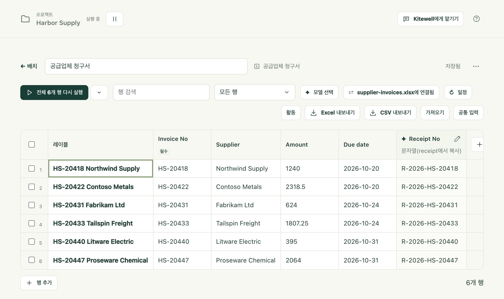
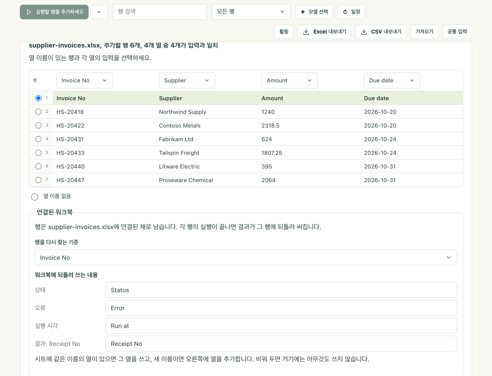

Excel에 목록이 있습니다. 이번 달 청구서가 한 행에 하나씩 있고, 각각에 해야 할 일이 있습니다. Kitewell은 행마다 워크플로를 한 번씩 실행하고, 각 결과를 원래 행에 되돌려 씁니다. 나중에 같은 파일을 열면 청구서 옆에 접수 번호가 적혀 있습니다.

Excel은 열리지 않습니다. Kitewell이 `.xlsx` 파일을 직접 읽고 쓰므로, 밤사이 화면이 잠겨 있어도 계속 작업합니다.

## 워크북 연결하기

파일이 있는 컴퓨터에 Kitewell 앱이 있어야 합니다. 브라우저에서는 파일에 접근할 수 없으므로 이 기능이 표시되지 않습니다.

1. 행마다 한 번씩 실행할 워크플로의 시트를 만듭니다. 만드는 방법은 [시트로 워크플로 일괄 실행](/ko/docs/batches/)에 있습니다.
2. 시트 도구 모음에서 **가져오기**를 선택하고 **이 기기의 워크북 연결**을 선택한 뒤 `.xlsx` 파일을 고릅니다. 파일을 Kitewell 창에 끌어다 놓아도 됩니다.
3. Kitewell이 찾은 내용을 확인합니다. **시트**, 열 이름이 있는 행, 어떤 열이 어떤 입력을 채우는지입니다. 이름이 입력과 같은 열은 자동으로 연결됩니다.
4. **행을 다시 찾는 기준**에서 청구서 번호처럼 행을 구별하는 열을 고릅니다.
5. **워크북에 되돌려 쓰는 내용**에서 결과가 들어갈 열을 확인합니다. **Status**, **Error**, **Run at**, 그리고 결과마다 한 열입니다. 이름을 바꿀 수 있고, 이름을 지우면 그 열에는 아무것도 쓰지 않습니다.
6. **연결하고 6행 추가**를 선택합니다.

이제 시트에 워크북의 행이 표시되고, 도구 모음에는 **연결**과 파일 이름이 표시됩니다.

## 행 실행하기

다른 시트와 똑같이 실행합니다. 입력이 기대하는 값이 될 수 없는 셀(금액 열의 “twelve” 같은)은 테두리로 표시되고, 그 행은 고칠 때까지 기다립니다.

행이 끝나면 Kitewell은 30초 안팎에 알아서 결과를 워크북에 씁니다. **지금 결과 쓰기**를 선택하면 기다리지 않습니다.

| 열 | 들어가는 내용 |
| --- | --- |
| Status | Done, Partly failed, Failed, Stopped, Rejected 중 하나 |
| Error | 행이 실패한 이유(한 줄) |
| Run at | 행이 실행된 시각 |
| 결과마다 한 열 | 접수 번호처럼 실행이 만든 값 |

헤더가 일본어인 워크북에는 일본어 단어가 들어갑니다. 状態, エラー, 実行日時, 그리고 Done 대신 済입니다. 헤더가 중국어나 한국어인 워크북에도 같은 방식으로 그 언어의 단어가 들어갑니다. 한국어라면 상태, 오류, 실행 시각, 그리고 Done 대신 완료입니다.

## Excel에서 파일이 열려 있을 때

Windows에서는 아무것도 실패하지 않습니다. 시트에 결과가 준비되었으며 Excel에서 파일을 닫으면 쓰겠다고 표시되고, 파일을 닫는 순간 결과를 씁니다. **결과를 복사본에 저장**을 선택하면 대신 파일 옆에 `supplier-invoices (results).xlsx`를 씁니다.

Mac에서는 Excel이 파일을 잠그지 않으므로, Kitewell은 파일이 열려 있는지 알 수 없어 그대로 결과를 씁니다. 행 실행이 끝나기 전에 Excel에서 워크북을 닫으세요. 나중에 Excel에서 저장하면 결과가 덮어써질 수 있습니다.

## 매일 아침 실행

시트에 [일정](/ko/docs/scheduling/)을 지정합니다. 그러면 두 가지를 더 묻습니다. **먼저 supplier-invoices.xlsx 읽기**와 **실행할 행**(**모든 행** 또는 **워크북에서 추가되거나 변경된 행만**)입니다.

두 번째를 고르면 매일 아침 파일을 읽어 새로 들어온 내용을 실행하고 결과를 되돌려 쓰며, 바뀐 것이 없으면 아무것도 시작하지 않습니다. 일정은 파일이 있는 컴퓨터에서 설정하세요. 다른 컴퓨터에서는 실행할 수 없습니다.

## 문제가 생기면

- **누군가 시트를 정렬하거나 필터링했습니다.** Kitewell은 쓰기 전마다 파일을 다시 읽고 각 행을 키로 추적합니다. 옮겨진 행은 빼고 어떤 행인지 알려 주며, 나머지는 씁니다.
- **들어가면 안 되는 결과가 들어갔습니다.** **되돌리기**로 파일을 되돌립니다. Kitewell은 최근 10번의 쓰기 각각에 앞서 사본을 보관합니다. 이번 릴리스에서는 다음 쓰기 때 같은 결과가 다시 들어갑니다.
- **디스크의 워크북이 바뀌었습니다.** 시트에 **워크북 다시 읽기**가 표시됩니다. 새로 생기거나 바뀐 행을 가져오고, 워크북에 더 이상 없는 행은 **목록에서 사라짐**으로 표시합니다.
- **단계가 실패합니다.** [문제 해결](/ko/docs/troubleshooting/#a-spreadsheet-step-fails)을 참조하세요.

## Excel 더 알아보기

[Excel 참조](/ko/docs/reference/spreadsheets/)에서 나머지를 다룹니다. 양식 형태로 배치된 견적서나 주문서 읽기, 워크플로에서 쓸 수 있는 스프레드시트 단계 10가지, 시트 대신 단계로 같은 일을 구성하는 방법, 내 컴퓨터에 남는 것, 그리고 제한 사항입니다.
