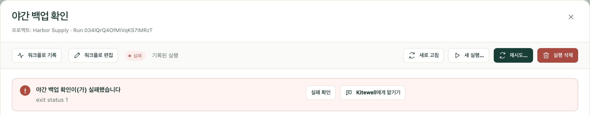
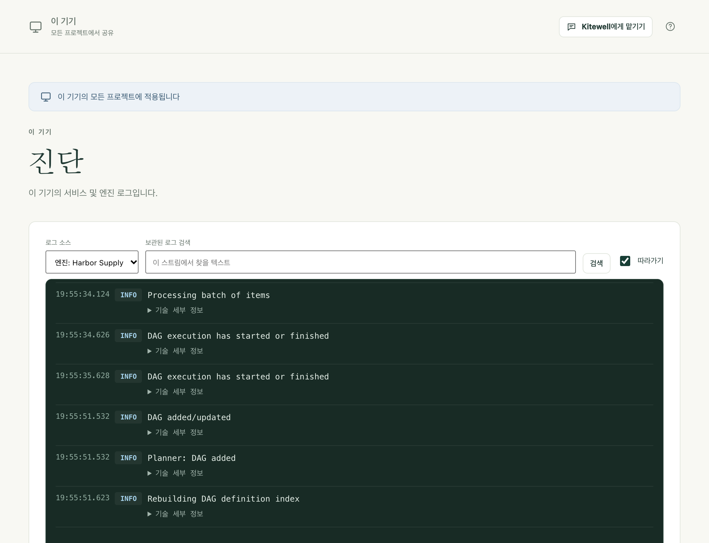

무엇이 잘못되었는지와 어떻게 해야 하는지 찾아보세요. 해당하는 항목이 없으면 버전, 한 작업, 그리고 비밀번호를 지운 출력을 함께 [지원 요청](/ko/support/)을 보내 주세요.

## 실행이 실패했습니다

**실행 및 로그**에서 실행을 엽니다. 맨 위의 요약이 실패한 단계와 그 단계가 남긴 메시지를 알려 줍니다.

- **실패 확인**은 그 단계와 로그를 보여 줍니다.
- **어시스턴트에게 묻기**는 대신 원인을 살펴봅니다.
- **편집기에서 수정**은 실패한 단계에서 워크플로를 열어, 고친 뒤 원하는 단계부터 실행을 이어 가게 해 줍니다. 워크플로 자체의 기록에서 연 실행에 표시됩니다. **워크플로**에서 워크플로 옆의 **실행 기록 보기**를 선택하세요.

[실패 진단](/ko/docs/ai/#failure-diagnosis)을 켜 두면, 실행이 다시 시도할지, 무엇이 사용자를 기다리는지, 무엇을 바꿔야 하는지도 알려 줍니다. [실행 및 로그](/ko/docs/runs/#fix-a-failed-run)를 참고하세요.

## 터미널에서는 되는 명령이 Kitewell에서는 실패합니다

Kitewell의 환경은 터미널이 주는 환경과 다릅니다. 프로그램은 전체 경로로 지정하고, 단계에 작업 폴더를 정하고, 셸이 정해 준 변수에 기대지 말고 필요한 변수를 직접 정하세요. 명령이 누군가의 입력을 기다리는지, 터미널 세션 안에만 있는 자격 증명을 쓰는지도 확인하세요.

## 예약된 워크플로가 실행되지 않았습니다

먼저 **실행 및 로그**를 엽니다. 예약 시각에 있는 **놓침** 행이 이유를 알려 줍니다. 기기가 잠자기 상태였거나, Kitewell이 실행 중이 아니었거나, 프로젝트 엔진이 실행 중이 아니었거나, 실행이 시작되지 않았습니다.

그런 다음 **워크플로**를 엽니다. 워크플로의 다음 시작 아래에 있는 줄이 일정이 지금 어떻게 될지 **실행됩니다**, **로그인한 동안에만 실행됩니다**, **실행되지 않습니다** 중 하나로 알려 주며, 이유와 고치는 버튼이 함께 표시됩니다. 페이지 맨 위의 배너는 프로젝트 전체에 대해 같은 내용을 알려 줍니다.

둘 다 아무것도 알려 주지 않으면, 워크플로의 **일정**이 **저장된 일정 사용**에 체크된 채 저장되었는지, 시간대가 의도한 것인지 확인하세요.

Mac에서는 그 시각에 컴퓨터가 깨어 있고 로그인한 상태여야 합니다. Windows에서는 로그인 서비스를 켜면 아무도 로그인하지 않아도 예약 작업이 실행됩니다. [일정](/ko/docs/scheduling/#run-with-nobody-signed-in-windows)을 참고하세요.

놓친 시작은 워크플로가 요청한 경우에만 나중에 보충됩니다. 워크플로의 **일정 → 놓친 일정**을 확인하세요.

## 웹사이트 단계가 실패합니다

먼저 실행 아티팩트에 있는 단계의 스크린샷을 보세요. 대개 로그인 페이지, 쿠키 배너, 봇 확인이 원인입니다. 그런 다음 다음을 확인하세요.

- Chrome이 설치되어 있거나 Windows에서는 Microsoft Edge가 있고, **브라우저 확인**이 성공하는지
- **허용 웹사이트 · 한 줄에 하나 (선택)**를 입력했다면 페이지의 호스트가 그 안에 있는지
- 대기 시간이 페이지에 충분한지
- 어떤 지시에도 비밀번호가 들어 있지 않은지. 비밀번호는 **브라우저가 입력하는 값**에 넣으세요.
- 단계나 워크플로에 모델이 선택되어 있는지

사이트가 바뀌어 재생된 동작이 더 이상 통하지 않으면 **프로젝트 설정 → 저장 공간 → 재생 캐시**에서 지우세요. [웹사이트 자동화](/ko/docs/browser/)를 참고하세요.

## 스프레드시트 단계가 실패합니다

대부분의 거부 메시지는 워크북, 시트, 셀을 알려 줍니다. 단계의 **확인**은 무엇이든 실행하기 전에 엔진에 물어봅니다. 흔한 원인은 다음과 같습니다.

- 경로가 이 컴퓨터에 있는 `.xlsx` 또는 `.xlsm` 파일의 전체 경로가 아닙니다. `.xls`나 `.ods` 파일은 먼저 Excel에서 `.xlsx`로 저장해야 합니다.
- 단계가 가리키는 시트나 열이 워크북에 더 이상 없습니다. 메시지가 대신 있는 것을 나열합니다.
- 셀이 열에 고정된 형식으로 바뀌지 않습니다. 예를 들어 수량을 글자로 적은 경우입니다.
- 파일이 Excel에서 열려 있어, 닫힐 때까지 쓰기가 미뤄집니다.
- 병합된 셀이 단계가 쓸 위치를 덮고 있습니다. 메시지가 병합을 풀어야 할 범위를 알려 줍니다.

연결된 워크북에 쓴 내용은, Kitewell이 쓴 뒤 파일이 바뀌지 않았다면 시트에서 되돌릴 수 있습니다. [Excel 자동화](/ko/docs/spreadsheets/)를 참고하세요.

## 데스크톱 단계가 실패합니다

먼저 실행 아티팩트에 있는 단계의 스크린샷을 보세요. 그런 다음 다음을 확인하세요.

- **기기 설정 → 데스크톱 자동화 → 데스크톱 접근 권한 확인**에서 모든 권한이 허용되었다고 나오는지. Mac에서 화면 기록과 손쉬운 사용 권한이 필요한 것은 **Kitewell Agent**입니다.
- 화면이 잠겨 있지 않고 컴퓨터가 깨어 있는지. 화면이 잠기면 모든 데스크톱 단계가 실패합니다.
- Windows에서 Kitewell은 관리자로 실행하지 않았는데 앱만 관리자로 실행되고 있지 않은지
- 작업이 **작업당 최대 동작 수** 안에 들어가는지, 아니면 더 작은 작업으로 나뉘어 있는지
- 모델에 컴퓨터 사용 도구가 있는지, 아니면 단계가 **일반 도구 (모든 비전 모델용)**를 쓰는지
- 어떤 지시에도 비밀번호가 들어 있지 않은지. 비밀번호는 **단계가 입력하는 값**에 넣으세요.

데스크톱이 비기를 기다린 단계는 사용자의 마우스나 키보드 때문에 일시 중지된 것입니다. 아무도 쓰지 않는 컴퓨터라면 **데스크톱 설정**에서 그 대기를 줄이거나 끄세요. 앱이 바뀌어 재생된 작업이 더 이상 통하지 않으면 **프로젝트 설정 → 저장 공간 → 재생 캐시**에서 지우세요. [데스크톱 앱 자동화](/ko/docs/desktop/)를 참고하세요.

## Google에 "This app is blocked"라고 표시됩니다

Google이 Gmail에 대한 Kitewell의 접근 검토를 마칠 때까지, 대부분의 계정에서 Kitewell의 브라우저 로그인이 차단되며 페이지에는 우회할 방법이 없습니다. 그 페이지를 닫고 Kitewell로 돌아가 **대신 앱 비밀번호 사용**을 선택하세요. [이메일 자동화](/ko/docs/email/)를 참고하세요.

## 메일함을 다시 연결해야 합니다

이 컴퓨터가 로그인할 수 없는 메일함을 쓰는 실행은 거부되며, **개요**가 연결하거나 다시 연결할 주소를 알려 줍니다. **메일 계정**을 열고 **다시 연결**을 선택하세요. 흔한 원인은 다음과 같습니다.

- 계정 비밀번호가 바뀌었거나, 관리자가 세션을 끝냈습니다.
- Google 로그인을 6개월 동안 쓰지 않았거나, 컴퓨터가 꺼져 있어서 Microsoft 로그인이 마지막으로 갱신된 지 90일이 넘었습니다.
- 공급자 사이트에서 앱 비밀번호가 삭제되었습니다.
- Microsoft 365 관리자가 IMAP이나 인증된 SMTP를 껐거나, Kitewell에 관리자 승인을 요구합니다. 오류 메시지에 관리자에게 보낼 링크가 있습니다.
- Google Workspace 관리자가 타사 앱을 차단합니다.

팀원이나 Dagu Cloud에서 온 프로젝트는, 여기서 연결할 때까지 메일함이 연결되지 않은 상태로 표시됩니다. [이메일 자동화](/ko/docs/email/)를 참고하세요.

## AI 작업이 실패합니다

에이전트가 설치되어 로그인되어 있는지, 또는 선택한 모델에 작동하는 공급자 자격 증명이 있는지 확인하세요. **에이전트와 모델**의 **에이전트 테스트**와 **모델 테스트**가 실행 전에 둘 다 확인합니다. 그런 다음 기록된 프롬프트, 작업의 오류 출력, 그리고 공급자가 한도나 결제 때문에 이용을 막았는지 살펴보세요. 문제를 알릴 때는 실제 자격 증명을 빼 주세요.

## Docker를 사용할 수 없습니다

이 컴퓨터에서 Docker를 시작한 다음, 워크플로 편집기에서 **Docker 확인**을 사용하세요. Kitewell은 Docker를 설치하지도 시작하지도 않습니다. 컨테이너가 마운트하는 폴더와 파일이 컨테이너를 실행하는 컴퓨터에 있는지도 확인하세요.

## 기록에서 실행이 사라졌습니다

프로젝트의 실행 기록 보관 기간보다 오래된 실행은 자동으로 지워지며, 편집 권한이 있는 사람은 누구나 실행을 삭제할 수 있습니다. [실행 및 로그](/ko/docs/runs/#delete-runs)를 참고하세요.

## ChatGPT와 Claude

### 앱이 Kitewell에 연결할 수 없다고 합니다

컴퓨터가 잠자기 상태이거나, 꺼져 있거나, Kitewell을 실행하고 있지 않습니다. 컴퓨터가 잠자기에 들어간 직후에는 ChatGPT나 Claude가 알아차리기까지 45초쯤 걸릴 수 있습니다. 그 컴퓨터에서 Kitewell을 열고 **이 기기 → MCP**에 **온라인**이 표시되는지 확인한 뒤 다시 시도하세요.

### 연결에 허용되지 않은 호출이라며 거부됩니다

거부 메시지는 "This connection is read-only"나 "This connection can run workflows but not edit them"처럼 연결의 권한이 허용하는 범위와, 그것을 바꾸는 곳을 알려 줍니다. **이 기기 → MCP → 연결된 앱**을 여세요. 변경은 앱의 다음 호출부터 적용됩니다.

### 동의 페이지에 컴퓨터가 오프라인이거나 자리가 없다고 표시됩니다

- "Open Kitewell on that computer to continue": 컴퓨터가 잠자기 상태이거나, 꺼져 있거나, Kitewell을 실행하고 있지 않습니다. Kitewell을 열고 **이 기기 → MCP**에 **온라인**이 표시될 때까지 기다린 뒤 **다시 시도**를 선택하세요.
- 자리가 없음: 무료 요금제에는 API 키와 연결된 앱을 합쳐 하나만 둘 수 있는데, 이 컴퓨터에 이미 하나가 있습니다. **이 기기 → MCP**에서 그것을 해지하거나 Kitewell Personal 또는 Team으로 바꾼 다음 다시 연결하세요.

### 앱은 연결되지만 읽기만 합니다

ChatGPT는 일부 요금제에서, 허용한 권한과 관계없이 읽기 전용 도구만 쓸 수 있습니다. [ChatGPT](/ko/docs/mcp/#chatgpt)를 참고하세요.

### 연결 추가 자체가 실패합니다

ChatGPT나 Claude에서 Kitewell을 제거한 뒤 다시 추가하세요. [ChatGPT 또는 Claude 연결](/ko/docs/mcp/#connect-chatgpt-or-claude)을 참고하세요.

## Windows에 SmartScreen 알림이 표시됩니다

Windows는 자주 보지 못한 게시자의 설치 프로그램을 경고합니다. 내려받은 파일의 SHA256이 [다운로드 페이지](/ko/download/)의 값과 같은지 확인한 다음, **추가 정보**와 **실행**을 선택하세요. Windows가 설치 프로그램의 서명이 *잘못되었다*고 하면, 진행하지 말고 [알려 주세요](/ko/support/).

## Kitewell을 설치했는데 시작되지 않습니다

Windows에서는 Setup.exe가 마지막에 Kitewell을 엽니다. 창도 메시지도 나타나지 않고 `%LOCALAPPDATA%\Kitewell\logs\shell.log`에 한 줄도 추가되지 않았다면, Kitewell의 코드가 하나도 실행되기 전에 멈춘 것입니다.

보통은 Windows 애플리케이션 제어 때문입니다. 새로 설치한 Windows 11에서 켜져 있는 스마트 앱 컨트롤은 서명되지 않은 Kitewell 빌드를 불러오지 않습니다. 다음 두 곳에서 확인할 수 있습니다.

- **설정 → 개인 정보 및 보안 → Windows 보안 → 앱 및 브라우저 컨트롤 → 스마트 앱 컨트롤**에서 켜져 있는지 알 수 있습니다.
- **이벤트 뷰어 → Windows 로그 → 응용 프로그램**에 `Kitewell.dll`에 대한 .NET Runtime 1026 `FileLoadException`이 있습니다.

[다운로드 페이지](/ko/download/)에서 서명된 릴리스를 설치하세요. 직접 빌드한 것은 서명되어 있지 않아 그런 PC에서는 실행되지 않습니다.

## Kitewell이 WebView2 설치를 요청합니다

Kitewell의 창은 Microsoft Edge WebView2 런타임으로 만들어졌습니다. 런타임이 없으면 Kitewell이 열릴 때 **WebView2 설치**를 제안합니다. Microsoft에서 런타임을 내려받으며, 1분쯤 걸립니다.

## Kitewell이 백그라운드 서비스를 시작할 수 없습니다

창이 시작 화면에 머물다가 서비스가 남긴 메시지를 **다시 시도**, **데이터 폴더 열기**와 함께 보여 줍니다. 다음 두 가지 이유는 직접 고칠 수 있습니다.

### 다른 프로그램이 Kitewell의 포트를 쓰고 있습니다

메시지가 `127.0.0.1:19741`에 대한 `bind: address already in use`로 끝납니다. 대개 Kitewell의 다른 사본이 원인입니다. 두 번째로 설치한 것이거나, 설치된 앱 옆에서 실행 중인 개발 빌드입니다. 그것을 종료한 다음 **다시 시도**를 선택하세요.

같은 메시지가 Hyper-V, WSL, 방화벽 정책 때문에 이 기기에서 포트가 예약되었거나 막혔다고 알려 줄 수도 있습니다. 이때는 PC 관리자가 그 포트를 풀어 주어야 합니다.

### 데이터 폴더 경로가 너무 깁니다

Windows에서 서비스는 데이터 폴더 경로가 79자보다 길면 실행을 거부하고, 확인한 길이와 함께 그렇게 알려 줍니다. Kitewell은 그 아래의 실행 폴더 안에서 프로그램을 시작하는데, Windows는 경로가 너무 긴 폴더에서는 프로그램을 시작하지 않습니다. 그러면 모든 워크플로의 모든 실행이 디렉터리 이름이 잘못되었다는 말만 남기고 실패합니다.

보통은 `%LOCALAPPDATA%`가 더 깊은 곳이나 네트워크 드라이브로 리디렉션된 것이 원인입니다. 기본값인 `%LOCALAPPDATA%\Kitewell\data`는 42자 안팎입니다. PC 관리자에게 `%LOCALAPPDATA%`를 로컬 디스크에 두도록 요청하세요.

## Kitewell MCP가 수신 대기하지 않습니다

**이 기기 → MCP**는 리스너가 시작되지 못하면 경고를 표시합니다. 가장 흔한 이유는 다른 프로그램이 모든 기기에서 같은 포트인 19742를 차지하고 있는 것입니다. 설치된 앱 옆의 개발 빌드처럼 Kitewell의 두 번째 사본인 경우가 많습니다. 그 프로그램을 종료하고 Kitewell을 다시 시작하거나, Kitewell에 다른 **수신 주소**를 지정하세요.

## 업데이트 확인이 실패합니다

네트워크와 [릴리스 상태](/ko/releases/)를 확인하세요. 사용 중인 시스템의 첫 공개 릴리스가 나오기 전에는 읽을 업데이트 피드가 없으며, 피드에 닿지 못한 확인은 최신 버전이라는 증거가 아니라 실패한 확인입니다. 체크섬이나 설치 프로그램 검증이 실패하면 우회하지 말고 알려 주세요.

## 로그 찾기

실패한 단계라면 **실행 및 로그**에서 시작하세요.

그 밖의 경우에는 **이 기기 → 진단**을 엽니다. **로그 소스**에서 서비스 자체의 출력, 오류, 프로젝트마다의 엔진 중에서 고릅니다. 보관된 내용을 검색하고 내려받을 수 있습니다.

## 세부 정보

- 로그 파일은 10MiB마다 교체되며 이전 사본 세 개를 보관합니다.
- 로그 파일은 Mac에서는 `~/Library/Application Support/Kitewell/logs`, Windows에서는 `%LOCALAPPDATA%\Kitewell\logs`에 있습니다. Windows에서는 그 옆의 `shell.log`에 앱 자체가 한 일(시작, 다시 시작, 종료)이 기록됩니다.
- Kitewell 자체 인터페이스는 `127.0.0.1:19741`에서 수신 대기합니다. Kitewell MCP는 기본적으로 `127.0.0.1:19742`에서 수신 대기합니다. 각 프로젝트의 워크플로 엔진은 시작할 때 정한 자기만의 루프백 포트를 씁니다.
