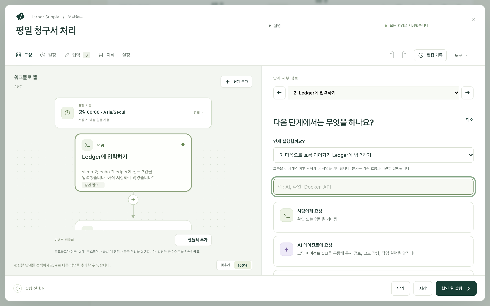
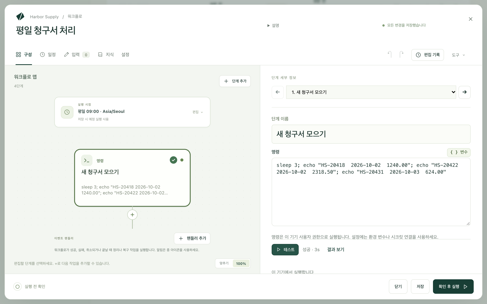
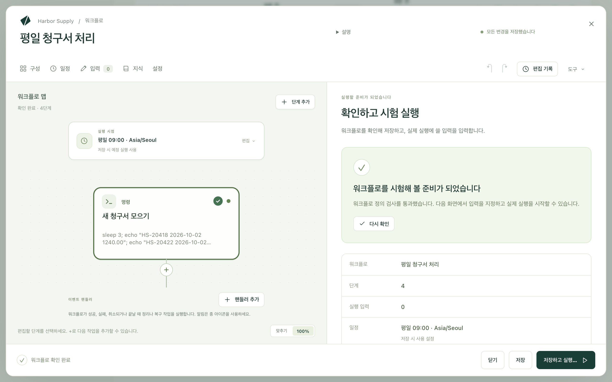
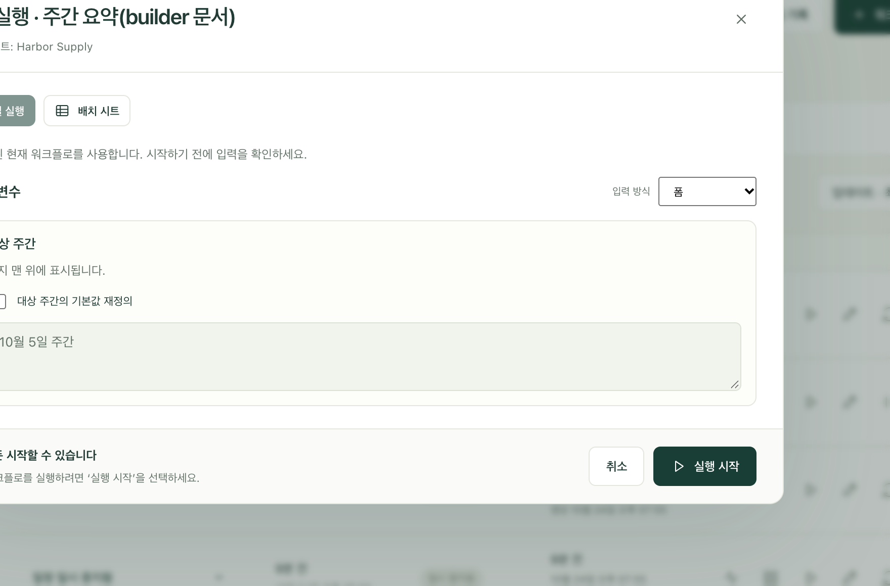

워크플로는 손으로 하던 일을 한 번 적어 두어 Kitewell이 대신 할 수 있게 한 것입니다. 청구서를 모으고, 입력하고, 요약을 이메일로 보내는 식입니다. 한 조각씩 만들고, 조각마다 따로 시험해 본 다음, 전체를 실행해 동작을 지켜봅니다.

각 조각이 단계입니다. 단계는 명령 실행, 웹사이트 입력, 메일함 읽기, 사람에게 묻기처럼 한 가지 일을 하고, 다음 단계는 그 단계가 끝나기를 기다립니다. 편집기는 단계를 맵으로 그려 주므로 순서를 한눈에 볼 수 있습니다.

## 준비할 것

워크플로를 담아 둘 프로젝트. 사이드바에 **워크플로**가 있다면 이미 있는 것입니다. 그 밖에는 고르는 단계에 따라 다릅니다.

- 명령, 웹사이트 단계, 대기에는 다른 준비가 필요 없습니다.
- AI 단계에는 **에이전트와 모델**에서 설정한 모델이나 에이전트가 필요합니다.
- 이메일 단계에는 **더 보기 → 메일 계정**에서 연결한 메일함이 필요합니다.
- 단계에 필요한 비밀번호나 키는 먼저 **더 보기 → 시크릿**에 시크릿으로 저장합니다. 그러면 값이 로그에 나타나지 않습니다.

필요한 것을 찾지 못한 단계는 실행 전에 알려 주므로, 이 모든 것을 먼저 준비하지 않아도 만들기 시작할 수 있습니다.

## 한 단계씩 만들기

1. **워크플로 만들기**를 선택하고 이름을 붙입니다. 편집기가 비어 있는 **구성** 화면으로 열리고 **무엇을 자동화할까요?** 하고 묻습니다.
2. 작업을 고릅니다. 추가한 단계는 왼쪽 **워크플로 맵**에 나타나고, 작업 중인 단계는 오른쪽 **단계 세부 정보**에 열립니다. 이 화면에서는 이것을 *작업*이라고 부르지만, 맵에 올라가면 단계가 됩니다.
3. **단계 이름**에 `새 청구서 모으기`처럼 평범한 말로 이름을 입력합니다. 나중에 로그에서 찾게 될 이름입니다.
4. 작업에 필요한 내용을 채웁니다. 명령 단계에는 **명령** 필드 하나가 있고, 웹사이트 단계에는 주소와 그곳에서 할 일을 입력합니다.
5. 다음 단계를 추가하려면 **단계 추가**나 맵에서 단계 아래의 +를 선택합니다. 새 단계의 위치는 **언제 실행할까요?** 항목에서 정합니다.
   - **이 다음으로 흐름 이어가기**: 이 단계 뒤에 있던 단계들이 이제 새 단계를 기다립니다.
   - **다음에 분기 추가**: 첫 경로와 나란히 가는 다른 경로를 만듭니다.
   - **독립적으로 시작**: 아무것도 기다리지 않는 작업에 씁니다.
6. 일을 다 적을 때까지 계속합니다. 순서는 나중에 **복제**, **위로 이동**, **아래로 이동**, **단계 제거**로 정리할 수 있습니다.

빈 워크플로에서는 입력을 줄이는 지름길이 두 가지 있습니다. **이 워크플로가 할 일을 설명하세요**에 일을 설명하고 **어시스턴트에게 묻기**를 선택하거나, **또는 예제로 시작**에서 카드를 고르세요. 예제는 나중에 **도구 → 예시 보기**로 다시 열 수 있습니다.

## 고를 수 있는 작업

**작업 찾기**로 목록을 검색할 수 있으므로, 찾아 헤매는 대신 `메일`이나 `Excel`을 입력하면 됩니다. 대부분 다음 작업으로 시작합니다.

- **명령 또는 스크립트 실행**: 이 컴퓨터에서 무언가를 실행합니다.
- **웹사이트 자동화**: 사이트를 열고 클릭, 입력, 읽기, 다운로드를 평범한 말로 지시합니다. [웹사이트 자동화](/ko/docs/browser/)를 참조하세요.
- **데스크톱 앱 자동화**: 이 컴퓨터의 앱을 사람처럼 사용합니다. [데스크톱 앱 자동화](/ko/docs/desktop/)를 참조하세요.
- **메일 보내기**, **메일 찾기**, **메일 정리**: 연결한 메일함에서 메일을 쓰고, 읽고, 정리합니다. [이메일 자동화](/ko/docs/email/)를 참조하세요.
- **모델에 묻기**: 모델에 질문을 보내고 답을 보관합니다.
- **AI 에이전트에 요청**: 이 컴퓨터에 설치된 코딩 에이전트에게 일을 맡깁니다.
- **AI에 판단 요청**: 무언가를 분류하거나, 점수를 매기거나, 예/아니요로 답합니다. 결과는 다음 단계가 읽을 수 있는 형태로 나옵니다.
- **사람에게 요청**: 멈추고 누군가가 확인하거나 입력할 때까지 기다립니다.
- **대기**: 일정 시간 동안, 특정 시각까지, 또는 파일이 생길 때까지 멈춥니다.
- **조건까지 반복**: 준비될 때까지 정해진 시도 횟수 안에서 주기적으로 확인합니다.
- **각 항목 처리**: 목록의 항목마다 단계를 한 번씩 실행하고 결과를 모읍니다.
- **값에 따라 분기**: 일을 이쪽 경로나 저쪽 경로로 보냅니다.
- **텍스트 템플릿 채우기**: 템플릿과 몇 가지 값으로 메시지나 파일을 만듭니다.
- **다른 워크플로 실행**: 이미 있는 워크플로를 하나의 단계로 재사용합니다.

더 기술적인 작업도 같은 목록 아래쪽에 있습니다. **Docker에서 실행**, **웹 서비스 호출**, **API 작업 사용**, **다른 컴퓨터에서 실행**, **머신과 파일 주고받기**입니다. Excel 작업은 맨 끝의 **스프레드시트** 제목 아래에 모여 있습니다. [Excel 자동화](/ko/docs/spreadsheets/)를 참조하세요.

## 전체를 실행하기 전에 한 단계만 테스트하기

단계 하나가 동작하는지 알아보려고 워크플로 전체를 실행할 필요는 없습니다.

1. 맵에서 단계를 선택합니다.
2. **테스트**를 선택합니다. Mac에서는 ⌘↩, Windows에서는 Ctrl+Enter입니다.
3. **테스트** 옆의 막대를 지켜봅니다. 단계가 무엇을 하는 중인지, 그리고 어떻게 끝났는지 표시됩니다. **결과 보기**를 선택하면 돌아온 내용을 읽을 수 있습니다. **출력**에는 단계가 출력한 내용이, **오류 출력(stderr)** 항목에는 단계가 보고한 문제가 담깁니다.

테스트는 저장하지 않은 변경 사항을 포함해 그 단계만 실행하며, 워크플로를 저장하지 않습니다. 앞 단계는 실행되지 않습니다. 앞 단계의 값은 그 단계에서 마지막으로 통과한 테스트에서 가져오거나 직접 입력합니다. **값과 입력**에는 단계가 읽는 값이 나열되고, 아직 빠진 값이 표시됩니다.

테스트는 실제 작업입니다. Kitewell은 시작하기 전에 "me@example.com에서 실제 메일을 보냅니다", "이 기기에서 실행합니다"처럼 무엇을 할지 알려 줍니다. 그 문장을 먼저 읽고, 정말 실행하려는 경우에만 **그래도 테스트**를 선택하세요.

**사람에게 요청**, **각 항목 처리** 루프 안의 단계, 이벤트 핸들러, 서버 그룹을 대상으로 하는 단계, 이 네 가지는 아직 단독으로 테스트할 수 없으며, 실행하는 대신 그렇다고 알려 줍니다.

## 실행할 때마다 바뀌는 값

날짜, 폴더, 제목처럼 실행마다 달라지는 값이 필요하면 단계에 직접 쓰지 말고 **입력**에 두세요. 각 입력은 실행을 시작할 때 채우는 양식의 필드가 됩니다.

입력을 쓰려면 단계의 필드에 `${`를 입력하고 목록에서 입력을 고릅니다. 같은 목록에서 시크릿과 앞 단계가 저장한 결과도 고를 수 있으며, Kitewell은 결과를 쓰는 단계가 그 결과를 만드는 단계를 기다리도록 해 줍니다.

## 확인한 다음 실행하기

**저장**은 작업 내용을 보관합니다. 잠시 멈추고 싶을 때 언제든 쓰세요. 워크플로의 일정은 저장하는 순간부터 적용됩니다.

**확인 후 실행**은 실제 작업이 일어나기 전의 마지막 점검입니다. 이름, 워크플로에 있는 **단계**와 **실행 입력**의 수, **일정**을 모아 보여 주고, 먼저 고치면 좋은 점을 **실행하기 전에** 아래에 나열합니다. **워크플로 확인**은 초안에 실수가 없는지 검사합니다.

그다음:

1. **저장하고 실행…** 버튼을 선택합니다. 워크플로가 저장되고 실행 양식이 열립니다.
2. 워크플로에 입력이 있으면 **매개변수** 아래의 필드를 채웁니다. 이미 값이 있는 필드는 기본값을 덮어쓰겠다는 확인란을 선택해야 바꿀 수 있습니다.
3. **실행 시작**을 선택합니다.

실행은 진행되는 대로 단계별로 열립니다. 실행은 시작 시점의 워크플로를 사용하므로, 나중에 편집해도 이미 진행 중인 실행은 바뀌지 않습니다. 결과를 어떻게 다룰지는 [실행 및 로그](/ko/docs/runs/)를, Kitewell이 자동으로 시작하게 하려면 [일정](/ko/docs/scheduling/)을 참조하세요.

## 멈추고 사람에게 묻기

누군가 살펴보기 전에는 끝내면 안 되는 일도 있습니다.

**사람에게 요청**은 그 자체로 하나의 단계입니다. 지시를 쓰고, 답이 필요하면 선택지, 의견, 숫자 같은 양식을 추가합니다. 실행은 누군가 이를 완료할 때까지 기다립니다.

자동 단계가 한 일을 누군가 확인하게 하려면 그 단계의 **승인** 섹션을 열고 **이 단계 실행 후 승인을 기다림**을 켭니다. 질문과 받을 값을 입력합니다. **되돌릴 때 다시 실행할 단계**에서는 검토자가 수정을 요청했을 때 반복할 단계를 고릅니다.

승인은 단계가 실행된 *후에* 일시 중지합니다. 무언가 일어나기 *전에* 허락을 받아야 한다면 그 앞에 **사람에게 요청** 단계를 둡니다.

사람에게 맡긴 작업에서도 일을 되돌려 보낼 수 있습니다. **수정을 위해 되돌리기**에서 **검토자가 작업을 되돌릴 수 있도록 허용**을 켜고, **작업을 되돌릴 단계**로 이 단계보다 앞서 실행되는 단계를 고릅니다. 다시 실행되는 AI 단계와 모델 프롬프트에는 피드백이 전달됩니다. 명령은 각 값을 변수로 읽으며, 첫 실행에서는 그 값이 비어 있습니다.

대기 중인 실행은 **실행 및 로그 → 대기 중**의 **확인이 필요한 항목**에 있습니다. 사람에게 맡긴 작업에는 **작업 완료**가 있고, 되돌리기를 허용한 경우 **되돌리기…** 버튼도 있습니다. 승인에는 **승인**, **돌려보내기**, **실행 거부**가 있습니다. 되돌려 보내면 고른 단계와 그 이후의 작업이 반복되고, 거부하면 실행이 끝납니다.

## 워크플로가 끝날 때 작업 실행하기

이벤트 핸들러는 흐름 안이 아니라 워크플로의 단계와 나란히 실행됩니다. 첫 단계 전, 실행이 사람을 기다리는 동안, 성공 시, 실패 시, 취소 시, 또는 항상 마지막에 실행할 수 있습니다. 임시 파일을 지우거나, 변경을 되돌리거나, 복구 서비스를 호출할 때 씁니다.

맵 아래의 **이벤트 핸들러**에 이 워크플로의 핸들러가 나열됩니다. **핸들러 추가**를 선택하고 실행 시점을 고릅니다. **단계 실행 전**, **승인 대기 시**, **성공 시**, **실패 시**, **취소 시**, **항상 마지막에** 중 하나입니다. 핸들러는 따로 열립니다. **작업 유형**으로 핸들러가 할 일을 바꾸고, **워크플로로 돌아가기**로 맵에 돌아옵니다. **사람에게 요청**, **AI에 판단 요청**, **값에 따라 분기**, **각 항목 처리**, **대기**, **조건까지 반복**은 핸들러가 될 수 없습니다.

핸들러는 워크플로의 입력과 변수, 실행 상태를 읽을 수 있지만 단계의 결과는 읽을 수 없습니다. **실행 및 로그**에서는 실행마다 단계 옆에 핸들러가 함께 표시됩니다.

워크플로가 실패했다는 것을 사람들에게 알리려면 핸들러 대신 [알림](/ko/docs/alerts/)을 쓰세요.

## AI 에이전트나 모델에 묻기

먼저 **에이전트와 모델**에서 이름을 붙인 에이전트나 모델을 설정한 다음 워크플로에 추가합니다.

- **AI 에이전트에 요청**은 이 컴퓨터에 설치된 명령줄 에이전트를 실행합니다. 에이전트를 고르고, 프롬프트를 쓰고, **에이전트 설정 및 컨텍스트**에서 프로젝트 폴더와 필요한 컨텍스트를 설정합니다.
- **모델에 묻기**는 설정해 둔 모델에 프롬프트를 보냅니다. 모델을 고르고 필요한 답을 설명합니다.

나중 단계에서 답이 필요하면 변수로 저장하세요.

**도구 → AI 프롬프트 확인**에서는 실행하기 전에 각 AI 단계가 받을 지시를 볼 수 있습니다. 값은 실행할 때 채워집니다. 키, 권한, 제공업체별 요구 사항은 [AI 에이전트와 모델](/ko/docs/ai/)을 참조하세요.

## 가져온 API 사용하기

[OpenAPI 명세를 API 라이브러리로 가져온](/ko/docs/apis/) 다음 워크플로에 **API 작업 사용**을 추가합니다. API와 작업(operation)을 고르면 Kitewell이 명세를 바탕으로 필수 매개변수와 요청 본문까지 포함한 요청 필드를 만들어 줍니다.

나중 단계에서 **변수**를 열고 API 단계의 응답에서 필드를 고릅니다. Kitewell은 값을 저장하고, 그 결과가 쓰이기 전에 요청이 끝나도록 합니다.

## Docker 이미지 실행하기

이 컴퓨터에서 Docker를 시작합니다. 작업 목록에서 **Docker에서 실행**을 선택합니다.

1. 태그를 포함해 **이미지**를 고릅니다. 추천 목록을 검색하거나 **이미지 찾아보기**를 씁니다. **검사**는 이미지의 포트, 폴더, 변수를 읽어 단계를 채우는 데 도움을 줍니다.
2. 이미지 안에서 실행할 명령을 입력합니다. 여러 줄, 파이프, 셸 변수를 쓰려면 **셸 스크립트**를 씁니다. 이때 이미지에 `/bin/sh`가 있어야 합니다.
3. 필요한 옵션을 펼칩니다. 작업 폴더, 마운트, 환경 변수, 게시 포트, 네트워크입니다. 컨테이너 안에서 만든 파일을 컨테이너 밖에 남기려면 마운트가 필요합니다.
4. **Docker 확인**으로 연결을 확인합니다. **테스트**는 이미지와 명령을 실제로 실행하므로, 마운트와 그 영향을 먼저 살펴보세요.

Kitewell은 Docker를 설치하거나 시작하지 않습니다. **실행 후 컨테이너 유지**를 켜지 않으면 컨테이너는 실행 후 삭제됩니다. 마운트한 파일과 Docker 볼륨은 따로 백업해야 합니다.

## 다른 컴퓨터에서 명령 실행하기

**더 보기 → 서버**를 엽니다. 서버마다 주소, 사용자 이름, 로그인 방법을 추가합니다. 비밀번호는 [시크릿](/ko/docs/secrets/)에 보관하거나, 암호 문구가 없는 로컬 비공개 키를 씁니다. **호스트 키 검증**에서는 기본값을 유지하고 **연결 테스트**로 지문을 승인하거나, **이 기기의 known_hosts**를 쓰거나, **검증하지 않음**을 고릅니다. **점프 호스트**를 쓰면 다른 컴퓨터 뒤에 있는 서버에 접속할 수 있습니다.

그룹을 만들면 여러 서버를 하나의 이름으로 묶을 수 있습니다. 서버를 원하는 순서로 놓고, 동시에 몇 대에서 실행할지 정하고, 실패하면 배포를 멈출지 계속할지 고릅니다.

워크플로에는 **다른 컴퓨터에서 실행**을 추가합니다. **실행 위치**에서 서버나 그룹을 고르고 명령을 입력합니다. 그룹을 고르면 컴퓨터마다 별도의 단계가 만들어지므로, 각 결과가 **실행 및 로그**에 따로 표시됩니다.

모든 명령 단계와 스크립트 단계를 같은 곳으로 보내려면 워크플로의 **설정 → 실행 위치**를 씁니다. 여기서 그룹을 고르면 워크플로 전체가 각 컴퓨터에서 차례로, 컴퓨터마다 별도의 실행으로 돌아갑니다. Docker, AI, 웹 서비스, 가져온 API, 하위 워크플로 단계는 여전히 Kitewell을 실행하는 컴퓨터에서 실행됩니다.

## 문제가 생기면

- **단계가 시작하자마자 실패합니다.** 대개 프로그램이 없거나, 폴더가 틀렸거나, 이 컴퓨터에 값이 없는 시크릿 때문입니다. 단계를 단독으로 **테스트**하고 **오류 출력(stderr)** 내용을 읽으세요.
- **단계가 읽는 값이 비어 있습니다.** 그 값을 만드는 단계가 먼저 실행되어야 합니다. 값을 읽는 단계에서 **사용할 수 있는 값**을 열어 그 값이 목록에 있는지 확인한 다음 **다음에 실행**을 확인하세요.
- **편집기에서 필드를 바꿀 수 없습니다.** 일부 고급 설정은 워크플로의 텍스트에만 있습니다. 메시지가 그렇다고 알려 주며, **도구 → YAML 편집**으로 텍스트를 열 수 있습니다.
- **터미널에서는 되는 명령이 여기서는 안 됩니다.** 단계는 Kitewell을 실행하는 사람의 권한으로, 워크플로의 폴더에서, 내 셸 설정 없이 실행됩니다. 프로그램은 전체 경로로 지정하세요.

자세한 내용은 [문제 해결](/ko/docs/troubleshooting/)에 있습니다.

## 세부 사항

- **도구**에는 같은 워크플로를 두 가지로 보여 주는 **비주얼 편집기**와 **YAML 편집**, **예시 보기**, **AI 프롬프트 확인**, **워크플로 확인**, 그리고 텍스트 편집기가 입력 중에 제안하는 내용을 다시 불러오는 **편집기 제안 새로 고침**이 있습니다.
- **도구 → YAML 편집**은 워크플로를 **워크플로 YAML**이라는 레이블 아래 텍스트로 엽니다. 비주얼 편집기에서 하는 모든 일이 여기에 기록되며, 한 번만 실행하는 일정, 특수한 실행기, 주석처럼 텍스트로만 쓸 수 있는 것도 있습니다. Ctrl+Space를 누르면 제안이 나오고 Tab으로 들여씁니다. 주석과 비주얼 편집기에 표시되지 않는 설정은 비주얼 편집기로 돌아가도 그대로 남습니다.
- 무언가를 출력하는 단계는 그 내용을 파일로 남길 수 있습니다. **산출물 이름(선택)** 필드를 채우면 파일이 실행의 **산출물**에 나타납니다. 단계가 `$DAG_RUN_ARTIFACTS_DIR`에 직접 파일을 쓸 수도 있습니다.
- 워크플로는 마지막 50회의 단계 테스트를 보관하며, 테스트는 한 번에 하나씩 실행됩니다. 테스트가 제시하는 값은 마지막으로 통과한 테스트에서 옵니다.
- 단축키: Mac에서는 ⌘S, Windows에서는 Ctrl+S로 워크플로를 저장합니다. 비주얼 편집기에서 **구성**이 열려 있을 때 ⌘↩ 또는 Ctrl+Enter로 선택한 단계를 테스트합니다.
- 단계가 실행하는 명령은 시스템 자체의 명령입니다. Windows에서는 PowerShell에서, Mac에서는 셸에서 실행됩니다. `echo "…"`, `sleep 2`, `exit 1`은 양쪽에서 동작하지만 `cat`, `ls`, `printf`, `&&`는 Windows에서 동작하지 않습니다.
- 워크플로 텍스트로는 엔진 자체의 메일 설정(`mail_on`, `smtp`, `error_mail`, `info_mail`, `mail_on_error`)을 지정할 수 없습니다. 지정하면 저장에 실패합니다. 대신 Kitewell에서 [알림](/ko/docs/alerts/)을 설정합니다.
