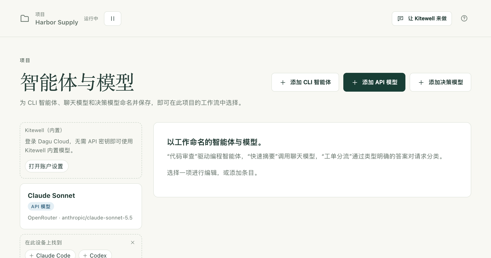

Kitewell 的 AI 功能需要一个模型：可以是你用提供商的 API 密钥添加的模型，可以是这台电脑上已安装的编程工具，也可以是在已登录 Dagu Cloud 的电脑上使用的 Kitewell 内置模型。

有了模型，Kitewell 就能在聊天中和你一起搭建和修复工作流，失败的运行能自己说明原因，表格能从每次运行中读取值，工作流也能在执行过程中向模型提问。

## 准备工作

- 凡是通过互联网调用模型的功能，都需要提供商的 API 密钥。如果项目中已经有了，侧边栏中的 **智能体与模型** 会将其列出。[Kitewell 的内置模型](#use-kitewells-included-model)不需要密钥。
- 使用命令行编程智能体时，需要在这台电脑上安装该工具并完成登录。Kitewell 会启动它，但绝不会替你登录。
- **智能体与模型** 页面供管理员和编辑者使用。提供商对请求收取的费用由你自己承担。

## 添加项目可用的模型

1. 在侧边栏中选择 **智能体与模型**，然后选择 **添加 API 模型**。
2. 选择 **提供商**：Anthropic、OpenAI、Google Gemini、OpenRouter、Z.ai、OpenCode Zen 或 Local server (Ollama, vLLM)。本地服务器不需要密钥。
3. 在 **API 密钥** 下，选择保存该 API 密钥的项目[密钥](/zh/docs/secrets/)。密钥是经过妥善保存、绝不会显示在日志中的密码或 API 密钥。管理员也可以在这里选择 **新密钥…**，在 **粘贴 API 密钥** 中粘贴，一步就把它保存为密钥。该密钥会绑定到使用此模型的每次运行，工作流本身从不包含它。
4. 输入 **模型 ID**。对于 OpenRouter、OpenCode Zen 和正在运行的本地服务器，这里会列出提供商提供的所有模型，你可以输入名称的一部分进行搜索。对于其他提供商，这里只给出建议，提供商接受的任何 ID 都可以使用。
5. 给它起一个你自己的名称，比如“快速摘要”“发票读取”，然后选择 **测试模型**。在发送任何内容之前，面板会显示确切的提示词、发送到哪里、使用哪个密钥，以及会留下什么。

该页面包含三种条目，用 **类型** 选择：

- **API 模型** 直接询问提供商的模型并返回其回答。它用于 **询问模型** 任务、助手、失败诊断、表格的结果列，以及 **自动操作网站** 和 **自动操作桌面应用** 任务。
- **决策模型** 用于分类、打分和回答“是或否”的问题，并为每个回答给出概率。**添加决策模型** 提供 OpenRouter 或 TypeSafe。**让 AI 做出决策** 任务用它对某样东西分类或打分，以便后面的步骤根据答案分支；[表格](/zh/docs/batches/)也用它判断“是或否”、选项和等级这几类列。
- **CLI 智能体** 驱动安装在这台设备上的编程智能体。

条目失败时可以改用其他条目：这时它的卡片上会显示“备用：”并列出这些条目。每次尝试都是一个新的请求，会再次计费。

## 使用 Kitewell 的内置模型

在已登录 [Dagu Cloud](/zh/docs/cloud-sync/#sign-in) 的电脑上，**智能体与模型** 会列出 **Kitewell（内置）**。它不需要 API 密钥：每个请求都经由 Dagu Cloud 发送到 OpenRouter，费用从工作区的 Dagu Cloud 积分中扣除。

- 可以把它选作 **询问模型** 或 **自动操作网站** 任务的 **模型**，也可以用于表格的结果列或失败诊断。在工作流的 YAML 中，它写作 `kitewell-agent-included`。
- **自动操作桌面应用** 在所有套餐中都用它读取屏幕，除非项目在 **项目设置 → 屏幕步骤** 中选择了其他模型。处理截图时，Dagu Cloud 使用专为电脑操作打造的视觉模型。**让 AI 做出决策** 不能使用它。
- 在管理员于 **设备设置 → Kitewell 的 AI 模型** 中设置模型之前，Kitewell 的聊天会用它来回答。

试用期一次性提供 100 积分。Kitewell Personal 和 Team 为套餐所付费的每台电脑每月提供 500 积分，由整个工作区共享，并在每月 1 日（UTC）重置。助手的网页搜索也消耗同样的积分。

在 Personal 和 Team 上，可以在 [Dagu Console](https://console.dagu.sh/kitewell) 中以 12 美元购买 1,000 积分的积分包。积分包中的积分永不过期，在当月积分用完后才开始使用。

管理员可以在 **设备设置** 的 **Dagu Cloud 账户** 中查看剩余积分。积分用完后，内置模型会被拒绝使用，直到积分重置或你购买积分包；试用期间则要等到你订阅为止。你自己的模型可以继续使用。

Dagu Cloud 会要求 OpenRouter 只把这些请求路由给既不存储请求、也不用请求训练模型的提供商。它不保留任何提示词文本，只记录工作区、设备、模型和所用的积分。

## 使用这台电脑上的编程智能体

请先安装该工具并登录。Kitewell 能识别 15 种工具：Aider、Amp、Claude Code、Cline、Codex、Cursor、DeepSeek、Droid、Gemini、GitHub Copilot、Goose、Kiro、OpenCode、Pi 和 Qwen；其他任何工具都可以作为 **自定义命令** 运行。在这台电脑上找到、但尚未被任何智能体使用的工具会出现在 **在此设备上找到** 下，点一下即可为它创建条目。

1. 选择 **添加 CLI 智能体**，并选择 **工具**。列表会标明哪些工具已安装在这台设备上，哪些没有。
2. 对于 Claude Code、Codex 和 OpenCode，**加载模型** 会填入该工具提供的模型。其他工具需要你输入模型名称。
3. 选择 **测试智能体**。在运行之前，面板会显示它将发送的提示词、它将在哪个文件夹中工作（一个全新的空临时文件夹，结束后会被删除），以及它会跳过的任何确认。
4. 在工作流中，添加一个 **交给 AI 智能体** 任务，选择 **智能体**，并填写 **提示词 · 描述任务**。在 **智能体设置与上下文** 下，设置它工作的 **项目文件夹**。

Kitewell 会使用该工具在这台电脑上已有的登录来运行它。对于支持这一设置的工具（例如 Claude Code、Codex 和 GitHub Copilot），智能体上的 **推理强度** 决定工具推理的程度，单个步骤也可以覆盖这个设置。

智能体上的 **失败时** 最多可列出另外三个 CLI 智能体。当这个智能体的工具因出错而退出时（例如触发速率限制、未登录或崩溃），会按顺序依次尝试它们。回答质量不佳不算失败。每次尝试都会从头运行提示词，因此会再次产生费用。

审阅者退回智能体步骤的工作时，智能体会再次运行，并在提示词中加上审阅者的反馈。请参阅[暂停并请人处理](/zh/docs/workflow-builder/#stop-and-ask-a-person)。

编程智能体是一个以你的身份在这台电脑上运行的程序，拥有你授予该工具本身的所有访问权限。它可以读取和修改文件，也可以运行命令。智能体上的 **跳过权限提示** 会关闭工具自身的确认，只要设置了其中任何一项，智能体的卡片上就会带有 **跳过审批** 标记。切勿把来自外部的文本交给这样的智能体：当邮件中的文本会传给这样的智能体时，工作流编辑器会发出警告，因为发邮件的人随后就能向它下达指令。这种情况下请使用 **询问模型**，它无法运行任何东西。

## 助手

Kitewell 在这台电脑上有一个跨所有项目的聊天。你可以让它搭建或修复工作流、运行某些内容，或者查明某次运行失败的原因。用 Kitewell 窗口顶部的 **让 Kitewell 来做** 打开它，或者在 Mac 上按 ⌘J、在 Windows 上按 Ctrl+J。它供管理员和编辑者使用。

聊天打开时停靠在 Kitewell 窗口右侧。**在单独的窗口中打开** 会把它移出来，**保持在最前面** 让该窗口位于其他窗口之上，**停靠到 Kitewell 窗口** 会把它放回去。在 Mac 上，菜单栏菜单中的 **打开聊天** 会显示它；在 Windows 上，点击托盘图标可以显示或隐藏它。

它使用 **Kitewell 的 AI 模型** 来回答，该模型在 **设备设置** 中为所有项目统一设置一次。在管理员设置之前，已登录 Dagu Cloud 的电脑会使用 [Kitewell 的内置模型](#use-kitewells-included-model)；否则，管理员可以直接在聊天中进行设置。

需要的不只是简短回答的工作会放进一个线程中，并与相关的工作流或运行关联。当一个请求变成一项工作时，Kitewell 会开启一个线程；**在线程中回复** 可以从任意消息开启线程。**返回主对话** 回到主对话，**标记为完成** 关闭线程，**重新打开** 再次打开它。多个线程可以同时工作。

Kitewell 工作时你可以继续输入：它会在下一步读取新消息，**立即插话** 会停下当前的工作，先回答那条消息。当 Kitewell 窗口打开时，聊天知道窗口中显示的内容，所以“这个工作流”指的是编辑器中的那个，包括尚未保存的修改。

在你按下卡片上的按钮之前，Kitewell 提议的任何内容都不会保存，它要做的任何事情也不会执行。

- 新建或修改的工作流会以卡片形式出现，附有流程图和 **详情**。选择 **应用**，或选择 **拒绝**（会询问原因）。计划会以开启状态提出，并显示接下来的运行时间；取消勾选 **开启其计划** 可将其以暂停状态保存。应用后，**打开** 会打开工作流，**立即运行** 会运行它；对现有工作流的修改可以用 **撤销** 撤回。
- 它会以卡片形式为[表格](/zh/docs/batches/)提议行和列。应用时还可以启动所涉及行的运行，这样就无法撤销了。
- 它可以运行工作流，批准、拒绝或退回等待中的步骤，停止运行，以及暂停或恢复计划。每一项都是一张附有工作流流程图的卡片，只有在你按下按钮（例如 **运行** 或 **批准**）时才会执行；**暂不** 表示拒绝。
- 它可以真实地运行一份草稿，看看能否成功。在一个线程中第一次这样做时，它会用 **允许试跑** 征求你的同意。试跑会使用项目的密钥运行命令、浏览器步骤、读取操作和模型调用。任何会向别处发送或修改内容的操作（POST、电子邮件、在其他机器上运行的命令）都只会报告它原本要发送的内容。
- 在你选择 **允许** 之后，它可以在自己的浏览器中操作某个网站，以了解工作流应该如何使用该网站；你可以在聊天中观看，并随时 **接手操作**。它可以读取公开网页，但不能读取这台设备或其所在网络上的地址；在已登录 Dagu Cloud 的电脑上，它还可以搜索网页。
- 它可以把最多六个简短问题放在一张卡片里问你，你可以用 **发送回答** 作答，或用 **跳过** 略过。它可以按名称向你索要某个密钥：你把值输入它的卡片并选择 **保存**，助手永远看不到这个值。只有管理员可以用这种方式添加密钥，或列出密钥名称。
- 它每收到一条消息都会读取项目的[知识库](/zh/docs/knowledge/)，并在你工作时记下它了解到的内容。当你说明希望它如何工作时，它会立即记住，并提供 **撤销**。一旦对话读取过网页或运行的输出，它会[先征求你的同意](/zh/docs/knowledge/#what-the-assistant-does)。

在所有套餐上，Kitewell 也会主动发布自己的卡片。等待你处理的运行会有一张卡片，可以直接在卡片上 **批准**、**拒绝** 或作答。通知设置发送到这台设备的内容也会有卡片：失败的工作流附带 **重试**；没有启动的计划附带 **立即运行**；成功、被取消或运行时间过长的运行，以及已完成的表格，各显示一行提示。除非聊天在最前面，否则每一项也会显示为通知。

失败运行上的 **让 Kitewell 来做** 会请它查明原因并提出修复方案。

对话保存在这台电脑上，不包含在备份中。**删除** 删除一条消息，**删除线程** 删除整个线程；**设备设置 → Kitewell 的 AI 模型** 下的 **删除所有项目的对话** 会删除全部内容。Kitewell 保存的工作流和其他更改会保留。

## 运行为何失败

Kitewell 可以读取失败的运行，并告诉你该怎么处理。

1. 打开 **项目设置 → 失败诊断**，开启 **自动诊断失败的运行**。
2. 选择它要使用的 **模型**。
3. 在 **工作流** 下，让每个工作流保持 **项目默认值**，或单独设为 **开启** 或 **关闭**。选择 **保存诊断设置**。

一连串失败中只有第一次会被诊断，之后的失败不会逐一诊断；一次成功就会结束这一连串失败。答案会显示在失败的运行上，结论为 **重试**、**需要你处理**、**需修改工作流** 或 **不明确** 之一，并附上原因和下一步做法。**诊断** 可为任何失败的运行请求诊断，**重新诊断** 会请求一个新的答案。

发送给模型的内容包括：失败步骤的结果、其日志的末尾部分、浏览器、桌面或智能体步骤停止时正在做什么、子运行的失败情况，以及这次运行实际使用的定义。模型不会获得任何工具，所以运行输出的任何内容都无法执行操作。诊断结果保存在这台设备上，并随其运行一起删除。

## 哪些内容会离开这台电脑

提示词及其上下文会发送给你选择的提供商或工具，之后就适用该提供商的计费、数据保留和隐私规则。工作区位于你的电脑上，并不意味着每个任务都只在这台电脑上进行。

- 运行之前，工作流编辑器中的 **工具 → 检查 AI 提示词** 会显示每个 AI 任务将收到的指令。运行时的值会在运行开始时填入。
- 运行之后，**运行与日志** 会显示这次运行记录下来的提示词以及返回的内容。
- 聊天会发送最近的对话、Kitewell 窗口中显示的内容（包括编辑器中打开的工作流）、项目的工作流、模型和知识库，以及它使用的每个工具返回的内容。密钥的值永远不会被发送。
- 当聊天使用的模型是 OpenRouter 自身地址上的 OpenRouter 模型时，其请求会要求 OpenRouter 只把它们路由给既不存储、也不用收到的内容训练模型的提供商。
- Kitewell 的内置模型会把每个请求发送到 Dagu Cloud，再由 Dagu Cloud 转交给 OpenRouter。

完整情况请参阅[哪些数据会离开你的电脑](/zh/docs/data-flow/)。
