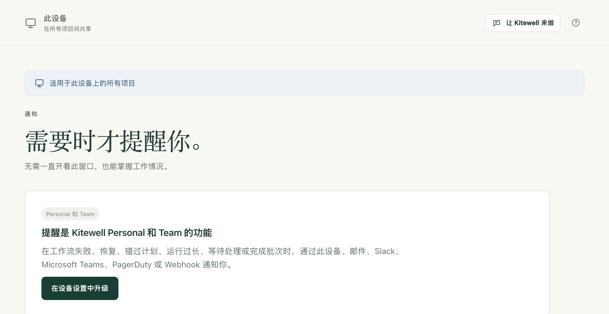

提醒会在工作流需要你处理时通知你：运行失败了、正在等人批准某件事，或者到了时间却没有启动。这样你就不必一直开着 Kitewell 来查看情况。

## 准备工作

所有套餐和试用期都包含提醒功能。试用期或套餐结束后，**通知** 页面会改为提示订阅，并且不会发送任何内容：没有邮件，没有消息，连这台电脑上的通知也没有。也不会先存起来日后再发，所以提醒从套餐生效的那一刻起重新开始。

这些提醒由电脑发出。[Dagu Console](/zh/docs/console/#alerts-from-dagu-console) 也可以在已同步项目的工作流失败、或某台电脑停止报告时，向你发送邮件。

在之前的套餐下保存的渠道仍会列在 **已保存的渠道** 中，你可以在那里删除它。在套餐恢复之前，它不会发送任何内容。

## 选择提醒发往何处

打开 **此设备 → 通知**。渠道就是接收提醒的地方。选择 **添加渠道**，选择 **类型**，填写 **名称**，再填写该渠道所需的信息：

- **此设备** 在这台电脑上显示通知。它一开始就在：在 **桌面通知** 下开启 **在此设备上通知**，并在系统询问时允许通知。它需要已安装的 Kitewell 应用，仅有浏览器窗口是不够的。
- **电子邮件** 需要填写 **收件人**，即一组邮件地址。邮件所经由的服务器在 **邮件服务器** 下为整台设备统一设置一次：**SMTP 服务器**、**端口**、**用户名**、**密码**、**发件人**，以及 **连接安全性**，可选 **STARTTLS（通常为端口 587）** 和 **TLS（通常为端口 465）**。必须使用加密连接。如果你的邮件服务商有要求，请使用应用专用密码。
- **Slack** 需要填写 **传入 Webhook 网址**。在 Slack 中为频道添加一个 Incoming Webhook，然后粘贴它的地址。
- **Microsoft Teams** 需要填写 **工作流 URL**。在 Teams 中，选用在收到 Webhook 请求时向频道发帖的模板创建一个工作流，然后粘贴它的地址。
- **PagerDuty** 需要填写来自 Events API v2 集成的 **集成密钥**，以及 **服务区域**：**美国** 或 **欧盟**。提醒会创建一个故障事件（incident），恢复时将其关闭。
- **Webhook** 需要填写 **接收方 URL**，并以 [Standard Webhooks](https://www.standardwebhooks.com/) 格式向它发送带签名的 JSON。**签名密钥** 会在保存渠道时生成，且只显示一次；请把它交给接收消息的一方。

**发送测试** 会在保存之前，用你已输入的值发送一条示例提醒，有错误马上就能发现。PagerDuty 的测试会创建一个故障事件并随即关闭，所以不会呼叫任何人。

每个渠道都会显示最近一次发送是否送达，**最近的提醒** 列出已发送的内容以及仍在重试的内容。**发送工作流提醒** 会关闭这台设备发出的所有提醒；重新开启后，从那一刻起重新开始，不会补发关闭期间发生的事。

## 选择要接收哪些提醒

规则决定哪些事件发往哪些渠道，共分三层：

1. **通知** 页面上的 **默认提醒规则** 适用于所有没有自己规则的项目。初始状态下，它们会把 **失败时**、**需要输入时**、**错过计划运行时** 和 **完成批次时** 发送到 **此设备**。
2. **项目设置 → 通知** 可以为某个项目设置专属规则：选择 **为此项目使用专属规则**，而不是 **遵循此设备的默认规则**。项目的规则会取代默认规则，而不是在默认规则之外追加。
3. 工作流上的铃铛（在其编辑器中，或在 **工作流** 列表中）只针对这一个工作流。你可以 **静音**：**1 小时**、**1 天**、**1 周** 或 **直到我取消静音**；可以用 **为此工作流使用专属规则** 为它设置专属规则；也可以将 **何时算作运行过长** 设为 **根据近期运行自动判断**、**超过设定时间后** 或 **永不**。然后选择 **保存提醒设置**。这些设置会立即在这台设备上生效，不会改动工作流本身，因此永远不会随工作流一起带走。

默认规则和项目规则中的 **判定为错过的时间**，是指计划运行最多可以晚多少分钟开始，超过就算作错过。默认值为 5 分钟。

## 每个事件的含义

- **失败时**：运行在最后一次自动重试后仍然失败。你会在一连串失败开始时收到通知，而不是每次失败都收到；下一次运行成功时，你还会再收到一次通知。恢复通知总是发往当初接收失败通知的同一批渠道。
- **需要输入时**：某个人工任务或审批正在等人处理。步骤在被回应后再次等待时，会再次通知。
- **错过计划运行时**：计划的运行没有启动，通知会说明错过了几次以及原因：电脑处于睡眠状态、Kitewell 未运行、项目的引擎已停止。工作流再次按时运行时，还会再发一条消息。
- **运行时间过长时**：运行仍在进行，远远超过了近期成功运行所用的时间，或者超过了你用铃铛设置的上限。每次运行只通知一次。
- **被取消时** 和 **成功时**：除非你把它们发往某个渠道，否则不会发送。
- **完成批次时**：[批次](/zh/docs/batches/)的每一行都已结束并读取了值，通知会说明有多少行未成功，以及按列统计的变化，例如“Price: 9 dropped, 3 rose”。你取消的批次不会通知；每一行都成功且没有任何变化的计划批次也不会通知。无法启动的计划批次会通知，并说明原因。批次中的各行不会逐一触发其他事件。

PagerDuty 只接受 **失败时**、**错过计划运行时** 和 **运行时间过长时**：故障事件需要有后续情况来关闭它，而只有这三种事件会结束。

## 提醒中包含什么

提醒会写明项目、工作流、运行由什么启动、何时开始、耗时多久；如果有失败，还会写明哪个步骤失败、如何失败，以及退出代码或时间上限。它绝不会包含步骤输出的内容，也不会包含运行收到的值：提醒会离开这台电脑，而输出中可能包含任何内容。

提醒中的链接会在执行这次运行的那台电脑上的 Kitewell 中打开该运行，因此适用于坐在那台电脑前的人。错过计划的提醒会打开项目的 **工作流** 页面，批次提醒会打开对应的表格。

无论 Kitewell 设置为哪种语言，提醒消息本身都以英文撰写。

## 何时发送提醒

当电脑处于唤醒状态且 Kitewell 正在运行时，后台服务会发送提醒。无法送达的提醒会重试，每次间隔越来越长，最长持续一天。电脑处于睡眠或关机状态时不会发送任何内容，错过的计划会在电脑唤醒后报告。一天多以前就已结束的运行，即使 Kitewell 后来才发现，也不会发送通知。如果想在一台本应保持开机的电脑没了动静时收到通知，请开启它的 [Dagu Console 停止报告告警](/zh/docs/console/#alerts-from-dagu-console)。

## 用提醒，而不是事件处理程序

[事件处理程序](/zh/docs/workflow-builder/#run-a-task-when-the-workflow-ends)是在工作流成功、失败、被取消或结束时运行的任务，用于清理和恢复。要通知别人，请使用提醒。

工作流本身不能给任何人发邮件：保存时会拒绝 `mail_on`、`smtp`、`error_mail`、`info_mail` 和 `mail_on_error`，因为用这种方式发出的提醒不受任何规则、静音和送达记录的约束。

## 遇到问题时

- **什么都收不到。** 先检查套餐，再检查 **发送工作流提醒**，然后检查规则：有专属规则的项目不会遵循默认规则。
- **这台电脑上收不到。** **此设备** 需要已安装的 Kitewell 应用，并且需要系统允许显示通知。可以用 **发送测试通知** 检查。
- **某个渠道显示发送失败。** 它的卡片会显示错误以及开始出错的时间。**编辑** 该渠道，并在保存前用 **发送测试** 验证修复是否有效。
- **某个工作流没了动静。** 在 **工作流** 中查看它所在行的铃铛：它可能被静音了，或者有自己的规则。

## 详细信息

- 这些提醒需要套餐或试用期。查看已有的设置以及删除渠道，在套餐结束后也可以。
- 一台设备最多可保存 50 个渠道。
- 未送达的提醒会在 1 分钟后重试，之后依次间隔 2、4、8、16 和 30 分钟，一天后放弃。如果对方回复表示已理解该消息并予以拒绝，则不会重试。
- **最近的提醒** 保留最近 200 次发送记录，显示其中最新的 20 条。
- **判定为错过的时间** 可设为 1 到 1,440 分钟。工作流自己的运行过长上限最长可设为一周。
- “运行时间过长”根据该工作流最近的成功运行自动判断，至少需要五次成功运行才会开始判断。
- Webhook 渠道既可以发送到 `https` 地址，也可以发送到 `http` 地址。Slack 只接受 `hooks.slack.com` 地址，Teams 只接受 `https`。
