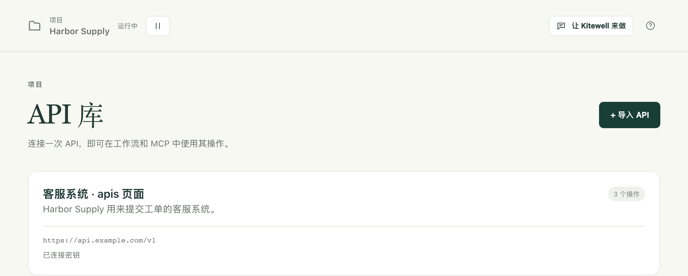
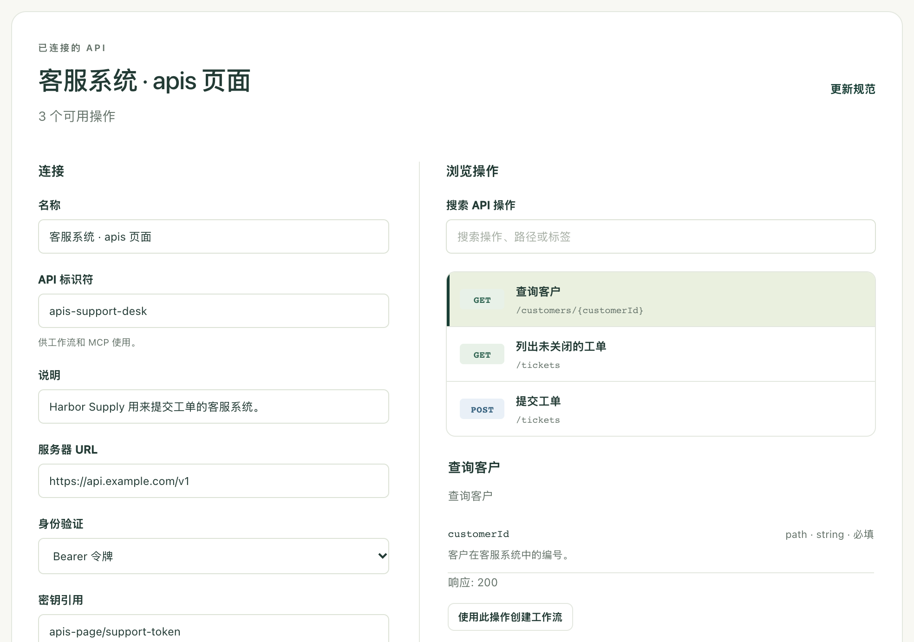

把另一项服务已经能做的事（比如查询客户、提交工单、录入订单）变成可以从列表中选用的步骤。你只需导入一次该服务的说明文档，Kitewell 就会生成表单，于是工作流步骤只需填写几个字段，而不必自己编写请求。

## 准备工作

- 该服务的 OpenAPI 文档：OpenAPI 3.0 或 3.1 格式的 JSON 或 YAML 文件。服务的运营方会发布它，通常是其开发者页面上名为“OpenAPI”或“openapi.json”的链接。如果找不到，请向他们索取。
- 如果服务需要，准备好它要求的令牌、密钥或密码。先准备好，但不要把它输入到工作流中：它应该存放在[密钥](/zh/docs/secrets/)中。
- 对于使用 OAuth 2.0 登录的服务（例如很多会计和 CRM 服务），则改为需要一个在其开发者页面上注册的应用。请参阅[使用 OAuth 2.0 登录](#sign-in-with-oauth-20)。

一个连接属于一个项目，该项目中的每个工作流都可以使用它。

## 导入服务

1. 在项目侧边栏中，打开 **更多 → API 库**，然后选择 **导入 API**。
2. 选择把文档交给 Kitewell 的方式：**上传文件**、**从 URL 导入** 或 **粘贴规范**。
3. 选择 **预览操作**。Kitewell 会读取文档并打开 **检查并连接**，其中列出该服务能做的所有事情。
4. 在 **浏览操作** 下，按名称、路径或标签搜索，并选择一个操作查看其输入和响应。如果某个操作无法作为步骤运行，Kitewell 会在那里直接说明原因。
5. 在 **连接** 下，检查 **名称**、**API 标识符** 和 **服务器 URL**。如果文档中没有服务器地址，请自行填写。
6. 选择 **身份验证**，如果服务需要，就关联一个密钥。请参阅下文的[关联凭据](#connect-credentials)；对于需要登录的服务，请参阅[使用 OAuth 2.0 登录](#sign-in-with-oauth-20)。
7. 选择 **连接 API**。

之后，该连接会以卡片形式出现在 **API 库** 中，显示它有多少个操作，以及是否已关联密钥；如果是 OAuth 2.0，则显示这台设备是否已登录。

随时选择这张卡片，都能回到同一个界面：左侧是它的设置，右侧是它的操作。

**API 标识符** 是工作流用来找到这个连接的名称，因此保存后就不会再变。文档本身保存在项目中，即使它来自某个 URL 也是如此，所以运行时不会重新获取。预览和连接都不会调用该服务。

如果文档的 URL 本身需要登录，请先在浏览器中下载文件，再使用 **上传文件** 或 **粘贴规范**。

## 关联凭据

在 **身份验证** 下，选择服务要求的方式：**无需身份验证**、**Bearer 令牌**、**API 密钥**、**用户名和密码** 或 **OAuth 2.0 登录**。最后一种在下文有单独的一节。如果选择 **API 密钥**，还要填写 **密钥名称**，并在 **密钥发送位置** 中选择 **标头**、**查询参数** 或 **Cookie**。

然后指定保存该值的密钥。输入或选择同一项目中已有的 **密钥引用**，例如 `services/support-token`。若要在这里新建一个，请打开 **保存新密钥**，在 **密码或访问令牌** 下输入值，然后选择 **保存密钥**。

对于 Bearer 令牌或 API 密钥，密钥中保存的就是令牌或 API 密钥本身。对于 **用户名和密码**，在连接中输入 **用户名**，把密码保存在密钥中。

连接只保存引用。Kitewell 会查出值，并将其添加到使用该连接的每个请求中，值本身绝不会出现在工作流或日志中。以后要替换值，请参阅[密钥](/zh/docs/secrets/)。

## 使用 OAuth 2.0 登录

有些服务不发放令牌，而是让你登录并授权访问。Kitewell 会在每台设备上登录一次，此后一直保持访问有效，因此工作流永远不需要处理令牌。

1. 在服务的开发者页面上注册一个应用。在要求填写重定向 URL（有时称为回调 URL）的地方，填入 Kitewell 在 **身份验证** 下显示的 **重定向 URL**，例如 `http://127.0.0.1:19741/oauth/callback`。你登录后，服务会把你送回这个地址。记下客户端 ID；如果服务提供了客户端密钥，也一并记下。
2. 在 **身份验证** 下，选择 **OAuth 2.0 登录**。如果服务的文档描述了登录方式，Kitewell 会填好 **授权 URL**、**令牌 URL** 和 **范围**。否则，请从开发者页面复制。
3. 输入 **客户端 ID**。如果服务提供了客户端密钥，请在 **客户端密钥引用** 下指定保存它的密钥，或者用 **保存新密钥** 新建一个。没有客户端密钥时留空。
4. 选择 **连接 API**。Kitewell 会保存连接并开始登录：选择 **在浏览器中继续**，登录该服务，并授权 Kitewell。回到 Kitewell 后，**此设备上的登录** 会显示“自（你登录的时间）起已连接”。

Kitewell 会在访问过期前续期，包括每次都会发放新刷新令牌的服务。如果服务不再接受这次登录（比如有人撤销了授权，或者长时间未使用），**API 库** 中的卡片会显示 **需要重新连接**，连接中也会显示服务给出的原因。选择 **重新连接** 并再次登录。

登录属于完成登录的那台设备。在其他设备上运行这些工作流的每个人，都要在那台设备上选择一次 **连接**。在此之前，使用该 API 的运行会在开始前被拒绝，项目概览中会列出需要连接的 API。备份和项目导出都不会带上登录信息。**断开连接** 会将其从这台设备上移除。保存不同的客户端 ID、端点或范围也会使登录失效，之后请重新连接。

## 在工作流中使用操作

1. 打开工作流，进入 **搭建**，选择 **添加步骤**。
2. 选择 **使用 API 操作**。
3. 选择一个 **已连接的 API**，然后在 **查找 API 操作** 下搜索并选中你需要的操作。
4. 填写 Kitewell 生成的输入。必填项排在前面；其余的请打开 **可选参数** 填写。如果操作需要请求体，会出现 **请求体** 表单。对于操作要上传的文件，请填写它在这台设备上的完整路径，例如 `~/Documents/receipt.pdf`，或者选择前面某个步骤中指明文件的输出。
5. 使用输入旁边的 **变量**，插入工作流输入或前面步骤中的值。
6. 选择 **工具 → 检查工作流**，然后保存并运行，再在 **运行与日志** 中查看结果。

你也可以从服务这一侧开始：在 **API 库** 中打开它的卡片，在 **浏览操作** 下选择一个操作，然后选择 **使用此操作创建工作流**。

## 把结果传给下一个步骤

打开 API 步骤上的 **响应字段**，查看文档描述的字段。在后面的步骤中，打开输入旁边的 **变量**，从中选择一个字段。Kitewell 会添加映射并连接这两个步骤，于是后面的步骤会等待 API 调用完成。

例如，客户查询可以把它的 `id` 交给提交工单的步骤。可选的字段取决于文档对响应内容的描述。如果文档没有详细描述，整个响应会作为一个值提供。

## 更新服务的说明文档

Kitewell 会按导入时的样子保存文档。原始 URL 处的变更不会自动同步到项目中。

1. 在 **API 库** 中打开连接，选择 **更新规范**。
2. 上传、获取或粘贴新文档，然后选择 **预览操作**。
3. 检查操作，然后选择 **保存连接**。

Kitewell 在保存前会检查项目的工作流。如果新文档会让某个已保存的工作流出错（它使用的操作不见了，或者输入发生了变化），更新会被拒绝，原来的连接保持不变。请先修复那些工作流，或者用另一个 **API 标识符** 导入新文档，再把工作流逐个迁移过去。

同理，只要有已保存的工作流在使用某个连接，就无法删除该连接。**删除 API** 会列出占用它的工作流。

## 共享连接但不包含凭据

[项目导出](/zh/docs/sharing/)会带上导入的文档和连接的设置：服务器地址、身份验证类型和密钥名称。不包含密钥的值。在接收方设备上，该密钥会在 **密钥** 中显示 **需要填写值**，直到有人在那里设置它，或者你把连接指向该项目中的另一个密钥。

OAuth 2.0 连接会带上客户端 ID、端点、范围和客户端密钥的名称，但不包含登录信息。运行其工作流的每台设备都要连接一次。

导出中还会保留文档的来源地址。直接写在文档、服务器地址或工作流输入中的凭据不会被自动删除。分享文件之前，请检查这些字段。

## 导入器接受的内容

- 一个 JSON 或 YAML 文档，最大 8 MiB。Swagger 2 文档需要先转换为 OpenAPI 3.0 或 3.1；如果你尝试导入，Kitewell 会给出提示。
- 引用必须指向同一文档内部。导入前请先把外部引用打包进文档。
- 请求体可以是 JSON、URL 编码的表单、文本或 multipart 表单。multipart 表单上传的文件用它在这台设备上的路径指定，最大 100 MB。其他二进制请求体不能用作 API 步骤，请改用调用 Web 服务的步骤。
- 同时需要两种凭据的操作，或者使用 Kitewell 不支持的身份验证方案的操作，会在操作列表中标出并说明原因。
- 分页不会自动进行。请自行提供页码或游标输入，并在工作流中重复发送请求。

具有编辑权限的 AI 助手也可以使用这些已导入的操作和架构。请参阅 [MCP 与 API 访问](/zh/docs/mcp/)。
