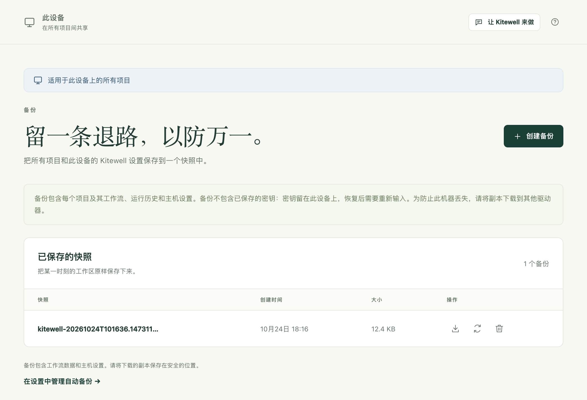
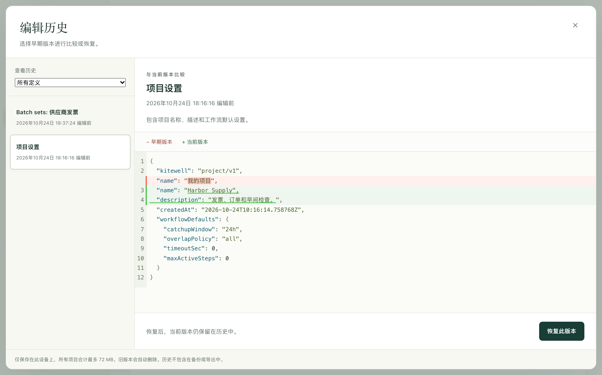

快照会把这台设备上的所有项目（工作流、运行历史、设置、表格和知识库）打包成一个文件，你可以把它存放在安全的地方，以后再恢复。Kitewell 可以每晚自动创建一个快照。它还会保留你编辑过的任何内容的早期版本，因此撤销某个工作流的更改时，无需恢复全部内容。

## 准备工作

这台设备的管理员权限。**备份** 位于侧边栏的 **此设备** 下。

## 立即创建备份

1. 打开 **此设备 → 备份**，选择 **创建备份**。
2. 稍等片刻。创建快照期间，每个项目的引擎都会停止，完成后再重新启动。
3. 快照会出现在 **已保存的快照** 下，并显示其 **创建时间** 和 **大小**。
4. 选择快照旁边的箭头 **下载备份**，把文件保存到你能掌控的地方。



只存放在这台设备上的快照，可以用来撤销更改。但如果设备本身丢失或被盗，它就帮不上忙了，因此请把下载的副本保存在另一个驱动器上，或团队受保护的存储中。

## 每天备份

开启 **设备设置 → 自动备份 → 每日备份**，并选择 **备份时间**。之后 Kitewell 会按这台设备自身的时区，在该时间过后不久每天创建一个快照。如果设备当时处于睡眠状态，快照会在唤醒后创建。

Kitewell 会保留最新的 10 个自动快照，并删除更早的快照。你自己手动创建的快照，以及恢复前创建的安全快照，会一直保留到你删除为止。

有两种情况会阻止自动快照。有工作流正在运行、排队或等待（包括等待审批）时，快照会推迟，Kitewell 每 15 分钟重试一次。而所有项目都已停止的设备则完全不会创建快照，因为没有需要保护的运行。

## 只撤销一项更改

每次保存工作流、表格或项目设置时，Kitewell 都会保留被替换的版本。在 **工作流** 页面、**项目设置** 或工作流编辑器的工具栏中选择 **编辑历史**。

1. 在列表中选择一个版本。每个版本都标有你覆盖它的时间。
2. 查看对比。**早期版本** 是你正在查看的版本，**当前版本** 是现在保存的版本。
3. 选择 **恢复此版本**，然后选择 **恢复** 确认。



恢复时，当前版本会保留在历史中，因此你可以再改回去。**查看历史** 可以把列表缩小到某一个工作流或设置。你删除的工作流仍在这里：恢复它会把它带回来，其计划处于暂停状态。

这份历史只保存在这台设备上。它不在快照中，也不在项目导出中，恢复快照会将其清空。

## 从快照恢复全部内容

1. 等进行中的工作完成。有工作流正在运行、排队或等待时，恢复会被拒绝。
2. 打开 **此设备 → 备份**，选择快照旁边的循环箭头 **恢复备份**。
3. 阅读警告，并选择 **恢复备份** 确认。Kitewell 会先保存一个安全快照，然后替换每个项目以及这台设备的设置，并重新加载。
4. 阅读恢复报告的内容，并逐项处理。

恢复会为每个项目列出需要重新输入的密钥、需要重新连接的邮箱，以及下次运行时会重新登录的网站步骤。容器镜像注册表的登录信息会被清除，因此也请重新输入。

这台设备会保留属于它自己的内容：它的登录信息、API 密钥，以及哪些项目处于停止状态。任何快照都不会把你锁在外面，也不会把别人的密钥带到你的设备上。

恢复从不写入 Dagu Cloud。[已同步的项目](/zh/docs/cloud-sync/)会恢复为快照中的状态，下一次更新时再取得 Dagu Cloud 中的副本。

## 快照包含哪些内容

| 包含在快照中 | 不包含 |
| --- | --- |
| 设备设置、提醒渠道和规则 | 密钥的值以及解密它们的密钥 |
| 项目、工作流定义、工作流默认值 | 提醒渠道的密码、Webhook 地址和密钥 |
| 导入的 OpenAPI 文件和 API 连接设置 | 邮箱登录信息 |
| 批量表格、发布版本、知识库页面 | 保存的网站登录信息和重放缓存 |
| 密钥的名称和说明 | 桌面步骤记录下的屏幕内容 |
| 运行历史和产物 | 运行输出日志 |
| 与助手的对话和失败诊断 | 编辑历史、提醒历史 |
| 为撤销而保留的已链接 Excel 文件副本 | 这台设备的登录信息和 API 密钥 |
| 这台设备针对各项目所做的决定：已批准的 SSH 主机、密钥路径、哪些工作流在这里运行 | Dagu Cloud 连接，即数据文件夹顶层的一个文件 |

不包含的内容是有意排除的。如果一个快照同时包含某个密钥和解密它的密钥，就等于把这个密钥明文保存了，因此恢复后的设备会重新要求输入凭据。

该文件不加密，而且其中一部分是你自己的业务数据：运行的输出和产物、与助手讨论的内容，以及表格写回的每个 Excel 文件最多十份副本。直接写在工作流、OpenAPI 文件或来源 URL 中的凭据，也会原样保存在里面。请把下载的快照视为敏感文件，放到共享存储之前请自行加密。

Kitewell 只备份它自己保存的内容。步骤调用的脚本、它们读取的文件、Docker 卷、挂载的文件夹，以及工作流访问的服务，都不包含在内。请像备份电脑上的其他内容一样备份它们。

## 遇到问题时

- **“has a workflow running, queued, or waiting”。** 还有工作在进行。请等它完成，或回应它正在等待的审批，然后重试。
- **备份因大小限制而失败。** 一个快照最多包含 2 GiB 数据和 100,000 个文件。请先删除不再需要的运行历史。
- **恢复时提示该备份使用了此版本无法读取的格式。** 该快照来自另一个版本的 Kitewell。请安装创建它的那个版本，或恢复更新的快照。
- **恢复后某个工作流处于搁置状态。** 其定义会被保留并报告出来，以便你就地更正；其他工作流照常运行。

其他问题请参阅[故障排除](/zh/docs/troubleshooting/)。

## 留意存储空间

**项目设置 → 存储** 会显示项目占用了多少空间、磁盘还剩多少，并在空间不足时提醒你。它会列出：

- 每个工作流的运行历史，以及 **删除历史…**
- 保存的网站登录信息，以及 **清除登录信息…**
- 网站步骤和桌面步骤保留的重放缓存，以及 **清除**
- 项目保存的其他所有内容，合计为一个数字

每天一次，在 **备份时间**，Kitewell 会清理早于 **设备设置 → 运行历史保留期限** 的运行历史、随之产生的已结束表格运行，以及已不存在的运行留下的文件。调低保留期限设置会立即清理旧历史，而不是等到夜里。

运行日志本身没有大小上限。一次输出很多的运行，仍可能在其历史到期之前就占满磁盘。

## 数据保存在哪里

```text
macOS:    ~/Library/Application Support/Kitewell
Windows:  %LOCALAPPDATA%\Kitewell
```

`data` 保存项目和设置，`backups` 保存快照，`runtime` 保存下载的各个引擎版本，`logs` 保存服务写入的日志。手动移动其中任何内容之前，请先退出 Kitewell；在没有已下载快照的情况下，切勿为了解决安装问题而删除该文件夹。

## 详细信息

- 快照为 `backups` 下的 `kitewell-<timestamp>.tar.gz`，采用 gzip 压缩的 tar 格式，仅所有者可访问；Kitewell 自动创建的快照名称中带有 `-auto`。自动清理只计算这些快照。
- 每个归档的上限为 2 GiB 未压缩数据和 100,000 个文件。
- 编辑历史的上限为：所有项目合计 64 MB、总共 1,000 个版本，每个工作流或设置 100 个版本；最早的版本会先被删除。它保存在 `data/history/<project>` 中。
- 备份不包含 `credentials.json`、`state.json`、`mail.key`、`data/history`、每个项目的 `mail.json`、所有 `logs` 目录，以及每个项目引擎下的 `auth`、`secrets`、`browser` 和 `computer` 目录。这三个设备文件在恢复时会沿用当前的文件，而不是从归档中取出。
- 每日清理还会删除失败诊断，并请引擎回收不再被任何运行引用的产物。工作流可以在其 YAML 中用 `hist_retention_days` 或 `hist_retention_runs` 设置自己的历史保留规则，其优先级高于设备设置。引擎更新处于隔离状态时，会跳过清理。
- 恢复会用归档中的设置替换正在运行的 MCP 监听器。已在进行中的运行既不会被等待，也不会被终止。
