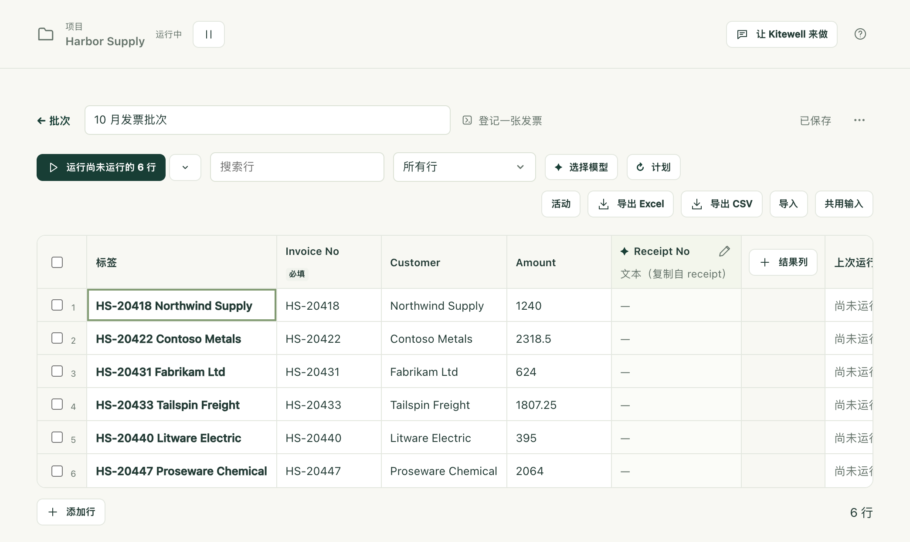

你有一份需要逐一处理的清单，例如本月的发票、需要核查的一百家供应商、搜索结果中的每一处房产，同时还有一个能处理其中一项的工作流。表格把这份清单按行排列，并针对每一行、用该行自己的值运行一次工作流。每次运行找到的内容会回到旁边的结果列中，于是整项工作就成了一张可以排序、筛选和导出的表。

失败的行可以单独重新运行。已经完成的行不会被打扰。无需有人守在旁边点击。

## 准备工作

- 一个能处理单个项目的工作流，并为每个项目之间会变化的内容设置命名的输入。没有输入的工作流也能按表格运行，但每一行都会做同样的事。
- 如果表格的列只是复制某个步骤已经收集到的值，就不需要其他任何东西。如果要改为让模型从每次运行中读取内容，项目需要在[智能体与模型](/zh/docs/ai/)下有一个 API 模型。

## 创建表格

1. 在侧边栏中打开 **更多**，选择 **批次**，然后选择 **新建表格**。
2. 选择 **工作流**，为表格设置 **表格名称**，然后选择 **创建表格**。
3. 表格打开后，工作流的每个输入各对应一列，并沿用其类型、默认值和允许的值，最左侧还有一个 **标签** 列。**标签** 用于为你标识每一行，绝不会传给工作流。
4. 填入各行（见下文），然后选择运行按钮。

你也可以从工作流的运行表单开始：从 **单次运行** 切换到 **批量表格**，你已输入的内容就会成为新表格的共用值。这个切换只在新的运行表单中提供，重试时没有。

一个表格最多可容纳 5,000 行和 30 个结果列。

## 填入行

- 直接在网格中输入，或者从当前所在的单元格开始，粘贴从电子表格中复制的单元格。行会按需自动添加。**添加行** 可以手动添加一行。
- 通过 **导入** 导入 Excel 工作簿或 CSV 文件，或者将文件拖放到表格的任意位置，又或者把行粘贴到面板的 **行** 框中，然后选择 **预览列**。预览会显示前几行，并已为你选好列名所在的那一行；你可以用 **将第 3 行用作列名** 选择其他行，或者选择 **没有列名**。然后把每一列映射到某个输入、**标签** 或 **跳过此列**。对于不是以逗号分隔的文件，可以用 **分隔符** 选择器处理。
- **共用输入** 是每一行都会使用的值，除非该行设置了自己的值。空单元格会以灰色斜体显示它将使用的共用值或工作流默认值。
- **从工作流的运行结果填充行** 让一次运行来查找项目（例如搜索得到的房源），并让各行保持最新。
- **链接本机上的工作簿** 会保持与 Excel 文件的连接，而不是把行复制进来，这样每一行的结果都会写回它所在的那一行。请参阅[自动处理 Excel](/zh/docs/spreadsheets/)。
- 助手可以提出行和列的建议，在你做出决定之前，这些建议会显示在打开的表格中。

列名上方的行、空行，以及“合计”或“Subtotal”这类合计行，不会被导入，每一类都会计数，并提供一个复选框，让你仍然可以把合计行包含进来。工作簿会在 Excel 打开时所在的工作表上打开，并提供其他工作表供选择。隐藏的行会被导入，除非你勾选排除它们的复选框。导入只会读取文件，绝不会更改它。

每个值都按其输入的类型读取：文本按原样，数字、`true` 或 `false`，以及按 JSON 读取的列表或对象。不符合类型的值，在输入时会被拒绝，在粘贴时会被跳过，从文件导入时则会保留但加以标记。被标记的单元格会带有红色圆框和原因，修正之前不会启动任何运行：即将运行的行中只要有一个不符合的单元格，整次启动就会停止，并指出是哪一行。

工作簿中的单元格会按 Excel 显示的样子导入：

- 日期为 `2026-10-01`，日期和时间为 `2026-10-01 12:00:00`，时间为 `09:30:00`；
- 数字不带分隔符或货币符号，也绝不会使用科学计数法；百分比以小数表示，因此 12% 为 `0.12`；
- `TRUE` 和 `FALSE` 变为小写的 `true` 和 `false`，这正是“是或否”输入所需的格式；
- `00123` 这类编码会保留前导零，无论单元格是文本，还是设置了前导零格式的数字；
- 向下跨多行合并的单元格会在每一行重复；同一行内的合并只保留在第一个单元格中；
- 公式给出的是 Excel 最后一次保存时的结果；
- 显示 Excel 错误（例如 `#N/A`）的单元格会以空值导入，并计入统计。

较旧的 `.xls` 文件和受密码保护的工作簿会被拒绝：请先将其另存为 `.xlsx`，或者移除密码。文件最大为 16 MiB。`.csv`、`.tsv` 和 `.txt` 文件也可以使用。

表格会在你编辑时自动保存，并显示 **已保存**。

## 运行各行

运行按钮会启动最应该运行的那一组行，并说明是哪些行。尚未运行任何行时，它显示为 **运行尚未运行的 6 行**；有行失败后，显示为 **重新运行失败或已停止的 2 行**；到最后，则是全部重新运行。旁边的下拉箭头会打开 **更多运行方式**，你可以在其中自己选择要运行的一组行。标记为 **已不在列表中** 的行，除非手动选中，否则不会包含在任何一组中。

每一行都会成为工作流队列中一次独立的运行。横幅会显示已完成多少行、同时运行多少行、队列的名称，以及在三行完成之后显示大约还剩多长时间。**default** 队列在整个项目中一次运行 5 个。如果某个网站会拒绝集中涌入的请求，请在横幅中选择 **更改同时运行的数量**，它会在 **队列** 页面上打开该队列，在那里调低 **同时运行数**。

在 default 队列中，行大约每次十行加入队列，其余行在有空位之前显示 **待处理**，引擎接收后显示 **排队中**。因此，共用该队列的其他工作流的计划运行最多只需等待一轮行，绝不会等待整个表格。

- **取消排队中的行** 会取消仍在等待的行。正在运行的行会继续。
- **全部停止** 也会停止正在运行的行。已完成的结果会保留。

每次启动都会保留一份工作流以及每行值的副本，因此之后编辑表格或工作流，不会改变已经排队的运行。自上次运行以来输入发生变化的行会显示 **已变更**，**自上次运行后已变更** 筛选器会列出这些行。编辑共用输入会标记所有使用它的行。

### 某一行失败时

选择该行，可以查看它停在了哪个步骤，以及该步骤的错误。**为 在门户上登记 设置重试** 会在工作流编辑器中打开该步骤，并准备好设置 **重试上限**：拒绝集中请求的网站，通常会让稍后的尝试通过。新的重试规则在这些行再次运行时生效，不适用于已经排队的运行。

## 从每次运行中收集结果

结果列会从每次运行中收集一个值。添加列时，在 **值的来源** 下选择收集方式。

**工作流发布的值** 会按原样从每次运行中复制该值：不用模型，没有费用，正是步骤找到的值，运行一结束就会填入。在该列创建之前运行过的行也会被填上。在 **输出** 下选择它。

- 如果新表格对应的工作流发布了值，会在“此工作流发布以下值。要将它们添加为列吗？”下列出这些值，并默认勾选。
- 网格右侧的 **结果列** 可以添加一列。
- 不符合列类型的值（例如数字列中的 `¥12,800`）会按发布的原样显示，并加以标记。它的详情中提供 **将列改为文本** 或 **改由模型读取**。
- 如果工作流不再发布某列的值，该列的表头会被标记。

只有进入运行输出的值才能被复制：网站和桌面步骤提取的值、邮件步骤的值，以及命令步骤声明的结果；人工填写的表单回答和循环内步骤的值不能复制。如果两个步骤发布了同名的值，以最后运行的那个为准。

**由模型读取运行** 适用于其他所有情况。为列命名，选择类型（**文本**、**数字**、**是或否**、**选项** 或 **等级**），并在 **要读取的内容（给模型的说明）** 下描述要查找什么，例如单位，以及有多个值时取哪一个。**选项** 和 **等级** 需要填写各自的 **选项** 或 **等级（从低到高）**。

这些列由 **智能体与模型** 中的 API 模型填写，在 **选择模型** 下选择：

- **提取模型** 读取文本列和数字列；没有决策模型时，也读取其他列。每个值都附带一段引文，即 **引自运行**；如果在发送的内容中找不到与引文逐字相同的文本，就会加以标记。
- **决策模型** 是可选的。它以概率判断是或否、选项和等级列，速度更快、成本更低，但不附引文。**低于此置信度的判断标为“不确定”** 设置一个置信度，低于该值的判断会被标记出来交给人处理；默认为 70%。

只有在启动这些行时，表格中已经有该列和模型，值才会在每次运行成功后读取。横幅中的 **填写 4 行** 会读取缺少值的已完成行，单元格详情中的 **重新读取** 会重新读取一次运行。两者都不会重新运行工作流。如果某个值是在你更改该列的定义之前读取的，它会被标记为已过时；更改模型则不会标记任何内容。

发送给模型的内容包括：该行的输入、运行中各步骤的结果、它发布的输出、它生成的最多五个文本文件，以及最多四个步骤日志的末尾部分；不包括截屏。请选择你放心交给这些内容的提供商。

## 让运行来查找行

行可以来自工作流运行时找到的列表，这样新项目无需任何人添加就会成为新行。在 **导入** 下，或者在新表格的空白行下方，选择 **从工作流的运行结果填充行**。

1. 选择 **工作流**（可以是表格自己的工作流），以及它的运行所发布的 **列表**：[网站](/zh/docs/browser/)或[桌面](/zh/docs/desktop/)步骤的 **项目列表**、**查找邮件** 步骤找到的邮件，或者某个步骤以列表形式发布的任何输出。
2. 查看它最近一次运行的前几个项目。如果它还没有运行过，或者它的字段只能从运行中得知，请选择 **立即运行**。
3. 在 **各输入项的填充来源** 下，每个输入都会取同名的项目字段。用 **以此匹配行** 选出能区分各项目的那一个，并设置该列表自身运行所需的输入。
4. 选择 **填充行**。工作流会运行一次，并为每个项目添加一行。

之后工具栏会显示行的来源，**刷新行** 会再次运行该工作流。运行成功后：

- 项目会填充键值相同的行。你手动添加的、键值相同的行会被接管，而不会重复出现。键值按文本比较，但看起来是数字的内容会按数字比较。
- 新项目会添加一行，在运行之前标记为 **新增**。
- 项目已消失的行会保留，以灰色显示为 **已不在列表中**，项目回来时它也会恢复。**已不在列表中** 筛选器会显示这些行，并提供一个按钮，可以一次性全部移除。
- 没有键值的项目、与其他项目键值重复的项目，以及超出 5,000 行上限的项目，都会被跳过并计数。

运行失败时不会改变任何内容，并会说明原因。返回的列表为空，或者没有任何带键值的项目时，也是如此：出问题的运行绝不会让整个表格变灰。只有列表确实变短时，才会标记缺少的行。

当来源不再匹配时（工作流已被删除或不再发布该列表、它填充的某个输入被重命名，或者列表中的项目少了某个字段），表格会提示这一点，批次列表中也会标记该表格。**更改来源** 会打开面板，并已重新调整好映射。

## 按计划运行并查看变化

要跟踪值随时间的变化，例如每天早上检查的价格或房源，请在表格的工具栏中选择 **计划**，并将 **重新运行每一行** 设置为 **每小时**、**每天**、**工作日**、**每周**，或者 cron 格式的 **自定义计划**；**关闭** 会将其移除。一个表格每小时最多运行一次。工具栏和表格列表会显示下一次运行的时间。

- 计划属于这台设备。它绝不会随表格同步，因此同事共享的表格只会在有人为其设置了计划的地方运行，绝不会意外地在两台电脑上运行。
- 它在这台电脑处于唤醒状态、并且该项目的引擎正在运行时运行。对于电脑关机或休眠期间错过的运行，可以选择电脑恢复后如何处理：**恢复后运行，除非下一次运行更近**（默认）、**恢复后总是运行** 或 **跳过**。无论选择哪一项，最多只会补跑一次错过的运行。
- 如果到了预定时间，上一次运行仍在进行，这次就会被跳过，并给出说明。
- 行来自工作流运行结果的表格会先刷新这些行，因此新项目会作为新行运行，已不在列表中的行则会被排除。取消勾选 **先从 查找新房源 刷新行**，即可按现有的行运行。

每一行都会保留它上一次以相同输入运行时读取到的值。之后发生变化的结果会在单元格中标记：新旧值都是数字时显示箭头，其他情况显示圆点，原来的值可以在悬停时以及单元格详情中看到。横幅会统计变化的数量，**显示它们** 会应用 **结果有变化的行** 筛选器。

只有文本列会忽略空格和字母大小写的差异；其他类型都按精确值比较。模型在不同的运行中可能会用不同的措辞表达同一个值，因此请尽可能复制步骤发布的值。

## 查看每次运行带来的变化

表格工具栏中的 **活动** 会按从新到旧的顺序，列出该表格最近 50 次已完成的启动。每一条都会说明运行了多少行、失败了多少行，每一列中哪些值上升、下降或变化了，哪些行是新增的、重新回到列表中的或已不在列表中的，以及最多 20 个发生变化的值及其原来的值。选择某个变化的值，即可打开它所在的行。

选择一个值，它的 **历史** 会显示过去一年中它每一次发生变化的时间点，数字还会以折线显示。

这些历史记录保留在运行该表格的设备上：每月一个文件，月份结束后压缩，十二个月后删除。

## 导出、复制和删除

- **导出 Excel** 和 **导出 CSV** 会把输入、值、每个判断的概率、每个已变化结果原来的值，以及每一行的 **状态**、**运行 ID** 和 **错误**，保存到一个以表格名称和日期命名的文件中。工作簿打开时，表头已冻结并带有筛选器，数字和日期是 Excel 可以排序的单元格，每一行的状态都以颜色区分。再次导入该文件时，会自动映射其中的输入。对于从工作流运行结果填充的表格，**列表状态** 列会说明哪些行是新增的，哪些已不在列表中。
- 表格菜单 **表格操作** 提供 **复制**（包含相同的行、输入、结果列和模型的副本）和 **复制（不含行）**（相同的设置，只有一个空行）。副本开始时不带结果，因为值属于产生它们的运行；也不带计划。
- **删除表格** 会删除该表格以及在这台设备上读取的值。运行仍保留在 **运行与日志** 中。表格中的行仍在运行时，无法删除该表格。

## 技术细节

- **完成批次时** [提醒](/zh/docs/alerts/)会在一次启动的每一行都已完成、并且已读取其值之后通知你：有多少行未成功、各列发生了哪些变化；如果先刷新了行，还会说明有多少行是新增的、重新回到列表中的或已不在列表中的。每一行都成功且没有任何变化的计划运行不会发出通知；手动运行则仍会报告。无法启动的计划运行会说明原因。批量运行的行不会逐行触发运行提醒，除非某一行在等待人工处理。
- [MCP 客户端](/zh/docs/mcp/)可以列出和读取表格（包括每个工作流发布的值，以及每个已变化值原来的值）；创建、替换和删除表格；从工作流的运行结果填充行并刷新它们；在这台设备上为它们设置计划；运行行、重新读取值和取消运行；以及链接或取消链接工作簿。替换表格是整体替换，因此被省略的行或列会连同其值一起删除。
- 表格本身属于项目，因此它会随项目导出，并[与 Dagu Cloud 同步](/zh/docs/cloud-sync/)，包括各行的值、行的来源，以及哪些行已不在列表中。行的状态、从运行中读取的值及其原来的值、最近一次刷新、活动和值的历史记录，以及表格的计划，都保留在运行它们的设备上。
