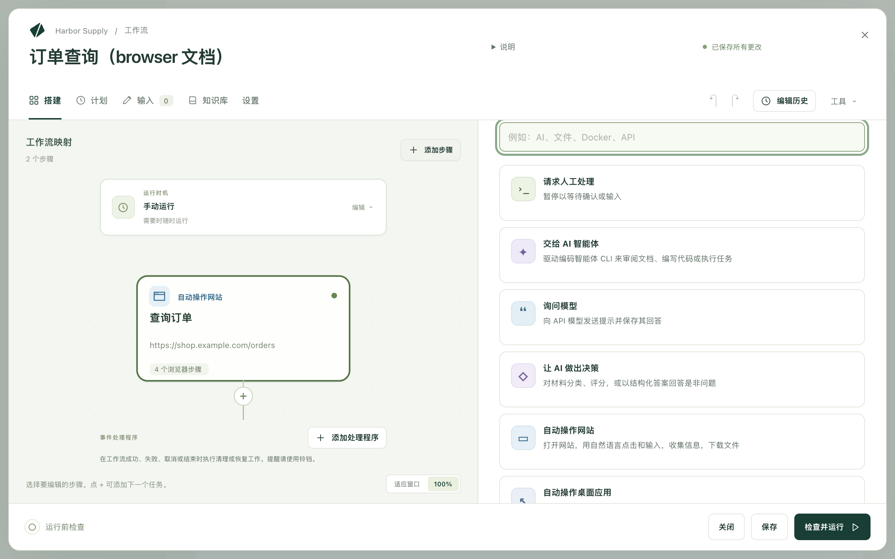
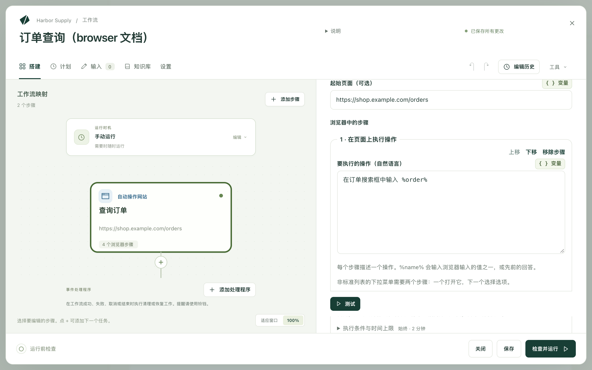

Kitewell 可以替你操作网站：打开网页、登录、点击和输入、上传文件、读取页面上显示的内容，并把找到的内容传给下一个步骤。你用平常的话写下要做什么，模型会在每个页面上判断该怎么做。不需要录制，也不需要编写选择器。

它可以替你完成这样的工作：

- 从供应商门户下载本月的发票。
- 把邮件里收到的收据上传到会计软件。
- 查询电子表格中每一笔订单的状态。
- 把网页仪表板上的数字复制到每日报告中。
- 为列表中的每一行填写同一个网页表单。
- 在网站发布新版本后，检查登录和结账功能是否仍然正常。

浏览器在你自己的电脑上运行，它完成的登录也保留在这台电脑上。

## 准备工作

这台电脑上的浏览器。在 Mac 上，请将 Google Chrome 安装在 `/Applications` 中。在 Windows 上，Kitewell 会使用已安装的 Chrome 或 Microsoft Edge。如果要使用 Chromium、Brave、Mac 上的 Edge，或者安装在其他位置的 Chrome，请在 **设备设置 → 浏览器 → 浏览器可执行文件** 中填写它的完整路径。步骤会显示是否找到了浏览器，以及将打开哪一个。

一个模型。网站步骤会询问 API 模型在每个页面上该做什么。在 **智能体与模型** 下[添加一个模型](/zh/docs/ai/)，然后在步骤的 **模型** 中选择它；也可以在 **设置 → 执行与重试 → 浏览器和桌面步骤的默认模型** 中为整个工作流设置一个。请使用 Anthropic、OpenAI 或 Gemini 的模型。小型本地模型通常无法操控浏览器。

然后在步骤上或在 **设备设置** 中选择 **检查浏览器**。它会像运行时那样，从 Kitewell 的后台服务打开一次浏览器，这样无法启动的浏览器现在就会暴露出来，而不是在计划运行的中途。在 Mac 上，这也让 macOS 能趁你在场时提出它的询问，由你当场作答。

## 搭建你的第一个网站步骤

这个示例会在一家网店的网站上查询一笔订单，并把订单状态交给下一个步骤。

1. 打开一个工作流，选择 **添加步骤**。任务选择器随即打开。

   

2. 选择 **自动操作网站**。为它设置 **步骤名称**，例如 `查询订单`。在 **技术设置** 下，**步骤标识符** 是后面的步骤读取此步骤所收集内容时使用的简短名称；请起一个简单的名字，例如 `order`。
3. 选择 **模型**，并将 **起始页面（可选）** 设置为开始的页面，例如 `https://shop.example.com/orders`。
4. 在 **浏览器输入的值** 下，选择 **添加值**，将其命名为 `order`，并把它的 **值** 设置为订单号。它可以是直接输入的文本、工作流输入，或者密钥（以不会出现在日志中的方式保存的密码或密钥）。
5. 在 **浏览器中的步骤** 下，使用 **添加浏览器步骤** 依次添加：
   - **在页面上执行操作**，将 **要执行的操作（自然语言）** 设置为 `在订单搜索框中输入 %order%`
   - **在页面上执行操作**，内容为 `点击“搜索”按钮`
   - **确认…**，将 **页面应…** 设置为 `订单详情已显示`
   - **收集信息**，将 **要查找的内容** 设置为 `订单状态和预计送达日期`，并在 **要收集的内容** 下添加两个值：`status` 和 `delivery`，两者的 **类型** 都设置为 **文本**

   

6. 打开 **浏览器设置**，开启 **显示浏览器窗口**，然后选择 **测试**，观察这个步骤单独运行的过程。
7. 添加一个后续步骤来使用它收集到的内容，写作 `${steps.order.outputs.status}`。

在新的工作流中，**或从示例开始** 还提供了两个可以直接复制的网站示例：**从网站收集数据** 和 **登录一次，然后收集**。

## 编写模型能执行的指令

一条指令，一个动作。**在页面上执行操作** 步骤只会执行其中的第一个动作，因此 `输入验证码并点击“继续”` 会在输入之后就停下。请改写成两个步骤。

不是普通列表的下拉菜单也需要两个步骤：一个步骤打开它，下一个步骤选择选项。

像跟同事说话那样，说出页面上的东西：

- `点击最新发票旁边的“下载”`
- `在“客户”字段中输入 %customer%`
- `打开“报表”菜单`

收集信息的步骤描述的是你想要什么，而不是一个动作：`确认页面上的订单号和总金额`。说明这个值是什么，而不是它在屏幕上的位置。

## 网站步骤能做什么

其中的步骤在同一个浏览器中按顺序运行。

- **打开页面** 会前往一个 **网址**。
- **在页面上执行操作** 只做一件事，写在 **要执行的操作（自然语言）** 中。`%name%` 会输入浏览器输入的某个值，或者你之前给出的回答。
- **上传文件** 把这台电脑上的文件交给页面。请参阅[上传文件](#upload-files)。
- **收集信息** 读取 **要查找的内容**，并填写 **要收集的内容** 下的值。每个值都有 **名称**、**类型**（**文本**、**数字**、**是或否**、**列表** 或 **项目列表**），以及告诉模型这个值是什么的 **说明（可选）**。**项目列表** 规定 **每个项目包含** 什么，例如一条列表信息的 `url`、`title` 和 `price`。后面的步骤以 `${steps.<标识符>.outputs.<名称>}` 的形式读取每个值。
- **确认…** 会在页面看起来不对时让步骤失败。**检查方式** 用于选择检查的方法。**用自然语言（由模型判断）** 读取 **页面应…** 并询问模型。**页面包含文本**、**地址包含** 和 **元素出现（CSS 选择器）** 则自己读取页面，不使用模型，每次运行的结果都相同。**持续检查时长（可选）** 给页面留出达到该状态的时间。
- **等待** 可以按 **固定时长**（在 **等待时长** 中设置）等待，也可以 **直到元素出现（CSS 选择器）**。
- **截屏** 会以你指定的 **截屏名称**，把一张 PNG 保存到运行的文件中。
- **向我索取输入** 会显示你的 **向您显示的问题**，并暂停运行，直到你回答，例如用于一次性验证码。**将回答用作** 为回答命名，以便后面的步骤输入它。

每个步骤还有 **执行条件与时间上限**，用于仅在条件成立时运行它，并限制它最多能用多长时间。两者都未设置的步骤最多用时两分钟。

## 不让模型接触密码

**浏览器输入的值** 保存步骤要输入的所有内容：客户编号、工作流输入、密码。指令中以 `%name%` 指代每个值，模型只会看到这个名称。

对于任何敏感内容，请选择密钥作为值。它不会出现在指令中，不会发给模型，也不会出现在日志中。如果某条指令直接写出了密钥的值，这条指令会失败，而不会把值发送出去；**检查并运行** 也会在你运行之前指出这一点。

## 上传文件

**上传文件** 把这台电脑上的文件放进页面的文件字段，就像你在文件选择器中选择文件一样，例如把收据放进会计工具的文件框，或把签好的表单交到门户上。

- **要上传的文件 · 每行一个** 接受完整路径，例如 `~/Documents/invoice.pdf`；通配模式，例如 `~/Downloads/*.pdf`；或者之前某个列出文件的步骤的结果。开启了 **将附件保存到运行的文件中** 的邮件步骤在找到邮件时会列出其附件，因此写入 `${steps.<标识符>.outputs.messages}` 就会上传这些邮件带来的文件。
- **上传位置（可选）** 用平常的话说明文件字段，或者打开文件选择器的按钮或拖放区域，例如 `收据拖放区域`。模型会查找一次，之后的运行复用找到的结果。如果页面只有一个文件字段，请留空；这样就完全不会询问模型。
- **每次运行都重新查找** 会改为每次都询问模型，适用于上传区域位置会变化的页面。

文件选择器永远不会在屏幕上打开，模型也永远看不到这些文件、文件名或文件位置。对于一次只接受一个文件的网站，如果给它多个文件，步骤就会失败；请分成多个步骤上传，或者对每个文件各运行一次该步骤。每个文件最大 50 MB。网站会在后台发送收到的文件，因此请在上传之后加一个 **确认…** 检查，确认网站完成时显示的内容，例如 **页面包含文本** `上传成功`，并将 **持续检查时长（可选）** 设置为一分钟。

助手在搭建上传步骤时，会先在它自己的浏览器中尝试，并在任何文件发送到网站之前征求你的同意，同时说明网站和每个文件。试运行包含上传的工作流时也是如此。

## 登录一次，保持登录

在 **浏览器设置** 中开启 **在多次运行之间保持登录**。Cookie 和登录状态会保存在这台电脑上，因此下次运行打开网站时已经处于登录状态。**登录一次，然后收集** 示例就是这样开始的：它的第一个步骤会显示窗口，等你亲自登录，之后的每个步骤和每次运行都复用这次登录。

**项目设置 → 存储 → 登录信息** 列出已保存的内容、各项被哪些工作流使用，以及用于删除某一项的 **清除登录信息…**。备份中不包含登录信息，因此恢复后的电脑需要重新登录，就像它会再次要求你提供密钥一样。

同时处理多个项目的循环无法共用同一个登录。请将循环设置为一次处理一个项目，或者关闭 **在多次运行之间保持登录**。

## 要求证书的网站

有些网站（例如公司或政府的门户）在打开之前会要求浏览器提供客户端证书。只需把证书添加到 Kitewell 一次，这台电脑上的每个网站步骤和助手的浏览器都会向你指定的网站出示它，系统也不会询问证书密码。

1. 打开 **设备设置 → 浏览器 → 客户端证书**。
2. 对于 `.pfx` 或 `.p12` 文件，选择 **从文件添加…** 并输入它的 **密码**。在 Kitewell 应用中，也可以改用 **从这台电脑添加…**，从 macOS 钥匙串或 Windows 证书存储中选择一个；系统可能会询问一次是否允许 Kitewell 复制它。
3. 在 **用于** 下，选择 **仅限这些网站**，并在 **网站，每行一个** 中列出它们，例如 `portal.example.com`，或者用 `*.example.com` 表示其下的所有网站。**所有要求证书的网站** 会把证书提供给任何提出要求的网站。
4. 选择 **添加证书**，然后选择 **检查网站**，用该证书打开一个网站。

步骤本身无需任何设置。如果某次运行因为网站要求证书而失败，失败的运行会为管理员提供途径，为该网站添加证书或使用已添加的证书，然后 **重试运行**。

只有网站步骤和助手的浏览器会出示证书。[桌面步骤](/zh/docs/desktop/)操作的是你屏幕上的浏览器，该浏览器会自己要求你选择证书，并等待回应，因此这类网站请用网站步骤来自动操作。

Kitewell 将证书保存在这台电脑上，使用它自己的密码保护，绝不使用你的密码，并且不会将其放入备份。添加或更改证书会重启项目引擎；进行中的运行会继续。Kitewell 的聊天会在证书到期前一个月和一周，以及到期时发出提醒。

## 运行记录是什么样的

在 **运行与日志** 下打开运行。**浏览器执行的操作** 按顺序列出各个步骤及其截取的截屏，旁边显示被询问的 **模型** 和 **模型用量**，即输入和输出的 token 数。

**无 AI 运行** 表示该步骤的操作中有多少没有询问模型就完成了：回放的动作、自行读取页面的检查，或者打开页面这类操作。成功过一次的动作会被记住，下次以同样的方式重复；回放的动作不会向模型发送任何内容。

当网站发生变化、记住的动作不再奏效时，会重新询问模型。在某个步骤上开启 **每次运行都重新判断** 可以关闭这一机制；网站改版后，**项目设置 → 存储 → 重放缓存** 可以清除工作流记住的内容。**收集信息** 和用自然语言写的检查，每次运行都会询问模型。

当步骤到达 **向我索取输入** 时，运行会等待。在 **运行与日志 → 等待中** 中或从通知中打开它，在 **您的回答** 中输入，然后选择 **回答**；也可以选择 **拒绝**，让该步骤失败。回答会随运行一起保存，因此请将它用于会过期的验证码，而不要用于密码。如果在你处理之前浏览器已经关闭，**重新启动浏览器步骤** 会从它的第一个步骤开始重新运行该步骤。

## 对多个项目运行

- 电子表格中的列表：给工作流设置一个输入（例如订单号），然后从[批量表格](/zh/docs/batches/)运行，每个项目一行。表格会显示进度、失败情况和剩余时间。
- 网站上显示的列表：收集一个 **项目列表**（例如搜索的全部结果），并[让它填充表格的行](/zh/docs/batches/#let-a-run-find-the-rows)。刷新时会添加新的项目，并标记已经消失的项目。
- 一次运行中的列表：把该步骤放进 **逐项处理** 循环。
- 按计划运行：添加[计划](/zh/docs/scheduling/)，保持 **显示浏览器窗口** 关闭，以免你工作时 Chrome 弹出来，并让[提醒](/zh/docs/alerts/)在运行失败或等待回答时通知你。

## 遇到问题时

先查看步骤的截屏：登录墙、Cookie 横幅或机器人验证可以解释大多数失败。然后：

- 步骤提示页面上没有与指令匹配的内容。改写指令，说出页面上的东西，或者把它拆成两条。
- 上传提示没有打开文件选择器。在 **上传位置（可选）** 中写明文件字段本身，或者打开选择器的按钮；如果上传入口位于菜单或对话框之后，请在前一个步骤中先把它打开。
- 浏览器无法启动。运行 **检查浏览器**；如果没有找到浏览器，请设置 **设备设置 → 浏览器 → 浏览器可执行文件**。
- 步骤需要的网站无法加载。如果你填写了 **允许的网站 · 每行一个（可选）**，就必须列出该网站使用的每一个主机，包括它的登录服务器和图片服务器。

其余内容见[故障排除](/zh/docs/troubleshooting/#a-website-step-fails)。

## 技术细节

步骤上的 **浏览器设置** 还包含 **保存截屏**（**步骤失败时**、**步骤失败时以及结束时**、**每个步骤之后** 或 **永不**），以及以像素为单位的 **窗口宽度** 和 **窗口高度**。**允许的网站 · 每行一个（可选）** 接受 `example.com` 或 `*.example.com` 这样的主机名；本地地址、端口和路径会被拒绝。

发送给模型的是页面上可见的文本和布局，每个由模型决定的动作发送一次，费用由你选择的提供商收取。回放的动作和直接读取页面的检查不发送任何内容，浏览器输入的值、它上传的文件和你的密钥也都不会发送。上传的文件会发送到网站，和你自己选择这些文件时一样。请参阅[哪些数据会离开你的电脑](/zh/docs/data-flow/)。

有些网站会拒绝自动化浏览器。保存的登录，以及越过 Cookie 横幅之后的起始页面，可以应对常见的情况；CAPTCHA 验证码不会被破解。计划运行时，电脑必须处于唤醒状态。

[搭建你的第一个网站步骤](#build-your-first-website-step)中的工作流包含两个步骤：一个 **自动操作网站**，带有起始页面、一个名为 `order` 的值、两个 **在页面上执行操作** 步骤、一个 **确认…** 检查，以及一个读取状态和送达日期的 **收集信息** 步骤；然后是一个使用这两个值的后续步骤。
