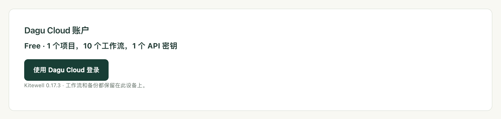

在笔记本电脑上修改工作流，办公室的电脑就会运行新版本，不需要给任何人发送文件。[Dagu Cloud](https://console.dagu.sh) 保存项目的定义；工作仍由每台电脑自己执行，使用它自己的密码，密钥的值也不会离开当初输入它的设备。

是否同步，按项目逐个决定。在你同步之前，项目只留在它所在的电脑上，也不会有任何内容发送到 Dagu Cloud。

## 准备工作

- 一个 Dagu Cloud 账户。账户免费，免费账户可以同步 1 个项目。
- 如需与他人共享，需要 Kitewell Team。它是最多 25 人的年度合同，按工作区连接的电脑数量报价；请发送邮件至 company@descarty.com 获取报价，更大的团队请选择 [Enterprise](/zh/pricing/#enterprise)。团队所有者为工作区付费，成员无需单独订阅。Kitewell Personal 每月 20 美元，供一个人在一台电脑上处理自己的工作，不能邀请他人。请参阅[价格](/zh/pricing/)。

## 登录

1. 打开 **此设备 → 设备设置**，找到 **Dagu Cloud 账户**。这里会显示这台电脑使用的是哪个套餐。
2. 选择 **使用 Dagu Cloud 登录**。
3. Kitewell 会显示一个短代码和 **在浏览器中继续** 按钮。选择它，在浏览器中登录，核对浏览器中的代码与 Kitewell 显示的是否一致，然后连接这台电脑。

一台电脑只与一个工作区同步，连接后，**Dagu Cloud 账户** 中会显示该工作区的名称。一个工作区可容纳的电脑数量由套餐决定：免费账户和 Kitewell Personal 为 1 台，Kitewell Team 为购买的台数。再连接一台时，会断开你自己在该工作区中最早连接的那台电脑；如果其余电脑都属于别人，则会拒绝连接，直到有电脑断开连接或套餐可容纳更多台。

仅登录不会发送任何内容。已登录的电脑会核验自己的套餐，并报告 Kitewell 版本以及自身的名称和 ID。只有你同步的项目才会发送工作流和运行状态，日志和密钥的值则从不发送。登录后，这台电脑还可以使用 [Kitewell 的内置模型](/zh/docs/ai/#use-kitewells-included-model)，其请求经由 Dagu Cloud 发送。

## 同步项目

1. 打开项目选择器，选择 **管理**。
2. 在 **管理项目** 中，选择项目旁边的 **同步到 Dagu Cloud**，然后确认。

项目会被上传并标记为 **已同步**，此后每次保存都会先发送到 Dagu Cloud。

:::caution
工作流 YAML、批量输入和 API 地址会按原样共享。如果你在其中直接输入过密码，请在同步前删除，改为保存在[密钥](/zh/docs/secrets/)中。
:::

如果上传中途中断，项目会显示 **上传未完成**，并提供 **继续上传**。在上传完成之前，保存会一直等待。

免费账户可同步 1 个项目。Kitewell Personal 最多可同步 5 个项目，Kitewell Team 最多 15 个，每个项目最多 100 个工作流。一个工作区可容纳的电脑数量由套餐决定：免费账户和 Kitewell Personal 为 1 台，Kitewell Team 为购买的台数。再连接一台时，会断开你自己在该工作区中最早连接的那台电脑；如果其余电脑都属于别人，则会拒绝连接，直到有电脑断开连接或套餐可容纳更多台。套餐已没有空位时，同步项目会被拒绝，并说明原因。已同步的项目计入工作区的套餐，而不计入这台电脑自身的项目数量上限。

如需从 Personal 改为 Team，或更改 Team 的电脑数量，请发送邮件至 company@descarty.com。如需改回 Personal，请先移除其他成员、撤销他们的邀请，并只保留一台已连接的电脑。

## 在另一台电脑上处理项目

1. 让那台电脑登录同一个工作区。
2. 打开 **管理项目**，选择 **从 Dagu Cloud 下载**。
3. 在 **Dagu Cloud 中的项目** 中，选择项目旁边的 **下载**。

列表会把已在这台电脑上的项目标为 **此设备上**，把你的角色只能读取的项目标为 **仅查看**。如果某个项目与这台电脑上已有的项目同名，下载会被拒绝，直到你将其中一个改名。

下载的工作流以暂停状态送达。先手动运行一次，再启用这台电脑应运行的工作流。

处理邮箱的工作流是例外：它同一时间只在一台电脑上运行，因为两台电脑会把同一封邮件读两次。如果另一台电脑已在运行这样的工作流，你在这里启用它时会看到提示，并可选择 **在此运行** 把它移到这台电脑上。

## 保持最新

Kitewell 会在启动时、打开项目时，以及打开工作流进行编辑时，获取在其他地方所做的更改，向 Dagu Cloud 查询的频率最多为每分钟一次。在 Personal 和 Team 上，电脑还会每隔约五分钟自行检查一次，因此无人使用的电脑也能取得新版本。免费账户只在上述三个时机以及你手动请求时检查。

如需在其他时间检查，请在 **管理项目** 中选择 **从 Dagu Cloud 更新**。在编辑器中打开的工作流，只要你还没有输入任何内容，就会就地接收更新。

接收更改会重启项目的引擎。已在进行中的运行会继续使用开始时的定义。对这台电脑来说是新的工作流会以暂停状态送达；已有的工作流则保留其是否开启、在哪里运行以及提醒设置。

如果在你打开某一项之后有人保存了它，你的保存会中止，并显示 **已在 Dagu Cloud 中更改**。选择 **覆盖** 可用你的更改替换对方的更改，选择 **取消** 则保留你的编辑但不保存。

已同步项目的文件由 Kitewell 管理。在 Kitewell 之外对这些文件所做的编辑，会在 Dagu Cloud 传来更改时，或下次在 Kitewell 中保存该项时被替换。

## 哪些会同步，哪些留在本机

已同步的项目包含与[项目导出](/zh/docs/sharing/)相同的内容：工作流定义和计划、智能体和模型、API 连接及其导入的文档、服务器和服务器组、队列、镜像注册表、批量表格、密钥的名称和说明、项目的工作流默认值，以及项目的[知识库](/zh/docs/knowledge/)。它还包含项目的[发布版本](/zh/docs/releases/)，而导出不包含这些。

:::note[密钥的值留在你的电脑上]
已同步的项目只按名称列出它使用的密钥。每台电脑各自保存自己的值，并在该电脑上设置；设置之前，**密钥** 中会显示 **需要填写值**。
:::

每台电脑还各自保留自己的镜像注册表登录信息、SSH 密钥和已批准的主机密钥、工作目录、启用了哪些工作流、提醒、运行历史和日志。除了下文所述的每次运行的状态，这些内容都不会发送到 Dagu Cloud。

## 在 Dagu Cloud 中查看运行

已同步的项目会报告其运行情况。每台电脑每两分钟一次（进行中的运行有变化时会更早），向 Dagu Cloud 发送每次运行的工作流、状态和触发方式，进入队列、开始和结束的时间，以及失败步骤的名称。同时附上它的 Kitewell 版本、操作系统和启动时间。

参数、日志、输出和表格中的值都留在电脑上，未同步的项目从不报告。工作区成员可以在 Dagu Cloud 中查看自己能打开的项目的运行。

**设备设置** 中的 **Dagu Cloud 账户** 会显示当前属于哪种情况：**运行状态已与 Dagu Console 共享**，或 **此工作区已关闭运行状态共享**。

工作区所有者可以在 Dagu Cloud 的 **设置** 中取消勾选 **共享 Kitewell 运行状态**，然后选择 **保存更改**，将其关闭。之后电脑只报告自己正在运行，在此期间结束的运行永远不会发送。

[Dagu Console](/zh/docs/console/) 介绍了控制台显示的内容及其发送的告警。

## 团队协作

工作区所有者在 Dagu Cloud 的 **Kitewell** 页面上管理团队：

- 通过 **邀请** 按电子邮件地址邀请成员。邀请在被接受、被撤销或七天后过期之前，都计入 25 人的名额。对方用该地址登录 Dagu Cloud 即可接受邀请。
- **同步项目** 列出团队同步的所有项目，并为每位成员分别设置在各个项目上的角色：
  - **查看者** 可以读取和下载项目。
  - **编辑者** 还可以保存对项目的更改。
  - **管理员** 还可以从 Dagu Cloud 删除项目。
  - **无访问权限** 会隐藏项目。

所有者可以打开每个项目。同步某个项目的成员会成为该项目的管理员。成员连接电脑的方式和你一样，在 Dagu Cloud 询问时选择团队的工作区即可。

:::caution
编辑者保存的更改，会在同步该项目的每台电脑接收更新后，立即在那台电脑上运行。只将编辑者角色授予你放心让其在团队电脑上运行命令的人。
:::

在你的角色为 **查看者** 的项目中，页面标题栏和下载列表中会显示 **仅查看**。你仍然可以运行其中的工作流、在你的电脑上设置其密钥的值，以及启用这台电脑应运行的工作流。Kitewell 会隐藏 Dagu Cloud 会拒绝的编辑操作：更改工作流、创建或应用发布版本，以及声明密钥。

## 套餐结束时

付费套餐结束后，提醒、MCP Events 和 Webhook 会停止。其他一切会继续运行 7 天，每个页面上的横幅会说明超出免费套餐的项目、工作流、API 密钥或已连接的应用将在哪一天停止。

- **选择保留的内容**：在横幅或 **设备设置** 中，在套餐上限之内选择哪些项目、工作流、密钥或应用继续启用。如果你什么都不选，则保留最近运行或使用过的那些。
- **不在套餐内**：超出上限的内容会标记为 **不在套餐内**。它们无论按计划还是手动都不会运行，也无法编辑，但你仍可以打开它们、查看运行历史、导出或删除。已在进行中的运行会正常完成。
- **不会删除任何内容**：重新订阅后，一切都会像以前一样运行，包括计划。

改用上限更低的套餐时也是如此。无法连接 Dagu Cloud 的设备会保持其最后的付费套餐，直到该许可证到期，之后同样有 7 天。

## 停止同步

- **管理项目** 中的 **停止同步** 会让项目同时保留在这台电脑和 Dagu Cloud 中。之后在这里的保存只留在本地。
- **从 Dagu Cloud 删除** 出现在下载列表中你的角色为 **管理员** 的项目上，它会删除这台电脑未同步的项目，并释放其在套餐中的名额。其他电脑上的副本将无法再保存到 Dagu Cloud。
- 与其他工作区同步的项目会显示 **其他工作区**，并且只提供 **停止同步**。

如果项目被从 Dagu Cloud 删除，或你失去了对它的访问权限，它会作为本地项目保留在你的电脑上。

电脑离线时，保存到其已同步项目会被拒绝。只留在本机的更改仍然可以进行，例如启用工作流、设置密钥的值；已启用的工作流也会继续使用本机上的副本运行。如果 Dagu Cloud 不再接受这台电脑的连接，请在 **设备设置** 中选择 **重新连接账户**。
