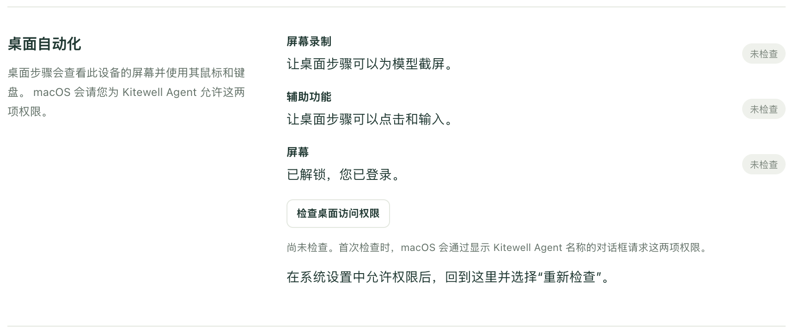
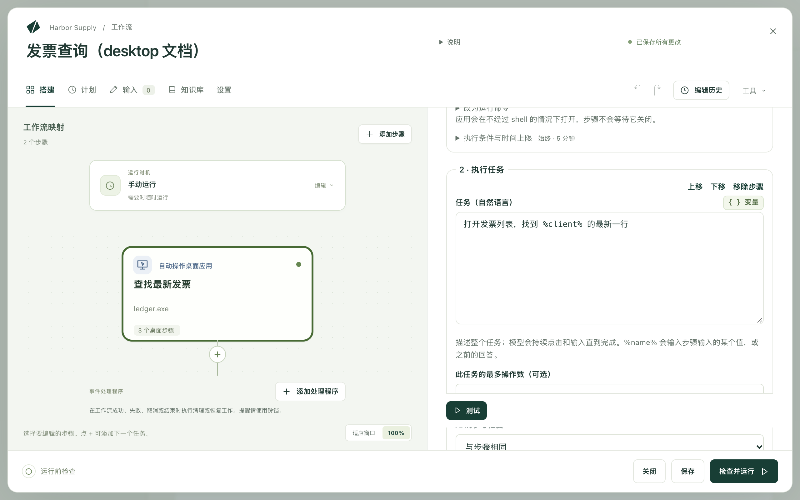

Kitewell 可以像人一样使用你电脑上的应用：先看屏幕，再点击和输入。你用平常的话描述任务，例如“为 %client% 创建一张发票并保存”，模型就会一直操作，直到完成。

这正是桌面 RPA 工具所做的工作，即操控没有 API 的应用，但这里无需手动录制任何内容，也不用维护选择器。第一次由模型摸索出完成任务的方法；之后的运行中，只要应用仍然匹配，就会在不使用模型的情况下回放它做过的操作：在 Windows 上依据应用自身的界面元素，在 macOS 上依据屏幕画面的匹配。当应用不再匹配时，会就发生变化的部分重新询问模型。

这样就能处理那些既没有 API、也没有网页版的会计软件或 ERP 客户端：

- 把电子表格的每一行复制到会计或销售应用中。
- 从桌面仪表板上读取一个数字，并传给下一个步骤。
- 从只能通过菜单导出的应用中导出报表。
- 在应用更新后，检查它显示的内容是否正确。

它可以在 macOS 和 Windows 上、在你面前的屏幕上运行。运行时它会占用鼠标和键盘，而你一碰它们，它就会立即交还。

## 准备工作

一个读取屏幕的模型。每个项目有一个，在 **项目设置 → 屏幕步骤** 中设置。在你选择其他模型之前，使用的是 [Kitewell 的内置模型](/zh/docs/ai/#use-kitewells-included-model)：无需 API 密钥，在所有套餐中费用都从工作区的 Dagu Cloud 积分中扣除，免费套餐的积分足够短暂试用。要用自己的模型读取屏幕，例如 Claude Sonnet 5、GPT-5.4 或 Gemini 3.6 Flash，请在 **智能体与模型** 下[添加该模型](/zh/docs/ai/)，然后在那里选择它，或在该模型的页面上选择 **用于屏幕步骤**；Kitewell 会先让它读取一张测试截图。除非步骤的 **模型**，或工作流的 **设置 → 执行与重试 → 浏览器和桌面步骤的默认模型** 指定了其他模型，桌面步骤都使用项目的模型。Anthropic、OpenAI 或 Gemini 的模型在其提供商有电脑操作工具时用它操作屏幕；其他能调用工具的视觉模型则借助通用的点击和输入工具完成工作，但速度更慢，可靠性也更低。**桌面设置** 下的 **模型使用桌面的方式** 通常为 **自动**；选择 **通用工具，适用于任何视觉模型** 后，任何模型都使用通用工具。

使用屏幕的权限。打开 **设备设置 → 桌面自动化**。在你选择 **检查桌面访问权限** 之前，每一行都显示 **未检查**，检查之后显示 **就绪** 或 **需要关注**。

- 在 Mac 上，这些行是 **屏幕录制** 和 **辅助功能**。首次检查会向 macOS 申请这两项权限，对话框中显示的名称是 **Kitewell Agent**，即 Kitewell 的后台服务，实际操控屏幕的正是它。请允许这两项权限；如果你关掉了某个对话框，**打开系统设置** 会带你前往正确的面板。
- 在 Windows 上，这一行是 **已登录的会话**：桌面步骤在你登录期间、在你的屏幕上运行。开启 **无人登录时也运行** 后，引擎也会在后台运行，但桌面步骤仍会等你；它所在的工作流会显示 **仅在您登录时运行**。另外，除非 Kitewell 也以管理员身份运行，否则桌面步骤无法在以管理员身份运行的应用中点击或输入。

屏幕已解锁，并且你已登录。桌面步骤使用你看到的屏幕，因此锁屏或休眠的电脑无法运行它们，按计划运行时也是如此。

## 搭建你的第一个桌面步骤

这个示例会打开会计应用，找到某个客户的最新发票，并把发票号交给下一个步骤。

1. 打开一个工作流，选择 **添加步骤**，然后选择 **自动操作桌面应用**。为它设置 **步骤名称**，例如 `查找最新发票`。在 **技术设置** 下，**步骤标识符** 是后面的步骤读取此步骤所读内容时使用的简短名称；请起一个简单的名字，例如 `invoice`。
2. 将 **模型** 保留为 **项目默认**，或为此步骤选择其他模型。
3. 在 **步骤输入的值** 下，选择 **添加值**，将其命名为 `client`，并把它的 **值** 设置为客户名称。它可以是直接输入的文本、工作流输入，或者密钥（以不会出现在日志中的方式保存的密码或密钥）。
4. 在 **桌面上的步骤** 下，使用 **添加桌面步骤** 依次添加：
   - **打开应用**。在 Mac 上，填写 **应用**，或通过 **选择应用…** 选择。在 Windows 上，在 **程序** 中填写程序的路径，或通过 **选择程序…** 选择。
   - **执行任务**，将 **任务（自然语言）** 设置为 `打开发票列表，找到 %client% 的最新一行`
   - **从屏幕读取**，将 **要读取的内容（给模型的说明）** 设置为 `该行的发票号和总额`，并在 **要读取的值** 下添加两个值：`number`，其 **类型** 设置为 **文本**；`total`，其 **类型** 设置为 **数字**

   

5. 选择 **测试**，把手从鼠标和键盘上移开，然后观察。
6. 添加一个后续步骤来使用它读取到的内容，写作 `${steps.invoice.outputs.number}`。

在新的工作流中，**或从示例开始** 提供了 **从桌面应用中复制数据**，它会打开这台电脑上已有的一个应用，并读取其中显示的内容。

## 编写模型能完成的任务

网站步骤一次执行一个动作；桌面步骤接受的则是一整项任务。模型会不断点击和输入，直到任务完成，所以请写出你希望完成的事，而不是每一次点击：

- `打开发票列表，找到 %client% 的最新一行`
- `为 %client% 新建一张金额为 %amount% 的发票，并保存为草稿`
- `将本月的销售报表导出为 CSV，保存到“文档”文件夹`

**桌面设置** 下的 **每个任务的最多操作数** 限制一项任务最多可以进行多少次点击和按键。默认值为 50，**此任务的最多操作数（可选）** 可以为单个任务设置不同的上限。需要更多操作的任务会失败，因此请拆分任务，或者提高上限。

## AI 的参与程度

桌面步骤不必每次都询问模型。**桌面设置** 下的 **AI 的参与程度** 为整个步骤设置这一点，单个任务也可以单独设置：

- **回放；画面变化时由 AI 修正**（默认）会录下成功完成的任务，并在之后的运行中回放。当某个画面与录制内容不再匹配时，模型会从那里接手，并修复录制内容。
- **每次运行都由 AI 判断** 会为每个动作询问模型。它能适应屏幕上显示的任何内容，但每次运行都会为每个动作发送一张截屏。
- **仅回放，不用 AI** 只根据录制内容运行。不会向提供商发送任何内容，也不会调用模型；如果步骤再也找不到录制时的内容，它会停下来并说明发生了什么变化，而不会随意发挥。

录制内容保留在录制它的电脑上。在 Windows 上，在学会某项任务的那次运行中选择 **固定这些步骤**，会把录制内容写入步骤，这样每台 Windows 电脑都能回放它。

全程使用 **仅回放，不用 AI**、并且没有用句子写成的检查的步骤，完全不需要模型。**从屏幕读取** 第一次需要模型；在 Windows 上，之后的运行会尽可能不用模型，再次读取相同的元素。在 macOS 上它每次运行都会询问模型，所以在 macOS 上不要将它设置为 **仅回放，不用 AI**。

## 桌面步骤能做什么

其中的步骤在这台电脑的屏幕上按顺序运行。

- **打开应用** 启动一个应用或程序，但不会等它关闭。在 Mac 上，**改为运行命令** 接受一个 **命令** 和 **参数 · 每行一个（可选）**。
- **执行任务** 执行 **任务（自然语言）** 中写明的任务。`%name%` 会输入步骤输入的某个值，或者你之前给出的回答。
- **从屏幕读取** 读取 **要读取的内容（给模型的说明）**，并填写 **要读取的值** 下的值，每个值都有 **名称**、**类型**，以及告诉模型这个值是什么的 **说明（可选）**。后面的步骤以 `${steps.<标识符>.outputs.<名称>}` 的形式读取每个值。
- **确认…** 会在屏幕看起来不对时让步骤失败。**检查方式** 用于选择检查的方法。**由 AI 判断一句话** 读取 **屏幕应显示…**，并根据截屏询问模型。**画面上有文本**、**有某个元素** 和 **窗口标题包含** 不使用模型，直接读取最前面窗口的元素；它们需要 Windows。**持续检查时长（可选）** 给应用留出达到该状态的时间。
- **等待** 按你在 **等待时长** 中指定的时间等待。
- **截屏** 会以你指定的 **截屏名称**，把整个屏幕的 PNG 保存到运行的文件中。
- **向我索取输入** 会显示你的 **向您显示的问题**，并暂停，直到你回答。**将回答用作** 为回答命名，以便后面的步骤输入它。等待期间，其他桌面步骤可能会使用屏幕。

每个步骤还有 **执行条件与时间上限**，用于仅在条件成立时运行它，并限制它最多能用多长时间。两者都未设置的步骤最多用时五分钟。

## 不让模型接触密码

**步骤输入的值** 保存步骤要输入的所有内容，在任务中以 `%name%` 指代。模型只会看到这个名称。

对于任何敏感内容，请选择密钥作为值。它不会出现在任务中，不会发给模型，也不会出现在日志中。如果某项任务直接写出了密钥的值，这项任务会失败，而不会把值发送出去；**检查并运行** 也会在你运行之前指出这一点。

## 与你共用屏幕

桌面步骤一次只运行一个：屏幕只有一块，所以第二个步骤会等待第一个。在 **逐项处理** 循环中和[批量表格](/zh/docs/batches/)中也是如此：各个项目轮流运行，而不是同时运行。

在点击或输入之前，步骤会等到鼠标和键盘已有五秒无人使用；一旦你再次使用它们，它就会立即暂停，因此绝不会从你手中抢走输入。**桌面设置** 下的 **等待鼠标和键盘无人使用的时长** 可以更改这段等待时间；在无人使用的电脑上，设为 `0` 即可关闭等待。

桌面步骤运行时，菜单栏或系统托盘中的 Kitewell 图标会变成一个指针，菜单顶部会列出每个正在运行的步骤（正在使用你的电脑、因你正在使用而暂停，或者正在等待另一个桌面步骤），下面是 **停止**，它只会结束这些步骤所属的运行。屏幕上不会叠加绘制任何东西，因为模型会在截屏中看到它，并可能去点击它。

## 运行记录是什么样的

在 **运行与日志** 下打开运行。**桌面上发生的操作** 按顺序列出各个步骤及其截屏，并说明步骤在哪些地方等待你停止使用鼠标和键盘，或者等待另一个桌面步骤。旁边显示被询问的 **模型** 和 **模型用量**，即输入和输出的 token 数。

**无 AI 运行** 表示该步骤的操作中有多少没有询问模型就完成了：回放的任务、自行读取窗口的检查，或者打开应用这类操作。回放的动作不会向模型发送任何内容。

任务如何回放取决于系统：

- 在 Windows 上，作用于按钮、字段或菜单的动作，会在该元素当前所在的位置回放，所以窗口被移动或标题发生变化，都不会让它停下。其他动作则像在 macOS 上一样，根据屏幕画面回放。
- 在 macOS 上，回放直接依据屏幕画面：它需要相同的屏幕尺寸，并且每个画面看起来都要和录制任务时一样。

在判定回放未命中之前，它会等待录制的元素出现或屏幕画面匹配，最长等待 **桌面设置** 下 **等待元素最长** 所设定的时间；未设置时为 10 秒。

回放未命中时，模型会从那里接手；如果设置为 **仅回放，不用 AI**，步骤则会停下来并说明发生了什么变化。应用改版后，**项目设置 → 存储 → 重放缓存** 可以清除工作流记住的内容。该缓存保留在这台电脑上，不会包含在备份中。

## 当提供商要求你确认时

有些模型提供商会停下来，要求由人来批准某个动作，例如一次购买。步骤也会随之停止。**桌面设置** 下的 **当模型提供方要求确认操作时** 默认为 **停止该步骤**；选择 **继续执行** 则会让这些动作未经批准就执行。更稳妥的做法是在任务之前加一个 **向我索取输入** 步骤，这样由你来做决定，并且决定会随运行一起记录下来。

## 遇到问题时

先查看步骤的截屏。然后：

- 步骤提示需要某项权限。再次运行 **检查桌面访问权限**，并允许该行列出的权限。
- 屏幕已锁定，或者登录的是其他人。桌面步骤需要这台电脑的屏幕处于解锁状态，并且由你登录。
- 任务的操作数用完了。将它拆成两项任务，或者提高 **每个任务的最多操作数**。
- 有人在整个时间上限内都在使用鼠标或键盘，因此步骤始终没能用上屏幕。请在电脑空闲时运行，或者为该步骤设置更长的时间上限。
- 浏览器要求你选择证书。桌面步骤操作的是你屏幕上的浏览器，而添加到 Kitewell 的客户端证书无法作用于它。请改用[网站步骤](/zh/docs/browser/#sites-that-ask-for-a-certificate)来自动操作该网站。

其余内容见[故障排除](/zh/docs/troubleshooting/#a-desktop-step-fails)。

## 技术细节

模型决定的每个动作，都会把整个屏幕的截屏（包括其他打开的窗口）发送给该模型的提供商，并由该提供商收费。运行前请关闭不应被看到的内容，或者使用一台没有其他人使用的电脑。根据记忆回放的动作和读取窗口元素的检查不会发送任何内容，步骤输入的值和你的密钥也不会发送。随运行保存的截屏保留在这台电脑上，遵循运行的保留期限。请参阅[哪些数据会离开你的电脑](/zh/docs/data-flow/)。

桌面步骤只能在 macOS 和 Windows 上、在这台电脑自己的屏幕上运行。阻止屏幕录制的应用无法操作；在 Windows 上，如果 Kitewell 没有以管理员身份运行，以管理员身份运行的应用也无法操作。

[搭建你的第一个桌面步骤](#build-your-first-desktop-step)中的工作流包含两个步骤：一个 **自动操作桌面应用**，带有一个名为 `client` 的值、一个启动 Numbers 的 **打开应用** 步骤、一个查找该客户最新一行的 **执行任务** 步骤，以及一个读取发票号和总额的 **从屏幕读取** 步骤；然后是一个使用这两个值的后续步骤。

在 Windows 上，**打开应用** 改为接受程序名称，例如 `notepad.exe`，或者程序及要传给它的参数。
