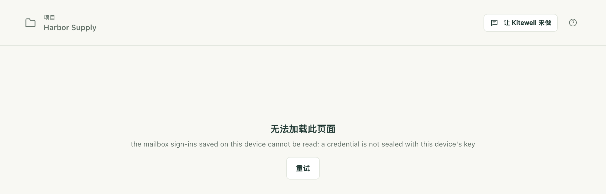
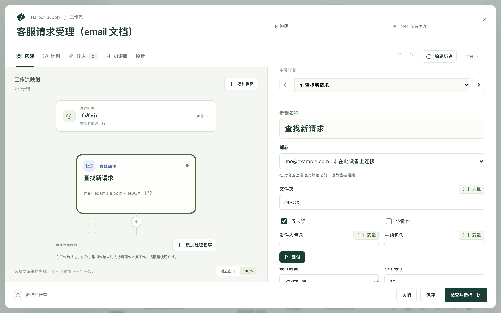

Kitewell 可以替你处理收件箱：找到重要的邮件，对它进行处理，然后归档；也可以自己撰写和发送邮件。它在你于这台电脑上连接的邮箱中工作，登录信息绝不会离开这台电脑。

以收件箱为起点或终点的工作：

- 保存每封未读发票邮件的附件，并记录其金额。
- 通过已连接的 API，把客服请求转为工单。
- 汇总过去 24 小时内收到的邮件，并发送摘要。
- 将收到的邮件分类到各个文件夹，由模型决定每封邮件的去处。
- 为每个请求起草回复，经人批准后再发送。

## 准备工作

在这台电脑上连接的邮箱：Gmail 或 Google Workspace、Microsoft 365 或 Outlook.com、iCloud、Yahoo、Fastmail，或者任何 IMAP 邮箱。项目中的 **邮件账户** 列出该项目的工作流所使用的邮箱，以及每个邮箱在这台电脑上的状态。

要添加邮箱，请在那里选择 **连接邮箱**，或者在任意邮件任务的 **邮箱** 字段中选择 **连接邮箱…**，然后输入地址。Kitewell 会根据地址，或者根据自定义域名的邮件投递去向，判断邮件提供商；如果判断有误，可以在 **提供商** 列表中更正。

| 提供商 | 连接方式 |
| --- | --- |
| Gmail、Google Workspace | 在 Google 审核 Kitewell 期间，使用应用专用密码 |
| Microsoft 365、Outlook.com | 在浏览器中登录 |
| iCloud、Yahoo、Fastmail | 在提供商网站上生成的应用专用密码（对话框中有链接）；服务器信息会自动填写 |
| 其他任何邮箱 | IMAP 和 SMTP 服务器、端口、安全设置、用户名和密码 |

浏览器登录会打开提供商的页面并等待，你批准后便会自动继续。然后 Kitewell 会登录一次，列出文件夹，并报告收件箱中有多少封未读邮件，或者说明登录失败的原因。在这项检查通过之前，不会保存任何内容。

各提供商的说明：

- 在 Google 完成对 Kitewell 的 Gmail 访问权限的审核之前，它会对大多数账户阻止 Kitewell 的浏览器登录。其页面会显示“This app is blocked”（此应用已被屏蔽），而且没有办法绕过。在此之前，对话框会通过应用专用密码来连接 Gmail 邮箱：开启两步验证，生成一个名为 Kitewell 的应用专用密码，然后粘贴进来。如果浏览器登录确实可用，则必须使用你输入的地址登录，并勾选 Gmail 复选框。如果 Google Workspace 管理员限制了第三方应用，则需要在 API 控制中允许 Kitewell。
- Microsoft 365 邮箱需要开启 IMAP 和经过身份验证的 SMTP，这由管理员在 Microsoft 365 管理中心中、该用户的“邮件”下的“管理电子邮件应用”中完成。只允许已批准应用的组织会收到一个链接，供其管理员一次性批准 Kitewell。共享邮箱需要以有权打开它的成员身份登录来连接。
- 应用专用密码在提供商的网站上生成，也可以在那里吊销。

连接会一直有效，直到提供商终止它：只要电脑开着，Kitewell 就会让浏览器登录保持有效。登录已失效的邮箱会在 **邮件账户**、**概览** 以及因此失败的任何运行旁边显示 **重新连接**。

## 搭建你的第一个邮件工作流

这个示例会在客服收件箱中查找未读邮件，通过已连接的 API 为每封邮件创建工单，并在工单创建后将对应邮件标为已读。

1. 打开一个工作流，选择 **添加步骤**，然后选择 **查找邮件**。选择 **邮箱**，将 **文件夹** 保留为 `INBOX`，保持 **仅未读** 开启，并为它设置 **步骤名称**，例如 `查找新请求`。选择 **测试**，查看哪些邮件符合条件；测试绝不会把任何邮件标为已读。

   

2. 选择 **逐封处理…**。Kitewell 会针对该步骤找到的邮件添加一个 **逐项处理** 循环，循环的最后是一个将当前邮件标为已读的 **整理邮件** 步骤。
3. 在循环中、该步骤之前，添加 **使用 API 操作**，选择工单系统的“Create issue”操作。在它的字段中，变量选择器会提供当前邮件的发件人、主题、日期和正文。
4. 添加一个[计划](/zh/docs/scheduling/)，例如每五分钟一次。

在新的工作流中，**或从示例开始** 提供了 **逐封处理新邮件**，它就是这种结构，只是具体要做的工作留给你来填写。

## 邮件步骤能做什么

**查找邮件** 会按从旧到新的顺序列出 **文件夹** 中符合条件的邮件，包括每封邮件的发件人、主题、日期和正文。可以用 **仅未读**、**含附件**、**发件人包含**、**主题包含** 和 **接收时间**（**任何时间**、**最近 1 小时**、**最近 24 小时**、**最近 7 天** 或 **最近 30 天**）缩小范围。**将附件保存到运行的文件中** 会把附件与运行的产物放在一起。**小于等于** 限制最多取多少封，默认为 20 封，最多 50 封，因此积压的邮件会在多次运行中按顺序处理完。查找绝不会把邮件标为已读。后面的步骤以 `${steps.<标识符>.outputs.messages}` 的形式读取这个列表。

**整理邮件** 处理你提供给它的 **邮件**：某个 **查找邮件** 步骤找到的邮件、其中的一封，或者某个 AI 任务给出的、指明每封邮件及其去处的回答。**标记** 可设为 **标为已读**、**标为未读**、**加旗标**、**移除旗标** 或 **保持不变**。**移动** 可设为 **不移动**、**移到文件夹**（文件夹名称在 **文件夹** 中填写，如果邮箱中没有同名文件夹，则会创建一个）、**归档** 或 **移到废纸篓**。任何邮件都不会被永久删除；已被别人移走的邮件会报告为找不到，但不会导致步骤失败。**测试** 只会预览更改。

**发送邮件** 从 **发件人** 中的邮箱发送，包含 **收件人**、**主题**、**消息** 和 **附件 · 每行一个文件路径**。在针对已找到邮件的循环中，**回复当前邮件** 会把回复放在该邮件的会话中，收件人为原邮件的发件人，主题为 `Re:` 加原主题，除非 **收件人** 和 **主题** 另有填写。Gmail 和 Microsoft 365 会在“已发送”中保留一份副本；其他提供商可能不会。

## 每封邮件只处理一次

保持 **仅未读** 开启，并在循环内、紧接在该邮件自己的步骤之后，将其标为已读或移走。这样，处理失败的邮件会保持未读，下次运行只会重试那一封。

如果改为在循环之后再标记，失败的邮件也会被标记，因为即使有些项目失败，循环之后的步骤仍会运行，那封邮件就再也不会被重试。对于针对整批邮件的工作（例如摘要），在最后放一个 **整理邮件** 步骤才是正确的做法。

**检查并运行** 会在以下情况下发出警告：找到的邮件从未被标记、只在循环之后才被标记，以及邮件正文会传给命令或能运行命令的 AI 智能体。这些正文是发件人写的，所以请把它当作发件人的内容来对待：如果需要模型读取邮件，请使用 **询问模型** 步骤，它无法运行命令。

## 团队使用

邮箱地址和其他文本一样，会随工作流一起传递；连接本身则绝不会。从同事那里或从 [Dagu Cloud](/zh/docs/cloud-sync/) 收到的项目，会在其 **概览** 中列出需要连接的邮箱；需要某个邮箱的运行，在该邮箱于这台电脑上连接之前会被拒绝。

在同步的项目中，处理邮箱的计划工作流同一时间只在一台电脑上运行，因此两台电脑绝不会处理同一封邮件。如果另一台电脑已经在运行它，而你在这里将它开启，系统会询问是否把它移到这里；另一台电脑会在下次同步时将其关闭。工作流列表会显示由哪台电脑运行它。

## 遇到问题时

- 因为邮箱未在这里连接，运行被拒绝。打开 **邮件账户**，选择 **连接** 或 **重新连接**。对话框会说明提供商拒绝了什么。
- Google 显示“This app is blocked”（此应用已被屏蔽）。关闭该页面，回到 Kitewell，然后选择 **改用应用专用密码**。
- 每次运行都会再次找到同样的邮件。这些邮件从未被标记：请在循环中添加一个 **整理邮件** 步骤，并将 **标记** 设置为 **标为已读**。

其余内容见[故障排除](/zh/docs/troubleshooting/#a-mailbox-needs-reconnecting)。

## 技术细节

凭据不会包含在备份、导出和同步中；恢复后的电脑会要求你重新连接。步骤读取的邮件会随运行一起保存在这台电脑上，遵循运行的保留期限，并且只会发往你的工作流发送它的地方，例如你在 AI 任务中选择的模型。请参阅[哪些数据会离开你的电脑](/zh/docs/data-flow/)。

Gmail 浏览器登录申请的是读取、添加标签、移到垃圾箱和发送邮件的权限（`gmail.modify`），绝不会申请永久删除邮件的权限；同意页面和[隐私政策](/privacy/)中都说明了这一点。相比之下，应用专用密码会授予对整个邮箱的 IMAP 和 SMTP 访问权限。

一个 **查找邮件** 步骤每次运行最多获取 50 封邮件。不支持转发、草稿，也不支持在单封邮件到达时触发；带 **仅未读** 的计划可以完成这项工作。关闭了 IMAP 或经过身份验证的 SMTP 的 Microsoft 365 租户完全无法连接。

[搭建你的第一个邮件工作流](#build-your-first-email-workflow)中的工作流包含三个步骤：开启了 **仅未读** 的 **查找邮件**；针对它找到的邮件、**同时处理的项目数** 设为 1 的 **逐项处理** 循环；以及在循环中选择了工单系统“Create issue”操作的 **使用 API 操作**，后面跟着将当前邮件标为已读的 **整理邮件**。
