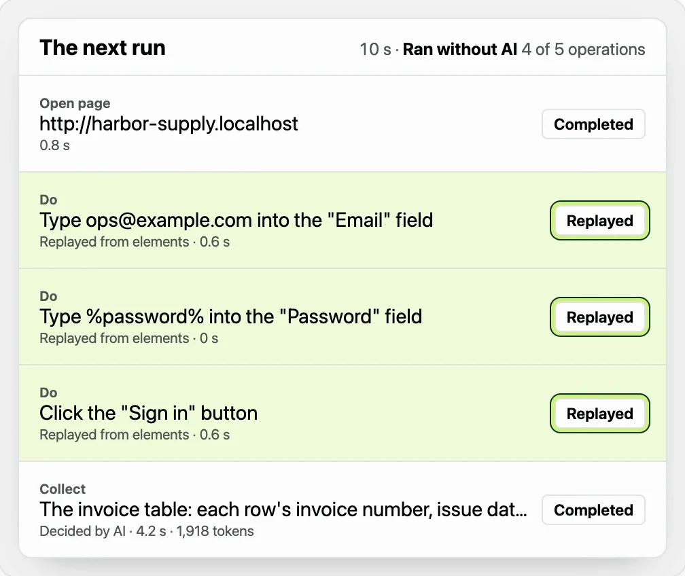
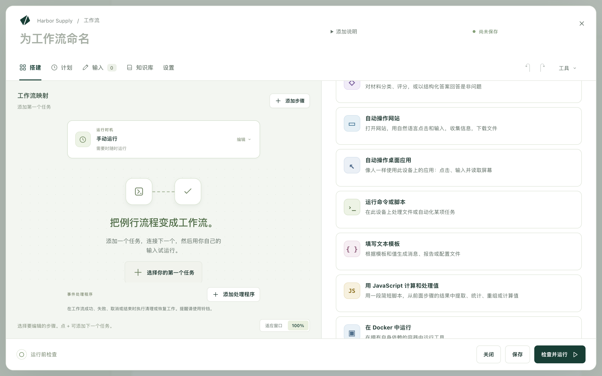
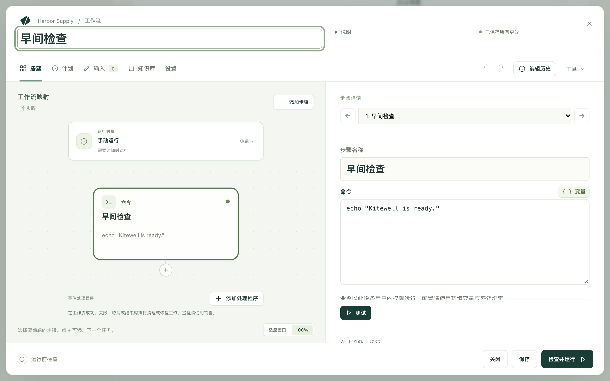
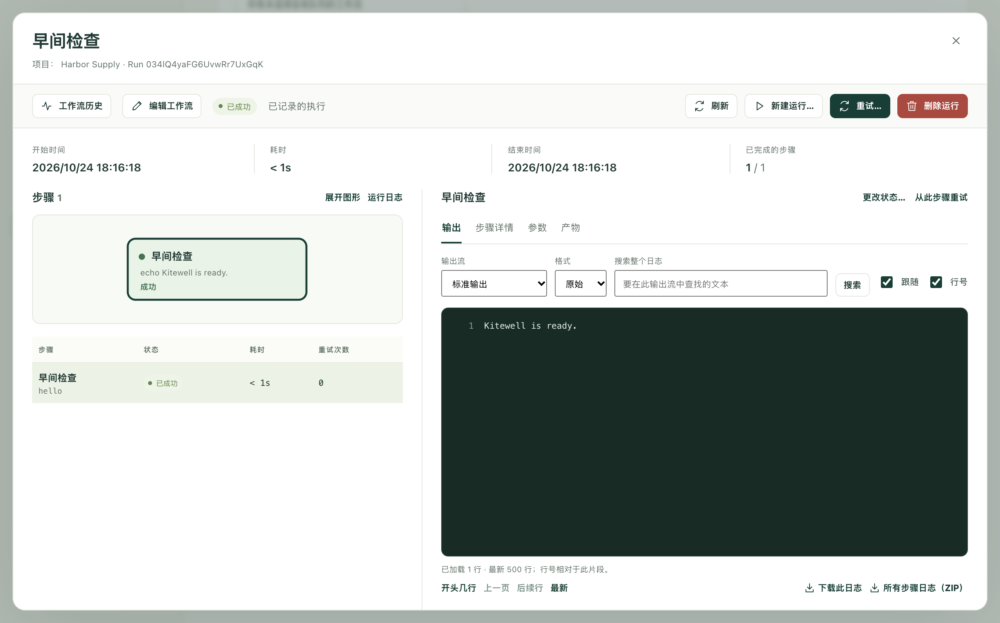

用平常的话把一项工作告诉 Kitewell。它的 AI 会在你眼前先把这项工作做一遍，然后提出一个按计划重复执行的工作流。本页带你完成第一项工作：从空白的聊天开始，直到它自己完成一次运行。

## 准备工作

已[安装](/zh/docs/install/)并打开的 Kitewell。首次打开时，选择 **登录以使用 Kitewell 的 AI**。浏览器会打开 Dagu Cloud，并显示一个需要你核对的代码，之后 Kitewell 的内置 AI 即可使用：无需 API 密钥，并附带 14 天试用期的 100 积分。如果想改用自己的模型，请选择 **在此设备上开始**，然后在聊天中连接模型；请参阅 [AI 智能体与模型](/zh/docs/ai/)。

涉及网站的工作还需要 Google Chrome；在 Windows 上也可以使用 Microsoft Edge。

## 把工作告诉 Kitewell

1. 打开聊天。聊天为空时，它会问 **有哪些事你一直在手动做？**，并提供几项可以直接开始的工作。
2. 选择其中一项，或者自己写一条请求：做什么、在哪里做、什么时候做。例如：

   > 每个工作日 9:00，用 [你的登录邮箱] 登录 [供应商门户的网址]，把新发票添加到我的工作表 [工作簿的路径] 中。

3. 发送。

写明网站、文件和时间。不要写密码：助手会用单独的卡片来询问密码。

## 看它完成工作

助手会先查看再动手编写，并通过卡片向你索取它需要的内容：

- **允许** 让它在 Kitewell 的浏览器中打开网站，浏览器显示在聊天顶部。**接手操作** 让你自己在那里点击和输入，用于只有你才能完成的步骤。
- 密码会填入一张卡片，并保存为密钥。助手永远看不到它。
- 光靠查看无法回答的问题，会以简短的表单提出。

## 检查后再应用

助手会以卡片形式提出工作流，按顺序列出各个步骤以及运行时间。阅读后选择 **应用**。在你应用之前，不会保存任何内容，也不会运行任何东西。

助手在浏览器中所做的操作会随工作流一起保留。它的点击都被记录了下来，因此第一次运行会直接重复这些点击，而不必重新摸索。

## 运行

让聊天立即运行它，或者打开工作流并选择 **立即运行**。然后打开 **运行与日志**，选择 **查看运行**。

选择浏览器步骤，即可查看浏览器执行的每一项操作：

- **已回放**：已记录的点击或按键，不用 AI 直接重复。
- **已恢复**：页面发生了变化，于是 AI 找到了新的做法，并保留下来供下次运行使用。
- 从页面读取值（例如新发票）的操作，每次运行都会询问 AI。

该步骤的 **无 AI 运行** 统计的是不需要模型的操作数量。

## 按计划运行

如果请求中说明了时间，例如每个工作日 9:00，工作流就会附带相应的计划。Kitewell 会在那个时间运行工作流。关闭窗口也没关系，它会在菜单栏或系统托盘中继续运行。在依赖无人值守的运行之前，请先阅读[计划](/zh/docs/scheduling/)。

## 遇到问题时

- 运行失败了。从 **运行与日志** 打开它。顶部的摘要会指出失败的步骤，并提供 **查看失败原因**，用于显示该步骤的日志。
- 工作流与网站对不上。在聊天中说明哪里不同，助手会修改工作流并再次提出。

## 不使用 AI

工作流也可以手动搭建，一次添加一个步骤。最简单的工作流只有一条命令：

1. 选择 **创建工作流**，在 **工作流名称** 中输入 `早间检查`。
2. 选择 **选择你的第一个任务**，然后选择 **运行命令或脚本**。

   

3. 在 **命令** 中输入 `echo "Kitewell is ready."`

   

4. 依次选择 **检查并运行**、**保存并运行…**、**开始运行**。

运行完成后，输出中会显示这一行。

[搭建工作流](/zh/docs/workflow-builder/)介绍了所有类型的步骤。

## 技术细节

- 命令以运行 Kitewell 的用户账户的权限执行。
- `echo "…"` 是少数几个在 Windows 的 PowerShell 和 Mac 的 shell 中表现相同的命令之一。为一个系统编写的命令，不一定能在另一个系统上运行。
