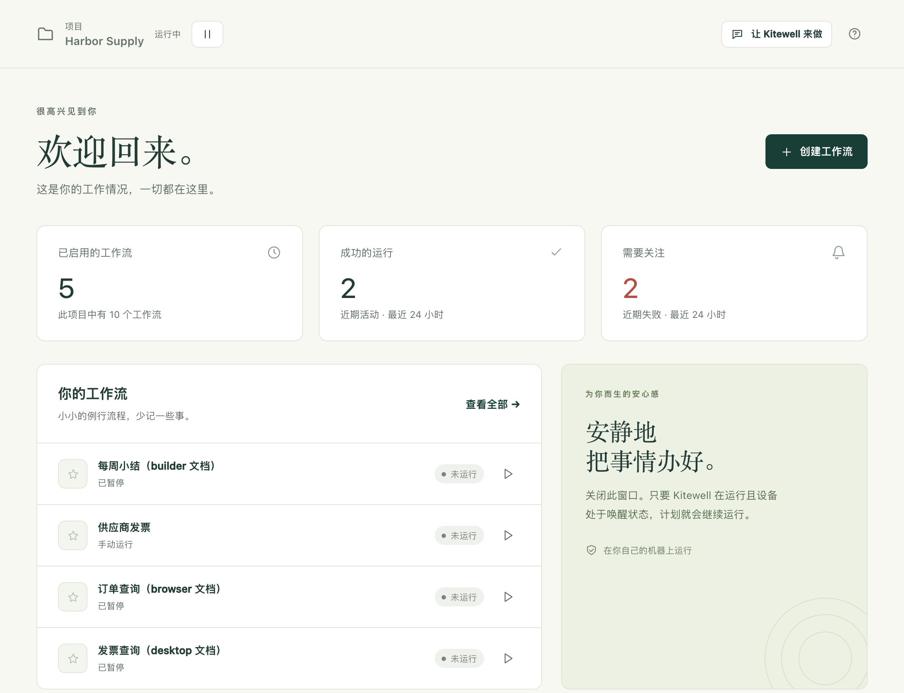

Kitewell 替你的团队完成那些一直靠手工做的例行工作。你只需描述一次，它就会在你自己的电脑上按你选定的时间运行，每次运行都会连同结果和输出一起保留下来。

## 从这里开始

1. 在 Mac 或 Windows PC 上[安装 Kitewell](/zh/docs/install/)。
2. [搭建你的第一个工作流](/zh/docs/getting-started/)。一个工作流就是一项例行工作，由若干步骤组成。
3. [设置计划](/zh/docs/scheduling/)，并了解 Kitewell 要在无人值守时运行需要满足哪些条件。
4. [与团队共享工作流](/zh/docs/sharing/)。

14 天试用无需信用卡。

## 工作流能做什么

- **[用步骤搭建](/zh/docs/workflow-builder/)**：命令和脚本、容器、通过 SSH 连接的另一台机器、Web 请求、AI，以及暂停下来等人审批。
- **[通过 Webhook 启动](/zh/docs/webhooks/)**：GitHub、Stripe、某个表单或 Zapier 发来请求时，就会开始一次运行，无需开放端口或配置隧道。
- 用自然语言而不是代码来 **[自动操作网站](/zh/docs/browser/)**、**[桌面应用](/zh/docs/desktop/)** 或 **[电子邮件](/zh/docs/email/)**。
- **[自动处理 Excel](/zh/docs/spreadsheets/)**：直接读取办公室现有的工作簿，并把每个结果写回它所在的那一行。
- **[按表格逐行运行](/zh/docs/batches/)**：每行运行一次，并汇总每次运行找到的内容。
- **[询问助手](/zh/docs/ai/#the-assistant)**：让它起草或修复工作流，并让它[诊断](/zh/docs/ai/#failure-diagnosis)失败的运行。
- **[导入 OpenAPI 描述](/zh/docs/apis/)**，然后填写 Kitewell 据此生成的请求表单。
- 与同事 **[共享项目](/zh/docs/sharing/)**，或 **[与 Dagu Cloud 同步](/zh/docs/cloud-sync/)**，让每一份副本都保持一致。每台设备提供自己的凭据，并且只启用它应当运行的内容。

:::note[早期版本]
Kitewell 刚刚推出，功能和限制仍可能变化。公开的安装程序支持 macOS 和 Windows，Linux 版本已在计划中。目前提供哪些版本，请查看[下载](/zh/download/)。
:::

## 费用

Kitewell 从 14 天试用开始，无需信用卡：在最多 3 台电脑上使用 Team 的功能，并附带 100 积分，可用于 [Kitewell 的内置模型](/zh/docs/ai/#use-kitewells-included-model)。从 Kitewell 登录 Dagu Cloud 时，试用即开始。试用结束后，在你订阅之前不会运行任何内容；项目仍以只读方式留在电脑上，可以打开和导出。每个项目都有各自的工作流、历史记录和密钥。

Kitewell Personal 为每月 20 美元，供一个人在一台电脑上处理自己的工作：五个项目，每个项目最多 100 个工作流，并可使用[提醒](/zh/docs/alerts/)和 [Webhook](/zh/docs/webhooks/)。它在你已登录时运行。Kitewell Team 为每台电脑每月 99 美元，面向最多 25 人的组织：15 个项目，一个同步这些项目的团队，并且在 Windows 上无人登录时也能运行。如果你之前用过 Kitewell，免费套餐以及 Personal 在无人登录时的运行可继续使用到 2026 年 12 月 1 日。详见[价格](/zh/pricing/)。

## 什么在哪里运行

除非你[将某个项目与 Dagu Cloud 同步](/zh/docs/cloud-sync/)，否则你的项目会一直留在你的设备上。密钥的值从不离开设备。与助手的对话、失败诊断，以及读入表格的值，也都留在设备上。

AI 步骤会把它读到的内容发送给你选择的模型提供商，例如运行输出、工作流定义、网页的文本。[哪些数据会离开你的电脑](/zh/docs/data-flow/)列出了所有去向。

关闭窗口不会停止任何东西。Kitewell 在 Mac 上会继续在菜单栏中运行，在 Windows 上则在系统托盘中运行，你的计划也会照常触发。要停止服务和工作流引擎，需在该菜单中选择 **退出 Kitewell**。

在 Mac 上，计划的工作要运行，电脑必须处于唤醒状态，并且你必须已登录。在使用 Kitewell Team 的 Windows 上，只要开启登录服务，即使无人登录，计划的工作也会运行，电脑还会为此唤醒。Kitewell 不提供云端机器。AI 提供商、远程服务器、容器和外部服务各有其要求和费用。

## 技术细节

Kitewell 为每个项目运行一个本地的 Dagu 工作流引擎。每个引擎都有自己的数据目录、调度器和加密密钥。步骤以运行 Kitewell 的用户账户的权限执行，因此请只运行你信任的工作流定义和命令。
