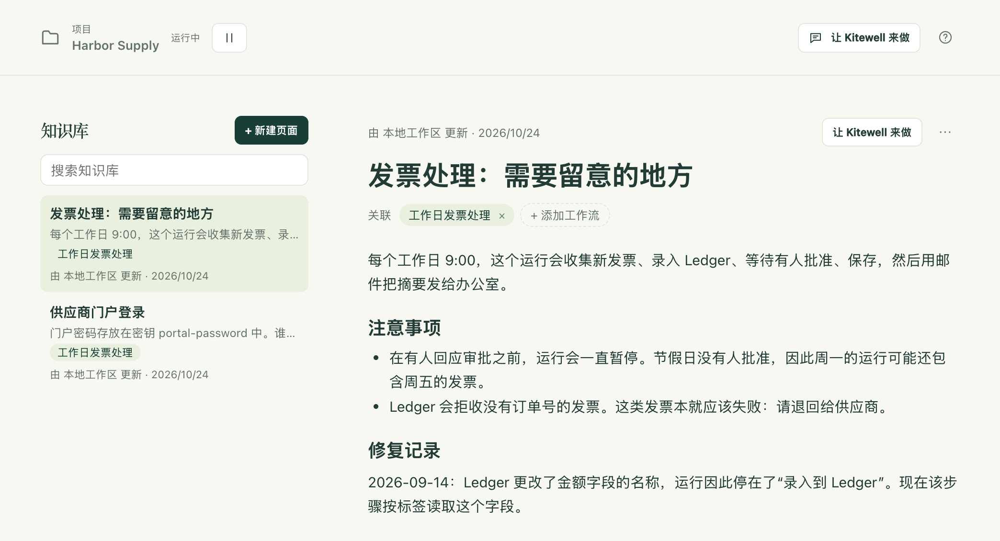

每个团队都知道一些从没写下来的事：为什么门户在月初会要求输入验证码，哪些发票本来就该失败，去年 9 月出了什么问题、又是怎么修好的。知识库就是项目存放这些笔记的地方。助手在回答你之前会先读这些笔记，并在你工作时不断补充，这样下一次对话和下一位同事都能从团队已经掌握的情况出发。

页面写的是工作流定义无法表达的内容。步骤、计划和输入留在工作流中；页面说明的是原因。

## 写一个页面

1. 在侧边栏中选择 **知识库**。项目的页面按从新到旧排列，你打开的页面会显示在旁边。
2. 选择 **新建页面** 并输入标题。页面一有标题就会创建。
3. 输入笔记内容。输入 `/` 可以插入标题、列表、清单、引用、代码、表格和分隔线；选中文字会出现一个小工具栏，其中有 **粗体**、**斜体**、**删除线**、**代码** 和 **链接**。输入时，`## ` 开始一个标题，`- ` 开始一个列表，`1. ` 开始一个编号列表。
4. 选择 **添加工作流**，选取该页面涉及的工作流。它的名称随后会出现在 **关联** 下，点击即可打开该工作流。不涉及任何工作流的页面（比如某个供应商的网站、团队的某条规定）也完全可以。
5. 无需手动保存。停止输入片刻后，页面上方的那行字会显示 **正在保存…**，然后显示 **已保存**。在 Mac 上按 ⌘S、在 Windows 上按 Ctrl+S 可以立即保存，离开页面时也会保存。

列表中的每个页面都会显示其第一行、涉及的工作流，以及最后修改它的人。助手写的页面带有 AI 标记。**搜索知识库** 可以按标题或正文中的任何词语找到页面，无论你输入的是全角还是半角字符。

同样的页面也会出现在对你有帮助的地方：

- 工作流编辑器的 **知识库** 标签页会显示与该工作流相关的页面，**添加页面** 会新建一个已关联到该工作流的页面。
- 失败的运行会在错误下方显示 **相关知识**。以前出过什么问题、又是怎么修好的，往往就写在那里。

## 助手会做什么

助手在处理每条消息之前都会读取项目的知识库：每个页面的一行摘要，以及你打开的页面和最多三个与你正在查看的工作流相关的页面的全文。需要时，它还可以读取其他任何页面，或者搜索所有页面。

它也会写页面。当你告诉它一个长期有效的事实、一条规则或一处更正时，当它出于定义中看不出的原因修改工作流时，或者当某个失败被修好时，它会立即把这些内容保存到页面中，并在面板中显示一条记录：新页面显示“已添加知识”，修改则显示“知识已更新”，同时附有 **撤销** 和 **打开**。当它创建工作流时，相关页面会出现在同一张卡片上，**应用** 会同时保存两者。

如果它写入时你正好打开着这个页面，被修改的部分会被标出，上方显示 **撤销** 和 **保留**。你一开始输入，标记就会消失。

有两条规则，让你可以放心地一直开着这项功能：

- 对话一旦读取过外部内容，它就会先征求你的同意。在助手获取过网页，或者读取过运行的日志、产物或表格之后，它就不再自行保存：修改会变成一张卡片，准确显示它要添加的内容，在你选择 **应用** 之前不会保存任何内容。网页或日志中的文字无法在无人察觉的情况下进入所有人的知识库。
- 它只写真实的内容。它写下的是你说过或决定的事，或者运行证实过的事，并使用你书写时所用的语言。当页面与工作流本身不一致时，以工作流为准，助手会更正页面。

页面是作为参考资料提供给助手的。页面上写的任何内容都不会被当作给它的指令。

## 其他人同时修改同一页面时

如果在你输入时，队友、另一台设备或助手修改了这个页面，你输入的内容不会丢失。页面会显示是谁修改的，并提供 **保留我的版本** 或 **使用对方的版本**；使用对方的版本后，可以在 Mac 上按 ⌘Z、在 Windows 上按 Ctrl+Z 撤销。如果你正在编辑时页面被删除了，可以选择 **保留为新页面** 或 **放弃我的编辑**。

## 遇到问题时

- 状态显示 **未保存**。页面没有标题，或者超过了 2,000 个字符。修正后选择 **重试**。无法保存的编辑会留在页面上，如果在 Kitewell 仍在运行时再次打开该页面，它们会重新出现；重启后不会保留。
- 页面以 Markdown 打开。页面中包含图片、一些 HTML，或者不是 `https://` 的链接，格式化编辑器无法在不丢失这些内容的情况下显示它们。请在 Markdown 中编辑，或者把那部分移出去。

## 详细信息

- 一个页面的标题最多 60 个字符，正文最多 2,000 个字符，最多可关联 20 个工作流；一个项目最多保存 100 个页面。从 1,800 个字符起，页面上方会出现字数计数；超过上限后将拒绝保存，并请你把多出的内容移到单独的页面中。
- **⋯** → **以 Markdown 编辑** 会为偏好 Markdown 的人显示页面的 Markdown，**以格式文本编辑** 则切换回去。**⋯** → **删除页面** 会在确认后为项目中的所有人删除该页面。
- 粘贴时会保留页面能容纳的内容：从电子表格复制的表格仍是表格，第一行作为表头；Markdown 文本会变为格式文本。只保留 `https://` 链接。
- 页面属于一个项目。项目中的每个人都能阅读页面；编辑者和助手可以修改页面。页面会[与 Dagu Cloud 同步](/zh/docs/cloud-sync/)，并包含在[项目导出](/zh/docs/sharing/)中。页面不属于[发布版本](/zh/docs/releases/)的内容，发布版本只包含工作流和密钥名称。
- [MCP 客户端](/zh/docs/mcp/)使用 `read` 和 `target: "knowledge"` 读取页面：可以读取整个索引、按 ID 读取单个页面，或者进行搜索。拥有 **编辑并运行** 权限时，它们还可以使用 `change` 以及 `upsert_knowledge` 或 `delete_knowledge` 类型写入页面。读取工作流时，也会一并返回与其相关的页面。
