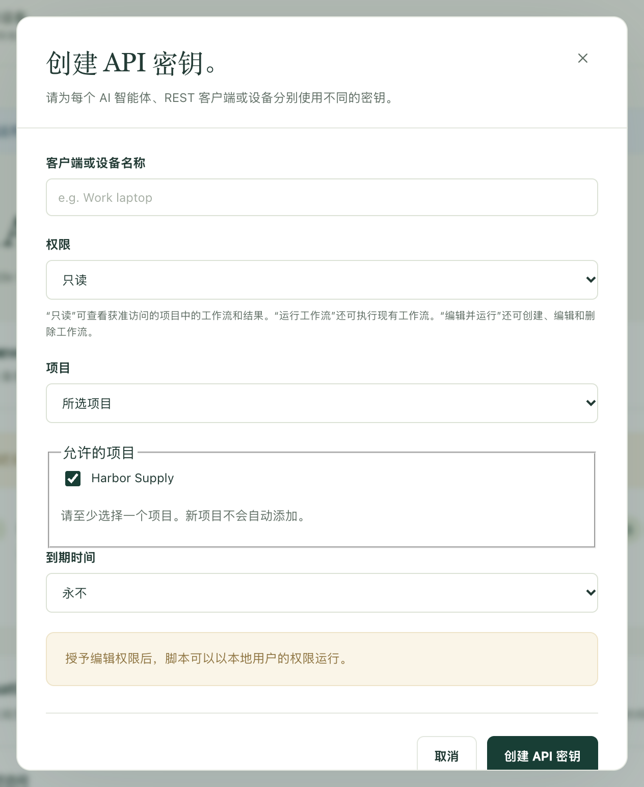
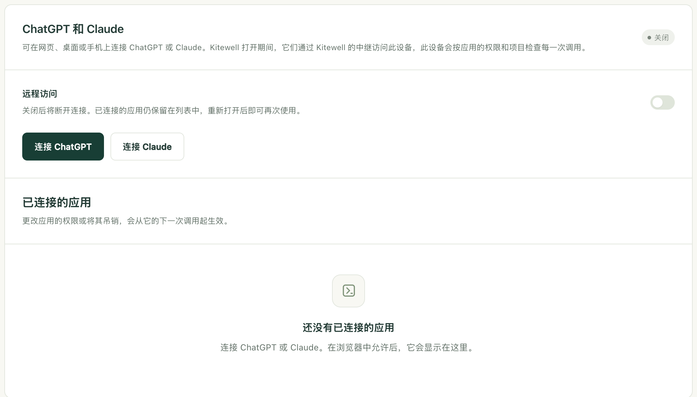

让 ChatGPT、Claude 或 Claude Code 运行你的某个工作流、查看某次运行做了什么，或者为你编写新的工作流。工作仍然在你自己的电脑上、在你允许的项目中进行，你也可以随时收回访问权限。

## 准备工作

- 存放工作流的那台电脑上开着 Kitewell，并且电脑处于唤醒状态。任何调用都无法到达处于睡眠状态的电脑。
- 如果助手在同一台电脑上（例如 Claude Code 或 Codex），则不需要其他任何东西。Kitewell 已经在 `http://127.0.0.1:19742/mcp` 上监听。
- 如果是网页版、桌面版或手机上的 ChatGPT 或 Claude，则需要一个 Dagu Cloud 账户，并让这台电脑[登录](/zh/docs/cloud-sync/#sign-in)该账户。它们从各自的云端发起调用，所以是通过 Kitewell 的中继，而不是上面的地址，到达你的电脑。

所有设置都在同一个页面上：**此设备 → MCP**。连接就绪时，**Kitewell MCP** 旁边的徽标会显示 **监听中**，下方的 **Kitewell MCP 网址** 就是要交给客户端的地址。


免费套餐总共只能有一个 API 密钥或已连接的应用。Kitewell Personal 和 Team 不限数量。吊销一个，就能为另一个腾出位置。付费套餐结束后，超出免费套餐数量的密钥和应用会在 7 天后停止工作，由你选择保留哪一个；请参阅[套餐结束时](/zh/docs/cloud-sync/#when-a-plan-ends)。

## 连接这台电脑上的助手

Claude Code、Codex 以及你自己运行的其他任何客户端，都用这种方式连接。它使用一个密钥：客户端在每次调用时都会发送的一长串秘密字符。

1. 打开 **此设备 → MCP**，选择 **连接 AI 智能体**。
2. 填写 **客户端或设备名称**，例如“工作笔记本上的 Claude Code”。这个名称只是为了方便你以后辨认。
3. 选择 **权限**：**只读**、**运行工作流** 或 **编辑并运行**。下一节会说明每种权限允许做什么。
4. 选择 **项目**。**所选项目** 只允许你在 **允许的项目** 下勾选的项目，不含其他项目；**当前及未来的所有项目** 还包括你以后创建的项目。
5. 选择 **到期时间**：**永不**、**30 天**、**90 天** 或 **自定义日期和时间**。
6. 选择 **创建 API 密钥**。



随后，Kitewell 会在 **API 密钥** 下显示一次密钥，并提供三种交付方式：

- **Kitewell MCP 网址** 是客户端要连接的地址。
- **Kitewell MCP 客户端配置** 是同样的信息，整理成许多客户端可以直接使用的一段配置。
- **给 AI 智能体的提示词** 是一段请求，粘贴到 Claude Code 或 Codex 中后，它们会自行添加连接。其中包含密钥，所以只能粘贴到你信任的助手中。

关闭对话框之前，请复制你需要的内容。密钥不会再次显示。如果丢失了，请吊销它并重新创建一个。

手动设置的客户端需要 URL、Streamable HTTP，以及请求头 `Authorization: Bearer <your key>`。客户端必须支持由你自己输入的凭据。ChatGPT 和 Claude 做不到这一点；它们改用登录方式连接，如下文所述。

回到页面上，**可以让它做的事** 中有三个请求，可以复制到已连接的助手中试用：**给命令设定计划**、**为 AI 智能体步骤设定计划** 和 **排查一次失败**。每个请求都会写明你当前打开的项目，并要求助手检查工作流，在你读过之前保持其计划为关闭状态。

## 每种权限允许做什么

| 权限 | 助手可以做什么 |
| --- | --- |
| **只读** | 查看你的项目、工作流、运行及其日志、运行留下的文件，以及项目的知识库。不会更改任何内容。 |
| **运行工作流** | 以上全部，另外还可以启动、重试、重新运行或取消运行；批准、拒绝、退回或完成等待人工处理的步骤；回应正在等待的网站或桌面步骤；以及运行表格中的行。 |
| **编辑并运行** | 以上全部，另外还可以创建、修改或删除工作流、智能体和模型、服务器、队列、工作流默认设置、API 连接、表格和知识库页面。 |

从能完成工作的最小权限开始。要问昨晚什么失败了，**只读** 就够了。要请它运行一次，**运行工作流** 就够了。只有 **编辑并运行** 允许助手编写工作流，而工作流中的命令会像你本人一样在那台电脑上运行：它们可以修改文件，也可以访问其他服务。只有当你放心让某个助手亲自在那台电脑上运行命令时，才把 **编辑并运行** 交给它。

权限只在允许的项目内生效，并不能把电脑的其他部分锁住。

连接能看到的是其项目中的所有内容：工作流命令的文本、其运行的日志，以及运行收到的值。它看不到的是：你的密钥值、邮箱密码、Dagu Cloud 登录信息、其他 API 密钥，以及没有授予它的项目中的任何内容。密钥留在设备上，工作流在运行时按名称读取它。

<a id="connect-chatgpt-or-claude"></a>

## 连接 ChatGPT 或 Claude

ChatGPT 和 Claude 通过 `https://mcp.kitewell.app/mcp` 访问你的电脑，使用的是由你的电脑主动建立的连接。你的网络不会开放任何端口，而且你的电脑会对照你批准的权限和项目检查每一次调用，与检查密钥的方式完全相同。

1. 在 Kitewell 中打开 **此设备 → MCP**，选择 **连接 ChatGPT** 或 **连接 Claude**。尚未登录 Dagu Cloud 的电脑会先登录，然后 **远程访问** 会开启。
2. 选择 **权限** 和 **项目**，然后选择 **保存并显示步骤**。Kitewell 会显示 URL 和针对该应用的步骤，并记住你的选择，供下次连接时使用。
3. 按照下文 [Claude](#claude) 或 [ChatGPT](#chatgpt) 中的说明，用该 URL 在应用中添加 Kitewell。
4. 应用会打开 Dagu Cloud。请使用这台电脑所登录的账户登录。
5. 授权页面打开时，你的选择已经填好。检查电脑、权限和项目，按需修改，然后选择 **允许**。



之后，该应用会出现在 **已连接的应用** 下，并显示其 **权限**、**项目**、连接时间和最近一次调用的时间。

### Claude

1. 在 Claude 中，打开 **自定义 → 连接器**（Customize → Connectors），选择 **+ 添加**（+ Add），然后选择 **添加自定义连接器**（Add custom connector）。
2. 将其命名为 Kitewell，粘贴 URL，然后选择 **继续**（Continue）。保留建议的登录设置，选择 **添加**（Add）。
3. 登录 Dagu Cloud，检查权限和项目，然后选择 **允许**。

在 Team 和 Enterprise 套餐中，需要先由所有者在 **组织设置 → 连接器**（Organization settings → Connectors）中添加 Kitewell，然后成员在其上选择 **连接**（Connect）。Claude 的 Free 套餐允许添加一个自定义连接器。

### ChatGPT

ChatGPT 只能在网页版中通过开发者模式连接。若想让该条目显示 Kitewell 的图标，请先<a href="/kitewell-icon-256.png" download>下载 Kitewell 图标（PNG）</a>。图标尺寸为 256 × 256 px，在 ChatGPT 的 10 KB 限制以内。

1. 在网页版 ChatGPT 中，打开 **插件**（Plugins），选择 **添加**（Add），然后选择 **创建自定义 MCP 服务器**（Create custom MCP server）。如果找不到，请先在 **设置 → 安全与登录**（Settings → Security and login）中开启 **开发者模式**（Developer mode）；如果是 Business、Enterprise 或 Edu，则在 **设置 → 应用 → 高级设置**（Settings → Apps → Advanced settings）中开启。
2. 将其命名为 Kitewell，如有需要可添加 Kitewell 图标，将 URL 粘贴到 **服务器 URL**（Server URL），保留 **OAuth**，勾选 **我了解并希望继续**（I understand and want to continue），然后选择 **创建为插件**（Create as a plugin）。
3. 选择 **前往 Kitewell**（Proceed to Kitewell），登录 Dagu Cloud，检查权限和项目，然后选择 **允许**。
4. 选择 **在聊天中试用**（Try in chat）。在之后的任何聊天中，你也可以输入 **@** 并选择 Kitewell，或者从 **+** 工具菜单中选择它。

之后，Kitewell 会出现在 **插件 → 个人 → 由你创建**（Plugins → Personal → Created by you）下，其页面会显示它登录时使用的账户。

以下两项限制来自 ChatGPT 本身，而不是 Kitewell：

- 在 Plus 和 Pro 中，ChatGPT 只使用 Kitewell 的只读工具。启动运行和编辑工作流需要 ChatGPT Business、Enterprise 或 Edu。
- 在 Business 中，只有管理员和所有者可以使用开发者模式。在 Enterprise 和 Edu 中，需要先由管理员授予权限。

ChatGPT 还会警告说，自定义 MCP 服务器存在风险。Kitewell 只能获得你批准的权限和项目。

### 调用提示无法访问电脑时

电脑必须开机、处于唤醒状态并运行着 Kitewell。否则，应用仍会列出 Kitewell 的工具，但每次调用都会回复那台电脑上的 Kitewell 无法访问，并说明它最后一次在线的时间。请在那台电脑上打开 Kitewell，然后再问一次。如果仍然失败，请参阅[故障排除](/zh/docs/troubleshooting/#chatgpt-and-claude)。

## 更改或收回访问权限

- 密钥：**API 密钥** 中的 **编辑** 可以更改其名称、权限、项目或到期时间，而不必更换密钥本身。**吊销** 会使其失效。
- 已连接的应用：使用 **已连接的应用** 下的 **更改** 和 **吊销**。在 ChatGPT 或 Claude 中撤销连接，也会在五分钟内同步到你的电脑。
- 同时停用 ChatGPT 和 Claude：关闭 **远程访问**。连接会断开，已连接的应用仍保留在列表中，重新开启后即可再次使用。这台电脑上的密钥不受影响。

编辑、吊销和到期都从下一次调用开始生效。已经启动的运行会继续进行。如果延长或取消到期时间，已过期的密钥会重新生效。

工作流的 Webhook 使用同一个中继，但有自己的 URL，并且在 **远程访问** 关闭时仍可正常工作。相关内容请参阅[从其他服务启动工作流](/zh/docs/webhooks/)。

## 有事发生时通知 ChatGPT

支持 MCP Events 的应用可以直接收到通知，而不必一遍又一遍地询问：

- `run.finished`：某次运行已结束。可以指定一次运行，或者指定要报告的结果。
- `run.needs_input`：某次运行正在等待审批、人工任务或问题的回答。
- `batch.finished`：表格中一[批次](/zh/docs/batches/)的行已结束。
- `schedule.missed`：错过了一次计划运行。

每个应用的订阅都列在 **已连接的应用** 中该应用的下方，并显示最近一次送达的时间；**移除** 会结束其中一个订阅。吊销该应用会结束其全部订阅。**远程访问** 关闭期间，订阅会暂停；除非应用续订，否则订阅最长持续一周。事件由你的电脑发现并发送，因此只有在 Kitewell 运行时才会送达。与[提醒](/zh/docs/alerts/)一样，MCP Events 包含在 Kitewell Personal 和 Team 中。

## 详细信息

### 连接能看到的工具

连接只会列出其权限允许的工具，所以只读连接永远看不到具有写入功能的工具。

| 工具 | 权限 | 作用 |
| --- | --- | --- |
| `read` | **只读** | 读取项目、工作流及其架构、运行及其日志和产物、智能体和 API 模型、服务器、队列、邮箱、工作流默认设置、已导入的 API、[批量表格](/zh/docs/batches/)及其值，以及项目的[知识库](/zh/docs/knowledge/)。失败的运行如果有[失败诊断](/zh/docs/ai/#failure-diagnosis)，会一并附上。`target: "reference"` 返回使用指南。**运行工作流** 会增加一项预览，显示重新运行时可以复用哪些步骤；**编辑并运行** 会增加两项功能：在不保存的情况下检查工作流的 YAML，以及打开这台电脑上的 Excel 工作簿。 |
| `show` | **只读** | 绘制工作流的依赖关系图；指定运行时，还会显示每个步骤的状态。ChatGPT 和 Claude 会把它显示为一个跟随进行中运行的视图；其他客户端则以文本形式按顺序获得各个步骤。 |
| `execute` | **运行工作流** | `start`、`retry`、`rerun`、`cancel`、`approve`、`reject`、`push_back`、`complete`、`answer`、`restart`、`resume`、`run_sheet`、`read_sheet_values` 和 `cancel_sheet`。**编辑并运行** 会增加 `refresh_sheet`、`link_workbook` 和 `unlink_workbook`。 |
| `change` | **编辑并运行** | 创建、替换和删除工作流、智能体、服务器和服务器组、队列、工作流默认设置、API 连接、表格及其在这台设备上运行所用的计划，以及知识库页面。 |
| `preview_api` | **编辑并运行** | 读取你提供的 OpenAPI 文档，或者从 URL 获取文档，并列出其中的操作。它不会保存任何内容，但从 URL 获取时会访问你电脑以外的地方。 |

权限不允许的调用（例如客户端沿用了之前权限下的工具列表）会被拒绝，并说明应在 Kitewell 的什么地方更改权限。

每次替换或删除都需要最近一次读取返回的 `version`，这样客户端就不会覆盖它没有看到过的更改。发生冲突时，请重新读取、检查，然后有意识地再次发送。

若要跟踪一次运行而不必反复询问，可以在启动、重试或重新运行时向 `execute` 传入 `wait`（最长 60 秒），也可以向带有 `target: "run"` 的 `read` 传入它。一旦运行结束，或者停在等待人工处理的步骤上，调用就会立即返回。如果先到时间，调用会返回运行当时的状态。

任何连接都不能向已链接的工作簿写入结果，也不能撤销这类写入。这两件事都由人在应用中完成。

### 选择项目

带有 `target: "projects"` 的 `read` 只列出连接可以访问的项目，而且本身不需要指定项目。其他每个调用都要用 `projectId` 指定项目，在 REST 路由上则使用 `?projectId=<id>`。只能访问一个项目的连接可以省略；能访问多个项目的连接必须指定一个。请先获取项目列表，再传入名称与请求相符的项目 ID。

智能体、服务器、队列和工作流默认设置属于某个项目，因此同一个密钥会根据它所指定的项目修改不同的对象。

### 通过 MCP 使用已导入的 API

拥有 **编辑并运行** 权限的助手可以导入 OpenAPI 文档，并根据其中的操作构建工作流：

1. 使用 `preview_api`，并提供 `spec`（JSON 或 YAML 文本形式的文档）或 `url` 进行预览。不会保存任何内容，也不会调用任何操作。
2. 使用 `change`、`type: "upsert_api"`、一个 `id` 和一个 `api` 定义进行保存。提供 `api.spec`，或者省略它，从 `api.sourceUrl` 获取一次。将 `api.auth.type` 设为 `none`、`bearer`、`apiKey` 或 `basic`，并用 `api.auth.secretRef` 指定项目中已有的密钥。密钥的值只能在应用中创建和替换，绝不能通过 MCP 进行。
3. 用 `read` 查找操作：`target: "apis"` 列出连接，`target: "api_operations"` 按 `id` 和可选的 `query` 在某个连接中搜索，`target: "api_operation"` 加上 `id` 和 `operationId` 会返回该操作的输入、响应，以及一个可作为起点的工作流步骤。
4. 添加 `api.request` 步骤，然后用常规工具检查、保存并运行工作流。返回的步骤是一个模板：运行前请检查其中的示例并替换占位符。

`upsert_api` 会替换整个连接，因此请先读取 `target: "api"`，保留你仍需要的字段，并将其 `definitionVersion` 作为 `version` 传入。带有 `type: "delete_api"` 的 `change` 只有在没有已保存的工作流使用某个连接时，才能将其删除。导入器接受哪些内容，请参阅[导入 API](/zh/docs/apis/)。

### 供脚本使用的 REST

同样的密钥也适用于一个普通的 HTTP 接口，供脚本和其他集成使用。它的基础地址是 MCP URL 的源（origin）加上 `/api`。即使在这台电脑上，每个请求也都需要 `Authorization: Bearer <your key>`；浏览器自身的登录不算密钥。

```http
GET /api/jobs HTTP/1.1
Host: your-host
Authorization: Bearer <Kitewell API key>
```

| 路由 | 最低权限 |
| --- | --- |
| `GET /api/projects`、`/api/jobs`、`/api/runs`、`/api/queues` | **只读** |
| `GET /api/runs/{jobId}/{id}`、`/api/jobs/{id}/graph` | **只读** |
| `GET /api/runs/{jobId}/{id}/logs` 和 `/logs/download` | **只读** |
| `GET /api/dags/schema`、`/api/harnesses`、`/api/data/usage` | **只读** |
| `POST /api/jobs/{id}/run` | **运行工作流** |
| `POST /api/runs/{jobId}/{id}/resume` | **运行工作流** |
| `POST /api/runs/{jobId}/{id}/approvals/{stepId}/approve`、`/reject`、`/push-back` | **运行工作流** |
| `POST /api/runs/{jobId}/{id}/human-tasks/{stepId}/complete` | **运行工作流** |
| `POST /api/jobs`，以及 `PUT` 和 `DELETE /api/jobs/{id}` | **编辑并运行** |
| `POST /api/jobs/{id}/pause`、`POST /api/dags/validate` | **编辑并运行** |
| `POST /api/runs/delete`、`DELETE /api/run-history/{jobId}` | **编辑并运行** |

读取日志时可以使用 `stepId`、`stream=stdout`、`stderr` 或 `run`、`tail=500`，或者最多 500 行的 `offset` 和 `limit`，以及用于搜索的 `query=<text>`。运行请求接受诸如 `{"params":{"region":"west"}}` 这样的请求体。

REST 涵盖工作流和批量表格。设备设置、密钥、API 密钥管理、Dagu Cloud 账户、备份和引擎控制都只在应用中进行，不会对外开放。已导入的 API 在应用中或通过 MCP 的 `change` 工具管理。

### 其他电脑上的客户端

监听器只接受 `127.0.0.1:19742` 上的本地连接。ChatGPT 和 Claude 改为经由中继连接，不需要下面的任何设置。

其他电脑上的客户端需要一个能通过 HTTPS 访问的地址，这需要你自行设置和运维。在 **Kitewell MCP 连接** 下，保持 **启用 Kitewell MCP** 开启，打开 **TLS 与远程连接**，并在 **公开的 Kitewell MCP 网址** 中填写以 `/mcp` 结尾的地址。然后二选一：将 **监听地址** 保持为 `127.0.0.1:19742`，并把你自己的 HTTPS 代理指向它，同时转发 `/mcp` 和 `/api/` 以及 `Authorization` 请求头；或者将地址设为 `0.0.0.0:19742`，并为 **证书文件** 和 **私钥文件** 填写绝对路径。选择 **保存连接**。

使用其他电脑可以访问的地址时，防火墙会询问是否允许 Kitewell 接受连接；如果在那里拒绝，所有客户端都会一直等待下去。Kitewell 不会设置 DNS、证书或路由器端口转发，也不提供运行你工作流的电脑。切勿将未加保护的 HTTP 监听器发布到互联网上。

如果徽标显示 **不可用**，且页面提示另一个程序正在使用端口 19742，那通常是另一个 Kitewell 副本，例如与已安装应用同时运行的开发版本。退出该程序，然后重启 Kitewell。

密钥以哈希值形式存储，绝不会保存完整内容。恢复[备份](/zh/docs/backups/)时会保留这台电脑上的密钥：请检查这些密钥，并吊销任何不应再拥有访问权限的密钥。如果客户端的凭据设置不清楚，请[联系支持](/zh/support/)。
