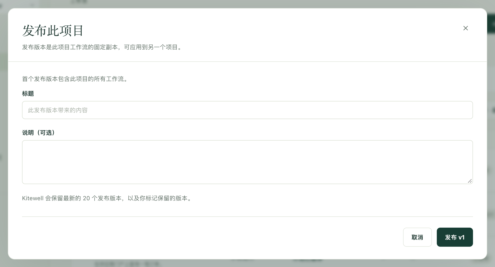

先在安全的地方试验更改，再让它影响真正重要的工作。用一个项目来搭建，用另一个项目来实际运行；把满意的工作流冻结为带编号的发布版本，准备好之后，再把这个版本交给另一个项目。

每个项目都有自己的服务器、模型、API 连接、队列和密钥的值，因此同一个工作流在一个项目中连接测试系统，在另一个项目中连接正式系统。

## 准备工作

同一台电脑上有两个或更多项目，名称随意，常见的组合是 **Dev**、**Staging** 和 **Prod**。免费套餐下一台电脑只能容纳一个项目，因此分阶段运行需要最多可容纳五个项目的 Kitewell Personal，或可容纳 15 个项目的 Team。创建和应用发布版本需要该项目的编辑权限。

## 创建发布版本

1. 在用于搭建的项目中打开 **工作流**。列表上方的一行会显示最新的发布版本，以及自那以后有多少个工作流发生了变化。
2. 选择 **发布…**。第一个发布版本包含项目中的所有工作流，对话框会说明这一点；之后，对话框会列出发生变化的内容，每个工作流旁边都有 **对比**。
3. 填写 **标题**，如有帮助可添加 **说明（可选）**，然后选择写有下一个编号的按钮，第一个版本就是 **发布 v1**。

发布版本是项目工作流及其读取的密钥名称的冻结副本。它永远不会改变，因此之后所做的任何编辑都要等到下一个版本。如果自最新的发布版本以来没有任何变化，就不会创建发布版本，Kitewell 会给出提示。

Kitewell 保留最新的 20 个发布版本，并删除更早的版本。**删除** 可以提前删除某个版本，但最新的版本除外，因为下一个版本的编号以它为准。已经接收了被删除版本的项目会保留其工作流，只是无法再次应用该版本。

如果想留住一个你信任的版本，无论之后还会有多少个版本，请在 **发布版本** 中选择它旁边的 **保留**。被保留的版本在任何电脑上和 Dagu Cloud 中都不会被移除，在有人选择 **取消保留** 之前也无法删除。最多可以保留 20 个版本。

在[已同步的项目](/zh/docs/cloud-sync/)中，发布版本会像其他内容一样同步，因此每位团队成员都可以应用同一个版本。发布版本不包含在[项目导出](/zh/docs/sharing/)中，但会保留在[备份](/zh/docs/backups/)中。

## 应用发布版本

1. 选择 **发布版本**，然后选择目标版本旁边的 **应用到…**。
2. 在 **应用到** 下，选择要应用到的项目，即这台电脑上的另一个项目。你只能查看的项目无法选择。
3. 阅读预览。对于每个工作流，**将发生什么** 会说明它是 **新增 · 以暂停状态送达**、**更新时间**、**保留**（因为它在那个项目中被编辑过，而该版本没有改动它），还是 **未更改**。**对比** 会显示差异。可以选择时，勾选 **保留 Prod 的版本**（这里显示的是接收项目的名称），即可让该项目自己的副本保持不变。

   预览还会在以下情况下提醒你：某个工作流在该项目中无法运行；调用了该项目没有的工作流，或使用了它没有的队列；名称与该项目中另一个工作流重复；或者更改了一个在应用时立即生效的计划。
4. 选择写有更改数量的按钮，例如 **应用 3 项更改**。

只有工作流会转移。另一个项目保留自己的服务器、模型、队列和密钥的值。不过，它会获得该版本读取的密钥名称；请在它的每台电脑上，通过 **密钥** 或 **概览** 设置这些密钥的值。

新的工作流以暂停状态送达。请开启该项目应运行的工作流。已存在的工作流会保留其是否开启、在哪里运行、提醒设置以及失败诊断的选择。

如果在生成预览之后该项目发生了变化，Kitewell 会请你重新查看预览。如果应用中途停止（例如达到了套餐的工作流数量上限），预览会列出尚未应用的内容；再次应用即可完成。

如果该版本没有可应用的目标，Kitewell 会提示你先创建或下载要应用到的项目。

## 查看各处运行的版本

接收过发布版本的项目会在工作流上方显示其来源，例如 **来自 Dev 的 v13**，每个工作流也会显示它是随哪个版本送达的。同步该项目的每台电脑上都会显示这些信息。

之后如果在那里编辑某个工作流，它会被标记为 **已在此编辑**。如果下一个版本没有改动同一个工作流，默认会保留这次编辑。如果改动了，预览会提醒你，并允许你保留该项目自己的版本。

在用于搭建的项目中，自最新版本以来发生过更改的工作流会标记为 **未发布**，让你一眼就能看出下一个版本会包含什么。

## 回滚

用同样的方式应用较旧的发布版本即可。有两点不同：

- 较新版本添加的工作流会单独列出，放在一个标题下，标题写明它们不在哪个版本中。只有你勾选的工作流才会被移除。
- 较旧版本替换掉的每个工作流，也会保留在这台电脑上该项目的编辑历史中，因此可以单独恢复其中某一个。

你也可以从运行该发布版本的项目开始操作。在 **来自 Dev 的 v13** 旁边，选择 **Dev 的发布版本…** 查看那个项目的发布版本，其中在这里运行的版本会标为 **正在此处运行**；然后在你想要的版本上选择 **应用到这里**。只有另一个项目也在同一台电脑上时，才能这样操作。
