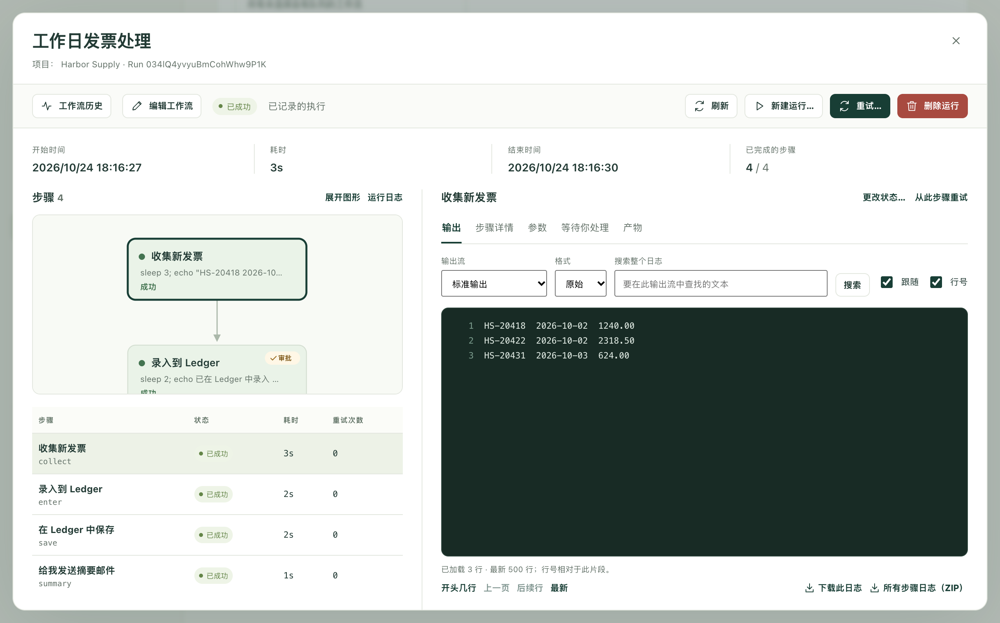
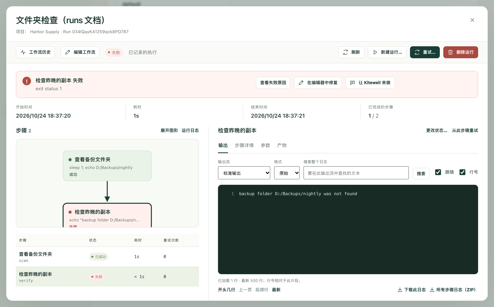

工作流每运行一次，Kitewell 都会记下经过：运行了哪些步骤，每个步骤输出了什么，生成了哪些文件，最后结果如何。运行顺利时，你很少需要来看。运行出了问题时，就在这里查明原因并加以解决。

侧边栏中的 **运行与日志** 会打开这份记录，标题为 **执行历史**。

## 找到你要的运行

最新的运行排在最上面。运行太多时，可以缩小列表范围：

- **工作流** 只显示某一个工作流的运行。**所有工作流** 显示全部。
- **创建时间范围** 设定时间段。默认为 **最近 7 天**，其他选项最长到 **全部时间**。
- **运行 ID** 用于在你知道标识符时找到某一次运行。标识符是列表中工作流名称下方的短代码，可以直接从那里复制。
- 选择 **应用筛选条件** 使筛选生效，或选择 **重置** 清除筛选。重置会把时间段放宽到 **全部时间**。

列表顶部的 **所有运行**、**运行中 / 排队中**、**等待中**、**失败**、**未运行**、**已成功** 和 **已取消** 用于切换结果类型。**未运行** 的行并不是一次运行：它标出某个计划时间已经过去却没有运行，并说明原因。请参阅[计划](/zh/docs/scheduling/#sleep-and-the-runs-that-were-missed)。再往上，**本页**、**进行中**、**失败的运行** 和 **成功率** 统计的是本页所列运行的情况。

每一行显示运行的是哪个工作流、结果如何、由什么启动、何时启动以及耗时多久。启动方式为以下之一：手动、计划、计划测试、补跑、重试、API、Webhook 或子工作流。

此页面上还有以下功能：

- **队列** 显示每个队列正在运行和正在等待的运行数量，并可以把等待中的运行移出队列。
- **暂停更新** 会在你阅读时停止刷新列表，按下后变为 **恢复更新**。
- **导出本页** 将你看到的行保存为电子表格文件，不会导出其他页上的运行。
- **批次** 打开[批量表格](/zh/docs/batches/)。

## 查看运行

选择行末的 **查看运行**；如果运行失败，则选择 **查看失败原因**。

运行会在单独的页面中打开。顶部依次显示 **开始时间**、**耗时**、**结束时间**，以及 **已完成的步骤** 数。

左侧的 **步骤** 先以图的形式画出这次运行，再列出每个步骤的 **状态**、**时间** 和 **重试次数**。**展开图形** 为图留出更多空间，**运行日志** 显示运行本身的记录，而不是某个步骤的记录。

右侧显示你选中的内容。选择一个步骤后：

- **输出** 显示它输出的内容。**输出流** 在 **标准输出** 和 **错误输出（stderr）** 之间切换；失败的步骤会先显示错误输出。**运行日志** 则显示 **运行事件**。
- **步骤详情** 显示该步骤的结束情况，以及它被要求做什么。
- **参数** 显示这次运行收到的值。
- **产物** 中是这次运行保存的文件。
- **项目** 出现在逐项处理列表的步骤中，每个项目一行。
- **等待你处理** 在需要有人回应时出现。

## 搜索或保存日志

日志可能很长，窗格中显示的是其中最新的部分。

- **搜索整个日志** 会在你正在查看的输出流的整个文件中查找，而不只是屏幕上显示的部分。输入文本后选择 **搜索**。日志很长时，如果还有内容没有搜完，会显示 **继续搜索**。
- **开头几行**、**上一页**、**后续行** 和 **最新** 用于在日志中移动。**跟随** 会在运行进行期间始终显示最新的行；**行号** 会加上行号。
- **下载此日志** 保存你正在阅读的输出流。**所有步骤日志（ZIP）** 将所有步骤的日志保存在一个文件中。

## 需要有人处理时

等待有人处理的运行会在顶部说明这一点，并显示等待的步骤数，**查看步骤** 可以直接跳到那里。这些运行也会出现在列表的 **等待中** 标签页下。

**等待你处理** 中，每个等待的步骤对应一张卡片。人工任务提供 **完成任务**；审批提供 **批准**、**退回** 或 **拒绝运行**；提出问题的自动步骤需要填写 **您的回答**。请参阅[搭建工作流](/zh/docs/workflow-builder/#stop-and-ask-a-person)。

## 修复失败的运行

失败的运行打开时，顶部会显示失败信息：哪个步骤失败了，以及是怎样失败的。

接下来可以：

- **查看失败原因** 会选中失败的步骤，方便你阅读它的输出。
- **在编辑器中修复** 会按那次运行的状态打开工作流，并代入该运行的输入和前面步骤收集到的值。修正步骤后，选择 **保存并继续…**，在 **从此开始** 中选择起点，Kitewell 就会使用相同的输入和文件，从那里开始一次新的运行。失败的运行仍保留在记录中。
- **询问助手** 会把这次失败交给[助手](/zh/docs/ai/#the-assistant)，由它查找原因并提出修复方案。
- 如果开启了[失败诊断](/zh/docs/ai/#failure-diagnosis)，运行还会说明这次失败需要怎样处理，以及应该查看哪个步骤。

## 再次运行

- **重试…** 会继续同一次运行，沿用相同的运行 ID，并使用这次运行记录下来的工作流和输入。**重试范围** 可选择 **失败和未完成的步骤** 或 **已选步骤**。然后选择 **开始重试**。之前的尝试仍是这次运行的一部分。
- 步骤输出上方的 **从此步骤重试** 会在该步骤处打开同一个表单，**同时重试下游步骤** 可以连同其后的工作一起重做。
- **新建运行…** 会以新的 ID 启动另一次独立的运行。记录下来的输入会预先填好，你可以修改；**运行方式** 用于选择使用当前保存的工作流，还是这次运行记录下来的工作流。然后选择 **启动新运行**。原来的运行仍保留在记录中。
- **中止运行** 会停止仍在进行或仍在排队的运行。
- 步骤输出上方的 **更改状态…** 会在不运行步骤的情况下，将其记录为 **已成功** 或 **失败**，适用于你已经手动处理好其结果的情况。运行本身的结果会重新计算。只有在运行已结束、且没有尚待执行的自动重试时，才会提供此操作。

## 删除运行

**删除运行** 会删除一次已结束的运行及其日志、输出和文件。在列表中，也可以勾选多个运行后选择 **删除…**。仍在进行或刚刚结束的运行会被保留，Kitewell 会给出说明。

你不必手动清理。Kitewell 每天会删除一次早于 **设备设置 → 运行历史保留期限 → 运行历史保留时长** 的运行，该设置默认为 30 天。**项目设置 → 存储** 显示每个工作流的历史占用了多少空间，并可对每个工作流使用 **删除历史…**。

## 运行生成的文件

侧边栏中的 **产物** 按从新到旧的顺序，列出项目中每次已结束的运行所保存的文件。步骤要保存文件，可以将文件写入 `$DAG_RUN_ARTIFACTS_DIR`，或在步骤编辑器中填写 **产物名称（可选）**。

可以按 **工作流**、**创建时间范围** 或 **文件名** 筛选，也可以按类型筛选：**全部文件**、**Markdown**、**图片**、**数据**、**文本与日志**。选择一个文件即可预览，**全屏查看** 会铺满窗口，**打开运行 →** 会转到生成该文件的运行。**显示更早的文件** 可以往前查看更早的文件。文件会随其运行一起删除，并包含在[备份](/zh/docs/backups/)中。

## 遇到问题时

- **列表中没有你要找的运行。** 时间段默认从最近 7 天开始。请放宽 **创建时间范围**，或用 **重置** 清除筛选。
- **找不到你预期的按钮。** 重试、中止、回应等待中的步骤以及更改状态，需要运行工作流的权限；删除运行、**在编辑器中修复** 和 **询问助手** 需要编辑权限。
- **旧的运行不见了。** 超过保留期限的运行每天会被删除一次；删除工作流也可能连同其历史一起删除。

## 详细信息

- 列表每页最多显示 50 次运行，按创建时间从新到旧排列。时间段和排序都按运行的创建时间计算，重试不会改变这个时间。
- 打开的运行在进行期间每 3 秒重新读取一次。
- 日志窗格每次加载 500 行；打开运行时，会显示步骤的最后 500 行，以及运行本身事件的最后 200 行。搜索每次最多返回 100 个匹配行，30 秒后停止，并说明从哪里继续。
- **所有步骤日志（ZIP）** 包含每个步骤的标准输出和错误输出，但不包含运行本身的事件日志，后者需要单独下载。
- **更改状态…** 只能设置单个步骤，不能设置整次运行，而且只能设为 **已成功** 或 **失败**。
