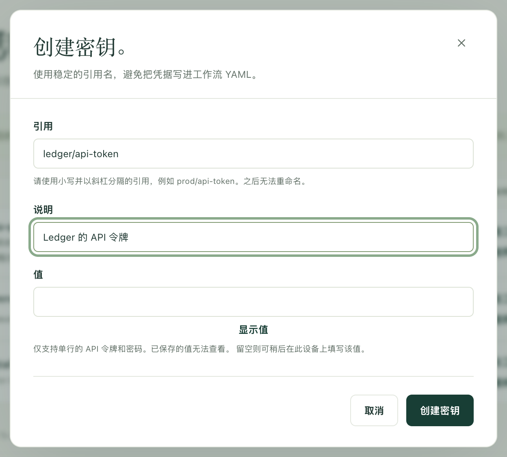
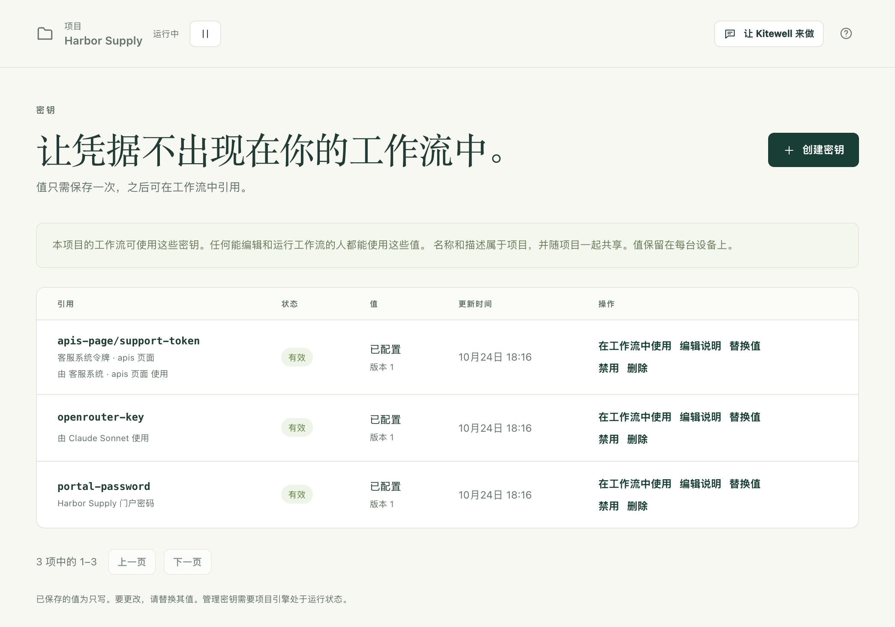

工作流经常需要密码、API 令牌或某种密钥。把它作为密钥（由 Kitewell 替你保管的凭据）保存一次，工作流就会按名称读取它。之后没有人需要再次输入它，它不会出现在工作流定义中，日志中原本显示值的地方会显示为 `*******`。

## 准备工作

- 一个你可以编辑的项目。**密钥** 位于侧边栏的 **更多** 中。对于通过 Dagu Cloud 以查看权限共享给你的项目，你可以设置这台设备上的值，但不能创建密钥。
- 项目正在运行。项目暂停时，页面会显示 **此项目已暂停**；请选择 **恢复**。

## 保存凭据

1. 打开 **更多 → 密钥**，选择 **创建密钥**。
2. 输入 **引用**，即工作流将使用的名称，例如 `services/api-token`。使用小写字母、数字和连字符，各部分之间用斜杠分隔。引用之后无法重命名。
3. 添加 **说明**，让下一个人知道它是用来打开什么的。
4. 在 **值** 中输入凭据。**显示值** 可以让你核对粘贴的内容。留空则可以稍后在这台设备上添加值。
5. 选择 **创建密钥**。

密钥会以 **有效** 状态出现在列表中，值显示为 **已配置**，**版本** 为 1。值本身无论在这里还是其他任何地方，都不会再显示。

## 在工作流中使用

在工作流编辑器中，在步骤的字段里输入 `${`，然后在 **密钥** 下选择该密钥。Kitewell 会把它绑定到工作流，并在字段中填入它的名称；值不会写进去。

另外三个页面也按名称而不是按值来使用密钥：

- 模型的 API 密钥，位于 **智能体与模型**。
- 服务器或跳板机的密码，位于 **服务器**。
- 导入的 API 的凭据或客户端密钥，位于 **API 库**。

如果要自己编写 YAML，请在该密钥所在行选择 **在工作流中使用**。Kitewell 会显示一个 `secrets:` 块，用于粘贴到顶层。其中写明了步骤从哪个环境变量读取值，例如 `services/api-token` 对应 `SECRET_API_TOKEN`。

在[网站步骤](/zh/docs/browser/)或[桌面步骤](/zh/docs/desktop/)中，在 **浏览器输入的值** 或 **步骤输入的值** 下选择密钥。指令和模型只能看到值的名称，写作 `%name%`；值本身由步骤输入。

[助手](/zh/docs/ai/#the-assistant)在搭建工作流时可以请求一个密钥。这时会出现一张卡片，请求添加该名称的密钥；你在 **值** 中输入凭据并选择 **保存**，助手永远看不到你输入的内容。

## 设备上还没有值时

密钥的名称和说明属于项目，值则属于你输入它的那台设备。通过导入或[同步](/zh/docs/cloud-sync/)得到的项目会带来名称，但还需要值。

- **需要填写值** 表示项目使用了该密钥，但这台设备上没有它的值。请选择 **设置值**。
- **概览** 列出这台设备仍需要的所有密钥，每个旁边都有 **设置值**。
- **仅在此设备上** 表示这台设备持有该密钥，但项目没有列出它。选择 **声明** 即可将其加入项目。
- 形如 **由 … 使用** 的一行写明了需要该密钥的对象（模型、工作流、服务器或 API），让你知道该去找哪一个凭据。

在设置值之前，Kitewell 会直接拒绝这项工作，而不是让它在中途失败。无论是手动、通过 Webhook、由 AI 智能体还是由助手启动的运行，都会在开始前停止，并显示“请先在‘密钥’页面为 … 设置值，然后再运行。”重试、重新运行或继续运行，启动批次，刷新表格的行，以及测试单个步骤，也都是如此。表格的计划到点时不会启动任何内容，并会说明原因。工作流自身的计划不会被拒绝：它的运行会启动，然后失败。

## 更改或删除

- **替换值** 在同一个引用下保存新的凭据。**版本** 号会增加，使用该密钥的任何内容都无需编辑。
- **编辑说明** 只更改说明，不影响其他内容。
- **禁用** 让该密钥不再被读取，值仍然保留。需要它的运行会启动，然后失败。**启用** 可将其恢复。
- **删除** 会从项目中删除该密钥，并从这台设备上删除它的值。同步该项目的其他设备会失去这个名称。原本持有值的设备会保留该值，并显示为 **仅在此设备上**，直到在那台设备上也将其删除。仍有对象在使用的引用会继续列出，并带有 **由 … 使用**，需要另外提供一个密钥。

## 遇到问题时

- **“请先在‘密钥’页面为 … 设置值，然后再运行。”** 这台设备上没有该密钥的值。打开 **密钥**，选择 **设置值**，然后再次运行。
- **“此项目已暂停”。** 选择 **恢复**，然后重试。
- **多行的值会被拒绝。** 只支持单行的令牌和密码。跨多行的密钥内容需要通过其他方式交给步骤，例如由步骤读取的文件。
- **“already has a value on this device”。** 创建密钥永远不会覆盖已保存的值。请改用 **替换值**。

## 它能防护什么，不能防护什么

密钥由项目的引擎加密后存储在磁盘上。解密用的密钥本身，又用操作系统持有的设备密钥封存：在 Windows 上，这是只有这台电脑才能打开的密钥，因此即使复制了数据文件夹，在别处也读不出任何内容。在一次运行期间，其中的每个步骤都会收到其工作流所绑定的密钥。

这不是沙箱。任何能够编辑并运行此项目工作流的人，都可以编写一个读取其密钥的步骤，而且步骤以运行 Kitewell 的那个人的权限运行。把密钥分到不同的项目中可以将密钥隔开，但不会限制命令能做什么。

Kitewell 会在日志、运行详情和输出中，用 `*******` 代替密钥的原值。步骤在打印前经过编码、截断或转换的值可能不会被遮盖，步骤写入文件或产物的值也不会被遮盖。请不要打印凭据。

## 导出、同步、发布版本和备份

| 项目的去向 | 名称和说明 | 值 |
| --- | --- | --- |
| 项目[导出](/zh/docs/sharing/) | 包含，引用等全部包含 | 不包含 |
| [与 Dagu Cloud 同步](/zh/docs/cloud-sync/) | 随项目同步 | 从不发送 |
| [发布版本](/zh/docs/releases/) | 包含其工作流读取的那些 | 不包含 |
| 设备[备份](/zh/docs/backups/) | 包含 | 不包含，解密用的密钥也不包含 |

每个收到该项目的人都会看到每个密钥显示为 **需要填写值**，并各自设置自己的值。

恢复备份会删除这台设备持有的值，即使是在创建该备份的设备上也是如此。请重新输入凭据：恢复时，每个项目最多会列出五个需要重新输入的密钥，**密钥** 和 **概览** 则会列出所有仍需要值的密钥。恢复时需要的凭据，请另外做一份受保护的记录。

如果 Dagu Cloud 不接受为该项目新增的密钥，值仍会保存在这台设备上，并显示为 **仅在此设备上**。同步该项目的其他人在它被声明之前看不到它，除非已同步的某项内容已经在使用这个名称。

导出和备份不加密。直接写在工作流、OpenAPI 文件或来源 URL 中的凭据，会原样保留在归档中。分享归档之前请先检查，放到共享存储之前请自行加密。

## 详细信息

- 引用须匹配 `^[a-z0-9][a-z0-9-]*(/[a-z0-9][a-z0-9-]*)*$`，最多 80 个字符。说明为一行，最多 200 个字符。
- 值只能是单行，因为引擎的日志遮盖功能是逐行处理的。
- 存储使用 Dagu 的 AES-256-GCM 密钥存储，位于 `engines/<project>/data/secrets`。它的密钥用设备密钥 `device.key` 封存在 `engines/<project>/key.sealed` 中；在 Windows 上，设备密钥由 Windows 封存，只供这台电脑使用；在 Mac 上，设备密钥是一个只有你的用户才能读取的文件。这些都不包含在备份中。
- 设备密钥每年更新一次，用它封存的所有内容都会重新封存；**设备设置 → 存储的机密** 会显示更新时间，并提供 **立即生成新密钥**。如果密钥丢失（例如重装 Windows 之后），同一区域会给出提示，所有已存储的值都需要重新输入。工作流及其数据不受影响。
- 引擎在运行开始时读取该运行的密钥，并以环境变量的形式交给其步骤。Kitewell 只有在替你使用某个值时才会自己读取它：供助手或表格使用的模型 API 密钥、连接 API 时的客户端密钥、助手的浏览器输入的值，以及它要从助手试运行的报告中隐去的值。
- 列表每页显示 50 个密钥，可用 **上一页** 和 **下一页** 翻页。
- 容器镜像注册表、邮箱和 API 的登录信息作为引擎内部的值保存，不会列在这里。请在 **项目设置**、**邮件账户** 和 **API 库** 中管理它们。
