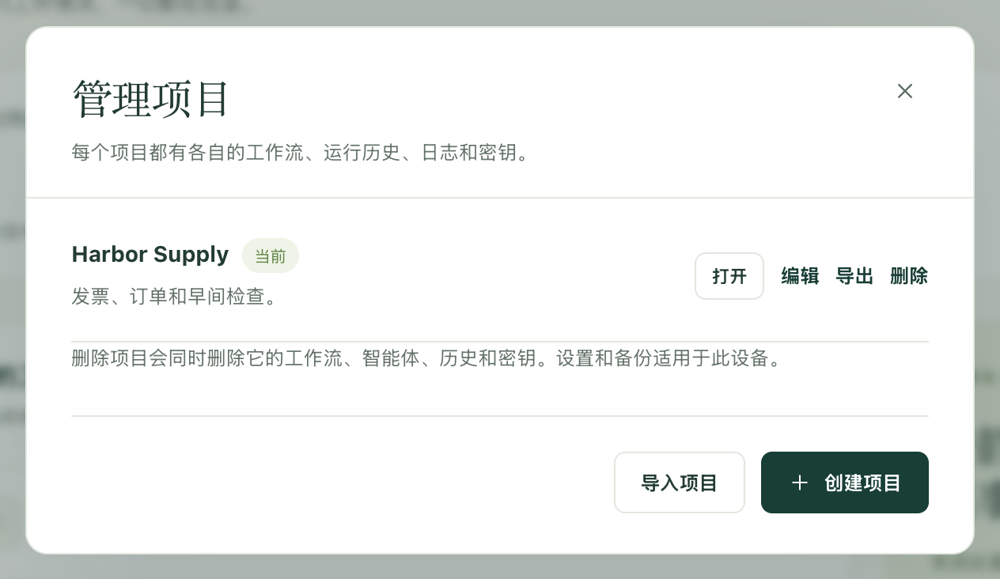

一次搭建好例行工作，就能把整个项目交给同事，或者交给你自己的第二台电脑。对方会得到工作流，以及这些工作流所需设置的名称，而不会得到你这边本该留下的任何东西：不含密码，不含运行历史，也不含邮箱登录信息。

如果希望在工作流变化时让每个副本都保持一致，请改为[将项目与 Dagu Cloud 同步](/zh/docs/cloud-sync/)。导出只是一份快照，你一修改任何内容，它就不再是最新的了。

## 把项目发送到另一台电脑

1. 打开侧边栏顶部的项目选择器，选择 **管理**。
2. 在 **管理项目** 中，选择项目旁边的 **导出**。Kitewell 会下载一个文件：`kitewell-project-harbor-supply-20261005T091500.tgz`，文件名中包含项目名称和时间。
3. 用你们团队平时传送文件的方式发送这个文件。
4. 在接收的电脑上，打开 **管理项目**，选择 **导入项目**，然后选择该文件。
5. Kitewell 会显示“其余内容需要由此设备提供：”，并列出缺少的内容：每个需要填写值的密钥、需要连接的邮箱、主机密钥尚未经任何人批准的机器、自定义命令，以及以暂停状态送达的工作流。选择 **打开**，然后按这个列表逐项处理。



导入总是会新建一个项目，绝不会替换你已有的项目。如果已经存在同名项目，Kitewell 会请你另起一个名称。

新项目会计入那台电脑的上限：Kitewell Personal 最多 5 个项目，Team 和试用期最多 15 个。工作流超过 100 个的项目完全无法导入。文件本身最大可为 16 MiB。

## 哪些内容会带过去，哪些不会

文件以一组普通文档的形式保存项目：

- 工作流定义及其计划；
- 已命名的智能体和模型；
- 已导入的 OpenAPI 文档及其 API 连接设置；
- 服务器地址和服务器组、队列，以及镜像仓库；
- 批量表格；
- 密钥的名称和说明，但绝不包含它们的值；
- 项目的工作流默认设置及其[知识库](/zh/docs/knowledge/)；
- 项目最后一次采用的是哪个发布版本。

接收的电脑需要自行提供其余内容：

- 密钥的值和镜像仓库的密码；
- SSH 私钥路径和已批准的主机密钥；
- 自定义智能体命令、已安装的工具，以及智能体的登录；
- 邮箱连接；
- 外部脚本、输入文件，以及挂载到 Docker 中的数据。

完全不包含的内容：运行历史、日志、产物、发布版本、本地编辑历史、项目提醒规则、失败诊断设置、网站登录信息、设备设置，以及这台电脑的 API 密钥。

:::caution
文件没有加密。直接输入在工作流命令、OpenAPI 文档、服务器地址或其他项目设置中的任何内容，都会原样带过去。发送文件之前请检查这些字段，并把凭据保存在[密钥](/zh/docs/secrets/)中，让它们留在本机。
:::

## 决定由哪台电脑运行计划

导入的工作流会以暂停状态送达，这是有意为之。先手动运行一次，检查它做了什么，然后再开启这台电脑应当负责的计划。

如果两台电脑都启用了同一个计划，两台都会各自独立地运行它。对于必须只执行一次的例行工作，请选定一台电脑来运行，其他副本保持暂停。那台电脑在计划时间必须开机且处于唤醒状态。请参阅[计划与后台运行](/zh/docs/scheduling/)。

## 让队友操作同一台电脑上的工作流

有时工作应该留在一台机器上，同事只需要启动它、查看它或修改它。这时，请给他们每人一个密钥，而不是一份项目副本。

1. 在那台电脑上，打开 **此设备 → MCP**。
2. 选择 **连接 AI 智能体**，为每个人或每个客户端各创建一个密钥，并赋予其角色所需的 **权限**：只查看用 **只读**，要启动工作用 **运行工作流**，要修改工作流用 **编辑并运行**。
3. 在 **允许的项目** 下，把每个密钥限定在对应的人所需的项目内。

之后，他们就可以用任意 MCP 客户端或普通 HTTP 请求来操作那台电脑。所有套餐都不限 API 密钥和已连接的应用的数量。当一个组织的成员以这种方式共用一台电脑时，需要 Kitewell Team；请参阅[价格](/zh/pricing/)。每次运行仍然以那台电脑自己的用户身份进行，因此密钥限制的是一个人能访问哪些项目，而不是工作流运行后能做什么。应用本身的可选登录与此无关，这些密钥不会为它创建登录账户。

其他电脑上的客户端需要一个能通过 HTTPS 访问的地址，这需要你自行设置。相关内容以及完整的权限说明，请参阅 [MCP 与 API 访问](/zh/docs/mcp/)。

## 用版本控制管理定义

项目的文档都是普通的 JSON 和 YAML 文件，因此团队可以在自己的 Git 仓库中审阅这些文件并进行版本管理。Kitewell 不会替你推送、拉取或合并这个仓库。

这些文件位于 Kitewell 的数据文件夹下：在 Mac 上是 `~/Library/Application Support/Kitewell`，在 Windows 上是 `%LOCALAPPDATA%\Kitewell`。

```text
data/workspace/project-<id>/
  project.json
  workflows/
  batch-sets/
  knowledge/
  agents/  apis/  queues/  registries/  secrets/  server-groups/  servers/
  releases/
```

`project.json` 保存项目的名称、说明、工作流默认设置，以及项目最后一次采用的发布版本。`workflows` 中每个工作流对应一个 YAML 文件，`batch-sets` 中每个批量表格对应一个文件，`knowledge` 中每个知识库页面对应一个文件，`releases` 中每个发布版本对应一个文件；其余每个文件夹中，每个智能体、API 连接、队列、镜像仓库、密钥名称、服务器组或服务器各对应一个 JSON 文件。请对整个 `project-<id>` 文件夹进行版本管理，并根据其中 `project.json` 里的名称找到正确的文件夹。请保持文件布局和文档 ID 不变。

在替换文件或应用仓库中的更改之前，请先退出 Kitewell，解决冲突，然后重新打开它，并在运行任何内容之前检查一遍项目。退出会中断正在进行的运行，所以请先等它们结束。不要用这种方式管理[已同步的项目](/zh/docs/cloud-sync/)：这些文件由 Kitewell 管理，当 Dagu Cloud 传来更改时，Kitewell 会替换它们。

请只共享这一个文件夹，而不是整个数据文件夹。设备凭据、密钥值和运行数据都属于各自的电脑。对于新加入的人，用 **导入项目** 和一份经过检查的导出更为合适。

## 导出机器人台账

许多团队都会维护一份机器人台账：每个自动化一行，写明它做什么、会访问哪些系统、由谁负责照管。在 **工作流** 页面上，**导出台账** 会将台账下载为一个 Excel 工作簿，每个工作流一行，各列按照金融信息系统中心（FISC）列出的机器人管理项目的顺序排列。

Kitewell 会根据每个工作流及其[知识库](/zh/docs/knowledge/)中能读到的内容填写各列，不需要询问模型：**机器人名称** 和 **机器人 ID**、**运行周期** 和 **状态**、说明它所启动的工作流的 **后续条件**、**业务内容**、说明它所打开的工作簿的 **输入数据和输出数据**、说明它所访问的网站、API、服务器、邮箱和模型的 **连接的系统和应用**，以及完整收录其知识库页面的 **文档**。

有六列留空供你填写：**管理负责人和经办人**、**委托方**、**出错时的处理方针**、**业务重要性**、**客户影响** 和 **法律法规影响**。列名会跟随 Kitewell 的显示语言。
