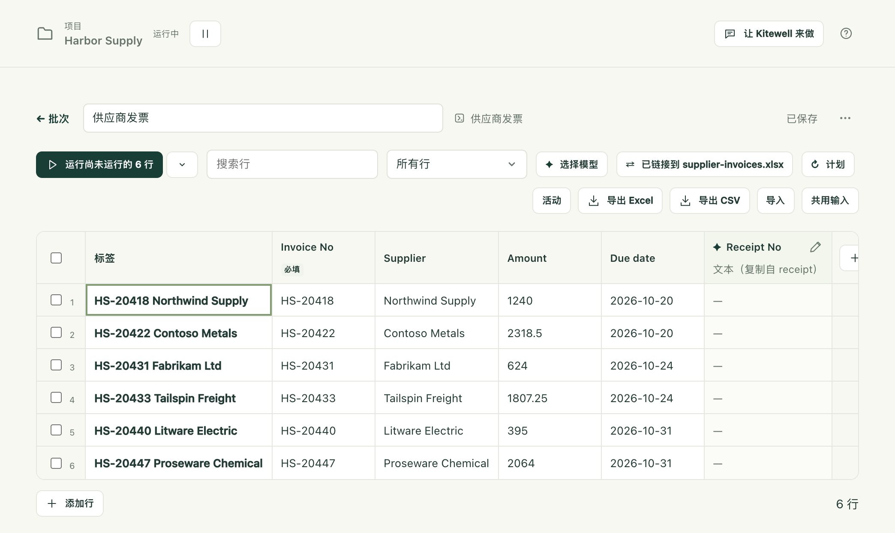
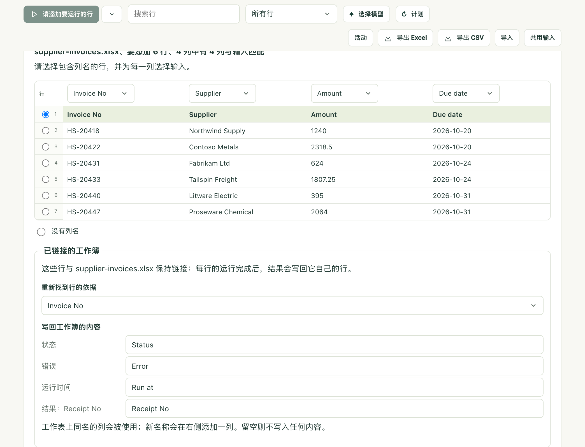

你在 Excel 里有一份清单（比如本月的发票，每行一张），需要对其中每一项做些处理。Kitewell 会针对每一行运行一次你的工作流，并把每个结果写回它所在的那一行。之后再打开同一个文件，回执编号就出现在了各张发票旁边。

Excel 始终不会被打开。Kitewell 直接读写 `.xlsx` 文件，因此即使在夜间锁屏时也能继续工作。

## 链接你的工作簿

你需要在存放该文件的电脑上使用 Kitewell 应用。浏览器无法访问该文件，因此在浏览器中不提供此功能。

1. 为需要每行运行一次的工作流创建一个表格，方法见[按表格批量运行工作流](/zh/docs/batches/)。
2. 在表格的工具栏中选择 **导入**，然后选择 **链接本机上的工作簿**，并选取 `.xlsx` 文件。把文件拖放到 Kitewell 窗口上，效果也一样。
3. 检查 Kitewell 识别出的内容：**工作表**、包含列名的那一行，以及哪一列填入哪个输入。名称与某个输入相符的列会自动映射。
4. 在 **重新找到行的依据** 下，选择能区分各行的列，例如发票号。
5. 在 **写回工作簿的内容** 下，查看结果要写入的列：“Status”“Error”“Run at”，以及每个结果各一列。你可以重命名其中任意一列，也可以清空名称，让该列不写入任何内容。
6. 选择 **链接并添加 6 行**。

现在表格中显示的是工作簿的各行，工具栏中会显示 **关联** 及文件名。

## 运行各行

像运行任何表格一样运行它们。如果某个单元格无法转换为其输入所需的类型（例如金额列中的“twelve”），它会被框出，该行会等到你修正后才运行。

各行完成后，Kitewell 会在大约半分钟内自动把它们的结果写入工作簿。**立即写入结果** 则无需等待。

| 列 | 写入的内容 |
| --- | --- |
| Status | Done、Partly failed、Failed、Stopped 或 Rejected |
| Error | 该行失败的原因，用一行说明 |
| Run at | 该行运行的时间 |
| 每个结果各一列 | 运行产生的值，例如回执编号 |

表头为日文的工作簿会写入日文：状態、エラー、実行日時，Done 则写作“済”。表头为中文或韩文的工作簿，同样会写入中文或韩文：中文为 状态、错误、运行时间，Done 写作“完成”。

## 文件在 Excel 中打开时

在 Windows 上，不会出现任何失败。表格会提示结果已经准备好，将在 Excel 中关闭该文件后写入，并在你关闭文件的那一刻写入。**将结果保存为副本** 则会改为在文件旁边写入 `supplier-invoices (results).xlsx`。

在 Mac 上，Excel 不会锁定文件，因此 Kitewell 无法判断文件是否已打开，会照常写入结果。请在各行完成之前，在 Excel 中关闭该工作簿：如果之后再从 Excel 保存，可能会覆盖这些结果。

## 每天早上自动运行

为表格设置一个[计划](/zh/docs/scheduling/)。它还会询问两件事：**先读取 supplier-invoices.xlsx**，以及 **运行哪些行**（**每一行** 或 **仅工作簿中新增或更改的行**）。

选择后者时，每天早上都会读取文件、运行新的内容、写回结果，没有任何变化时则什么也不启动。请在存放该文件的电脑上设置计划；其他电脑无法运行它。

## 遇到问题时

- **有人对工作表进行了排序或筛选。** Kitewell 在每次写入之前都会重新读取文件，并按键值跟踪每一行。被移动过的行会被跳过，并列出其名称，其余的行照常写入。
- **写入了不该写入的结果。** **撤销** 可以将文件恢复原状。Kitewell 会在最近十次写入的每一次之前保留一份副本。在当前版本中，下一次写入会再次写入相同的结果。
- **磁盘上的工作簿发生了变化。** 表格会提供 **重新读取工作簿**，它会导入新增和更改的行，并把工作簿中已不存在的行标记为 **已不在列表中**。
- **步骤失败。** 请参阅[故障排除](/zh/docs/troubleshooting/#a-spreadsheet-step-fails)。

## 更多 Excel 相关内容

[Excel 参考](/zh/docs/reference/spreadsheets/)介绍了其余内容：读取以表单形式排版的报价单或订单、工作流可以使用的十种电子表格步骤、用步骤而不是表格来完成同样的工作、哪些内容会留在你的电脑上，以及各项限制。
