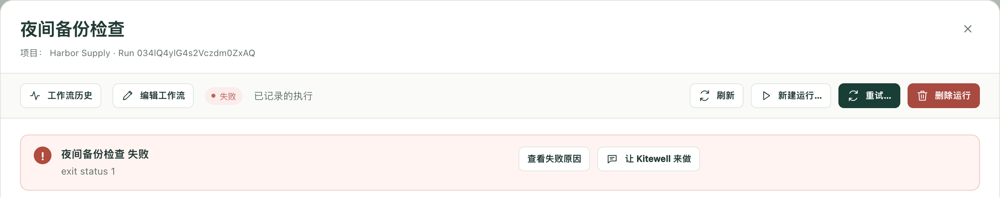
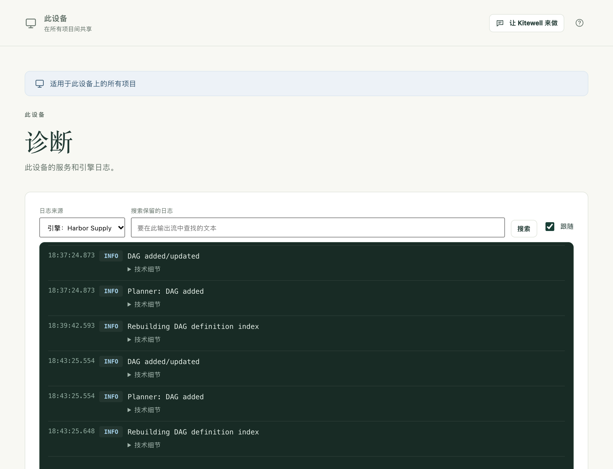

找到出问题的地方，以及应对方法。如果以下都不符合，请[提交支持请求](/zh/support/)，并附上你的版本信息、你做了什么，以及去掉所有密码后的输出。

## 运行失败

从 **运行与日志** 打开该运行。顶部的摘要会写明失败的步骤及其提示内容。

- **查看失败原因** 会显示该步骤及其日志。
- **询问助手** 会替你调查原因。
- **在编辑器中修复** 会在失败的步骤处打开工作流，让你修正后从选定的步骤继续运行。从工作流自身的历史中打开的运行才会提供此选项：在 **工作流** 中，选择该工作流旁边的 **查看运行历史**。

如果开启了[失败诊断](/zh/docs/ai/#failure-diagnosis)，运行还会说明是否应该重试、哪些地方需要你处理，或者需要更改什么。请参阅[运行与日志](/zh/docs/runs/#fix-a-failed-run)。

## 命令在终端中能运行，在 Kitewell 中却失败

Kitewell 的运行环境与终端提供给你的环境不同。请为程序指定完整路径，在步骤上设置工作文件夹，并设置程序所需的变量，而不要依赖 shell 替你设置的变量。还要检查该命令是否在等待有人输入回答，或者使用了只存在于你的终端会话中的凭据。

## 计划的工作流没有运行

先打开 **运行与日志**。在计划时间处会有一行 **未运行**，写明原因：设备处于睡眠状态、Kitewell 未在运行、项目引擎未在运行，或者没有运行开始。

然后打开 **工作流**。工作流下次开始时间下方的一行会说明其计划目前的结论：**将会运行**、**仅在您登录时运行** 或 **不会运行**，并附有原因和一个修复按钮。页面顶部的横幅会针对整个项目给出同样的说明。

如果两处都没有任何提示，请检查工作流的 **计划** 是否已在勾选 **启用已保存的计划** 的状态下保存，以及它的时区是否是你想要的时区。

在 Mac 上，到了那个时间，电脑必须处于唤醒状态，并且你已登录。在使用 Kitewell Team 的 Windows 上，开启登录服务后，即使无人登录，计划的工作也会运行；请参阅[计划](/zh/docs/scheduling/#run-with-nobody-signed-in-windows)。

错过的开始时间只有在工作流要求时才会在之后补跑。请查看它的 **计划 → 漏掉的计划**。

## 网站步骤失败

先查看运行产物中该步骤的截屏。登录页面、Cookie 横幅或人机验证通常就是原因。然后检查：

- 已安装 Chrome（在 Windows 上也可以是 Microsoft Edge），并且 **检查浏览器** 成功；
- 如果你填写了 **允许的网站 · 每行一个（可选）**，页面用到的主机都在其中；
- 等待时间足够页面加载；
- 指令中不包含密码；密码应放在 **浏览器输入的值** 中；
- 步骤或工作流已选择模型。

如果网站发生了变化，回放的操作不再有效，请在 **项目设置 → 存储 → 重放缓存** 中将其清除。请参阅[自动操作网站](/zh/docs/browser/)。

## 电子表格步骤失败

大多数拒绝信息会写明工作簿、工作表和单元格。步骤中的 **检查** 会在运行任何内容之前向引擎确认。常见原因：

- 路径不是这台电脑上 `.xlsx` 或 `.xlsm` 文件的完整路径。`.xls` 或 `.ods` 文件需要先在 Excel 中另存为 `.xlsx`；
- 步骤指定的工作表或列已不在工作簿中。信息中会列出现有的名称；
- 某个单元格无法转换为列所固定的类型，例如用文字写出的数量；
- 文件正在 Excel 中打开，写入会推迟到文件关闭；
- 步骤要写入的位置被合并单元格覆盖。信息中会写明需要取消合并的范围。

对已链接工作簿的写入，只要 Kitewell 写入后文件没有变化，就可以在表格中撤销。请参阅[自动处理 Excel](/zh/docs/spreadsheets/)。

## 桌面步骤失败

先查看运行产物中该步骤的截屏。然后检查：

- **设备设置 → 桌面自动化 → 检查桌面访问权限** 报告所有权限均已允许。在 Mac 上，需要获得屏幕录制和辅助功能权限的是 **Kitewell Agent**；
- 屏幕已解锁，电脑处于唤醒状态。屏幕锁定时，所有桌面步骤都会失败；
- 在 Windows 上，Kitewell 没有以管理员身份运行时，目标应用也没有以管理员身份运行；
- 任务没有超出 **每个任务的最多操作数**，或者已拆分成更小的任务；
- 模型具备计算机操作工具，或者步骤使用了 **通用工具，适用于任何视觉模型**；
- 指令中不包含密码；密码应放在 **步骤输入的值** 中。

等待桌面空闲的步骤，是因为你自己操作了鼠标或键盘而暂停的。在无人使用的电脑上，可以在 **桌面设置** 中缩短或关闭这段等待。如果应用发生了变化，回放的任务不再有效，请在 **项目设置 → 存储 → 重放缓存** 中将其清除。请参阅[自动操作桌面应用](/zh/docs/desktop/)。

## Google 提示应用已被屏蔽（This app is blocked）

在 Google 完成对 Kitewell 访问 Gmail 的审核之前，它会对大多数账户屏蔽 Kitewell 的浏览器登录，而且该页面无法继续操作。请关闭该页面，返回 Kitewell，选择 **改用应用专用密码**。请参阅[自动处理邮件](/zh/docs/email/)。

## 邮箱需要重新连接

如果某次运行指定了这台电脑无法登录的邮箱，该运行会被拒绝，**概览** 会写明需要连接或重新连接哪个地址。打开 **邮件账户**，选择 **重新连接**。常见原因：

- 账户密码已更改，或管理员结束了其会话；
- Google 登录已有六个月未使用，或者由于电脑一直关机，Microsoft 登录上次刷新已超过 90 天；
- 应用专用密码已在服务提供商的网站上被删除；
- Microsoft 365 管理员关闭了 IMAP 或经过身份验证的 SMTP，或者要求 Kitewell 需经其批准。错误信息中附有可发给管理员的链接；
- Google Workspace 管理员屏蔽了第三方应用。

从同事那里或从 Dagu Cloud 得到的项目，会把其中的邮箱列为未连接，直到你在这里连接它们。请参阅[自动处理邮件](/zh/docs/email/)。

## AI 任务失败

检查智能体是否已安装并登录，或者你选择的模型是否有可用的提供商凭据。**智能体与模型** 中的 **测试智能体** 和 **测试模型** 可以在运行前检查这两项。然后查看记录下来的提示词、任务的错误输出，以及提供商是否因用量限制或账单问题停止了你的服务。报告问题时，请不要附上真实的凭据。

## Docker 不可用

在这台电脑上启动 Docker，然后在工作流编辑器中使用 **检查 Docker**。Kitewell 既不会安装 Docker，也不会启动 Docker。还要检查容器挂载的文件夹和文件，在运行它的机器上确实存在。

## 历史中找不到某次运行

早于项目运行历史保留期限的运行会被自动删除，而且任何有编辑权限的人都可以删除运行。请参阅[运行与日志](/zh/docs/runs/#delete-runs)。

## ChatGPT 和 Claude

### 应用提示无法连接到 Kitewell

电脑处于睡眠状态、已关机，或没有运行 Kitewell。电脑刚进入睡眠时，ChatGPT 或 Claude 可能需要最多约 45 秒才能察觉。在那台电脑上打开 Kitewell，确认 **此设备 → MCP** 显示 **在线**，然后重试。

### 调用因连接权限不允许而被拒绝

拒绝信息会说明该连接的权限允许做什么，例如“This connection is read-only”（此连接为只读）或“This connection can run workflows but not edit them”（此连接可以运行工作流，但不能编辑），以及在哪里更改。请打开 **此设备 → MCP → 已连接的应用**。更改会在该应用下一次调用时生效。

### 授权页面提示电脑离线或没有空位

- “请在那台电脑上打开 Kitewell 以继续。”：电脑处于睡眠状态、已关机，或没有运行 Kitewell。打开 Kitewell，等待 **此设备 → MCP** 显示 **在线**，然后选择 **重试**。
- 没有空位：这台电脑的试用期或套餐已结束，因此不接受新的连接。请订阅 Kitewell Personal 或 Team，然后重新连接。

### 应用可以连接，但只能读取

在某些套餐上，无论你允许了什么权限，ChatGPT 都只能使用只读工具。请参阅 [ChatGPT](/zh/docs/mcp/#chatgpt)。

### 完全无法添加连接

从 ChatGPT 或 Claude 中移除 Kitewell，然后重新添加。请参阅[连接 ChatGPT 或 Claude](/zh/docs/mcp/#connect-chatgpt-or-claude)。

## Windows 显示 SmartScreen 提示

对于不常见的发布者提供的安装程序，Windows 会发出警告。请核对下载文件的 SHA256 与[下载页面](/zh/download/)上的值是否一致，然后选择 **更多信息** 和 **仍要运行**。如果 Windows 提示安装程序的签名*无效*，请停止安装，改为[报告此问题](/zh/support/)。

## Kitewell 已安装但没有启动

在 Windows 上，Setup.exe 会在最后打开 Kitewell。如果什么都没有出现，既没有窗口也没有消息，`%LOCALAPPDATA%\Kitewell\logs\shell.log` 中也没有新增任何一行，说明 Kitewell 在其自身的任何代码运行之前就被阻止了。

通常的原因是 Windows 的应用程序控制。全新安装的 Windows 11 会开启智能应用控制，它会拒绝加载未签名的 Kitewell 版本。可以在两个地方确认：

- **设置 → 隐私和安全性 → Windows 安全中心 → 应用和浏览器控制 → 智能应用控制** 会显示它是否已开启。
- **事件查看器 → Windows 日志 → 应用程序** 中有一条针对 `Kitewell.dll` 的 .NET Runtime 1026 `FileLoadException`。

请从[下载页面](/zh/download/)安装已签名的版本。你自己编译的版本没有签名，无法在这样的电脑上运行。

## Kitewell 要求安装 WebView2

Kitewell 的窗口基于 Microsoft Edge WebView2 运行时构建。缺少该运行时时，Kitewell 会在启动时提供 **安装 WebView2**。它会从 Microsoft 下载运行时，大约需要一分钟。

## Kitewell 无法启动其后台服务

窗口会停留在启动画面，然后显示服务返回的信息，并提供 **重试** 和 **打开数据文件夹**。其中有两种原因可以由你自己解决。

### 有其他程序在使用 Kitewell 的端口

信息末尾是针对 `127.0.0.1:19741` 的 `bind: address already in use`。罪魁祸首通常是另一份 Kitewell：第二次安装的副本，或者与已安装应用同时运行的开发版本。退出它，然后选择 **重试**。

同一条信息也可能说明该端口在这台设备上被 Hyper-V、WSL 或防火墙策略保留或屏蔽。这种情况需要由这台电脑的管理员释放该端口。

### 数据文件夹路径过长

在 Windows 上，如果数据文件夹的路径超过 79 个字符，服务会拒绝运行，并在提示中写明检测到的长度。Kitewell 会在该文件夹下的运行文件夹中启动程序，而 Windows 不会在路径过长的文件夹中启动程序。否则，每个工作流的每次运行都会失败，只提示目录名称无效。

常见原因是 `%LOCALAPPDATA%` 被重定向到了更深的位置或网络驱动器上。默认的 `%LOCALAPPDATA%\Kitewell\data` 约为 42 个字符。请联系这台电脑的管理员，让 `%LOCALAPPDATA%` 保留在本地磁盘上。

## Kitewell MCP 没有在监听

监听器无法启动时，**此设备 → MCP** 会显示警告。最常见的原因是端口 19742 被其他程序占用，这个端口在每台设备上都相同；占用它的往往是另一份 Kitewell，例如与已安装应用同时运行的开发版本。请退出那个程序并重启 Kitewell，或者为 Kitewell 设置一个不同的 **监听地址**。

## 更新检查失败

请检查你的网络和[版本发布状态](/zh/releases/)。在你的系统的首个公开版本发布之前，没有可读取的更新源；无法连接更新源的检查属于检查失败，并不能证明你已是最新版本。如果遇到校验和或安装程序验证失败，请报告该问题，而不要设法绕过。

## 查找日志

对于失败的步骤，请从 **运行与日志** 开始。

其他情况请打开 **此设备 → 诊断**。**日志来源** 可以在服务自身的输出、它的错误以及每个项目的引擎之间切换。你可以搜索已保存的内容并下载。

## 详细信息

- 每个日志文件达到 10 MiB 时轮换，并保留三份旧副本。
- 日志文件在 Mac 上位于 `~/Library/Application Support/Kitewell/logs`，在 Windows 上位于 `%LOCALAPPDATA%\Kitewell\logs`。在 Windows 上，旁边的 `shell.log` 记录应用自身的动作：启动、重启和退出。
- Kitewell 自身的界面监听 `127.0.0.1:19741`。Kitewell MCP 默认监听 `127.0.0.1:19742`。每个项目的工作流引擎会在启动时各自选用一个回环端口。
