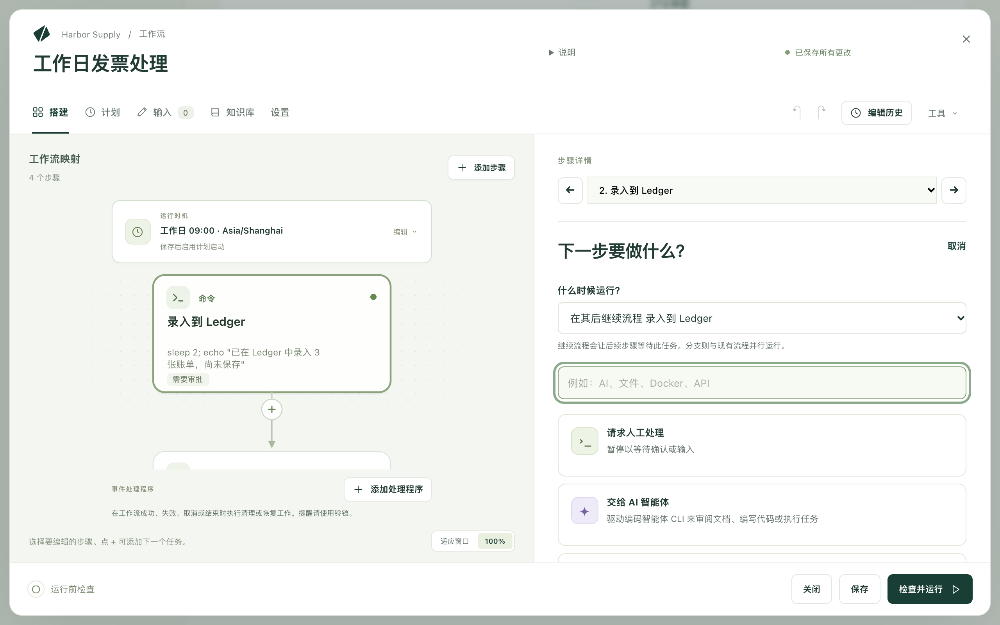
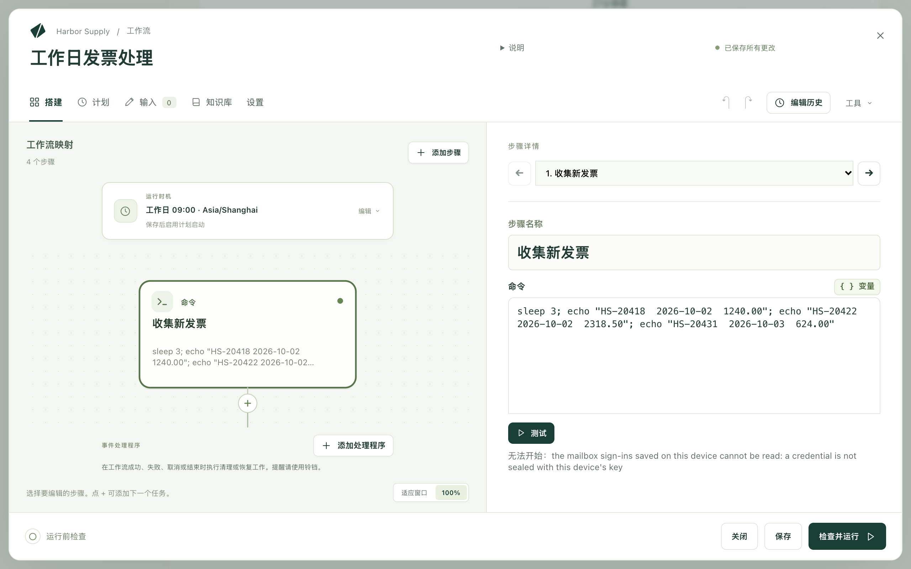
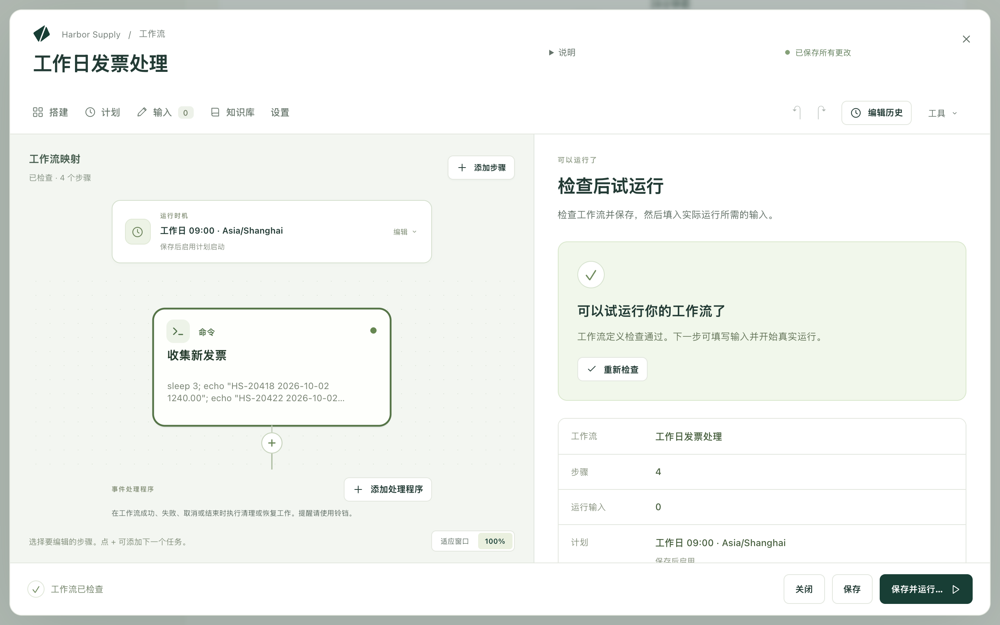
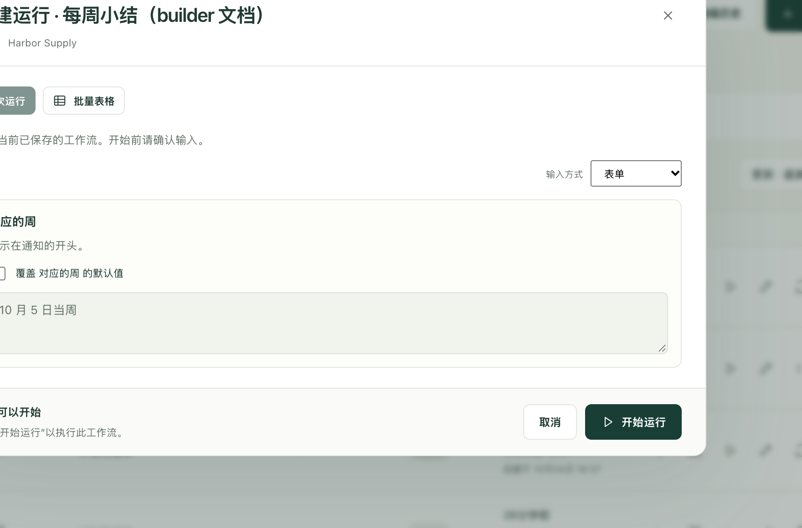

工作流就是把一项你手动完成的工作写下来一次，让 Kitewell 替你去做：收集发票、录入发票、用邮件发送摘要。你一次搭建一个部分，单独试一试每个部分，然后运行整个工作流，看着它完成工作。

每个部分就是一个步骤。一个步骤只做一件事，比如运行命令、在网站上填写内容、读取邮箱、询问某个人，下一个步骤会等它完成。编辑器会把步骤画成一张映射图，让你一眼看清顺序。

## 准备工作

一个用来存放工作流的项目；如果侧边栏中有 **工作流**，说明你已经有了。除此之外，需要什么取决于你选择的步骤：

- 命令、网站步骤或等待，不需要其他任何东西。
- AI 步骤需要在 **智能体与模型** 中设置好的模型或智能体。
- 邮件步骤需要在 **更多 → 邮件账户** 中连接的邮箱。
- 步骤要用到的密码或密钥，需要先在 **更多 → 密钥** 中保存为密钥，这样它的值永远不会出现在日志里。

缺少所需内容的步骤会在运行前告诉你，所以你不必先把这些都设置好，就可以开始搭建。

## 一步一步搭建

1. 选择 **创建工作流** 并为它命名。编辑器会打开空白的 **搭建** 视图，并询问 **你想自动化什么？**
2. 选择一个任务。你添加的步骤会显示在左侧的 **工作流映射** 下；正在编辑的步骤会在右侧的 **步骤详情** 下打开。这个界面把它们称为“任务”；任务一旦放到映射图上，就是步骤。
3. 在 **步骤名称** 中输入名称，用平常的话即可，例如 `收集新发票`。以后在日志中查找时，找的就是这个名称。
4. 填写该任务需要的内容。命令步骤只有一个字段，即 **命令**；网站步骤则需要网址以及要在那里执行的操作。
5. 要添加下一个步骤，请选择 **添加步骤**，或映射图上某个步骤下方的 +。**什么时候运行？** 决定新步骤放在哪里：
   - **在其后继续流程**：接在这个步骤之后，原来排在后面的步骤改为等待新步骤；
   - **在其后添加分支**：在这个步骤之后增加另一条路径，与第一条并行；
   - **独立启动**：用于不需要等待任何内容的工作。
6. 继续添加，直到把整项工作都写下来。之后可以用 **复制**、**上移**、**下移** 和 **移除步骤** 整理顺序。

空白的工作流有两种省去输入的捷径：在 **描述此工作流应做什么** 中描述这项工作并选择 **询问助手**，或者在 **或从示例开始** 下选择一张卡片。之后要再次打开示例，请使用 **工具 → 浏览示例**。

## 可选的任务

**查找任务** 可以搜索这个列表，你可以输入 `邮件` 或 `Excel`，而不必逐个翻找。以下是大多数人最先使用的任务：

- **运行命令或脚本**：在这台电脑上运行某个程序。
- **自动操作网站**：打开网站并点击、输入、读取或下载，全部用自然语言描述。请参阅[自动操作网站](/zh/docs/browser/)。
- **自动操作桌面应用**：像人一样使用这台电脑上的应用。请参阅[自动操作桌面应用](/zh/docs/desktop/)。
- **发送邮件**、**查找邮件**、**整理邮件**：在已连接的邮箱中撰写、读取和整理邮件。请参阅[自动处理邮件](/zh/docs/email/)。
- **询问模型**：向模型发送问题，并保存它的回答。
- **交给 AI 智能体**：把工作交给安装在这台电脑上的编程智能体。
- **让 AI 做出决策**：对某样东西进行分类、打分，或回答是或否，结果的形式可供下一个步骤读取。
- **请求人工处理**：停下来，等待有人确认或输入内容。
- **等待**：暂停一段时间、等到某个时刻，或者等到某个文件出现。
- **重复直到**：每隔一段时间检查一次，直到条件就绪，最多尝试指定的次数。
- **逐项处理**：对列表中的每一项各运行一次步骤，并汇总结果。
- **根据值分支**：让工作走这条路径或那条路径。
- **填写文本模板**：用模板和一些值生成消息或文件。
- **运行另一个工作流**：把已有的工作流作为一个步骤重复使用。

技术性更强的任务也在同一个列表中，位置更靠下：**在 Docker 中运行**、**调用 Web 服务**、**使用 API 操作**、**在其他机器上运行** 和 **在机器之间复制文件**。Excel 任务归在末尾的 **电子表格** 标题下，请参阅[自动处理 Excel](/zh/docs/spreadsheets/)。

## 在运行全部之前先测试一个步骤

要知道某个步骤能否正常工作，不必运行整个工作流。

1. 在映射图中选择该步骤。
2. 选择 **测试**，或者在 Mac 上按 ⌘↩、在 Windows 上按 Ctrl+Enter。
3. 观察 **测试** 旁边的状态栏：它会显示步骤正在做什么，然后显示结束时的结果。选择 **查看结果** 阅读返回的内容：**输出** 中是步骤打印的内容，**错误输出（stderr）** 中是它报告的问题。

测试只运行这一个步骤，使用你尚未保存的更改，并且不会保存工作流。之前的步骤不会运行：它们的值来自各自最近一次通过的测试，或者由你手动输入。**值和输入** 列出该步骤读取的内容，并标出仍然缺少的值。

测试会真正执行工作。Kitewell 会在开始前说明它将做什么，例如“从 me@example.com 发送真实邮件”“在此设备上运行”。所以请先读这一行，只有确实想执行时才选择 **仍然测试**。

有四类步骤目前还不能单独测试，它们会给出说明而不运行：**请求人工处理**、**逐项处理** 循环中的步骤、事件处理程序，以及以一组服务器为目标的步骤。

## 每次都会变化的内容

如果这项工作需要每次运行都不同的日期、文件夹或标题，请把它放在 **输入** 中，而不是写进步骤里。每个输入都会成为你开始运行时所填写表单中的一个字段。

要使用输入，请在步骤的字段中键入 `${`，然后从列表中选择该输入。同一个列表还提供密钥以及之前步骤保存的结果；Kitewell 会让使用某个结果的步骤等待产生该结果的步骤。

## 检查后再运行

**保存** 会保存你的工作。想暂停时随时可以使用；工作流的计划从你保存的那一刻起开始生效。

**检查并运行** 是真正执行工作之前的最后一次检查。它汇总工作流的名称、**步骤** 和 **运行输入** 的数量，以及它的 **计划**，并在 **运行之前** 下列出值得先修正的问题。**检查工作流** 会检查草稿中的错误。

然后：

1. 选择 **保存并运行…**。工作流会被保存，并打开运行表单。
2. 如果该工作流有字段，请填写 **参数** 下的字段。已有值的字段会被锁定，直到你勾选覆盖其默认值的复选框。
3. 选择 **开始运行**。

运行会随之打开，并逐个步骤地显示进展。运行使用的是它开始那一刻的工作流，因此之后再编辑，不会改变已在进行中的运行。结果该如何处理，请参阅[运行与日志](/zh/docs/runs/)；要让 Kitewell 替你启动运行，请参阅[计划](/zh/docs/scheduling/)。

## 停下来询问某个人

有些工作不应该在没有人看过的情况下就结束。

**请求人工处理** 本身就是一个步骤。写好说明；需要对方回答时，再添加一个表单，例如一个选项、一条评论或一个数字。运行会一直等待，直到有人完成它。

要让人检查某个自动步骤做了什么，请打开该步骤的 **审批** 部分，开启 **此步骤运行后暂停等待审批**。输入问题以及要收集的值。**退回时重新运行** 用于选择审阅者要求修改时需要重复执行的步骤。

审批是在其步骤运行之后才暂停。如果要在某件事发生之前就取得许可，请在它前面放一个 **请求人工处理** 步骤。

人工任务也可以把工作退回：在 **退回修改** 下，开启 **允许审阅者退回工作**，并在 **将工作退回到** 中选择一个在此步骤之前运行的步骤。重新运行的 AI 步骤和模型提示词会收到反馈；命令则以变量的形式读取每个值，第一次运行时这些变量为空。

等待中的运行位于 **运行与日志 → 等待中** 的 **等待你处理** 中。人工任务提供 **完成任务**；如果允许退回，还提供 **退回…**。审批提供 **批准**、**退回** 或 **拒绝运行**。退回会重复所选的步骤及其之后的工作；拒绝则会结束运行。

## 在工作流结束时运行任务

事件处理程序与工作流的步骤并列运行，而不在流程之中：在第一个步骤之前、运行等待人工处理时、成功时、失败时、取消时，或者始终在最后。可以用它删除临时文件、撤销某项更改，或调用恢复服务。

映射图下方的 **事件处理程序** 列出此工作流已有的处理程序。选择 **添加处理程序**，并选择它的运行时机：**步骤开始前**、**等待审批时**、**成功时**、**失败时**、**取消时** 或 **始终在最后**。处理程序会单独打开；**任务类型** 用于更改它要做的事，**返回工作流** 则回到映射图。**请求人工处理**、**让 AI 做出决策**、**根据值分支**、**逐项处理**、**等待** 和 **重复直到** 不能作为处理程序。

处理程序可以读取工作流的输入和变量以及运行的状态，但不能读取其步骤的结果。在 **运行与日志** 中，一次运行会在步骤旁边列出它的处理程序。

要通知别人工作流失败了，请使用[提醒](/zh/docs/alerts/)，而不是处理程序。

## 询问 AI 智能体或模型

先在 **智能体与模型** 中设置一个命名的智能体或模型，然后把它添加到工作流中：

- **交给 AI 智能体** 会运行安装在这台电脑上的命令行智能体。选择智能体，编写它的提示词，并通过 **智能体设置与上下文** 设置它的项目文件夹和所需的上下文。
- **询问模型** 会向你配置好的模型发送提示词。选择模型，并描述你需要的回答。

如果后面的步骤需要用到回答，请将它保存为变量。

**工具 → 检查 AI 提示词** 会在任何内容运行之前，显示每个 AI 步骤将收到的指令。值会在运行时填入。API 密钥、权限以及各提供商的要求，请参阅 [AI 智能体与模型](/zh/docs/ai/)。

## 使用导入的 API

[将 OpenAPI 描述导入 API 库](/zh/docs/apis/)，然后在工作流中添加 **使用 API 操作**。选择 API 和操作。Kitewell 会根据描述生成请求字段，包括必需的参数和请求体。

在后面的步骤中，打开 **变量**，从 API 步骤的响应中选择一个字段。Kitewell 会保存该值，并确保请求在其结果被使用之前完成。

## 运行 Docker 镜像

在这台电脑上启动 Docker。在任务列表中选择 **在 Docker 中运行**。

1. 选择一个 **镜像**，包括它的标签。可以搜索建议项，也可以使用 **浏览镜像**。**检查** 会读取镜像的端口、文件夹和变量，帮助你填写这个步骤。
2. 输入要在镜像中运行的命令。多行命令、管道或 shell 变量请使用 **Shell 脚本**；此时该镜像必须包含 `/bin/sh`。
3. 展开你需要的选项：工作文件夹、挂载、环境变量、发布的端口、网络。在容器内创建的文件，需要挂载才能在容器之外保留下来。
4. **检查 Docker** 用于检查连接。**测试** 会真实地运行镜像和命令，所以请先检查它的挂载和影响。

Kitewell 不会安装或启动 Docker。除非开启 **运行后保留容器**，否则容器会在运行后被删除。挂载的文件和 Docker 卷需要另外备份。

## 在其他机器上运行命令

打开 **更多 → 服务器**。添加每台服务器的地址、用户名和登录方式。密码请保存在[密钥](/zh/docs/secrets/)中，或者使用没有密码短语的本地私钥。在 **主机密钥校验** 下，可以保留默认设置并通过 **测试连接** 批准指纹，也可以使用 **本设备的 known_hosts**，或者选择 **不校验**。**跳板机** 用于连接位于另一台机器之后的服务器。

组可以给多台服务器起一个共同的名称。按你想要的顺序排列它们，选择最多可以同时运行几台，并选择出现失败时是停止部署还是继续。

在工作流中添加 **在其他机器上运行**。在 **运行位置** 中选择服务器或组，然后输入命令。选择组时，每台机器会各自生成一个步骤，因此每个结果都会单独显示在 **运行与日志** 中。

要把所有命令和脚本步骤都发送到同一个地方，请使用工作流的 **设置 → 运行位置**。在这里选择组时，整个工作流会依次在每台机器上运行，每台机器各是一次单独的运行。Docker、AI、Web 服务、导入的 API 和子工作流步骤，仍在运行 Kitewell 的电脑上运行。

## 遇到问题时

- **步骤一开始就失败。** 通常是缺少程序、文件夹不对，或者某个密钥在这台电脑上没有值。单独 **测试** 该步骤，并查看 **错误输出（stderr）**。
- **步骤读到的值为空。** 产生该值的步骤必须先运行。在读取它的步骤上打开 **可用的值**，确认该值在列表中，然后检查 **在其后运行**。
- **编辑器不允许你更改某个字段。** 有些高级设置只存在于工作流的文本中。提示信息会说明这一点，**工具 → 编辑 YAML** 可以打开文本。
- **命令在终端中能运行，在这里却不行。** 步骤以运行 Kitewell 的用户的权限、从工作流所在的文件夹运行，并且不带你自己的 shell 配置。请为程序提供完整路径。

更多内容见[故障排除](/zh/docs/troubleshooting/)。

## 技术细节

- **工具** 中包含 **可视化编辑器** 和 **编辑 YAML**（同一个工作流的两种视图）、**浏览示例**、**检查 AI 提示词**、**检查工作流**，以及 **刷新编辑器建议**（重新加载文本编辑器在你输入时提供的建议）。
- **工具 → 编辑 YAML** 会以文本形式打开工作流，标签为 **工作流 YAML**。可视化编辑器所做的一切都写在这里，另外还有少数只能用文本表达的内容：一次性的计划、不常见的执行器、注释。Ctrl+Space 会显示建议，Tab 用于缩进。注释以及可视化编辑器中不显示的设置，在切换回去之后仍会保留。
- 会输出内容的步骤可以把输出保存为文件：填写 **产物名称（可选）**，该文件就会出现在运行的 **产物** 中。步骤也可以把文件写入 `$DAG_RUN_ARTIFACTS_DIR`。
- 一个工作流会保留最近 50 次步骤测试，并且一次只运行一个测试。测试提供的值来自最近一次通过的测试。
- 快捷键：在 Mac 上按 ⌘S、在 Windows 上按 Ctrl+S 保存工作流。在可视化编辑器中打开 **搭建** 时，按 ⌘↩ 或 Ctrl+Enter 测试所选步骤。
- 步骤运行的命令是系统自身的命令：在 Windows 上步骤在 PowerShell 中运行，在 Mac 上在 shell 中运行。`echo "…"`、`sleep 2` 和 `exit 1` 在两者上都能用；`cat`、`ls`、`printf` 和 `&&` 在 Windows 上不能用。
- 工作流文本不能设置引擎自身的邮件设置，即 `mail_on`、`smtp`、`error_mail`、`info_mail`、`mail_on_error`。如果写了这些设置，保存会失败；[提醒](/zh/docs/alerts/)应改为在 Kitewell 中设置。
